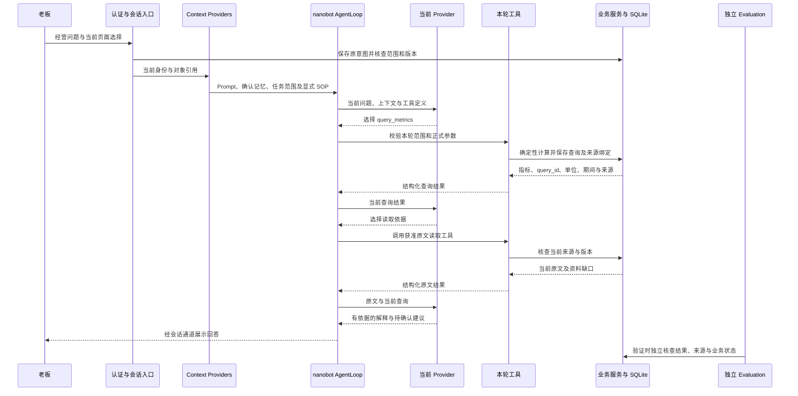

# Boss-Agent 产品 Agent 设计说明

## 1. 一次经营查询如何连接六类组件

老板在经营关注页面选择法人、区域和期间，进入分析会话后提问：

> 请核查当前已应用经营范围，说明成本、收入和毛利率的变化，给出依据及需要本人关注的事项。

系统将页面选择与本轮问题关联，核查身份、资料和版本，准备当前任务上下文。模型在本轮允许的工具中选择查询动作，业务程序计算指标，资料读取工具提供当前原文，模型根据实际返回继续分析并形成回答。

| 组件 | 在这次查询中的作用 |
|---|---|
| Prompt | 要求使用工具返回的事实，说明期间、单位与依据，区分事实、待验证原因和建议 |
| Workflow/SOP | 确定必要输入、查询顺序、资料核查与结束条件，缺少条件时请求补充 |
| Knowledge Base | 提供当前可用的经营原文、作者、日期、版本与适用范围 |
| LLM/DSLM | 理解问题，选择下一项工具，依据返回结果组织解释 |
| Tools | 执行指标计算、范围查询和原文读取，返回结构化结果 |
| Evaluation | 独立检查工具选择、数值、引用及业务状态是否满足任务要求 |

图中展示工具可组成的典型查询过程，实际顺序由当前入口、工具范围和运行条件决定。经营绑定会话通过 `businessOverviewRead` 读取已应用范围，通过 `query_metrics` 查询指标，通过 `bossEvidenceRead` 读取获准原文；正式 SOP03 的方法步骤引用 `query_metrics` 和 `read_evidence`。SOP 正文需要经过明确选择和依赖检查才能进入上下文。独立 Evaluation 在验证过程中执行，当前没有为每次聊天自动运行完整语义评分。

老板继续提出交办要求时，Agent 可以整理建议、负责人和时间。业务写入需要采用相应正式操作入口、当前对象版本及本人授权，保存后重新读取正式结果。查询结论、建议行动和已经执行的业务操作分别表达。

## 2. 产品服务对象与业务场景

Boss-Agent 为一位老板提供经营关注、个人秘书、会议资料、交办与承诺等能力。老板使用同一 Agent 处理多个会话和任务；技术维护者使用独立身份管理配置、资料、运行和评测。联系人、资料作者与任务负责人作为业务对象保存。

当前业务资料及外部业务接口采用明确标注的仿真范围，公开经营基准保留原始年度和单位。真实模型分析需要实例已经启用经过验证的外部模型连接。提问中的“当前任务”“当前专题”“所选资料”以页面选择及当前业务时钟为准。

### 2.1 具有真实模型运行记录的场景

| 业务场景与入口 | 提问示例 | Agent 提供的结果 |
|---|---|---|
| 老板工作简报：普通聊天 | 请读取今日工作、会议和任务，说明需要本人关注的三项事项，引用原始资料。 | 汇集当前事项、责任人、期限与依据，形成工作简报 |
| 今日事项安排：从今日工作进入 | 请读取今天需要本人处理的事项，说明当前业务日期、责任人和期限，保留依据。 | 查询晨间清单，区分需要决定、协调和知晓的内容 |
| 经营总览：应用法人、区域和期间后进入分析 | 请核查当前已应用经营范围，说明三项主要经营关注、指标和依据。 | 解释绑定范围的指标、变化、关注事项及资料缺口 |
| 农业专题：从专题进入分析并明确畜禽用途 | 请说明当前专题的经营数值、单位、主要变化、关联任务反馈及待核查事项。 | 查询原料、水产、苗种、技服、生猪、畜禽、养殖、食品、海外与研发资料；蛋禽、奶畜、肉用牛羊分别采用各自单位 |
| 交办与承诺：从任务详情进入 | 请读取当前绑定任务，说明目的、责任人、业务期限、当前反馈及需要本人决定的内容。 | 读取绑定任务及已保存反馈，说明需要本人决定的事项 |
| 会议与材料：普通聊天读取目录，讨论单场会议时选择对象 | 请读取当前会议资料目录，说明全部会议安排、参会人和原始资料，保留后续会议。 | 整理会议安排、材料状态及可用来源；会前材料生成通过对应准备入口执行 |
| 已准备研究：研究已通过正式入口准备且来源有效 | 请读取当前研究原文，说明研究问题、采用资料、原始期间及尚待核查内容。 | 核查已有研究及当前引用，整理证据和问题 |
| 人员会面：当前资料包含人物、会面材料及任务 | 请读取会面资料与当前任务，核查方明澈的职责、会议准备和待反馈事项。 | 使用当前演练资料形成会面关注事项；其他人物采用当前资料中的姓名 |
| 历史公开基准：选中年度经营基准后进入资料讨论 | 请读取所选的公开年度经营基准，说明其中2024与2025年的营业收入、成本和饲料业务毛利率，保留原始期间与单位。 | 解释年度原文及历史数据；当前模拟月份的经营结果另行查询 |

这些业务范围已有对应运行记录，具体覆盖见第 9 节。示例包含已记录问法和基于相同能力编写的问法，新表述的完整回答质量需要按任务继续验证。

### 2.2 通过现有代码入口提供的场景

| 业务场景与条件 | 提问示例 | 当前能力范围 |
|---|---|---|
| 所选资料整理：原文已经摄取并具有当前有效来源 | 请整理所选资料的关键事实、作者、日期和待核查问题，并保留出处。 | 读取选择的原文并整理；附件元数据与正文处理分别检查 |
| 消息与草稿：当前空间存在本人可见消息或正式草稿 | 请读取现有消息草稿，说明收件人、附件依据和仍需确认的内容，并给出文字修改建议。 | 查询既有消息和草稿，提供文字建议；保存及发送采用正式页面和本人确认 |
| 日历与出行：当前空间存在获准日程或行程 | 请读取当前日历和出行安排，列出时间、时区、准备事项及工具已经确认的冲突。 | 读取日历和行程投影，解释工具返回内容；变更、分享与确认采用正式操作入口 |
| 文字整理与写作：启用真实模型并提供可读文字 | 请把我下面提供的文字整理成一份会议发言提纲，保留原有事实和待确认问题。 | 处理当前文字；涉及业务事实时读取正式工具，文件保存与消息发送单独执行 |

这四类场景具备代码入口，每种新问法尚未全部取得独立模型质量记录。经营绑定会话只开放当前经营范围工具；消息、日历等其他工作查询使用普通聊天入口。对象、范围或资料选择变化后，通过相应页面重新进入，保证本轮采用正确引用。

## 3. Agent 的运行结构

产品使用一个 nanobot `AgentLoop` 承载模型调用、工具循环、会话与流式回答，复用 `Nanobot`、消息总线、会话管理及原生通信能力。项目围绕该运行循环扩展业务身份、任务上下文、来源版本、确定性计算、本人决定和业务持久化。

| 部分 | 职责 | 保存或返回的内容 |
|---|---|---|
| 页面与会话入口 | 接收问题，绑定当前经营范围、任务、会议或资料 | 原始输入、会话、轮次与对象引用 |
| Context Providers | 准备本轮能够采用的说明、方法和资料 | Prompt、确认记忆、目标、任务范围与版本引用 |
| AgentLoop 与 Provider | 执行模型步骤，根据工具结果继续运行 | 工具调用建议、回答片段与运行结束事件 |
| 工具及业务服务 | 检查参数和权限，执行读取、计算及获准操作 | 结构化事实、正式对象、来源、版本与回执 |
| SQLite 与原生 Session | 保存业务状态与会话，使后续操作能够查询 | 业务对象、授权、幂等记录、资料、会话及运行引用 |
| 运行记录与评测 | 观察实际执行并独立检查结果 | 模型请求、工具结果、配置引用、终止原因和断言结果 |

这六类 Agent 组件在同一次运行中配合：知识通常通过工具进入上下文，SOP 同时关联方法正文和程序检查，Evaluation 可以检查整个执行轨迹。组件职责不要求每次请求都经过相同顺序。

## 4. Prompt：角色、证据要求与表达规则

### 4.1 本轮上下文如何组成

| 来源 | 内容 |
|---|---|
| nanobot 原生上下文 | 基础系统说明、会话历史及工具定义 |
| 维护端 Prompt | 当前启用且来源有效的业务指导文字 |
| 会话任务指导 | 可用工具、证据要求、业务时钟、资料缺口和老板简报格式 |
| 本人确认信息 | 当前有效记忆、目标与任务范围 |
| 显式选择的 SOP | 满足依赖的业务方法正文及版本 |
| 外部模型调用指导 | 本轮实际工具目录、方法采用条件和最终回答要求 |

会话指导要求模型依据工具实际返回形成结论，区分已证实事实、待验证原因和建议行动。期限判断采用业务时钟；跨对象关联需要明确字段或原文支持；金额影响需要同范围、同期间和同单位的计算条件。

工具返回的 `insights` 表示程序检查产生的调查线索。模型需要继续核查原文和相关记录，才能判断原因。回答使用老板能够理解的姓名、业务状态和日期，保留依据、可能影响、建议负责人、时间及需要本人决定的内容。

### 4.2 Prompt 的版本与采用

维护端支持保存、静态校验、启用和停用。运行选择 Prompt 时，核查启用指针、草稿版本、内容摘要、校验状态，以及引用来源的访问范围、类型、版本与当前有效性。来源更新、撤销或失效后，旧引用停止满足采用条件。

`RuntimeRecorder.context` 将有效内容提供给 `RuntimeContextBlock`，保存 Prompt 版本、摘要与来源引用。进行中任务采用启动时取得的内容，后续业务操作仍需核查当前授权和对象版本。上下文加载记录与模型遵从情况分别验证。

当前指导文字同时保存在维护资产、任务代码和 Provider 请求指导中。分析回答行为需要检查这些实际来源；单次运行对全部指导来源的完整版本追溯仍需完善。

## 5. Workflow/SOP：业务步骤与模型选择如何配合

### 5.1 从问题接收到结果查询

1. 会话入口核查当前本人认证、会话及轮次，将输入摘要保存为 `conversation_intent`。相同轮次的重复请求读取原回执。
2. 服务端绑定当前任务、经营范围、资料选择及版本，准备本轮可用工具与必要输入。
3. `ConversationPlanner.plan` 根据输入、绑定对象、历史产物和资料选择准备读取计划及引用；其中包含关键词和条件分支。
4. 外部模型在本轮开放范围内选择工具，取得真实结果后继续分析。部分专门查询还需要匹配服务端准备的参数绑定。
5. 工具执行前后核查范围与来源，业务服务保存正式对象和状态。会话回答结束与业务完成分别判断。
6. 需要本人决定时，通过正式操作入口确认；结果未知时查询原请求及业务对象，防止重复写入或发送。

程序检查负责身份、来源、版本、参数和授权；模型负责依据返回结果决定后续分析。开放式问法和跨场景追问的质量需要使用独立任务验证。

### 5.2 十三类业务方法

| 方法 | 业务用途 | 方法关注的结果 |
|---|---|---|
| SOP01 | 今日工作 | 有依据的事项次序、会议与本人安排 |
| SOP02 | 经营提醒 | 关注原因、处理决定及后续复查 |
| SOP03 | 经营查询 | 确定性指标、同次查询依据及未知范围 |
| SOP04 | 会前准备 | 当前会议、参会人、材料与缺口 |
| SOP05 | 会议纪要 | 本人确认纪要及逐项获准交办 |
| SOP06 | 交办跟进 | 责任人、期限、反馈、结果及本人决定 |
| SOP07 | 待审材料 | 当前申请版本、材料缺口与本人决定 |
| SOP08 | 沟通 | 联系人、草稿、当前授权及发送记录 |
| SOP09 | 战略研究 | 研究问题、获准原文、引用与待验证事项 |
| SOP10 | 人员会面 | 人员职责、会面目标、历史事实和承诺 |
| SOP11 | 出行接待 | 时间、时区、冲突、影响与准备清单 |
| SOP12 | 私人安排 | 私人内容范围及获准忙碌信息分享 |
| SOP13 | 历史与记忆 | 当前本人确认、有效引用及修改删除后的采用 |

每份方法保存触发条件、输入、步骤、工具引用、授权、输出和结束条件。SOP03 规定：明确区域、产品、期间、单位与币种，调用 `query_metrics`，再用同一 `query_id` 调用 `read_evidence`，核查版本并说明结果。缺少原因材料时，原因保持未知。

`BossSkillCatalog` 使用 `MarkdownIt` 读取 `tool:` 引用，核对方法与后端绑定，检查启用状态、原生可用性、工具注册及工作投影范围。`ProductSkills.context` 当前识别 `$boss-sop03` 等显式调用，检查通过后加载正文并记录 `boss_sop_reference`。

十三份方法已经存在，完整可执行范围取决于每种方法的工具和业务接入。当前部分命令通过本人页面执行，全部 SOP 的自然语言自动选择与逐方法完整验证尚未完成。方法文件存在、上下文采用、模型遵从和业务执行分别取证。

## 6. Knowledge Base：领域资料、记忆与业务事实

### 6.1 不同信息如何管理

| 信息 | 保存方式 | 使用规则 |
|---|---|---|
| 领域原文 | SQLite `objects` 中的 `document` | 保留作者、日期、版本、来源类型、适用范围及访问权限 |
| 检索索引 | FTS5 的 `knowledge` 与 `knowledge_text` | 返回当前来源和片段，继续核查原文与采用资格 |
| 本人记忆 | 记忆对象及确认授权 | `OwnerMemoryContext` 只提供当前有效的本人确认内容 |
| 任务、会议、审批等 | 各自正式业务对象与投影 | 根据当前状态、对象版本与来源查询 |
| 会话历史 | nanobot Session 与产物引用 | 用于连续交流，当前事实仍需查询正式来源 |

来源有效性采用业务时钟判断，访问检查继续核查本人范围、资料类型和版本。未来、过期、撤销、冲突和已替代资料分别处理。记忆确认被撤销、内容修改或删除后，新任务需要采用当前有效结果；历史决定保留当时引用。

### 6.2 原文摄取、检索与读取

当前摄取支持 TXT、Markdown、PDF 与 DOCX，使用 `pypdf`、`python-docx`、`markdown-it-py` 和 `lxml` 处理相应格式，并检查文件大小、正文长度及格式条件。

SQLite 建立 FTS5 索引，document 变更触发器维护 `knowledge_text`。维护端 `search_knowledge` 使用 `LIKE` 进行文字匹配，最多返回 50 项，保留来源、版本、片段和字符位置；`controls.py` 另有使用 `knowledge MATCH` 的全文检索路径。

模型常用 `bossEvidenceRead` 按来源编号读取原文，通过 `bossWorkspaceRead` 取得已有研究等获准工作投影。用户选择的资料通过会话绑定进入读取计划。普通会话尚未注册通用自主知识搜索工具，因此资料发现主要依赖当前选择和已有工具返回的来源。

领域资料通过上下文和工具结果补充模型能力。当前没有采用 Embedding、向量召回或 Reranker，也没有把导入资料用于模型训练。受控自主搜索、检索质量及失效资料处理的完整任务验证仍需完善。

## 7. LLM/DSLM：理解问题、选择工具与组织回答

LLM 负责理解自然语言，在允许的工具中选择动作，利用返回结果继续分析并形成回答。DSLM 指领域专用语言模型，本项目将其设为可选；当前农业能力来自领域资料、SOP、指标计算与工具，没有接入独立 DSLM 的训练、微调或推理过程。

### 7.1 模型运行方式

| 运行条件 | 当前行为 |
|---|---|
| 已验证并启用外部模型连接 | `ProductRuntime._apply` 创建实际 Provider，交给 `FeatureProvider.adopt_external`；模型步骤调用外部服务 |
| 没有启用外部模型连接 | `FeatureProvider` 按请求选择会话、经营查询、今日工作、交办或提醒的模拟 Provider，执行本地工具和业务过程 |

`FeatureProvider` 优先采用已启用的外部 Provider，该分支覆盖普通会话及业务请求。模型连接支持 DeepSeek 与 OpenAI 的 Chat Completions，启用条件包括当前版本的文本、工具调用及流式验证、有效凭据引用、配置版本检查和运行任务检查。

已有运行报告采用 DeepSeek `deepseek-flash`。OpenAI 连接具有代码支持，其具体实例启用及验证结果需要另外核查。实际模型调用通过 `model_requests` 和 `external_model_invoked` 判断；仿真业务的 `source_type` 与真实模型调用分别记录。

### 7.2 模型调用限制

当前维护 Schema 将 `max_tool_rounds` 限定为 1—12，单次输出 `max_output_tokens` 限定为 128—8192，模型连接超时为 1—600 秒，实际采用值来自启用配置。

`FeatureProvider._external_inputs` 根据已记录的模型请求数量检查调用预算，并为最后一次允许请求设置 `tool_choice=none`，由真实模型依据已有结果形成回答，明确尚未核实内容。每次请求继续提供实际工具目录和方法采用条件。

`RecordedProvider` 使用 `max_retries=0`，真实请求受运行截止时间控制。当前具备调用次数、输出长度和时间限制，累计 Token 与累计金额的完整强制预算尚未实施。费用缺少价格或完整用量时保持未知。

## 8. Tools 与业务控制：如何取得事实和执行动作

### 8.1 工具能力及开放范围

| 工具 | 业务作用 |
|---|---|
| `bossDashboardRead` | 读取今日工作和当前事项 |
| `bossTasksRead`、`conversationRead` | 查询任务、反馈、消息、正式产物及当前运行 |
| `bossMeetingsRead` | 查询会议目录、材料和相关检查结果 |
| `bossEvidenceRead` | 根据当前来源编号读取获准原文 |
| `bossSectorRead`、`businessOverviewRead` | 查询专题或当前绑定经营范围 |
| `query_metrics`、`read_evidence` | 取得确定性指标及同次查询的依据 |
| `create_assignment`、`send_assignment`、`read_assignment` | 在获准功能内创建交办、模拟发送和查询结果 |

`FeatureToolRegistry` 管理注册目录，启用配置确定全局范围，Context Provider 进一步限定本轮工具。普通会话的八项读取或查询工具由 `CONVERSATION_TOOLS` 定义；经营绑定具有独立目录；写入工具需要功能专用上下文。

页面具备某项 HTTP 或 WebSocket 命令，仍需经过模型工具注册和本轮开放条件才能被模型调用。当前部分 SOP 命令继续通过正式页面执行。

### 8.2 身份、来源与写入检查

`ConversationReadTool.execute` 使用 JSON Schema 验证参数，在读取前后核查当前本人认证、会话、执行空间、资料范围及引用。专门查询适配继续限制经营参数。数值由业务程序计算，模型解释工具结果。

业务写入由服务端提供 `envelope`、授权和幂等信息，领域服务检查动作、对象、内容、版本、当前来源及本人决定。相同请求和内容查询已有回执，不重复产生业务结果。来源或对象发生变化时，需要重新核查当前条件。

Prompt、SOP、资料文字和模型输出不能授予本人权限。创建或发送交办、确认完成、审批决定、保存纪要、修改日程和确认记忆，均受相应业务流程控制。模拟发件箱记录与外部收件人实际送达分别验证。

### 8.3 状态、异常与恢复

输入不完整时保留需要补充的条件，权限或参数不符时拒绝相应动作。运行记录保存失败、取消、超时和轮次耗尽等终止原因。模型后续失败不会清除已经保存的业务对象，未知结果通过原请求回执与正式对象查询恢复。

`run_id`、会话、轮次与业务对象引用连接执行过程。记录包含实际配置、Prompt、工具定义与实现摘要、来源和记忆引用、模型请求、工具结果、用量覆盖及终止原因。业务完成、本人批准和模型运行结束使用各自判断依据。

## 9. Evaluation：验证方法与已有结果

### 9.1 当前检查如何组织

| 检查类型 | 检查内容 | 当前范围 |
|---|---|---|
| 维护端确定性评测 | 毛利率复算、来源有效性、确认记忆、版本、资料摘要及业务对象数量 | 直接执行程序断言，保存证据，不产生模型请求 |
| 真实 Agent 运行检查 | 认证、原生会话、入口绑定、实际模型请求、工具调用和运行状态 | 通过真实服务记录判断相应任务的执行过程 |
| 回答内容检查 | 企业名称、部分业务数值、历史期间和用途单位 | 检查已保存回答中的指定内容 |
| 工程与权限检查 | 来源、请求、工具、取消、超时及入口范围 | 按具体检查程序与对应版本确定范围 |
| 运行观察 | 模型、Prompt、配置、工具、业务产物、用量及终止原因 | 支持追溯，语义质量需要独立断言 |

维护端评测当前保存 `usage_coverage=NO_MODEL_REQUESTS` 和空的 `run_ids`。模型、Prompt 与 SOP 选择属于该次记录的版本标签，该页面尚未串联实际模型生成及完整回答评分。

`SUCCEEDED` 表示运行正常结束。完整质量评测还需要判断问题是否得到回答、数值与单位是否正确、引用是否支持结论、归因是否成立、建议是否可执行，以及权限拒绝是否符合要求。评分预期保留在评测程序中，不进入模型上下文。

### 9.2 已有真实模型场景结果

2026-10-28 的本机仿真业务报告包含 27 项能够通过同一 `run_id` 关联的回答与运行摘要：

- 覆盖普通问题、13 个专题及用途、今日工作、经营总览、三个畜禽用途绑定、四种任务状态，以及公开基准、会议、研究和人员资料。
- 匹配摘要均记录 `SUCCEEDED`、`external_model_invoked=true`、非空工具调用，模型为 DeepSeek `deepseek-flash`。
- 回答检查中，8 项具有指定业务文字或数值断言，其余项目的 `business_assertions` 为空数组；企业名称检查另行执行。

这些结果证明相应输入具有真实模型与工具运行记录。报告没有完整绑定本文全部源码摘要，也没有覆盖所有新问法、全部 SOP 和完整语义质量，因此能力判断继续受具体输入、版本及断言范围限制。

报告位于 `.work/simulation-20261028/`，包括 `live-agents.json`、`live-followups.json`、`live-ordinary.json`、`live-purposes.json`、`live-purposes-final.json` 与 `answers-final.json`。这些本机文件不属于正式可分发证据。正式任务和验收结果采用项目状态来源，用户验收仍为待确认。

## 10. 设计选择与需要完善的能力

### 10.1 设计选择的依据

一个老板的经营、会议、交办与私人安排共享目标和本人决定，采用一个 AgentLoop 配合多会话与不同工具范围，可以保持业务过程连续。领域服务统一维护正式事实、计算与授权，为跨页面读取、执行和结果查询提供一致依据。

模型承担理解、分析和表达，业务程序承担确定性计算、版本检查、状态转换与持久化，适合经营数据和本人决定的准确性要求。方法正文指导步骤，服务端限制权限，模型依据工具结果继续分析，三者分别承担可检查的责任。

领域资料、SOP 与工具已经提供农业业务知识和计算能力。DSLM 的采用需要结合具体任务的质量、时间及成本证据判断。向量检索同样需要通过真实资料的检索效果评估。

### 10.2 当前未完成范围

| 能力 | 当前条件与完整要求 |
|---|---|
| 自然语言方法选择 | 当前采用显式 SOP 调用及带有关键词分支的计划准备；需要完善日常表达下的方法选择、必要输入确认和跨场景追问验证 |
| 自主知识发现 | 当前依赖已经选择或工具返回的来源；需要在本人范围内提供受控搜索，返回有效版本和位置，再读取原文 |
| 全部 SOP 的执行覆盖 | 方法正文已经存在，部分命令仍通过页面执行；需要逐项明确模型工具、本人步骤、结果重读与真实业务证据 |
| 完整 Prompt 追溯 | 维护资产、任务指导与 Provider 指导分别提供内容；需要将全部有效指导来源及版本关联到同一次运行 |
| 统一回答质量评测 | 已有确定性断言、真实运行检查和部分回答检查；需要覆盖完整业务问题、引用支持程度、原因判断、建议质量、多次重复与失败结果 |
| 完整运行预算 | 已有次数、输出长度及时间限制；累计 Token 和金额预算继续待完成 |
| 产品体验与外部能力验收 | 具体页面连续操作、全部场景和用户验收采用正式记录；真实外部消息投递、专业执行与其他未完成产品要求继续保留，语音保持暂停 |

质量评测为方法选择、检索和工具扩展提供判断依据。配置或实现变化后，需要针对同一业务任务核查改动是否改善结果，同时保留权限、来源和业务状态要求。

## 11. 实现位置与版本依据

### 11.1 主要源码入口

| 设计部分 | 当前实现位置 |
|---|---|
| 应用与原生循环 | [application.py](../validation/application.py)：`serve`、`AgentLoop.from_config`、Context Provider 注册 |
| Provider 与工具范围 | [product_bi.py](../validation/product_bi.py)：`FeatureProvider`、`FeatureToolRegistry`；[product_runtime.py](../validation/product_runtime.py)：`ProductRuntime` |
| 模型连接与请求记录 | [boss_v7_models.py](../validation/boss_v7_models.py)：`ModelConnections`；[connection.py](../validation/connection.py)：`RecordedProvider` |
| 会话接收与计划 | [conversation_agent/native.py](../validation/conversation_agent/native.py)：`NativeConversationAgent`；[domain.py](../validation/conversation_agent/domain.py)：`ConversationPlanner` |
| 会话指导与参数检查 | [runtime.py](../validation/conversation_agent/runtime.py)：`ConversationRuntimeRecorder`；[会话工具](../validation/conversation_agent/__init__.py)：`ConversationReadTool` |
| Prompt 与运行上下文 | [boss_prompt_config.py](../validation/boss_prompt_config.py)：`_select_runtime_prompts`；[boss_runtime_records.py](../validation/boss_runtime_records.py)：`RuntimeRecorder` |
| SOP 资产及采用 | [agent/skills](../agent/skills)、[SOP03](../agent/skills/boss-sop03/SKILL.md)、[agent-assets.json](../specs/agent-assets.json)；[product_skills.py](../validation/product_skills.py)、[boss_native_skills.py](../validation/boss_native_skills.py) |
| 原文、索引与来源政策 | [boss_v7_knowledge.py](../validation/boss_v7_knowledge.py)、[boss_knowledge_ingestion.py](../validation/boss_knowledge_ingestion.py)、[business.py](../validation/business.py)、[controls.py](../validation/controls.py)、[boss_source_policy.py](../validation/boss_source_policy.py)、[boss_source_access.py](../validation/boss_source_access.py) |
| 资料选择与本人记忆 | [boss_conversation_sources.py](../validation/boss_conversation_sources.py)：`ConversationSources`；[boss_memory_runtime.py](../validation/boss_memory_runtime.py)：`OwnerMemoryContext` |
| 业务工具与写入适配 | [product_read_tools.py](../validation/product_read_tools.py)、[sop_write_tools/fc01](../validation/sop_write_tools/fc01) |
| 评测与回答检查 | [boss_v7_evaluation.py](../validation/boss_v7_evaluation.py)、[verify_comprehensive_agents.py](../scripts/verify_comprehensive_agents.py)、[verify_simulation_answers.py](../scripts/verify_simulation_answers.py)、[会话检查程序](../app/tests/conversation_agent) |

### 11.2 适用版本与参考

本文依据 2026-10-28 的当前 `main` 工作目录，HEAD 为 `9cd9888490521242def326f475c93823a68ec95b`，包含尚未提交的经营、会议、会话及仿真验证内容。该 commit 单独不能代表本文涉及的全部当前文件。

需求采用 [PRD](PRD.md) 与 [完整产品需求](PRD完整产品后续需求.md)，设计来源为 [HLD](HLD.md) 和 [Agent 运行设计](LLD-agent.md)。六类组件及可选 DSLM 的需求依据见 [selection-probe.json](../specs/selection-probe.json)。当前行为以具体源码为准，各日期的设计和运行证据按其适用范围使用。

外部方法参考包括 OpenAI 的 [Agent 构建指南](https://openai.com/business/guides-and-resources/a-practical-guide-to-building-ai-agents/)、Anthropic 的 [Building effective agents](https://www.anthropic.com/research/building-effective-agents) 及 OpenAI 的 [Evaluation best practices](https://developers.openai.com/api/docs/guides/evaluation-best-practices)，分别用于理解指令与工具、Workflow 与模型动态选择、独立质量评测的职责。

产品任务及验收状态引用 [feature-delivery.json](../specs/feature-delivery.json)，当前活动工单为 [SIMULATION-20261028](development/SIMULATION-20261028.md)。开发接手依据 [开发接手与执行规范](开发接手与执行规范.md)。

文档标识为 `DOC-AGENT-SIX-COMPONENTS`，维护任务为 `DOC-AGENT-20261028`，维护责任为当前文档维护者，last_verified 为 2026-10-28，文档有效性为 CURRENT。维护范围为本文与开发索引，文档完成条件为场景、组件、调用关系、能力边界及证据范围具有来源。源码摘要、已有报告摘要与文档检查结果保存于项目内已忽略的 `.work/agent-architecture-review/verification.json`；文档检查不改变产品验收结论。
