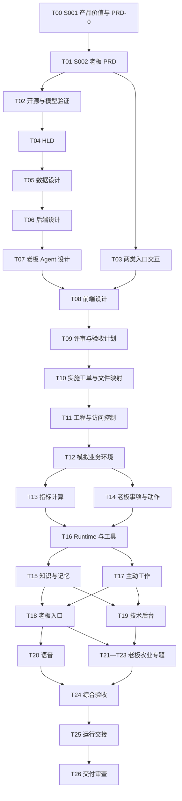
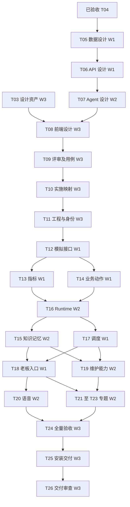

# Boss-Agent 项目计划

每次必读 [开发接手与执行规范](开发接手与执行规范.md)。本文用于完整产品范围、任务依赖和阶段规划追溯；当前执行采用 [菜单开发总计划](菜单开发总计划.md)、`specs/menu-plan.json`和`specs/feature-delivery.json`。下文阶段顺序及监督周期不独立生效；定时监督已由用户要求停止。当前菜单、交付版本和未完成项必须读取唯一正式状态，不从本文累计数字推断。

## 阶段参考：FC04与UI01

依据D-UI-PAUSE-20261024，完成当前FC04已经安排的必要验证及相关缺陷处理后暂停FC06和后续业务迭代，仅在自然空闲后接续docs/UI01菜单与登录页调整工单.md。需求为只展示已完成功能菜单、优化登录蓝绿白背景、增加测试账号注入按钮、技术维护与认证帮助等尺寸、移除指定本机身份文案。UI01完成后等待用户，不自动恢复业务队列。用户共同验收单独记录；现有用户桌面和数据不退出、不重启、不用于验证。当前需求入口和开发计划最前当前决定优先，周期只读监督继续。

## 阶段参考：功能优先级迭代

2026-10-24用户决定D-ITERATION-20261024：在MVP现有交付上按需求重要程度持续迭代，每次完成一个需求闭环后推进下一项。当前规划specs/iteration-plan.json，计划docs/功能闭环开发计划.md，首项docs/FC07交办与承诺工单.md。N3唯一维护正式执行状态。MVP01开发版本931c8dd及十二项待共同验收记录保留，不提前登记用户通过。

FC07优先接续采购交办的进展、催办、延期、结果和本人结束决定；后续按规划队列逐项建立工单。开发者完成必要自检并提供准确可启动体验版本、没有当前必要缺陷后，由N3登记开发完成并自动继续下一项；用户共同验收独立记录，N4仅必要定向验证。其余候选需求保持排队状态，一次只有一个活动功能，STT用户暂停保持。原始规划与监督可维护，监督不修改业务或正式状态，不启动开发进程，不打断运行中的聊天。每30分钟简洁中文监督继续。

## MVP基线交付范围

2026-10-24用户决定D-MVP-20261024已确认：仅交付采购成本协调MVP，其余需求降级暂不开发，继续推进当前实际开发。当前需求为docs/PRD.md，范围为specs/mvp-scope.json，执行计划为docs/功能闭环开发计划.md，工单为docs/MVP01采购成本体验交付工单.md；这些当前文件优先于本文历史全量章节。

本轮仅登录→今日采购事项→两个期间成本查询→原文依据→本人确认协调交办→重新打开记录。复用FC01/FC02和当前FC03候选，只补齐主路径必要缺口，不再依次开发FC04—FC31。完整产品需求和队列移入docs/PRD完整产品后续需求.md、docs/完整产品后续开发计划.md，均为后续迭代资料，不作为MVP阻塞条件。

开发者保留必要自检，取消常驻全量独立验收门槛；用户与本聊天共同验收当前12项MVP条件。N3负责当前组合与可启动交付，N1/N2只处理具体必要缺陷，N4当前运行自然结束后转为MVP定向验证。运行中不追加消息或中断，不新建聊天，不删除既有代码/数据/证据。

全部外部SIMULATED_FIRST、真实本地权限/本人确认/版本/幂等/保存、高保真Desktop v6与nanobot融合、STT暂停、视觉与/tmp限制及用户预览保护保持。旧28任务/23父任务/192点和FC03二十二项仅保留各自历史范围，不因MVP缩减登记完成。定时监督仍每30分钟，改为简洁报告当前可体验变化、阻塞、MVP剩余与下一动作。

计划日期：2026-10-22。当前执行模式：`SINGLE_TASK`。T02 选型可行性按 D18 完成，已确定 nanobot 0.3.5 与 Electron 45.0.0；模型仅使用 DeepSeek，服务端配置已接入。后续 T03 绑定页面，T04 形成完整 HLD，业务改造与产品验收按原任务继续。产品业务使用者：一位老板。任务与验收当前状态以 `delivery-ledger.json` 为准。

## 1. 产品范围

### 1.1 建设对象

Boss-Agent 为一位老板提供个人秘书能力，处理本人日程、经营关注、会议准备、沟通、交办、决定、私人安排和长期记忆。所有业务入口、工具及主动工作围绕这位老板的目标、授权与待处理事项组织。

产品形态为电脑桌面应用，老板入口和技术管理入口均在桌面窗口内承载，交付目标设备可安装启动的应用。D17 确定平台范围，D16 的开源 Runtime、用户端及管理端复用要求继续有效。手机、平板专属适配和独立浏览器产品不属于当前交付；R01—R32 保持完整。具体 OS、版本、架构和桌面宿主由 T02 核查后记录。

| 对象 | 当前建设内容 | 使用或数据边界 |
|---|---|---|
| 老板 Agent | 一个服务老板的 Agent，复用经验证的开源 Runtime，连接模型、工具、知识、记忆和调度 | 同一老板可以有多个会话与任务；按任务组织 SOP 和 Skills |
| 老板入口 | 在经验证开源用户端上扩展今日工作、聊天交办、经营关注、会议资料、任务承诺、通知设置 | 唯一业务使用者通过这些入口查询、交办及决定；引用 D16 |
| 技术管理后台 | 复用经验证开源管理端，扩展老板 Agent 配置、模拟数据、场景事件、模型工具、知识、调度、运行与评测 | 技术维护身份管理系统；私人正文及业务决定没有默认权限；引用 D16 |
| 模拟业务服务 | 为老板任务提供有关联的业务事实、资料、消息、反馈、专业结论和动作结果 | 数据明确标为 `SIMULATED`；模型调用、工具执行、存储与运行记录真实 |
| 部门与专业人员 | 联系人、材料作者、交办对象、事项负责人及专业意见来源 | 模拟接口返回其资料、回复和进展；联系人 ID 不具有登录或授权能力 |
| 农业经营专题 | 10 个老板查询、判断、准备材料、协调交办和复查的专题 | 同一老板 Agent 使用对应资料及指标；专业结果作为来源材料 |

当前范围不包含其他职能部门 Agent、部门工作台、部门业务账号、部门个人记忆、部门内部任务编排，以及采购成交、配方发布、用药、设备控制、质量放行、生产排程或资金交易的业务执行系统。范围依据见 D11。

老板的交办、模拟发送、日程变更、本人审批决定和完成确认仍需实际保存并重新查询。部门反馈、延期申请、财务核查及专业处置进展通过模拟中心注入；老板 Agent 关联材料、识别缺少证据并向老板呈现。任务完成由老板确认，专业结果与本人交办分别保存状态。

### 1.2 依据与当前阶段

- [需求输入](Boss-Agent需求输入.md)：维护老板需求、公开研究、业务材料及演示输入；第 1.1、4.1、11.4 节定义当前服务主体和权限。
- [决策记录](项目决策记录.md)：维护用户确认与未知条件，D02 定义模拟范围，D11 定义老板专属范围，D12 定义 S001 的工作范围及交接。
- 本文第 10 节：维护全部工单的必读输入、执行内容、输出路径、验收及接收任务；第 9 节列出产物责任。
- [任务台账](../delivery-ledger.json)：唯一任务与验收状态来源，保留全部待办。
- [计划环境记录](计划环境记录.md)：维护当前需求校验和与文件检查范围。

当前已有需求、项目计划、PRD-0、价值验证定义、PRD、共同验证方法、任务台账及 T02 独立验证工程，真实 DeepSeek、开源两端、Runtime 和 Electron 已实际运行。完整产品工程设计、业务页面和产品验收按后续工单完成。当前目录未初始化 Git。固定项目与模型决定见 D03/D04/D17/D18，当前证据见选型验证。

### 1.3 S001 产品目标与价值审查

T00 调用 S001，采用 `ASSESS` 和 `HOLD SCOPE`，继承已经确认的老板专属范围。审查内容包括老板的核心问题、13 类秘书任务和 10 类农业专题的价值依据、人工处理基准、资源条件、建设与运行成本、风险及成功标准。需求优先级用于安排执行与演示顺序，全部 R01—R32 继续保留。

S001 分别定义应聘作品的工程证明目标和老板实际使用的价值假设。模拟任务的真实运行能够证明实现、可追溯性和可重复性；真实企业收益、付费意愿与使用习惯需要相应观察证据。没有访谈或运行结果时保留待验证状态。

S001 在本文第 11 节维护 PRD-0 战略设计，第 12 节维护 A00 审查；测量数据定义保存在 `specs/value-validation.json`。S002 将目标与假设映射到 FR、规则和 AC；S004 引用资源及运行约束；S009 定义测量方法并核查实际结果；S006 在交付审查中核对承诺与证据。后续更新直接维护对应章节。

## 2. 需求与验收映射

### 2.1 老板个人秘书任务

| 需求编号 | 需求输入位置 | 老板获得的结果 | 主要工单 | 验收记录 |
|---|---|---|---|---|
| R01 | 4.2—4.4、13.5 | 今日安排关联目标、日程、本人承诺和事件，说明排序及参与原因 | T14、T16—T18 | A18、A24 |
| R02 | 5.3—5.5、13.5 | 经营变化进入本人提醒；合并、冷却、恢复、免打扰、升级、暂缓及关闭有效 | T13、T17—T19 | A17、A19、A24 |
| R03 | 5.1—5.2、5.6、13.2 | 按区域、产品、期间连续追问，取得可复算数字、明细、出处和时效 | T12—T13、T16、T18 | A13、A16、A24 |
| R04 | 4.5—4.6、13.5 | 会前材料包含参会人、历史承诺、事件、冲突与缺少资料 | T14—T16、T18 | A14—A16、A18、A24 |
| R05 | 13.4—13.5 | 会议记录形成纪要、决定和交办草稿，按照本人授权保存 | T14、T16、T18 | A14、A16、A18、A24 |
| R06 | 4.5—4.6、13.4 | 本人交办可跟进模拟回复与证据，延期经过本人决定，完成由本人确认 | T14、T16—T18 | A14、A17、A24 |
| R07 | 10.4—10.5、13.3、13.5 | 阅读本人待审材料、比较版本、识别缺少资料，记录获准审批决定 | T14—T16、T18 | A14—A16、A24 |
| R08 | 4.2、13.5 | 正确辨认联系人，生成消息草稿并执行获准模拟发送 | T14、T16、T18 | A14、A16、A24 |
| R09 | 6.4、13.5 | 战略和行业材料包含来源、日期、事实、假设与可核查引用 | T15—T16、T18 | A15、A16、A24 |
| R10 | 4.2、13.5 | 与负责人会面时取得目标、工作事实、历史交办和待讨论问题 | T14—T16、T18 | A14—A16、A24 |
| R11 | 4.2、13.5 | 本人出行与接待有正确时区、冲突检查、准备清单及变更影响 | T14、T16、T18 | A14、A16、A24 |
| R12 | 4.3、11.4、13.5 | 私人安排可与工作协调，正文、分享内容和维护访问范围分别受控 | T11、T14、T18 | A11、A14、A24 |
| R13 | 6.2、11.2、13.5 | 历史决定可追溯，个人记忆可确认、修改、删除，新会话采用有效版本 | T15—T16、T18—T19 | A15、A19、A24 |

### 2.2 老板农业经营专题

每项专题保留一次老板完整任务记录和至少一种资料缺少或状态变化检查。反馈由模拟服务提供，验收检查老板得到的解释、依据、交办与复查结果。

| 需求编号 | 需求输入位置 | 老板任务及资料要求 | 工单 | 独立验收 |
|---|---|---|---|---|
| R14 | 13.7 原料与饲料、14.3 | 解释报价与成本影响，核对合同、库存质量、有效配方、生产及订单，形成协调事项 | T21 | A21a |
| R15 | 13.7 水产季节、14.3 | 核查需求变化的季节、品种、渠道和养殖周期，展示覆盖及待验证原因 | T21 | A21b |
| R16 | 13.7 苗种批次、14.3 | 核查共同批次、运输、接收和回访，整理专业核查请求 | T21 | A21c |
| R17 | 13.7 动保与技服、14.3 | 查看观察、专业确认、执行和复查进展，交办资源协调 | T22 | A22a |
| R18 | 13.7 生猪合作、14.3 | 查看同批次成本、数量、出栏及结算，辨认费用归属与变化原因 | T22 | A22b |
| R19 | 13.7 禽类与反刍、14.3 | 按肉禽、蛋禽、奶畜和肉用牛羊的单位及阶段查询，并准备产品或区域会面 | T22 | A22c |
| R20 | 13.7 公司水产养殖、14.3 | 查看设备或环境事件关联单元、时间及批次，跟进专业反馈 | T23 | A23a |
| R21 | 13.7 食品与品质、14.3 | 查看已确认追溯范围、客户流向和资料缺口，形成统筹交办 | T23 | A23b |
| R22 | 13.7 海外业务、14.3 | 核查国别、产能、交付、回款及汇率，准备跨时区会议和资源决定 | T23 | A23c |
| R23 | 13.7 研发应用、14.3 | 阅读试验条件、对照、评审与客户反馈，记录本人项目决定和复查要求 | T23 | A23d |

### 2.3 共同支撑能力

| 需求编号 | 需求输入位置 | 必须具备的能力 | 主要工单 |
|---|---|---|---|
| R24 | 6、8、12 | 固定开源版本，真实 Runtime、DeepSeek、工具、流式事件、取消、超时及轮数限制 | T02、T04、T07、T16 |
| R25 | 9—10、11.3 | 14 类模拟接口、统一数据集、seed、版本、人工调用、时钟、事件、重置和记录，均服务老板任务 | T05—T06、T12、T19 |
| R26 | 11 | 六类老板入口；16 类技术管理能力，用于老板 Agent 和模拟环境 | T03、T08、T18—T19 |
| R27 | 4.2、12.4 | 真实语音转写、文本核查、共同交办过程及独立费用 | T07—T08、T20 |
| R28 | 1.1、4.1、11.4—11.5 | 老板授权、维护权限、对象范围、工具范围、内容版本与私人资料保护 | T01、T06、T09、T11、T14、T24 |
| R29 | 10.4—10.5、13.6、14 | 超时、不可用、未授权请求、并发、重复动作、工具成功后模型失败与未知问法 | T09、T12、T14、T16、T24 |
| R30 | 6.2、11.2、12 | 关联模型、工具、配置、数据、错误、Token、真实耗时、计价日期、估算范围与未知值 | T11、T16、T19、T24 |
| R31 | 6.3—6.5、13—14 | 连续演示、专题、独立复算、人工基准、变体、同初始条件的模型比较和重复演示 | T09、T21—T24 |
| R32 | 2、14—15 | 启动、持久化、重置、恢复、运行与演示文档、复用说明、个人贡献和开发记录 | T10—T11、T25—T26 |

T00/A00 为 R01—R32 建立目标、用户价值及验证假设；T01/A01 将这些输入形成产品规则。上述需求编号保持稳定，战略验证通过状态与业务验收状态分别登记。

## 3. 依赖与维护责任

| 规范或能力 | 唯一维护位置 | 使用方及核查内容 |
|---|---|---|
| 产品目标、用户价值及资源假设 | 本文第 11 节、`specs/value-validation.json`，S001 | S002 映射规则；S004 使用资源约束；S009 验证效果；S006 核查声明 |
| 老板业务规则与需求范围 | `docs/PRD.md`，S002 | 设计、实现和验收引用 R01—R32、目标 identifier 及 D11 |
| 页面交互、设计稿与素材 | `docs/交互与页面规范.md`、`design/T03/`、`deliverables/T03/`，S003 | S005-4 接收完整高保真稿、可编辑来源与素材，维护组件映射；技术后台与老板业务入口分别授权 |
| 系统归属与选型 | `docs/HLD.md`、`docs/选型验证.md`，S004 | 配置、记忆、调度和正式业务状态各有唯一维护者 |
| 数据、来源、指标及关系 | `docs/LLD-data.md`，S005-1 | S005-2 引用字段；联系人、作者和专业人员属于资料对象 |
| API、授权、业务状态与事件 | `docs/LLD-backend.md`、`specs/openapi.yaml`、`specs/runtime-events.schema.json`，S005-2 | Agent 与前端引用相同版本；外部资料状态与老板任务状态分别维护 |
| Agent 过程、工具与上下文 | `docs/LLD-agent.md`、`specs/agent-assets.json`，S005-3 | 一个老板 Agent 使用任务方法；评测标签和预期答案不进入上下文 |
| 前端组件及服务映射 | `docs/LLD-frontend.md`，S005-4 | 老板与维护入口读取正式状态，刷新与断流不改变业务结果 |
| 完整工单、顺序与实施说明 | 本文、`specs/implementation-map.json`，S000/S007 | S007 在 T10 更新本文，具体工程路径及命令以映射文件为准 |
| 任务及验收状态 | `delivery-ledger.json`，S000/S007 | 设计通过和业务通过分别登记，全部未完成工作持续保留 |

S001 → S002 → 技术验证与专业设计形成前置依赖。数据设计 → 后端设计 → Agent 设计 → 前端设计遵循实际输入。T02 使用 T01 输出的验证任务定义，在独立目录中验证候选接入；完整业务实现从 T11 开始。T15 使用 T16 的真实模型及 Runtime 验证新会话记忆和资料采用，因此工单编号顺序与执行顺序可以不同。



需求范围和模拟授权为 `SATISFIED`；产品价值及需求设计产物与证据见 T00/A00、T01/A01，固定版本兼容、两端复用验证、专业设计与实际运行环境为 `PENDING`。企业生产接入与部门产品建设不适用于当前范围。完整依赖见台账；独立任务可由当前执行者交替推进，计划不假设额外人员或子代理资源。

## 4. 里程碑与估算

用户已确认两天内完成、本地电脑及现有资源演示，来源为 2026-10-21 的资源回复及 D06。下表人日数是未经实际速度验证的工作量参考，类型 `INFERRED`，不能直接作为两天日历。全部 R01—R32 保持，具体执行安排须依据实际复用、接入和运行证据计算关键依赖时间。

| 里程碑 | 工单 | 人日估算 | 达成条件 |
|---|---|---:|---|
| M1 产品价值、需求与接入依据 | T00—T03 | 5—8 | PRD-0 目标、假设、资源及验证方法可交接；老板 PRD、DeepSeek 共同任务、两类入口交互、高保真稿与素材完整 |
| M2 可实施设计 | T04—T10 | 6—9 | 数据、接口、Agent、前端一致；用例、文件映射和执行命令明确 |
| M3 数据与老板事项可操作 | T11—T14 | 6—9 | 服务启动，模拟关系、确定性计算、老板动作和访问控制可检查 |
| M4 Agent 持续处理任务 | T15—T17 | 5—8 | 真实模型、工具、知识、记忆和主动工作运行 |
| M5 老板入口与技术后台 | T18—T20 | 6—9 | 全部页面操作、后台配置生效及真实语音可验证 |
| M6 老板农业专题 | T21—T23 | 7—11 | 10 个专题分别完成正常过程和相关变体 |
| M7 完整验收与交接 | T24—T26 | 6—10 | 全部范围有有效证据，目标验证有明确结论，能够重新启动和演示 |

工作量参考合计 41—64 人日，其中 T00 为 1—2 人日；兼容、集成与修复参考预留约 15%，向上取整为 7—10 人日，总计 48—74 人日。该参考没有实际开发速度支持，不能据此判定两天目标已经可行或必然不可行。H33 记录两天可行性待验证；精确截止时刻、可投入工时和本地资源容量待核查。用户已允许使用已有 GPT、DeepSeek 和语音 API。

正式执行时，S007 以两天为交付目标，根据 PRD-0 资源条件、T02 实际兼容结果和可用投入更新本文的日期及工时。关键依赖为产品价值与需求、模型验证、专业设计、业务接口、Runtime、知识及调度、页面、专题及语音、综合验收与交接。安排必须包含完整检查时间；发现时间缺口时明确受影响任务，不擅自删除承诺或省略验收。

## 5. 工单与产物的使用规则

本文第 10 节包含 T00—T26 的完整指令。第 1—7 节维护范围、映射、依赖、估算及验收要求，第 8 节维护共同执行规则，第 9 节说明产物来源。工单中的未来文件在前置任务完成后读取，不创建空白文件作为已具备输入的证明。

T00—T10 形成正式目标、需求、设计、用例和具体工程路径。T11—T23 在每项实现时执行对应检查，保存实际命令、结果和开发记录。T24 核对完整老板流程与目标验证，T25 核查指定设备运行与交接，T26 核对全部承诺和当前证据。

每项工单的输入用于不同问题：PRD-0 说明价值假设与验证条件，PRD 说明业务目标与规则，设计说明字段、状态和组件，开发记录说明当前实现与有效命令，运行证据说明行为结果。后续产物通过章节或 identifier 引用权威定义，不复制维护另一份规则。

## 6. 验收范围与证据要求

| 检查集合 | 必须验证的行为 | 结果依据 |
|---|---|---|
| 产品目标与价值 | 目标、假设、R01—R32、验收用例和结论可追溯；工程展示与实际使用价值分别判断 | PRD-0、value-validation、实际人工基准、费用及使用观察；缺少证据的结论保持待验证 |
| 单一老板服务范围 | 一个老板 Agent、老板业务入口、技术维护入口；联系人不能登录或获得工具权限 | Agent 注册、身份配置、路由及服务端访问结果；X01—X03 的当前排除范围符合 D11 |
| 完整老板任务 | R01—R13 均能从老板输入得到结果；交办、反馈、延期、取消与完成可继续查询 | 输入、模型与工具过程、授权、资料、老板确认及正式状态 |
| 农业专题 | R14—R23 分别完成正常过程和相关变体，专业结论作为来源资料 | 10 份独立运行记录、查询参数、影响依据、老板任务及复查结果 |
| 数值与业务归属 | 检查需求 13.2 的全部预期变化及 14.3 的关系、单位、期间、批次、质量、覆盖和估计 | 原始精度明细、独立计算、版本和展示舍入规则 |
| 身份与授权 | 老板合法路径、未认证拒绝、维护越权拒绝、联系人伪造身份、工具超出授权 | 服务端断言及对象范围；私人正文和本人记忆受控 |
| 知识及记忆采用 | 更新、撤销、删除后，在新会话与重启后查询 | 当前资料和已确认记忆进入回答，失效内容不再被检索采用 |
| 配置与后台 | 全部 16 类管理能力保存、重载并影响实际运行 | 配置版本与实际任务采用记录；维护身份不能确认老板业务动作 |
| 主动工作 | 时间、事件、数据变化、重复触发、恢复、冷却、暂停、取消、重启 | 唯一调度责任、实际通知和业务写入，原始事实与本人处理状态分别维护 |
| 模型与语音 | DeepSeek 从相同初始资料执行两次独立共同任务；真实录音经过转写及文本核查进入交办 | 实际请求、Provider、API 类型、工具结果、用量和耗时；语音费用独立 |
| 异常与安全 | 并发、版本改变、工具不可用、模型失败、流式中断、注入及工具成功后的模型失败 | 原始错误、已执行动作及后续查询一致，没有预设成功或自动换模型 |
| 重复演示与独立评测 | 同初始数据重跑、改变问法与事件组合，模型不知道预期答案 | 数据集、会话、记忆、计划、事项和发件箱隔离；独立数值与状态断言 |
| 费用、效果与交接 | 记录模型等待、人工核查和修改，与同材料人工过程比较；按文档重新启动 | 真实观察、计价日期、估算范围、运行命令和环境版本 |

数值错误、无授权动作、重复写入、来源属性错误和错误完成状态均需要修正并复验，平均得分不能抵消。费用、时延及演示节奏的通过阈值由 D05 结合实际环境确认；未确认时记录实际值和待定结论。

每项证据包含需求、任务、验收、用例、入口、身份、授权、初始数据、模型及配置版本、源码版本、环境、动作、预期、实际断言、命令、真实时间、业务时间和产物位置。设计能力、模拟业务和真实执行分别记录；结构校验不能代替业务验收。

当前文字阶段不调用视觉功能，页面功能采用 DOM 和实际请求检查。用户明确要求最终高保真设计稿和素材包，T03 制作阶段使用完成该指定交付所必需的设计、导出及视觉检查能力，按 D08 记录实际证据；当前视觉质量保持未验证。部门相关内容的范围核查依据当前需求与 D11，专业资料的完整性仍由对应老板专题验收。

## 7. 资源、未知条件与当前任务状态

| 必要条件 | 受影响任务 | 处理方式 |
|---|---|---|
| 老板使用观察、人工基准与价值证据 | T00、T01、T09、T24 | 区分确认目标与假设，制定采集方法；缺少真实企业资料时不声称已证明实际收益 |
| DeepSeek 凭据、网络和协议兼容 | T02、T16、T24 | 检查已授权配置，实际调用后登记结果；缺少条件只阻塞对应任务 |
| 开源固定版本与复用位置 | T02、T04 | 根据完整官方资料和运行证据确定，配置、记忆及调度职责明确 |
| 检索、Embedding 和语音服务 | T07、T15、T20 | 按设计选型并实际验证，取得获准资料与录音，费用独立记录 |
| 老板默认目标、关注规则与专题材料 | T00、T01、T05、T12 | 采用明确标记的演示设定，保留版本、来源和可调整参数 |
| 两天交付、本地电脑及现有资源 | 全部里程碑 | D06 已确认目标；H33 验证可行性，S007 更新依赖与日历；精确时刻、工时和容量待核查 |
| 已有 API 与货币预算 | T02、T04、T16、T20、T24 | D05 确认允许已有 GPT、DeepSeek 和语音 API；检查账户、连接和真实费用，预算不推断为零 |
| 工程实际目录与依赖 | T10、T11 | T10 根据批准设计建立文件映射和真实命令；计划中的逻辑目录不冒充已有代码 |

27 项工单与 34 项验收的当前状态由台账维护；台账另记录 3 项当前排除的部门建设范围。T00 产物为 PRD-0 与价值验证定义，T01 产物为 PRD 与共同验证方法，A00/A01 检查设计交接。后续接收任务为 T02、T03，实际实施和效果验证按相应任务授权执行。

## 8. 共同执行要求

所有工单继承 D17 与 PRD 第 10.5 节的电脑桌面产品要求。下表为现有任务及验收的必需内容，不新增业务角色或功能分母。

| 任务 / 验收 | 桌面产品必需交付及检查 |
|---|---|
| T02 / A02 | 按 D18 完成选型可行性：固定 nanobot 0.3.5、Electron 45.0.0、macOS 13.7.8 Intel x86_64 与 .app，取得实际两端、模型和运行证据；完整 P15 系统权限及恢复组合按真实状态交接后续开发和产品验收 |
| T03 / A03 | 全部功能线框、高保真页面、适用状态、预览、PDF 和素材围绕电脑桌面窗口；检查 1024×768、1280×800、1440×1024 及 200% 缩放；手机专属稿件不计当前必交内容 |
| T04 / A04 | 说明桌面宿主、渲染界面、服务进程、存储、调度及安全边界；默认退出停止本地服务，后台运行、自启动与更新明确配置 |
| T08 / A08 | 定义桌面窗口、导航、系统权限、文件选择、外部来源、IPC 参数授权及关闭前未保存内容处理；复用现有两端页面及组件 |
| T11 / A11 | 建立实际桌面构建与安装启动、单实例或调度互斥、配置存储与进程关闭；固定依赖和目标系统 |
| T17 / A17 | 验证系统通知与应用内通知、权限关闭、退出停止、休眠恢复、有效期及重复事件抑制；业务状态独立保存 |
| T18/T19 / A18/A19 | 六类老板入口、16 类维护能力在桌面应用真实操作，检查窗口缩放、键盘路径及两类身份隔离 |
| T20 / A20 | 实际桌面麦克风授权、拒绝、撤销、录音停止、真实转写及文本确认；文字入口保持可用 |
| T24 / A24 | 将桌面窗口、系统权限、IPC 越权、断网及生命周期纳入集成和安全验收，维持完整 R01—R32 与 DeepSeek 重复性检查 |
| T25/T26 / A25/A26 | 交付目标系统安装包、校验和与真实安装启动记录；核查退出、重启、休眠恢复、卸载后的资料保留、更新与迁移条件及全部当前证据 |

每项任务均读取 `@docs/Boss-Agent项目计划.md`、`@docs/项目决策记录.md`、`@delivery-ledger.json` 和本文件对应工单。工单另列所需专业文档与指定章节。执行前确认输入属于当前有效版本，前置任务已经提供可用结果；必要输入缺少时登记具体受影响内容。

设计文档保存本专业负责的定义，其他内容引用原始章节或 identifier。执行工单中的输入清单、操作要求和输出清单各自承担不同信息，不再附写同义目标或重复触发摘要。每个代码块可以作为对应任务的执行指令。

所有实施任务遵循 S008：依据当前文件编辑，使用成熟依赖，错误及时报告，不使用替代模型响应或预设成功。允许需求指定的模拟业务数据与服务；模型、工具、持久化、检索和运行证据必须真实。每项完成后运行相应检查，问题修复并复验，不把首次完整检查交给用户。

T02 以及 T11—T25 保存 `docs/development/Txx.md`，内容包括需求与设计引用、实际修改位置及 identifier、配置及数据版本、执行命令、实际断言、结果、证据路径和未完成条件，并更新 `docs/development/index.md`。T25 若只完成文档与环境操作，也记录实际启动和演示结果。各专业产物创建后更新 `docs/README.md`。

运行证据保存至 `evidence/Txx/<run_id>/`，包括命令输出、实际请求及工具记录、业务状态重新查询结果和检查回执。原始凭据不得进入产物。S009 核对语义，台账只登记具有相应证据的结果；计划文档数量和命令退出码均不能代替业务通过。

每项工单完成后维护台账的任务、验收、证据和完整待办集合。本文仅列该任务负责的专业输出；共同记录义务统一采用本节。T10 确定实际工程目录、可执行检查命令及文件权限，后续代码文件清单通过 `specs/implementation-map.json` 引用。

## 9. 产物责任与可用时间

| 生产任务 | 主要产物 | 后续使用方 |
|---|---|---|
| 当前计划 | 本文及其引用的需求输入、决策、环境记录、台账 | 全部工单 |
| T00 | 本文第 11—12 节、`specs/value-validation.json` | T01、T04、T09、T10、T24、T26 |
| T01 | `docs/PRD.md`、`specs/selection-probe.json` | T02—T10、T24 |
| T02 | `docs/选型验证.md`、`docs/选型环境.md`、`validation/` | T04、T07、T16 |
| T03 | `docs/交互与页面规范.md`、`design/T03/` 完整设计与素材、`deliverables/T03/Boss-Agent-design.pdf`、`deliverables/T03/Boss-Agent-design-assets.zip` | T08、T18—T20 |
| T04 | `docs/HLD.md` | T05—T11、T17、T25 |
| T05 | `docs/LLD-data.md`、`specs/data-dictionary.json` | T06—T09、T12—T15、T21—T23 |
| T06 | `docs/LLD-backend.md`、`specs/openapi.yaml`、`specs/runtime-events.schema.json` | T07—T09、T11—T19 |
| T07 | `docs/LLD-agent.md`、`specs/agent-assets.json` | T08—T09、T15—T17、T20—T23 |
| T08 | `docs/LLD-frontend.md`、`specs/page-service-map.json` | T09、T18—T20 |
| T09 | `docs/设计评审.md`、`docs/测试与验收计划.md`、`docs/安全检查计划.md`、`specs/acceptance-cases.json` | T10—T26 |
| T10 | 更新本文中的实施安排；`specs/implementation-map.json` | T11—T26 |
| T11 | 实际工程、依赖锁定文件、`docs/运行环境.md` | T12—T26 |
| T12—T23 | 对应功能源码、检查代码、配置、实际记录及 `docs/development/Txx.md` | 依赖该任务的实现与验收 |
| T24 | `docs/验收报告.md`、`evidence/T24/<run_id>/case-results.json` | T25—T26 |
| T25 | `docs/运行与交接.md`、`docs/面试演示.md`、`docs/knowledge/index.md` | T26 |
| T26 | `docs/交付审查.md`、最终台账及文档索引 | 用户与后续维护 |

`specs/` 中的文件使用成熟 JSON/YAML 工具读取及校验。数据字典维护字段及关系；API 定义引用这些字段；Agent 资产引用 API 的操作标识；页面映射引用相同 API 和事件。不得在多个规范内分别改变同一字段含义。

## 10. 标准化执行工单

### T00 产品目标、老板价值与资源假设

```text
$haonan-s001-ceo-strategy
任务：T00。前置：当前需求、计划及用户决定可读。
必读输入：
- @docs/Boss-Agent需求输入.md：完整读取；第 1—4 节的作品目标与老板需求，第 6—8 节的能力和复用依据，第 13—15 节的场景、验收及资源问题。
- @docs/Boss-Agent项目计划.md：第 1—2 节范围与 R01—R32、第 4 节投入假设、第 6—7 节成功证据和未知条件。
- @docs/项目决策记录.md：D01、D02、D05、D06、D11、D12，继承当前目标、模拟授权和老板专属范围。
执行要求：
1. 按 ASSESS 与 HOLD SCOPE 审查。分别定义应聘作品的工程证明目标、老板使用的价值目标、业务使用者与技术维护身份；目标和证据缺少的假设使用独立 identifier。
2. 逐项关联 13 类秘书任务、10 个农业专题及共同能力与老板问题，注明触发情境、现有处理方法、需要本人参与的原因、预期结果和价值依据。安排优先级及依赖，保持 R01—R32 的完整承诺。
3. 定义人工处理基准与 Agent 的测量方法：任务完成率、结果正确性、来源可追溯性、本人核查及修改时间、遗漏和重复动作、等待时间、单任务费用。记录指标公式、单位、样本条件、采集位置和限制，阈值依据 D05；未知值不得填写为实测结果。
4. 评估人员投入、设备、模型、检索语音服务、数据准备及维护成本；列出成本公式、输入来源、预算未知、机会成本和关键资源依赖。根据应聘目标说明开源采用、个人贡献与能力证明，根据老板需求评估现有处理方式及预期改善；商业收益或付费意愿仅在有证据时形成结论。
5. 审查空输入、无效资料、上游失败、错误结论、未经授权动作及隐私风险，明确对产品价值和成功条件的影响；具体字段、接口与控制机制交给 S002/S004/S005。
6. 完成完整性、一致性、清晰度、范围、可行性五项审查及外部使用视角检查，记录依据、来源类型、置信度、当前判断、未验证假设、验证方法与重新评估条件；每项验证注明样本、周期依据、成功条件和停止条件。必要未知只限制依赖该条件的结论，范围变化引用用户明确决定。采用市场、价格或产品能力资料时核查当前完整原始来源并记录日期。
7. 向 S002 交付目标、情境、优先级与验证要求，向 S004 交付资源和运行约束，向 S009 交付测量定义。为每项交接注明接收任务、验证任务和验收编号；确认目标与待验证假设分别标记。
输出物：
- 更新 docs/Boss-Agent项目计划.md 第 11—12 节：定位与目标、老板画像及情境、当前处理方式、核心价值、R01—R32 价值映射与顺序依据、产品形态、资源和成本假设、风险、五项审查、当前决定、建设阶段及下游交接；证据附来源及日期，未验证内容明确标记。
- specs/value-validation.json：goal_id、hypothesis_id、来源类型、置信度、当前状态、requirement_ids、metric_id、指标定义/单位/公式、人工基准方法、样本与环境条件、验证周期及依据、成功与停止条件、阈值及其决定来源、数据采集方式、验证任务、验收编号、证据要求和重新评估条件；待测数值保持未知。
- 更新 docs/项目决策记录.md：记录目标、资源、阈值及验证条件的当前状态和影响任务，保持已确认范围。
验收与交接：A00。每项 R01—R32 可追溯到目标或必要支撑理由；每个价值假设有测量及证据要求；资源未知有明确影响，PRD-0 可供 T01 编写需求、T04 设计架构、T09 设计验证。A00 通过仅证明战略设计可交接，效果结论使用实际验证记录。
```

### T01 老板产品需求与范围

```text
$haonan-s002-prd
任务：T01。前置：T00。
必读输入：
- @docs/Boss-Agent项目计划.md 第 11—12 节与 @specs/value-validation.json：当前目标、老板情境、价值假设、资源约束、指标及验证责任。
- @docs/Boss-Agent需求输入.md：完整读取；第 1.1、4.1、11.4 节确定服务主体，第 4—6、10—14 节确定任务、数据与验收。
- @docs/Boss-Agent项目计划.md：第 1—2 节的范围和 R01—R32；第 6 节的验收集合。
- @docs/项目决策记录.md：D02、D05、D07、D08、D11。
执行要求：
1. 将 R01—R32 转成 FR、业务规则和可观察 AC，引用 goal_id、hypothesis_id、metric_id，说明老板输入、需要的资料、本人授权、结果、异常及结束条件。
2. 定义老板、技术维护身份和外部联系人对象，明确本人决定、工具权限、私人资料和模拟反馈边界。
3. 定义交办、消息、审批决定、会议、提醒与外部专业资料各自状态；收到反馈与老板确认完成分别表达。
4. 明确 13 类秘书任务和 10 个老板农业专题的资料需求、老板参与条件、数值及来源要求，保留语音和未知问法。
5. 将费用、时延、演示阈值及资料条件的未知项关联现有决定；使用者访谈与真实企业收益保持其证据状态。
输出物：
- docs/PRD.md：范围、用户旅程、FR/规则/AC、权限、状态、数据属性、NFR、目标与假设映射、需求映射及未知决定；价值指标定义引用 PRD-0 与 value-validation。
- specs/selection-probe.json：T02 共同验证任务的步骤、查询及交办输入输出定义、初始资料关系、老板授权、重启/记忆/调度/权限断言；此文件定义验证方法，不填写运行结果。
验收与交接：A01。逐项核对 32 项范围均有规则和 AC，部门对象无产品账号或独立 Agent；T02、T03 接收产物。
```

### T02 开源两端、运行与 DeepSeek 接入验证

```text
$haonan-s004-hld $haonan-s008-coder $haonan-s009-test
任务：T02。前置：T01。
必读输入：
- @docs/PRD.md：老板授权、共同任务、实际调用要求和 NFR。
- @specs/selection-probe.json：验证步骤、输入输出与检查断言。
- @docs/Boss-Agent需求输入.md：第 8、12 节的候选调查与模型目标。
- @docs/项目决策记录.md：D02—D05、D11、D16。
执行要求：
1. 核查候选固定版本的完整官方文档、代码及依赖；记录版本、来源、许可声明、SDK、工具、事件、记忆和调度接入位置。用户端和管理端均须定位上游实际页面、源码及正式 API，逐项映射六类老板入口和 AD01—AD16；记录直接复用、扩展与新增业务能力，不能仅引用 SDK 或通用 UI 库。
2. 在 validation/ 建立独立可运行验证工程与配置说明，按定义生成获准模拟业务材料；凭据仅通过服务端配置引用。
3. DeepSeek 从相同初始数据执行两次独立检查，分别查询指标、读取依据、保存获准交办、重新查询；保留实际 API 类型与请求结果。
4. 验证配置变更、新会话记忆、重启、重复事件、暂停、老板合法访问、维护越权和未认证拒绝；区分 SDK 与调度承载位置。
5. 根据实际证据确定采用条件；服务缺少、协议不兼容及失败原因逐项记录，不以另一模型结果代替。实际启动上游两端，以 DOM 操作验证老板查询与交办重读、后台配置保存重载及下一任务采用；同时核查六类 Agent 组件的版本和职责。完整业务页面验收继续由 T18/T19 完成。
输出物：
- docs/选型验证.md：版本、两端及 Runtime 复用矩阵、页面/API/源码位置、扩展责任、六类组件、每项实际检查、请求及证据索引、限制与决定依据。
- docs/选型环境.md：实际运行程序、依赖、配置引用、模型协议、网络条件与验证命令，不含密钥。
- validation/：可重复运行的接入验证代码、依赖锁定、配置模板及真实检查入口。
验收与交接：A02 按用户 D18 决定评价本轮选型可行性，当前已通过。DeepSeek 两次实际执行、运行机制、开源用户端与管理端、Electron 宿主均有各自证据；T03 据此绑定页面，S004 形成 T04，S005-3 与 T16 引用相同版本。selection-probe 1.3.0 的全部单项状态继续保留，系统权限/恢复及严格变体由后续开发和产品验收完成；具体责任见选型验证与 D18，执行环境见选型环境。
```

### T03 老板入口与技术后台交互

```text
$haonan-s003-1-prototype $haonan-s003-2-ui
任务：T03。前置：T01。
必读输入：
- @docs/PRD.md：老板旅程、全部 FR/AC、维护身份、动作授权及 48 个 WF-1.1 线框。
- @docs/Boss-Agent需求输入.md：第 11 节的六类老板入口及 16 类技术管理能力。
- @docs/项目决策记录.md：D08、D11、D16；T02 形成的两端复用矩阵用于页面及框架绑定。
执行要求：
1. 定义老板从今日事项进入对话、依据、会议或交办，再回到当前进展的完整路径；通知和语音入口纳入导航。
2. 为每项操作定义输入、对象、授权展示、状态反馈、取消及结果去向；包含加载、空内容、运行、完成、失败和无权限。
3. 定义后台的配置、模拟环境和运行检查操作；老板业务确认在老板入口完成，后台展示获准确认记录。
4. 形成文字交互规范、组件职责、排版与样式参数及可访问性要求；继承 48 个线框的字段、动作和状态，引用 T02 上游页面、组件与正式 API 复用位置。T02 结果形成前可继续业务交互定义，框架实现绑定等待该证据；当前文字阶段不调用视觉功能。
5. T02 证据形成后继承上游页面、组件与主题，完成全部页面及适用状态的高保真设计稿、可编辑来源、可操作预览和设计 PDF；覆盖老板与后台、详情弹窗、窄视口、长内容、加载、空内容、运行、完成、失败和无权限。逐项登记 48 个来源区域、实际视图、状态及 FR/AC，执行必要的视觉检查。
6. 交付页面实际使用的真实素材，包括可分发图标、必要图像、Master 及 1x/2x 导出、来源许可、页面引用清单和 Token；打包完整设计与素材，核查引用、尺寸、压缩包内容及校验和。设计稿和素材包属于用户明确要求的最终产物。
输出物：
- docs/交互与页面规范.md：页面目录、任务路径、状态矩阵、操作说明、文字规范、组件与样式要求、FR/AC 映射及未验证的视觉内容。
- design/T03/：全部高保真页面及状态稿、可编辑来源、可操作预览、设计系统、tokens.json、真实素材源文件与导出、页面及状态映射、素材及页面引用清单、审查和校验和。
- deliverables/T03/Boss-Agent-design.pdf：可直接阅读的高保真设计稿；deliverables/T03/Boss-Agent-design-assets.zip：完整设计与素材包。
验收与交接：A03。全部页面为老板任务或技术维护提供必要操作；文字、视觉和素材分别检查，设计稿及素材包均交付且验证后才能通过。T08 接收规范、高保真稿、可编辑来源和素材；实际功能由 T18—T20 验证。
```

### T04 系统边界与组件维护责任

```text
$haonan-s004-hld
任务：T04。前置：T02。
必读输入：
- @docs/Boss-Agent项目计划.md 第 11—12 节与 @specs/value-validation.json：运行条件、人员与成本假设、资源未知及指标采集要求。
- @docs/PRD.md：老板范围、业务状态、授权、数据属性和 NFR。
- @docs/选型验证.md：已验证接入方式、复用与扩展位置、未满足条件。
- @docs/选型环境.md：实际版本、依赖、模型协议与运行条件。
- @docs/项目决策记录.md：D03—D05、D10、D11。
执行要求：
1. 确定老板 Agent、业务服务、模拟服务、存储、知识索引、事件、调度和两类入口的实际承载方式。
2. 为会话、个人记忆、老板任务、配置、调度计划和运行记录指定唯一维护来源及访问规则。
3. 定义启动、重启、取消、超时、持久化、数据隔离、网络及凭据处理，说明实现 NFR 的验证方式。
4. 将技术选择绑定 T02 证据及需求，记录依赖版本、扩展责任和升级影响；核查 PRD-0 的资源约束，提供运行费用与价值指标的采集位置。
输出物：
- docs/HLD.md：组件图、部署图、数据流、信任边界、身份与权限、ADR、NFR、恢复机制和维护归属；引用原始模型及接口资料。
验收与交接：A04。只有一个服务老板的 Agent 主体，组件职责与状态维护来源明确；T05—T08 依次开展专业设计。
```

### T05 老板任务数据与领域资料

```text
$haonan-s005-1-lld-data
任务：T05。前置：T04。
必读输入：
- @docs/PRD.md：对象、状态、来源、权限和农业专题 AC。
- @docs/HLD.md：存储、知识、记忆、配置及数据集的职责。
- @docs/Boss-Agent需求输入.md：第 5、10、13.2、14.3 节的数据关系、指标与复算要求。
执行要求：
1. 设计老板档案、技术维护身份、外部联系人、授权、会议、消息、老板交办、反馈、决定、通知、资料、记忆和运行关联。
2. 对农业事实定义主体归属、动物阶段、周期、批次及转移、质量状态、交易和专业资料关系；联系人属于资料实体。
3. 定义金额精度、单位、期间、币种、内部交易、季节曲线、分子分母、估计和覆盖；禁止缺少值自动变零。
4. 定义 observed_at、received_at、valid_from 等时间含义，资料有效版本、引用、撤销、记忆删除与索引更新。
5. 定义数据集生成、seed、版本、一致性、重置和历史隔离，保留真实运行时间与模拟业务时间。
输出物：
- docs/LLD-data.md：实体关系、生命周期、索引与查询、事务需求、知识检索、记忆治理、生成与重置规则。
- specs/data-dictionary.json：实体及字段 identifier、类型、单位、可空性、来源、关联、时间含义、指标公式、权限属性和版本；供接口与检查代码读取。
验收与交接：A05。R01—R32 的材料和状态均有数据依据，农业数量及归属可验证；T06 消费字段，T12—T15 实现。
```

### T06 API、老板授权与正式状态

```text
$haonan-s005-2-lld-back
任务：T06。前置：T05。
必读输入：
- @docs/PRD.md：老板可执行动作、技术维护范围、业务规则与 AC。
- @docs/HLD.md：组件与存储责任、身份及调度边界。
- @docs/LLD-data.md：实体、事务需求、版本及生命周期。
- @specs/data-dictionary.json：字段及关系的唯一语义定义。
执行要求：
1. 定义老板业务、Agent 调用、技术管理及 14 类模拟资料能力的接口分组；专业资料更新入口属于受控模拟管理。
2. 定义请求身份、老板授权来源、对象范围、内容版本、幂等、并发、保存与重新查询，联系人字段不得成为权限凭据。
3. 分别定义交办、消息、审批决定、日程、反馈、提醒、外部专业资料及运行的状态和合法变化。
4. 定义模型与工具事件、任务标识、取消、超时、流式中断和工具写入后模型失败时的可查询状态。
输出物：
- docs/LLD-backend.md：服务边界、状态图、授权与事务规则、错误语义、通知与调度接口、配置生效规则。
- specs/openapi.yaml：全部接口的 operationId、参数、请求与响应、身份要求、错误和版本；引用数据字典 identifier。
- specs/runtime-events.schema.json：实际传输方式采用的事件 envelope、事件类型、关联标识、状态、顺序及终止含义。
验收与交接：A06。每项老板动作、模拟反馈和后台操作有可检查的接口及状态；T07、T08、T12—T19 引用正式规范。
```

### T07 老板 Agent、SOP 与工具资产

```text
$haonan-s005-3-lld-agent
任务：T07。前置：T06。
必读输入：
- @docs/PRD.md：全部老板任务、参与条件、授权与未知表达要求。
- @docs/选型验证.md：Runtime、模型协议、工具、记忆与调度实际支持范围。
- @docs/HLD.md：组件归属和运行限制。
- @docs/LLD-data.md：知识、个人记忆、资料来源及有效版本。
- @docs/LLD-backend.md @specs/openapi.yaml @specs/runtime-events.schema.json：可调用操作、状态、事件和错误。
执行要求：
1. 定义一个老板 Agent 的系统职责、上下文、会话、工具选择与 13 类秘书任务 SOP，农业专题作为任务资料和方法配置。
2. 定义 Prompt、SOP、Skill、工具与模型的版本和启用关系；工具映射到正式 operationId。
3. 指定确定性计算、授权、幂等和正式状态由业务服务执行；模型处理理解、检索选择、解释及材料组织。
4. 定义知识摄取、引用、记忆确认和删除后的采用检查；分别定义 Embedding、检索、Reranker 的实际需要及语音转写流程。
5. 定义循环预算、取消、超时、状态核查、失败终止及资料注入处理；评测标签和答案与业务上下文隔离。
输出物：
- docs/LLD-agent.md：运行流程、SOP、上下文、记忆与知识采用、模型适配、检索语音接入、异常及评测方法。
- specs/agent-assets.json：Prompt/Skill/SOP/工具 identifier、版本、输入输出、operationId、权限、资料范围和对应验收编号。
验收与交接：A07。全部方法服务同一老板，模型推断不能变为专业结论或授权；T08、T15—T17、T20—T23 使用资产规范。
```

### T08 页面组件、事件与服务连接

```text
$haonan-s005-4-lld-front
任务：T08。前置：T03、T07。
必读输入：
- @docs/PRD.md：用户动作及结果 AC。
- @docs/HLD.md：采用的前端技术、服务连接及组件责任。
- @docs/交互与页面规范.md 及 design/T03/、deliverables/T03/：导航、组件、完整页面状态、文字规范、高保真页面及状态稿、可编辑来源、预览、Token 与素材清单。
- @docs/LLD-data.md：展示字段、时间、来源与状态语义。
- @docs/LLD-backend.md @specs/openapi.yaml @specs/runtime-events.schema.json：请求、身份、事件及版本。
- @docs/LLD-agent.md：模型执行过程、结果、确认与取消。
执行要求：
1. 定义老板与维护入口的路由、组件、请求、状态及访问边界，覆盖全部 16 类管理能力。
2. 定义消息、依据、业务对象和运行详情之间的导航；老板页面展示业务含义，技术信息进入维护页面。
3. 定义断流、重载、取消、失败、并发确认及配置版本变化时如何查询正式状态。
4. 明确语音录入、转写、文本核查和提交状态；列出 DOM 可观察结果和功能检查入口。
输出物：
- docs/LLD-frontend.md：路由、组件、状态管理、事件消费、权限、数据转换、错误和功能检查设计。
- specs/page-service-map.json：page_id、action_id、FR/AC、operationId、事件类型、身份、展示状态和结果查询位置。
验收与交接：A08。页面动作均有真实服务映射，老板及维护边界清楚；T09 评审，T18—T20 实现。
```

### T09 跨专业评审与可执行验收设计

```text
$haonan-s006-review $haonan-s009-test $haonan-s010-safety
任务：T09。前置：T08。
必读输入：
- @docs/Boss-Agent项目计划.md 第 11—12 节与 @specs/value-validation.json：目标、价值假设、指标、人工基准和证据限制。
- @docs/PRD.md @docs/HLD.md：完整范围、规则、系统责任和 NFR。
- @docs/LLD-data.md @specs/data-dictionary.json：字段及计算定义。
- @docs/LLD-backend.md @specs/openapi.yaml @specs/runtime-events.schema.json：状态、授权及传输。
- @docs/LLD-agent.md @specs/agent-assets.json：工具调用、资料采用与 Agent 边界。
- @docs/LLD-frontend.md @specs/page-service-map.json：用户动作与服务映射。
执行要求：
1. 按字段、状态、身份、数据版本、工具 operationId、事件及页面逐项核对一致性；问题定位到唯一维护文档。
2. 为全部 R01—R32 建立 case_id，注明老板入口或 API、初始资料、动作、预期业务状态和实际断言方法。
3. 每个农业专题分别设置完整过程及相关异常或变体；定义连续演示、未知问法、人工基准和 DeepSeek 同初始数据重复性检查；将 goal_id、hypothesis_id、metric_id 映射到 case_id、采集动作和判断规则，保留真实使用观察的必要条件。
4. 设计未认证、维护越权、联系人伪造身份、工具超授权、私人资料泄露、资料注入、重复写入和版本冲突检查。
5. 指定每项需要的真实服务、原始数据和结果文件；性能及费用阈值引用 D05，不填写未经验证的通过值。
输出物：
- docs/设计评审.md：范围、依据、问题位置、处置结论和可进入开发的条件。
- docs/测试与验收计划.md：检查层次、执行顺序、数据准备、独立复算、证据和复验范围。
- docs/安全检查计划.md：信任边界、具体攻击入口、身份、输入、预期拒绝及证据要求。
- specs/acceptance-cases.json：case_id、目标/假设/指标 identifier、R/AC/台账验收映射、前置数据、入口、身份、步骤、预期、断言、依赖服务与证据字段。
验收与交接：A09。必需场景完整、设计问题已处理；T10 据此形成真实实施命令与文件映射。
```

### T10 实施顺序、文件范围与命令

```text
$haonan-s007-planner
任务：T10。前置：T09。
必读输入：
- @docs/Boss-Agent项目计划.md @delivery-ledger.json：全部任务、状态、依赖和估算。
- @docs/Boss-Agent项目计划.md 第 11—12 节与 @specs/value-validation.json：资源条件、验证任务与证据要求。
- @docs/PRD.md @docs/HLD.md：当前范围与采用技术。
- @docs/LLD-data.md @docs/LLD-backend.md @docs/LLD-agent.md @docs/LLD-frontend.md：专业实现输入。
- @docs/设计评审.md @docs/测试与验收计划.md @docs/安全检查计划.md @specs/acceptance-cases.json：开发条件和验收用例。
执行要求：
1. 为 T11—T26 指定实际源码、迁移、配置、资产、检查文件及逐任务记录路径；维护共享文件归属。
2. 为每个任务指定需要的设计章节、前置实现 identifier、case_id、真实命令及输出文件，确认依赖和资料均可取得。
3. 将安装、启动、数据准备、检查、服务停止和重置命令绑定采用的项目工具；未知入口在实施时核查，不能填写假运行结果。
4. 更新本文的实施顺序、工单引用、估算及资源条件，同时更新台账 allowed_paths、依赖、验收和全部未完成项；独立任务保持可执行，外部条件只阻塞相关动作。
输出物：
- docs/Boss-Agent项目计划.md：维护完整工单、实际实施顺序、关键依赖、资源条件、估算及命令使用说明；具体参数引用 implementation-map。
- specs/implementation-map.json：按 Txx 列出读写路径、输入章节、实现入口、case_id、命令参数、前置服务和预期产物路径。
验收与交接：A10。所有实现任务可以定位输入、代码范围及检查命令，范围符合 D11；T11 接收具体工程计划。
```

### T11 工程、配置与访问控制基础

```text
$haonan-s008-coder $haonan-s011-devops
任务：T11。前置：T10。
必读输入：
- @specs/implementation-map.json：T11 文件、依赖及真实命令。
- @docs/HLD.md：工程结构、组件、运行与恢复方式。
- @docs/LLD-data.md @docs/LLD-backend.md @specs/openapi.yaml：持久化、身份、对象与配置接口。
- @docs/安全检查计划.md @specs/acceptance-cases.json：基础合法与拒绝路径。
执行要求：
1. 建立采用的工程、依赖锁定、配置模板、数据库迁移、启动及健康检查，实际运行服务。
2. 建立老板与技术维护认证、服务端对象授权、凭据引用和日志隐藏规则；联系人 ID 不能换取会话或权限。
3. 建立运行标识、数据版本、配置版本和关联日志，服务使用已保存配置。
4. 执行保存后重新读取、重启、无凭据失败、未认证请求和维护越权检查。
输出物：
- T11 文件映射指定的工程源码、依赖锁定、配置模板、数据库迁移、启动及检查文件；实际路径由 T10 的映射文件提供。
- docs/运行环境.md：实际组件、版本、地址、存储、数据及配置身份、启动和停止命令、已验证条件，禁止包含密钥。
验收与交接：A11。实际服务、持久化和两类身份工作正确；T12 使用运行环境和访问基础。
```

### T12 老板任务模拟业务环境

```text
$haonan-s008-coder
任务：T12。前置：T11。
必读输入：
- @specs/implementation-map.json：T12 代码及命令范围。
- @docs/LLD-data.md @specs/data-dictionary.json：实体、关系、版本、时间和生成规则。
- @docs/LLD-backend.md @specs/openapi.yaml：14 类接口及技术管理入口。
- @docs/Boss-Agent需求输入.md：第 10、13.2、13.7 节资料与数据要求。
- @docs/development/T11.md @docs/运行环境.md @specs/acceptance-cases.json：当前服务与检查条件。
执行要求：
1. 实现统一数据集、seed、生成器版本、业务时钟及 14 类接口，支持老板查询和获准动作的真实读写。
2. 生成联系人、汇报、财务说明、延期申请、回复及专业处置结果作为模拟输入；保存作者、时间、关联事项及版本。
3. 实现农业批次、动物阶段、成本归属、数量平衡、覆盖、质量和资料关系，生成足够支持筛选及聚合的明细。
4. 实现人工调用、事件注入、错误场景、幂等、结果查询和重置；评测答案与有结论的场景标签不返回给 Agent。
5. 核查同参数可重复、当前数据集隔离及历史保留，重置覆盖老板事项、会话、记忆、计划和发件箱。
输出物：
- T12 文件映射指定的模拟服务、数据生成器、配置定义及实际一致性检查。
- data/ 下实际生成的数据集清单和版本元数据；敏感或较大运行数据按项目存储规范管理。
- docs/development/T12.md 中列出 14 类接口、农业资料与验证命令的对应位置。
验收与交接：A12。输入、事件与动作结果可查询，整个模拟环境服务老板任务；T13、T14 使用实际接口。
```

### T13 经营指标与确定性计算

```text
$haonan-s008-coder
任务：T13。前置：T12。
必读输入：
- @specs/implementation-map.json：T13 实现及检查路径。
- @docs/LLD-data.md @specs/data-dictionary.json：公式、单位、精度、业务范围、币种及质量状态。
- @specs/openapi.yaml @docs/development/T12.md：指标查询所需实际接口和数据集。
- @docs/Boss-Agent需求输入.md：第 5、13.2、14.3 节计算与比较要求。
- @specs/acceptance-cases.json：独立数值断言及变体。
执行要求：
1. 实现明细查询、筛选、聚合、可比期间、季节曲线及指标字典，所有结果携带口径与数据时间。
2. 实现内部交易、客户与公司归属、汇率日期、估计及覆盖处理；原料报价、采购成本及实际耗用分别计算。
3. 依据可用库存、质量限制、有效配方和订单进行已定义影响测算，缺少条件时返回具体缺少项目。
4. 独立复算第 13.2 节全部预期变化；更换明细、期间、单位与数据质量后验证结果重新计算。
输出物：
- T13 文件映射指定的指标查询、计算服务、公式配置及独立复算检查。
- evidence/T13/<run_id>/ 中保存数据版本、查询参数、原始明细、计算依据和实际结果。
验收与交接：A13。数值、时间、来源和未知范围可检查；T16 将查询与计算接入老板 Agent。
```

### T14 老板事项、模拟反馈与本人授权

```text
$haonan-s008-coder
任务：T14。前置：T12。
必读输入：
- @specs/implementation-map.json：T14 文件和检查入口。
- @docs/PRD.md：老板会前会后、沟通、审批、交办、出行、私人安排和本人确认规则。
- @docs/LLD-backend.md @specs/openapi.yaml：授权、状态、事务、幂等和并发版本。
- @docs/development/T12.md：联系人、消息、专业资料与反馈接口的实际位置。
- @docs/安全检查计划.md @specs/acceptance-cases.json：业务动作与拒绝路径。
执行要求：
1. 实现联系人查询、老板日历与出行、会议、纪要草稿、模拟发件箱、交办、本人承诺及本人审批决定。
2. 将模拟回复、延期申请、财务说明和专业反馈关联到原事项，保留作者、时间、版本、附件和原期限。
3. 按老板授权处理发送、日程变更、延期、取消和完成；收到回复或专业状态改变不能自动代表老板已确认完成。
4. 验证同名联系人、内容版本改变、重复提交、并发更新、取消后反馈以及已执行结果的重新查询。
5. 验证维护身份不能改变老板决定、联系人 ID 不能取得权限、私人正文受控；模型内容生成由 T16 接入。
输出物：
- T14 文件映射指定的老板事项服务、授权与状态实现、实际 API 检查。
- evidence/T14/<run_id>/ 中保存合法动作、拒绝动作、版本冲突、幂等及重新查询证据。
验收与交接：A14。所有状态由实际接口保存并可查询；T16 连接模型，T17 跟进期限，T18 呈现老板事项。
```

### T15 知识引用、历史决定与个人记忆

```text
$haonan-s008-coder
任务：T15。前置：T16。
必读输入：
- @specs/implementation-map.json：T15 文件及检查命令。
- @docs/LLD-data.md @specs/data-dictionary.json：来源、版本、有效期、索引、撤销和记忆生命周期。
- @docs/LLD-agent.md @specs/agent-assets.json：摄取检索、引用、记忆采用及权限。
- @docs/development/T16.md @docs/development/T14.md：真实 Runtime、老板决定和对象访问实现。
- @docs/测试与验收计划.md @specs/acceptance-cases.json：新会话、重启、资料冲突与更新用例。
执行要求：
1. 使用成熟库摄取获准资料，保留 PUBLIC_SOURCE、SIMULATED 和 RUNTIME_RECORD 属性，以及原文位置、有效时间和版本。
2. 接入设计要求的实际检索及模型服务，执行中文查询、引用回查、资料冲突、更新撤销和访问范围检查。
3. 保存老板确认的目标、表达要求、历史决定及依据，支持本人查看、修改和删除；短期消息按规则管理。
4. 修改或删除后，在新会话和服务重启后检查当前要求的采用；撤销内容不能继续进入检索结果。
输出物：
- T15 文件映射指定的解析、检索、引用、索引维护和老板个人记忆实现及检查。
- docs/knowledge/ 中实际形成的业务与技术知识页面，记录来源路径、identifier、版本及维护责任。
- evidence/T15/<run_id>/ 中保存原文定位、检索内容、记忆版本及新会话结果。
验收与交接：A15。老板可检查出处和当前记忆，维护身份不能自行改变本人要求；T18、T19 接入实际能力。
```

### T16 老板 Agent Runtime 与真实模型工具过程

```text
$haonan-s008-coder
任务：T16。前置：T13、T14。
必读输入：
- @specs/implementation-map.json：T16 源码、资产与检查位置。
- @docs/选型验证.md @docs/选型环境.md：固定版本、实际模型协议、扩展位置和运行证据。
- @docs/LLD-agent.md @specs/agent-assets.json：老板职责、SOP、Prompt、工具、预算、上下文与异常。
- @specs/openapi.yaml @specs/runtime-events.schema.json：业务操作和事件定义。
- @docs/development/T13.md @docs/development/T14.md @specs/acceptance-cases.json：实际计算、老板动作与检查。
执行要求：
1. 集成一个老板 Agent 的 Runtime，加载版本化 Prompt、SOP、Skills 和工具，使用真实 DeepSeek 配置。
2. 将自然语言查询、会前材料、会议记录、交办和消息理解连接到实际接口，模型答案由当前资料生成。
3. 输出运行、模型、工具和业务对象的关联记录，支持流式进度、取消、超时、上下文及工具轮数限制。
4. 分别验证 DeepSeek 两次独立执行的查询、连续追问、工具写入与重新查询；配置改变后确认新任务使用有效版本。
5. 验证工具已经写入而模型随后失败时保留已执行状态，禁止重复写入、自动换模型及预设最终答案。
输出物：
- T16 文件映射指定的 Runtime 集成、Provider 适配、业务工具、Prompt/SOP/Skill 资产及实际检查。
- evidence/T16/<run_id>/ 中分别保存 DeepSeek 每次执行的请求、工具参数、结果、状态查询、用量及错误记录。
验收与交接：A16。模型过程与实际业务状态一致；T15 验证知识记忆，T17 实现主动工作。
```

### T17 老板主动工作与提醒控制

```text
$haonan-s008-coder
任务：T17。前置：T16。
必读输入：
- @specs/implementation-map.json：T17 文件和调度检查命令。
- @docs/HLD.md：唯一调度责任与重启机制。
- @docs/LLD-backend.md @docs/LLD-agent.md：触发、通知、当前任务及实际模型过程。
- @docs/Boss-Agent需求输入.md：第 5.3—5.5、5.7 节的关注、升级、复查及农业周期。
- @docs/development/T16.md @docs/development/T14.md @specs/acceptance-cases.json：实际 Runtime、老板任务与预期结果。
执行要求：
1. 实现晨间、到期、复查和经营事件触发，结合老板目标、已有措施、资料时间及需要本人参与的条件。
2. 实现持续时间、恢复、合并、冷却、免打扰、重要事项升级、知晓、暂缓、关闭、暂停和取消。
3. 模拟时钟驱动业务条件，真实运行时间单独记录；通知关联规则、老板事项及实际工具结果。
4. 验证重复事件、已有交办、老板取消、服务重启和恢复，不产生重复业务动作；暂缓保留原始事实和期限。
输出物：
- T17 文件映射指定的调度、触发规则、通知、状态处理与实际检查。
- evidence/T17/<run_id>/ 中保存计划版本、触发依据、实际执行、通知及重启检查。
验收与交接：A17。提醒能说明为何需要老板处理，暂停和取消有效；T18、T19 接入本人控制和维护检查。
```

### T18 六类老板入口与连续使用过程

```text
$haonan-s008-coder
任务：T18。前置：T15、T17。
必读输入：
- @specs/implementation-map.json：T18 组件与检查命令。
- @docs/交互与页面规范.md @docs/LLD-frontend.md @specs/page-service-map.json：页面、动作、事件和状态。
- @specs/openapi.yaml @specs/runtime-events.schema.json：实际接口、授权、事件及错误。
- @docs/development/T14.md @docs/development/T15.md @docs/development/T16.md @docs/development/T17.md：事项、知识、模型及调度实现。
- @specs/acceptance-cases.json：老板连续任务和页面状态检查。
执行要求：
1. 完成今日、聊天、经营关注、会议资料、任务承诺、通知设置，接入实际服务与当前老板身份。
2. 支持追问、读取依据、查看明细、打开产物、创建获准交办、模拟发送、处理延期、确认完成及取消。
3. 呈现数据属性、资料时间、缺少信息、执行进度及错误；技术请求参数在维护入口查询。
4. 执行 DOM 操作和实际请求检查，覆盖所有页面状态、刷新、断流、并发版本和私人内容；视觉检查保持未验证。
输出物：
- T18 文件映射指定的老板页面、组件、状态及实际 DOM/API 检查。
- evidence/T18/<run_id>/ 中保存页面动作、对应请求、结果跳转与持久化重新查询记录。
验收与交接：A18。老板可从输入持续处理到结果与后续动作；T20 接入语音，T21—T23 完成专题体验。
```

### T19 老板 Agent 技术管理后台

```text
$haonan-s008-coder
任务：T19。前置：T15、T17。
必读输入：
- @specs/implementation-map.json：T19 代码、组件与检查。
- @docs/Boss-Agent需求输入.md：第 10.7、11.2—11.6 节的模拟配置、16 类管理能力和权限。
- @docs/LLD-frontend.md @specs/page-service-map.json @specs/openapi.yaml：后台操作与服务映射。
- @docs/development/T12.md @docs/development/T15.md @docs/development/T16.md @docs/development/T17.md：模拟、知识、模型、调度实际配置来源。
- @docs/安全检查计划.md @specs/acceptance-cases.json：技术维护权限和配置采用检查。
执行要求：
1. 完成老板档案访问配置、模拟接口、数据集、场景事件、Prompt、SOP/Skills、知识、模型、工具、BI 规则、事项检查、记忆检查、调度、确认记录、运行用量和评测管理。
2. 按唯一配置来源执行保存、重载、启用和实际运行，标明进行中任务与新任务的版本归属。
3. 支持生成、重置、人工调用、事件注入、联系人反馈及专业材料注入；每项输入保留来源和版本。
4. 从同一运行查询模型、工具、数据及老板业务结果；维护界面只展示获准资料和确认记录，不能替代老板决定。
5. 每类保存操作均验证重新读取和实际使用方，验证维护身份读取私人正文、改写本人记忆或确认业务的拒绝路径。
输出物：
- T19 文件映射指定的后台页面、配置服务连接、模拟管理与检查代码。
- docs/development/T19.md 中维护 16 类能力的页面、操作、API、配置来源、使用方及证据位置表。
验收与交接：A19。配置实际生效，后台围绕同一老板 Agent 运转；T21—T24 使用模拟控制与运行检查入口。
```

### T20 老板语音交办

```text
$haonan-s008-coder
任务：T20。前置：T18。
必读输入：
- @specs/implementation-map.json：T20 文件与检查。
- @docs/LLD-agent.md：语音服务、实际模型过程与费用记录。
- @docs/交互与页面规范.md @docs/LLD-frontend.md @specs/page-service-map.json：录入、转写、文本核查和提交状态。
- @docs/development/T18.md @docs/development/T16.md @specs/acceptance-cases.json：真实老板入口、任务过程及验证条件。
- @docs/项目决策记录.md：D05、D07 的服务、预算及样本条件。
执行要求：
1. 使用已授权真实录音和实际语音服务完成转写，记录服务配置和用量。
2. 老板可以检查、修改或取消文本，确认后进入已有交办过程，保留文本与后续运行的关联。
3. 验证服务不可用、凭据错误、转写失败、用户取消和重复提交，语音失败不能产生业务成功状态。
输出物：
- T20 文件映射指定的语音连接、录入核查页面、用量记录和真实服务检查。
- evidence/T20/<run_id>/ 中保存获准样本引用、实际服务记录、核查文本及后续业务结果，不公开私人录音。
验收与交接：A20。实际转写进入同一老板任务，费用独立可查；T24 综合检查语音路径。
```

### T21 老板的原料、水产季节与苗种专题

```text
$haonan-s008-coder $haonan-s009-test
任务：T21。前置：T18、T19。
必读输入：
- @specs/implementation-map.json：T21 文件与用例。
- @docs/Boss-Agent需求输入.md：第 5.6、10.6—10.7、13.7 对应三个专题及 14.3 节。
- @specs/data-dictionary.json @specs/agent-assets.json @specs/acceptance-cases.json：资料、工具、方法和断言。
- @docs/development/T13.md @docs/development/T18.md @docs/development/T19.md：实际计算、老板入口与模拟控制。
执行要求：
1. 原料专题：老板询问报价影响，查询合同、在途、质量可用库存、配方、生产和订单，给出可复算条件及协调交办。
2. 水产季节专题：老板追问订单变化，核查同品种季节、渠道、客户周期和资料覆盖，组织原因依据及复查安排。
3. 苗种专题：老板核查共同反馈，追溯交付、运输、接收及回访条件，形成专业核查请求；专业结论由模拟资料提供。
4. 每项运行从老板问题进入资料、解释、本人授权的协调动作、模拟反馈和复查；分别增加资料缺少或状态变化检查。
输出物：
- T21 文件映射指定的专题数据配置、工具扩展、SOP/Skill 资产及检查代码，复用共同老板流程。
- evidence/T21/<run_id>/ 中按 A21a、A21b、A21c 分别保存完整过程、相关变体、来源与状态查询。
验收与交接：A21a—A21c。三项结果均服务老板判断，无专业业务执行；T24 复验相应专题与连续演示。
```

### T22 老板的技服、生猪、禽类与反刍专题

```text
$haonan-s008-coder $haonan-s009-test
任务：T22。前置：T18、T19。
必读输入：
- @specs/implementation-map.json：T22 文件与用例。
- @docs/Boss-Agent需求输入.md：第 5.6、10.6—10.7、13.7 对应专题及 14.3 节。
- @specs/data-dictionary.json @specs/agent-assets.json @specs/acceptance-cases.json：单位、周期、专业资料与预期结果。
- @docs/development/T13.md @docs/development/T18.md @docs/development/T19.md：计算及两类入口。
执行要求：
1. 技服专题：老板查询问题由谁处理、结果是否确认，组织观察、采样、专业意见、执行及复查资料，保存资源协调事项。
2. 生猪专题：老板查询同批次出栏结果，复算仔猪、饲料、服务和合作费用，核查转群、数量及结算状态。
3. 禽类与反刍专题：老板按动物和阶段查询，分别使用肉禽、蛋禽、奶畜、肉用牛羊指标；反刍资料可以独立查询。
4. 三项各执行完整老板任务及相关变体；反馈来自模拟接口，服务进展、养殖结果与老板交办完成分别判断。
输出物：
- T22 文件映射指定的资料配置、老板查询与解释工具、方法资产和检查代码。
- evidence/T22/<run_id>/ 中按 A22a、A22b、A22c 保存独立运行、复算、变体和本人交办状态。
验收与交接：A22a—A22c。专业意见保留来源，费用归属和动物阶段准确，老板协调结果可查；T24 复验。
```

### T23 老板的公司养殖、食品、海外与研发专题

```text
$haonan-s008-coder $haonan-s009-test
任务：T23。前置：T18、T19。
必读输入：
- @specs/implementation-map.json：T23 文件与用例。
- @docs/Boss-Agent需求输入.md：第 5.6、10.6—10.7、13.7 对应四个专题及 14.3 节。
- @specs/data-dictionary.json @specs/agent-assets.json @specs/acceptance-cases.json：时间、追溯、币种和试验资料规则。
- @docs/development/T13.md @docs/development/T18.md @docs/development/T19.md：实际计算和入口。
执行要求：
1. 公司养殖专题：老板查询设备或环境事件影响，关联单元、批次、观察时间和已采取措施，跟进模拟专业反馈。
2. 食品专题：老板查询客诉范围，查看已确认原料与加工批次、库存、客户和追溯缺口，保存统筹交办。
3. 海外专题：老板核查增长、产能、交付与资金，采用适用币种和汇率日期，准备跨时区会议及本人决定材料。
4. 研发专题：老板阅读试验条件、对照、专业评审与反馈，识别适用范围，记录本人项目决定与后续复查。
5. 四项分别运行完整任务及资料缺少或状态变化，不根据共同发生时间推定因果。
输出物：
- T23 文件映射指定的四类资料配置、老板方法、查询工具与检查代码。
- evidence/T23/<run_id>/ 中按 A23a—A23d 保存独立过程、相关变体、原始依据及老板结果。
验收与交接：A23a—A23d。时间、关联、币种和效果范围准确，专业处置保留为输入资料；T24 复验。
```

### T24 完整老板流程、模型与安全验收

```text
$haonan-s009-test $haonan-s010-safety $haonan-s008-coder
任务：T24。前置：T20、T21、T22、T23。
必读输入：
- @docs/Boss-Agent项目计划.md 第 11—12 节与 @specs/value-validation.json：目标与假设、指标、基准条件、阈值来源及允许形成的结论。
- @docs/PRD.md @docs/Boss-Agent项目计划.md：当前 FR/AC、R01—R32 和范围。
- @docs/测试与验收计划.md @docs/安全检查计划.md @specs/acceptance-cases.json：全部用例、独立断言和证据要求。
- @specs/implementation-map.json @docs/运行环境.md：实际命令、组件及环境。
- @docs/development/index.md：检索 T11—T23 实现和检查记录，逐项读取本次用例涉及的真实文件。
- @delivery-ledger.json @docs/项目决策记录.md：验收状态、D05 阈值及 D11 范围。
执行要求：
1. 从老板入口运行 13 类秘书任务和连续演示，核查 10 个农业专题各自的完整过程及相关变体。
2. 逐项验证 16 类后台能力的保存、重载和实际采用；技术维护与模拟联系人不能获得老板业务权限。
3. 使用相同初始数据独立运行两次 DeepSeek 共同任务；语音采用真实服务；独立复算数字和正式状态。
4. 执行未知问法、同名联系人、资料冲突、版本改变、任务取消、重复事件、写入后模型失败、注入及未授权请求。
5. 重置后重新演示，检查会话、记忆、数据和业务记录隔离；测量等待、人工核查、修改、用量及费用。
6. 根据失败用例按 S008 修复并复验受影响范围；仅对具有当前有效证据的 case_id 登记通过。
7. 按 goal_id、hypothesis_id、metric_id 汇集实际样本、基准、测量值与证据，分别给出作品工程目标和真实使用价值的结论；缺少使用观察或阈值时保持待验证，不能用模拟演示推断企业收益。
输出物：
- docs/验收报告.md：范围、版本、逐用例结论、实际断言、失败与未运行条件、模型比较、费用、人工基准，以及按目标/假设/指标组织的实际测量和结论限制。
- evidence/T24/<run_id>/case-results.json：case_id、验收 ID、状态、实际值、数据/源码/配置/环境版本、原始证据路径与使用方结果。
- 修复涉及的源码、检查及对应开发记录；保持唯一台账与全部未完成项。
验收与交接：A24。全部必需业务、安全、模型及评测结果通过；T25 按有效记录准备运行交接。
```

### T25 演示运行、用户说明与知识交接

```text
$haonan-s011-devops $haonan-s012-docs
任务：T25。前置：T24。
必读输入：
- @docs/HLD.md @docs/运行环境.md：实际环境、组件、版本、持久化和恢复方式。
- @docs/选型验证.md：开源固定版本、直接复用内容及本项目扩展责任。
- @docs/验收报告.md @delivery-ledger.json：有效结果与未完成条件。
- @specs/implementation-map.json：安装、启动、检查和重置的真实命令。
- @specs/openapi.yaml @specs/page-service-map.json：接口与老板、技术维护操作。
- @docs/development/index.md @docs/README.md：实际实现及知识来源。
执行要求：
1. 在已授权设备按文档执行安装条件检查、启动、重启、持久化、数据重置与完整演示，记录实际结果。
2. 为老板说明查询、依据、授权、交办、反馈、完成、记忆、语音及提醒操作；为维护者说明配置、模拟和运行检查。
3. 整理 API、配置来源、数据版本、开源复用与个人贡献，示范 10 个农业专题的选择入口及可追问内容。
4. 核对逐任务开发记录可检索，知识条目指向实际文件、identifier 和有效版本；发布目标与权限采用已有明确授权。
输出物：
- docs/运行与交接.md：依赖、配置引用、实际命令、数据准备、两类入口说明、持久化与恢复、错误定位、API 导航和当前环境状态。
- docs/面试演示.md：老板主流程、专题选择、现场变体、对应证据、模型与费用说明、复用和个人贡献；不预写模型最终答案。
- docs/knowledge/index.md：业务概念、数据、接口、Agent、前端、模拟与运行知识索引及来源。
- 更新 docs/运行环境.md 与 docs/README.md，分别记录源码、Git、构建、服务、数据及发布状态。
验收与交接：A25。文档中的命令在指定环境实际有效，演示可以重现；T26 接收交付材料和运行证据。
```

### T26 当前范围与交付证据审查

```text
$haonan-s000-pmp $haonan-s006-review
任务：T26。前置：T25。
必读输入：
- @docs/Boss-Agent项目计划.md 第 11—12 节与 @specs/value-validation.json：产品目标、价值假设、资源条件及成功标准。
- @docs/Boss-Agent需求输入.md @docs/Boss-Agent项目计划.md @docs/项目决策记录.md：当前老板范围与明确决定。
- @docs/PRD.md @specs/acceptance-cases.json：需求、规则、AC 与检查集合。
- @docs/验收报告.md @docs/运行与交接.md @docs/面试演示.md @docs/运行环境.md：实际完成范围、环境及演示证据。
- @docs/development/index.md @docs/knowledge/index.md @docs/README.md：任务与知识可检索性。
- @delivery-ledger.json：全部任务、验收、排除决定及证据关系。
执行要求：
1. 逐项核对 R01—R32 的实现和验收语义，检查 10 个老板农业专题、语音、DeepSeek 及后台配置均有当前有效证据。
2. 核对一个老板 Agent、两类入口、联系人资料对象及 D11 的范围限制，检查维护与老板权限和专业资料来源。
3. 核对源码、数据、模型、配置和环境版本与证据一致，确认原始结果、业务采用和持久化重新查询。
4. 运行交付台账校验；核查全部开发记录、产物引用和知识索引。全部必需验收通过后再执行完整交付校验。
5. 从 PRD-0 追溯 PRD、用例、实际指标与结论，核查工程目标和真实使用价值的证据是否充分；对待验证假设明确限制，不能将 A00 的设计通过登记为效果已证明。
输出物：
- docs/交付审查.md：逐项范围结论、证据有效性、语义审查、当前排除范围、未完成条件及可声明的完成状态。
- 更新 delivery-ledger.json 与 docs/README.md，所有完成结论引用实际证据；视觉检查保留实际验证状态。
验收与交接：A26。完整声明与有效业务证据一致，未验收内容仍在台账；向用户交付当前文档和运行入口。
```

## 11. T00 战略设计（PRD-0）

任务：T00；验收：A00；维护：S001；日期：2026-10-21；执行模式：`ASSESS`；范围模式：`HOLD SCOPE`；交付方式：`CONTINUOUS_DELIVERY`。

### 11.1 战略问题与前提审查

应聘者需要用可运行作品证明业务理解、产品设计、API 集成、模型评测与工程交付能力。老板角色需要把分散的日程、经营资料、会议、交办与历史决定组织成有依据、可以继续处理的本人事项。这两个目标分别接受验证。来源：S01 第 1—4、6、13—15 节，S02 第 1、6 节，S03 D02、D11、D12。

公开人物背景仅用于需求研究。当前服务对象是一位合成老板，秘书、区域负责人、专业人员都是资料与消息对象。真实老板是否愿意使用、能否节省时间、是否愿意付费均缺少观察证据。功能数量、流畅回答与厂商能力介绍不能证明这些效果。

| 来源 ID | 资料、位置与日期 | 来源类型 | 本轮核查与结论限制 |
|---|---|---|---|
| S01 | `docs/Boss-Agent需求输入.md`，全文；更新 2026-10-21，原调查 2026-10-20 至 2026-10-21 | EXPLICIT，用户需求及已有研究输入 | 已完整读取 1,225 行；用于继承需求、演示设定与验证要求。公开事实、市场产品能力与价格未作为本轮独立结论采用 |
| S02 | 本文第 1—7 节、T00 及任务映射；2026-10-21 | EXPLICIT，建设承诺；工时为 INFERRED | 继承 R01—R32、任务、验收与估算条件，工时没有历史速度证据 |
| S03 | `docs/项目决策记录.md`，D01—D15；2026-10-21 | EXPLICIT / UNKNOWN，按各条记录 | 目标、范围、模拟授权、两天及本地演示、已有 API 使用已确认；容量、价格、接入与效果待验证 |
| S04 | 用户本次 T00 指令；2026-10-21 | EXPLICIT，任务授权 | 授权完整战略交付及 A00 检查；下游实施需要对应任务授权 |
| S05 | S001 的 `strategy-validation.md`、S000 的 `codex-execution.md`、`decision-register.md`、`design-ownership.md`、`delivery-ledger.md`；读取 2026-10-21 | EXPLICIT，工作规范 | 用于证据分类、责任与交接，不提供业务效果证据 |
| S06 | 用户资源回复及 API 确认；2026-10-21 | EXPLICIT，时间与环境约束 | 两天内完成、本地电脑及现有资源演示，允许已有 GPT、DeepSeek 和语音 API；实际完成可行性、服务可用性及数值费用上限待验证 |

`EXPLICIT` 表示来源明确；`INFERRED` 表示设计推断；`UNKNOWN` 表示证据缺少。置信度使用 HIGH、MEDIUM、LOW、UNKNOWN，评价当前判断的依据强度，不表示统计概率。用户目标的置信度可为 HIGH，目标效果仍为 NOT_RUN。后续采用市场、价格、许可证或产品能力资料时，T02/T04 必须读取匹配版本的完整原始来源，记录发布日期、核查日期和适用条件。

### 11.2 HOLD SCOPE 推演与目标

| 范围模式 | 当前适用状态 | 决定依据 |
|---|---|---|
| SCOPE EXPANSION | 未选择 | S04 指定 HOLD SCOPE |
| SELECTIVE EXPANSION | 未选择 | S04 指定 HOLD SCOPE |
| HOLD SCOPE | 已选择 | D11、D12、S04，全部 R01—R32 保持承诺 |
| SCOPE REDUCTION | 未选择 | S04 指定 HOLD SCOPE |

| goal_id | 已确认目标 | 成功证据 | 当前效果状态 |
|---|---|---|---|
| G01 | 以完整可运行应聘作品证明业务理解、Agent 设计、API 集成、评测与个人工程贡献 | R01—R32 当前有效业务记录、DeepSeek 实际请求、现场变体、复用与个人贡献对应源码及文档 | NOT_RUN；A00 仅验证战略设计 |
| G02 | 帮助老板识别需要本人参与的事项，减少查找、核查、修改与重复处理负担 | 同材料人工与 Agent 配对记录、遗漏及重复动作、老板核查修改时间、等待与总投入 | NOT_RUN；效率与采用效果待验证 |
| G03 | 帮助老板依据有效资料作出本人决定，并保持授权、私人资料和交办控制 | 正确性、引用、权限拒绝、内容变化、取消、完成确认及后续状态查询 | NOT_RUN；业务边界来自 D11 |
| G04 | 使一个老板 Agent 的配置、复现、维护和交接能够被检查 | 配置重读及下一次采用、重启与重置、费用记录、独立运行说明和贡献证据 | NOT_RUN；属于 G01 的必要工程支撑 |

目标来源为 S01 第 1、2、4、14 节及 S03 D11、D12，类型 EXPLICIT、目标置信度 HIGH。H01—H32 分别验证需求价值与必要支撑；H33—H37 分别验证投入、费用、真实采用、开源贡献表达与材料准备。假设定义、指标与验证协议以 [value-validation.json](../specs/value-validation.json) 为唯一维护位置。

工程成立需要工具与状态实际运行；老板价值成立需要把等待、核查、修改和异常处理计入比较。数值错误、未授权动作、重复写入、来源属性错误和错误完成状态均单独判定失败，平均分不能抵消。费用、时延与改善幅度阈值由 D05 决定，当前为 null。

### 11.3 异常路径与价值风险

| 风险 ID | 情境与对价值的影响 | 成功条件与限制 | 验证责任 |
|---|---|---|---|
| F01 | 空输入没有可执行目标，猜测任务会增加本人核查成本 | 明确缺少目标，不产生业务写入；已提供的有效上下文继续可查 | H29，T01 定义规则；T09/T24，A09/A24 |
| F02 | 损坏文件、无声录音、过期资料或缺少范围可能制造错误依据 | 明确无效范围、来源及时间，终止依赖无效内容的动作；缺少数据保持未知 | H09/H27/H29，T05—T07；T15/T20/T24，A15/A20/A24 |
| F03 | 模型、检索、语音或业务接口失败导致等待与费用增加 | 返回实际失败；保存已经执行的动作及费用；不替换模型或使用预设成功答案 | H24/H27/H29/H30，T04/T06/T07；T02/T16/T20/T24 |
| F04 | 数值、归属、币种、周期或因果解释错误使老板作出错误决定 | 独立复算；区分观察、估计、人员意见与专业确认；不能凭共同出现判定原因 | H03、H14—H23，T13/T21—T24，对应专题验收及 A24 |
| F05 | 未授权发送、旧版本确认、重复请求或联系人身份混淆损害本人控制 | 有效授权与内容匹配；已明确授权可继续执行；条件变化才要求必要确认；重复动作数为零 | H06/H08/H28/H29，T01/T06，T14/T24，A14/A24 |
| F06 | 私人正文、录音、凭据或资料被维护身份及文档指令获取会失去信任 | 维护无默认业务决定权、私人正文访问权；资料指令不改变权限；证据文件也遵守访问范围 | H12/H28，T04—T07，T11/T24，A11/A24 |
| F07 | 回复、专业处置、养殖周期结果与老板确认完成混同，造成提前结束 | 每种结果有自己的证据；收到回复不自动完成交办；跨周期事项保留复查 | H06/H17/H18/H20/H23，T01/T05/T06；T14/T21—T24 |
| F08 | 评测答案进入模型、公开资料与模拟数据混用或只选成功运行，会夸大价值 | 模型不可读取答案和评分标签；所有尝试保留；分开汇报固定任务、未知变体及来源属性 | H25/H30/H31，T09/T24/T26，A09/A24/A26 |
| F09 | 维护开销、资料准备或核查时间大于节省时间 | 同时报告全部成本；不宣称效率改善；调整依据需要新证据，范围变化引用用户决定 | H33/H34/H35/H37，T10/T24/T26 |

每项风险使用 JSON 中 VP-FAULT 协议：覆盖合法与拒绝路径、正常与异常输入、错误发生前后状态及复查；测试由真实服务执行。D02 允许业务场景模拟，模型结果与执行记录必须真实。字段、接口、访问控制、事务及错误机制分别由 S002/S004/S005 设计。T00 定义必须保护的用户结果。

### 11.4 五项质量审查

| review_id / 维度 | 依据、来源类型、置信度 | 当前判断 | 未验证假设、验证方法与重新评估条件 |
|---|---|---|---|
| Q01 完整性 | S01 第 4、6、13—15 节；S02 R01—R32；EXPLICIT/HIGH | 战略设计具备 32 项映射、13 类秘书任务、10 类农业专题、9 项共同支撑及失败条件 | H01—H37；A00 核查全集及引用，T09/T24 按协议验证。新增目标、缺少任务或发现未覆盖失败路径时重评 |
| Q02 一致性 | D02、D05、D11、D12；EXPLICIT/HIGH | 目标、假设和模拟属性分别记录；老板唯一业务使用者；费用未知未改写为通过 | H24/H25/H28/H30/H33/H34；核对授权、正式状态及费用记录。服务、身份或预算变化时重评 |
| Q03 清晰度 | S01 第 14 节；S04；EXPLICIT/HIGH | 指标有公式、单位、采集位置、分母和失败规则；下游职责与接收验收明确 | H31/H36；T01/T09 核对规则和测量可执行性，T26 检查证据追溯。无法独立复算或接收任务发现歧义时重评 |
| Q04 范围 | D11、D12；EXPLICIT/HIGH | HOLD SCOPE；优先次序只表达依赖及展示安排，R01—R32 全部保留 | H28/H31；T01/T24/T26 检查一个 Agent、两种身份与 X01—X03。仅用户明确改变服务对象或承诺时变更范围 |
| Q05 可行性 | S02 第 4、7 节、S06 及 D03—D07；目标 EXPLICIT/HIGH，效果 UNKNOWN | 两天内完成和本地演示为确认约束；完整范围在该窗口内完成的可行性尚未验证 | H24/H27/H33/H34/H37；T02 兼容试验、T10 关键依赖安排、T20 语音、T24 费用。实际速度、可复用程度、设备容量或服务条件不足时立即重评 |

综合质量得分：未知。缺少经过确认的权重和评分基准，本轮采用逐项设计判断。Q01—Q05 的样本为全部交付文档、32 项映射及所引用协议；周期为 T00 交付前一次完整核对、T01/T09 接收时复核；成功条件为引用完整、定义可执行、未知有责任任务；发现范围遗漏或无法解释的冲突时停止对应通过声明。A00 不评价运行效果。

### 11.5 外部使用视角检查

| review_id / 视角 | 依据与当前判断 | 验证样本、周期及依据 | 成功、停止与重评条件 |
|---|---|---|---|
| Q06 面试官 | S01 第 2、4.7、13.6 节，INFERRED/MEDIUM：需要检查个人贡献及合理追问，固定演示不足以证明能力 | H31/H36；全部贡献清单、连续演示及每类秘书任务一个未预先编排变体；T24/T25/T26，基于现场可检查需求 | 每项能力指向实际结果与贡献位置；无法解释或无对应记录停止该能力声明；模型或实现变化后重评 |
| Q07 老板 | S01 第 4.3—4.6、6.5 节，INFERRED/LOW：价值取决于本人投入与漏项，真实使用习惯 UNKNOWN | H01—H23/H35；同材料人工配对；真实采用仅在取得授权使用者后观察一个完整安排、会议、交办与复查周期，周期长度由本人工作节奏确定 | D05 阈值与质量要求满足才讨论改善；访问授权不足或重大错误停止受影响试验；资料、习惯或任务频率改变后重评 |
| Q08 技术维护者 | S01 第 8.8、11.6 节，INFERRED/MEDIUM：配置保存、实际采用及重启后状态影响维护负担 | H24—H34/H37；全部配置类别和相关运行，T02/T19/T25；周期覆盖修改、运行、重启和重新读取 | 配置采用一致且工时可查；状态矛盾或费用不可追溯停止可维护性结论；依赖升级后重评 |
| Q09 专业资料提供者 | S01 第 4.8、13.7、14.3 节，INFERRED/MEDIUM：资料责任与专业结论必须保留 | H14—H23；每专题正常与缺少/变化路径，T21—T24；覆盖资料提供到老板复查 | 正文准确保留意见来源、条件和未确认项；越过专业职责停止该运行；材料或专业状态变化后重评 |

工程展示与真实采用存在证据差异；D11、D12 已明确采用完整模拟 Demo 证明工程能力，并保留实际使用价值待验证。当前没有需要改变范围的新决定。付费对象、销售渠道、商业收入与企业收益均为 UNKNOWN，不产生商业化承诺。

### 11.6 定位与当前决定

Boss-Agent 是服务一位老板的个人秘书 Agent，通过老板入口和技术后台连接模拟业务资料，组织经营关注、会议、沟通、交办、时间与长期决定，并保留可以核查的来源、授权和结果。

D01/S04 授权 T00 完整交付；D02 允许需求指定模拟；D11 固定老板专属范围；D12 固定 ASSESS 与 HOLD SCOPE。D03 的 nanobot 是待验证候选，具体版本、复用能力、许可证声明和 DeepSeek 接入由 T02 验证。模型范围引用 D04，已有调查中的产品描述不代表当前可用性。

### 11.7 老板画像与身份

| 身份 | 当前定义与核心需求 | 环境与权限 | 证据状态 |
|---|---|---|---|
| 业务使用者 | 一位合成董事长兼总裁；关心增长质量、现金、重点区域、本人承诺及跨职责资源申请 | 本地电脑的老板入口；频率和阅读习惯待验证；可查询、交办、决定和管理本人资料 | 职责与范围及本地演示 EXPLICIT/HIGH；具体习惯 INFERRED/LOW，H01/H35 |
| 技术维护者 | 配置同一个老板 Agent、模拟环境、资料与运行；定位失败和费用 | 技术后台；无默认业务决定权或私人正文访问权 | D11 EXPLICIT/HIGH；操作负担待测 H26/H32 |
| 建设与费用承担者 | 应聘者完成产品与工程证明；采用本地现有资源，货币预算未知 | 两天交付目标及已有 API 使用已确认；实际可投入工时、设备容量和账户可用性待核查 | S06、D05/D06，H33/H34 |
| 评审与受影响对象 | 面试官检查作品；联系人、专业人员和客户作为模拟资料对象 | 联系人不获得业务账号、独立 Agent 或工作台 | D11 EXPLICIT/HIGH；真实评审反馈待验证 H36 |
| 购买者 | 当前没有已确认购买者 | 定价、采购、付费意愿和分发渠道未知 | UNKNOWN；不能计算收入或市场份额 |

### 11.8 场景、价值映射与产品形态

产品为同一电脑桌面应用的老板入口、技术管理后台、单一老板 Agent 与关联模拟业务服务，引用 D17。六类老板入口及十六类后台能力完整继承 S01 第 11 节；页面组合由 T03/T08 决定，桌面承载与系统兼容由 T02 验证。聊天、页面与后续运行使用正式业务状态；语音实际转写后由老板核查文本，进入共同处理过程。平台调整不改变 H01—H37、M01—M17 的定义及当前证据状态，也不重新起算 D06 的两天目标。

当前人工处理方式为待验证基准设计，来源 S01 第 6.5 节与任务材料推断，类型 INFERRED、置信度 LOW。没有真实秘书工作观察。下表的预期结果是验证目标，不能登记为已获得收益。每行 Hxx 与 JSON 中同名假设对应；S01 引用位置同时作为价值依据。

优先级 P0 表示全部任务需要的基础；P1 表示连续演示的主要过程；P2 表示复用主要过程的秘书分支；P3 表示农业专题的领域验证。P0—P3 全部必需，优先级不表示删除、降级或额外发布日期。R31 的验证设计从 T09 开始，执行贯穿实现；R32 的记录从建设开始积累。

| R / H / 目标 / 顺序 | 触发情境与当前人工处理方法 | 需要本人参与的原因 | 预期结果与价值依据 | 依赖、任务及验收 |
|---|---|---|---|---|
| R01 / H01 / G01 G02 / P1 | 晨间分别查阅日历、承诺、事件并编排清单 | 当日时间、优先事项与决定属于本人 | 有排序依据的今日事项，减少查找及漏项；S01 4.2—4.4、13.5 | P0、R03/R06/R13；T14/T16—T18；A18/A24 |
| R02 / H02 / G02 G03 / P1 | 经营变化时人工巡查报表、辨认已有措施并提醒 | 跨职责资源不足或已授权升级条件成立 | 提醒说明参与原因、合并与恢复，减少重复打扰；S01 5.3—5.5 | P0、R03/R06；T13/T17—T19；A17/A19/A24 |
| R03 / H03 / G01 G03 / P1 | 连续追问时人工筛选报表、复算并组织解释 | 判断增长质量及是否继续核查 | 数值、明细、期间与未知原因可查；S01 5.1—5.2、5.6、13.2 | P0；T12/T13/T16/T18；A13/A16/A24 |
| R04 / H04 / G02 G03 / P1 | 会前查阅日程、汇报与历史纪要，手工整理议题 | 本人需要带着待决定事项进入会议 | 材料包含承诺、冲突与缺少内容，减少准备时间；S01 4.5—4.6 | P0、R03/R06/R13；T14—T16/T18；A14/A15/A16/A18/A24 |
| R05 / H05 / G02 G03 / P1 | 会后人工阅读记录、整理责任人与期限 | 本人确认决定及交办内容 | 可核查纪要与获准交办，降低遗漏和错误归属；S01 13.4—13.5 | P0、R04/R06；T14/T16/T18；A14/A16/A18/A24 |
| R06 / H06 / G02 G03 / P1 | 复查时人工找原消息、附件及回复，维护清单 | 延期、取消与完成需要本人决定 | 交办、回复、证据及确认完成分别可查；S01 4.5—4.6、13.4 | P0；T14/T16—T18；A14/A17/A24 |
| R07 / H07 / G02 G03 / P2 | 审批到达时人工阅读附件、比较版本及补充材料 | 申请需要本人授权 | 正确版本、缺少项与获准审批结果，减少阅读负担；S01 10.4—10.5、13.3 | P0、R06/R09；T14—T16/T18；A14/A15/A16/A24 |
| R08 / H08 / G02 G03 / P2 | 待回复时人工查询联系人和历史沟通并起草 | 对外表达与承诺由本人授权 | 正确收件人、草稿、模拟发送及状态；S01 4.2、13.5 | P0、R06/R13；T14/T16/T18；A14/A16/A24 |
| R09 / H09 / G02 G03 / P2 | 专题问题出现时人工检索、阅读、比较来源 | 本人决定研究重点及后续核查 | 日期、事实、假设、引用与限制明确；S01 6.4、13.5 | P0；T15/T16/T18；A15/A16/A24 |
| R10 / H10 / G02 G03 / P2 | 与负责人会面前人工汇总目标、交办与工作材料 | 本人沟通目的及待判断事项 | 获准工作事实和待讨论问题，减少上下文遗漏；S01 4.2、13.5 | P0、R04/R06；T14—T16/T18；A14/A15/A16/A24 |
| R11 / H11 / G02 G03 / P2 | 行程改变时人工换算时区并联系相关安排 | 时间取舍与行程变更需要本人授权 | 冲突、准备事项及受影响会议一并更新；S01 4.2、13.5 | P0、R04/R06；T14/T16/T18；A14/A16/A24 |
| R12 / H12 / G02 G03 / P2 | 私人时间与工作冲突时本人分别维护日历 | 私人正文、分享范围与取舍属于本人 | 可处理冲突且正文按授权可见；S01 4.3、11.4、13.5 | P0；T11/T14/T18；A11/A14/A24 |
| R13 / H13 / G02 G03 / P1 | 新会话或条件变化时人工查找旧决定和个人要求 | 修改、删除长期记忆由本人控制 | 依据及有效版本可追溯，后续任务采用当前要求；S01 6.2、11.2、13.5 | P0；T15/T16/T18/T19；A15/A19/A24 |
| R14 / H14 / G01 G03 / P3 | 报价变动时人工联合合同、库存、配方与排产核对 | 采购、产品、工厂需要跨职责资源协调 | 区分行情与实际成本，影响可复算；S01 13.7 原料、14.3 | P0、R03/R04/R06；T21/T24；A21a/A24 |
| R15 / H15 / G01 G03 / P3 | 订单减少时人工比对季节、品种、渠道与客户反馈 | 区域请求供应或服务资源调整 | 可比范围、覆盖与待核查原因，避免错误归因；S01 13.7 水产季节 | P0、R03/R04/R06；T21/T24；A21b/A24 |
| R16 / H16 / G01 G03 / P3 | 多个养户反馈时人工追查交付、运输与回访批次 | 跨区域联合核查及客户服务需要协调 | 只使用已知关系并说明受访范围；S01 13.7 苗种批次 | P0、R03/R06/R09；T21/T24；A21c/A24 |
| R17 / H17 / G01 G03 / P3 | 健康问题反馈时人工汇总观察、检测和专业意见 | 多地专家与服务资源存在协调请求 | 报告、确认、执行与复查分别呈现，专业责任可查；S01 13.7 动保技服 | P0、R04/R06/R09；T22/T24；A22a/A24 |
| R18 / H18 / G01 G03 / P3 | 出栏复查时人工核对批次投入、价格、费用和结算 | 合作问题、经营复查或资源申请需本人判断 | 同批次结果与费用归属可复算；S01 13.7 生猪合作 | P0、R03/R04/R06；T22/T24；A22b/A24 |
| R19 / H19 / G01 G03 / P3 | 销量改变时人工按动物、用途和阶段核对客户资料 | 产品服务与区域资源安排需要协调 | 肉禽、蛋禽、奶畜、肉用牛羊指标分别适用；S01 13.7 禽类反刍 | P0、R03/R04/R06；T22/T24；A22c/A24 |
| R20 / H20 / G01 G03 / P3 | 设备或环境事件出现时人工关联养殖单元及批次 | 跨单位设备、人员或供给资源需协调 | 有观察时间及归属的材料、交办与专业复查；S01 13.7 公司水产养殖 | P0、R02/R03/R06；T23/T24；A23a/A24 |
| R21 / H21 / G01 G03 / P3 | 客诉出现时人工查询原料、加工、库存和客户流向 | 重要事件需要统筹协调和后续检查 | 已确认范围、缺口、专业结论及交办可查；S01 13.7 食品品质 | P0、R02/R03/R06/R09；T23/T24；A23b/A24 |
| R22 / H22 / G01 G03 / P3 | 海外增长复查时人工合并订单、产能、资金和时区资料 | 产能、人员、供应及资金资源申请需本人决定 | 国别、币种、汇率日期、交付依据和跨时区议题正确；S01 13.7 海外业务 | P0、R03/R04/R06/R11；T23/T24；A23c/A24 |
| R23 / H23 / G01 G03 / P3 | 产品推广评审时人工阅读试验条件、对照和反馈 | 本人决定继续验证、调整项目或采纳已评审安排 | 效果解释有适用范围，决定和复查要求可查；S01 13.7 研发应用 | P0、R04/R06/R09/R13；T23/T24；A23d/A24 |
| R24 / H24 / G01 G04 / P0 | 工具任务启动时人工在报表和文本工具之间转移资料 | 老板交办需稳定执行、取消及终止 | 真实 Runtime 与 DeepSeek 支撑全部任务；S01 6、8、12 | T02/T04/T07/T16；A02/A04/A07/A16/A24 |
| R25 / H25 / G01 G04 / P0 | 演示和变体准备时人工整理独立材料及初始状态 | 任务必须有统一事实与可检查结果 | 14 类模拟接口、版本、时钟、事件、重置降低复现负担；S01 9—10、11.3 | T05/T06/T12/T19；A05/A06/A12/A19/A24 |
| R26 / H26 / G01 G02 G04 / P0 | 老板处理事项、维护者配置系统时人工跨工具查看 | 老板需要理解业务后果并执行本人决定 | 六类入口、十六类管理能力连接实际状态；S01 11 | T03/T08/T18/T19；A03/A08/A18/A19/A24 |
| R27 / H27 / G01 G02 / P2 | 语音交办时人工打字或转述后检查 | 本人核查转写内容及授权含义 | 真实转写进入共同流程，费用及修改时间单独记录；S01 4.2、12.4 | R24/R26/R28；T07/T08/T20；A07/A08/A20/A24 |
| R28 / H28 / G01 G03 / P0 | 读取私人资料或写入时人工核对身份、对象和授权 | 私人信息及正式决定需本人控制 | 有效授权可执行，越权拒绝，条件变化重新核查；S01 11.4—11.5 | T01/T06/T09/T11/T14/T24；A01/A06/A09/A11/A14/A24 |
| R29 / H29 / G01 G03 G04 / P0 | 输入变化或服务失败时人工核查已执行动作 | 本人需要知道真实状态及继续处理条件 | 空输入、错误、并发、重复和未知问法不伪报成功；S01 10.4—10.5、14 | T09/T12/T14/T16/T24；A09/A12/A14/A16/A24 |
| R30 / H30 / G01 G04 / P0 | 检查任务与账单时人工关联调用、版本和费用 | 老板需要知道等待、费用及结果依据 | 模型、工具、配置、数据与用量可追溯；S01 6.2、11.2、12 | T11/T16/T19/T24；A11/A16/A19/A24 |
| R31 / H31 / G01 G04 / P0 | 面试准备时人工反复演练并核查结果 | 本人需要可解释的效果及限制 | 固定任务、变体、配对基准和重复演示保留完整证据；S01 6.3—6.5、13—14 | T09/T21—T24；A09/A21a—A23d/A24 |
| R32 / H32 / G01 G04 / P0 | 更换运行环境或交接时人工安装、配置和排错 | 作品可用性与长期维护需有责任人 | 启动、持久化、重置、恢复、文档与贡献可重现；S01 2、14—15 | T10/T11/T25/T26；A10/A11/A25/A26 |

依赖列表示资料与能力依赖，具体工单顺序使用本文第 3 节及台账。秘书任务互相引用时允许查询尚未建立的事项并准确显示空状态；不把互相关联解释为工单循环依赖。

连续场景一：模拟晨间，老板在个人入口查看经营关注，追问水产饲料毛利、客户周期与供给影响，取得有出处的会议材料，确认跨职责交办；维护者注入回复后，老板核查证据并确认完成，下一次复查继续检查指标和专业进展。场景二：会前临时改变行程或资料版本，老板查看冲突、准备材料和有效授权，再提交变更。场景三：老板修改记忆、维护者调整配置，新的任务和重启后的查询显示当前有效内容。

### 11.9 价值、成本与反馈使用

核心问题为材料分散、本人事项与一般进展混杂、跨会话决定和状态难以持续核查。预期价值是把资料、期限、责任与本人动作关联，并让每次结果可以追溯。独特价值属于 H01—H32 待验证假设；没有材料支持竞争壁垒、市场份额或企业财务收益。

盈利模式、客户获取、销售周期、付费意愿和收入均为 UNKNOWN。开源采用服务 G01/G04：T02 固定项目与版本，保留许可证及官方文档依据、直接复用能力、扩展位置、项目自身业务代码和验证记录。个人贡献包括需求与取舍、模拟资料关系、指标和工具、授权及业务状态、页面、错误处理、验证和交接；每项必须指向本人实际完成的产物。复用运行能力不能登记为本人原创，H36 检查解释与证据的一致性。

反馈过程为：本人授权任务 → 实际结果与核查反馈 → 标记来源及访问范围 → 修改经本人确认的目标、记忆或经验证的任务方法 → 新会话或新任务重新验证。不存在已确认的训练数据获取、模型微调或商业增长承诺。反馈使用和删除要求由 T01/T05 明确。

#### 11.9.1 人工基准与 Agent 测量

指标完整定义见 JSON 的 metrics、protocols 和 thresholds。人工处理同一份材料、同一目标、同一授权及完成标准；不用 Agent 产物作为人工答案。交替安排人工与 Agent 的先后顺序，记录操作者、熟悉程度及训练次数；同一人员重复任务产生的学习影响必须报告。使用独立初始数据副本，模型分别运行；失败、超时和取消保留在记录中，执行前取消另计，开始后的失败不从完成率分母删除。

| metric_id | 指标及公式 | 单位与采集位置 | 判定限制 |
|---|---|---|---|
| M01 | 完成率＝满足全部任务检查的任务数 / 已开始任务数 × 100 | %；独立验收记录及业务重读结果 | 分场景、模型、固定任务/变体报告；样本数为零时 null |
| M02 | 正确性＝独立确认正确的断言数 / 预先定义必需断言数 × 100 | %；明细复算、授权及状态检查 | 未回答的必需断言计未通过；新增错误断言另列，不被分数抵消 |
| M03 | 可追溯性＝具有可访问且支持结论的有效来源的必需断言数 / 必需有来源断言数 × 100 | %；引用检查、原文版本与资料权限记录 | 有链接但不支持结论不计通过；范围、时间与来源属性一并核查 |
| M04/M05 | 本人核查时间＝核查活动区间并集；修改时间＝修改活动区间并集 | 秒/任务；人工计时与可核查操作事件 | 两类活动互斥标注；录音文本核查及修改纳入对应任务 |
| M06 | 遗漏数；遗漏率＝遗漏必需事项数 / 预定义必需事项数 × 100 | 项/任务及 %；独立清单与结果比较 | 重要遗漏单独记录；基准清单在运行前确定 |
| M07 | 重复动作数＝同一业务意图超出允许次数的实际动作数量 | 次/任务；正式写入、发件箱和通知记录 | 工具尝试与业务重复分别记录；重复写入必须为零 |
| M08 | 等待时间＝阻止用户继续目标任务的服务等待区间并集 | 秒/任务；真实请求、工具、转写和界面事件 | 并行区间只计算一次，分别报告各服务耗时；模拟时钟不用于耗时 |
| M09 | 单任务费用＝模型＋检索＋语音＋其他可归属服务费用 | 币种/任务；真实用量、计价版本与账单 | 失败请求计费纳入；缺少价格或用量时总额 null，保留已知小计 |
| M10 | 人工总投入＝准备、核查、修改、执行、异常处理活动区间并集；节省量＝人工基准总投入－Agent 辅助总投入 | 人秒/任务；配对计时记录 | 等待与主动投入分开，另报端到端耗时；时间重叠不重复累计 |
| M11/M12 | 未授权动作数量 / 越权读取或泄露数量 | 次；授权拒绝、实际状态和资料访问检查 | 必须为零；拒绝路径正确属于防护通过，不属于业务完成 |
| M13 | 重复运行符合相同检查的次数 / 独立重置运行次数 × 100 | %；数据、配置、会话与业务重读记录 | 文本措辞可变化，事实及动作条件必须成立 |
| M14/M16 | 建设投入＝实际工时之和；维护投入＝更新、准备、排错、恢复、复验工时之和 | 人时；任务记录及维护计时 | 资源估算与实际值分别保存，外部等待单独报告 |
| M15 | 有产物、来源和运行依据的能力声明数 / 全部声明数 × 100 | %；贡献清单与源码、运行记录 | 仅数量不足以证明理解，还需逐项解释与现场变体 |
| M17 | 获准使用观察中的主动采用、放弃、人工接管及原因 | 次、分类与原话记录 | 不推断付费意愿或企业收益；没有真实观察时 null |

VP-SECRETARY 覆盖 13 类秘书任务各一个正常任务和一个未预先编排变体；VP-AGRICULTURE 覆盖 10 专题各一次完整过程与至少一种缺少/变化检查，其中 R19 分别覆盖肉禽、蛋禽、奶畜和肉用牛羊。数量来自承诺覆盖需要，不能解释为统计充分。T09 依据人工与模型重复运行的波动、D05 最小有意义改善幅度及可用预算确定增加样本数量、统计方法和日历周期；T00 不编造样本量与置信区间。

VP-CORE 检查全部共同能力；VP-VOICE 使用获准真实录音；VP-RESOURCE 记录完整建设和维护周期；VP-USER 需要真实使用授权；VP-CONTRIBUTION 核对全部能力声明。每项假设引用协议，补充具体样本与成功条件，继承协议中的环境、周期、停止条件、采集及重新评估规则。业务阈值与测量上限分别维护：S01 第 14 节禁止事项为必要质量要求，D05 的时间、费用及效果阈值保持待定。

#### 11.9.2 资源与成本假设

| 资源 / 假设 | 计算方式与输入来源 | 当前未知及影响 | 验证任务与重新评估条件 |
|---|---|---|---|
| 人员 H33 | 工作量参考 41—64 人日，预留 ceil(基础人日 × 15%)＝7—10，合计 48—74；按每天 6 小时为 288—444 人时；来源 S02 第 4 节，未测量 | 两天目标已确认；实际投入和复用速度未知，工作量参考不能证明可按期完成或必然无法完成 | T10 使用实际投入及 T02 复用证据更新关键依赖安排；发现时间缺口立即记录影响 |
| 日历 H33 | 目标窗口＝两天；预测完成耗时＝关键依赖执行耗时＋不可重叠外部等待＋验证与修复时间 | 用户原话“这两天要做出来”；精确截止时刻及实际耗时未知，保留 H33 待验证 | S06、D06；T10/A10 核对安排；T25/T26 核对完整结果，不以目标代替完成证据 |
| 设备与网络 H33 | 分摊设备成本＝购置或租赁成本 × 项目使用比例；电力＝功率 × 时数 × 单价 | 本地电脑及现有资源已确认；容量、录音输入、网络和资源单价待核查，检查对象及结果记入运行环境 | T02/T04/T25；HLD 在本地验证资源需求，设备变化复验 |
| 模型 H24/H34 | Σ实际计费类别用量 × 对应版本单价 / 计价单位；缓存、输入、输出分别计费 | 本地运行及已有 GPT/DeepSeek API 使用已确认；具体型号、凭据可用性、价格和预算待核查；不把本地演示推断为零服务费用 | D05；T02/T16/T24；检查已有账户、完整原始来源及实际兼容 |
| 检索与语音 H27/H34 | Embedding Token × 单价＋Reranker 请求 × 单价＋转写分钟 × 单价＋索引存储分摊 | 已有语音 API 获准使用；实际服务、录音、摄取量、索引更新频率待核查；没有服务的费用不能当作零 | T07/T15/T20/T24；服务、资料量、音频条件改变后复验 |
| 数据准备 H37 | 材料整理、生成器、关系核查、知识摄取及版本更新人时 × 适用人工单价＋实际服务费用 | 模拟包规模为输入建议，实际条数、准备工时和获准录音未知 | T05/T12/T15/T21—T24；资料关系或更新频率变化时重评 |
| 维护 H32/H34 | 每周期维护费＝维护人时 × 人工单价＋存储、备份、服务及更新验证费用 | 维护周期、故障频率、单价及更新成本未知 | T19/T25/T26；至少覆盖配置变更、重启恢复、依赖更新后的复验 |
| 总成本 H34 | 建设费用＝建设人时 × 人工单价＋设备分摊＋开发服务费用；运行周期费用＝任务变动费用合计＋固定服务＋维护 | 货币预算、月任务量和价格未知；保留费用明细与估算覆盖比例 | D05/D06；T24/T26；预算、用量、价格变化时重评 |
| 机会成本 H33/H35 | 项目人时 × 放弃的替代活动单位价值；净时间价值＝节省人时 × 认可时间价值－运行及维护费用 | 其他应聘准备、学习或有偿工作机会与时间价值未知；不计算投资回报率 | T10/T24；只有本人提供依据后计算，不能以假定薪资填值 |

成本分类互斥，任务变动费用包含模型、检索、语音等，不能再次计入同周期固定费。币种分别汇报；跨币种合并必须有汇率日期和来源。单任务费用同时报告按尝试次数和成功任务数分摊的结果，分母为零或计价不全时未知。使用既有设备不能自动推断资源成本为零。

### 11.10 建设阶段与进入条件

| 阶段 | 范围与依赖 | 完成证据及待确认条件 |
|---|---|---|
| M1：T00—T03 | 战略目标、完整需求、DeepSeek 共同任务验证、两类入口交互、完整高保真稿与素材包 | A00—A03；T00 可交接，T02 实际状态见选型验证，A03 必须取得文字、视觉与素材检查证据 |
| M2：T04—T10 | 按数据、接口、Agent、前端依赖完成设计与用例，更新实施安排 | A04—A10；采用资源和阈值当前决定；缺少条件只影响依赖判断 |
| M3：T11—T14 | 统一模拟资料、确定性计算、老板事项与授权 | A11—A14，重新查询保存状态 |
| M4：T15—T17 | 真实 Runtime、知识记忆与主动任务；T16 为 T15 的实际模型前置 | A15—A17，版本采用、调度与失败证据 |
| M5：T18—T20 | 全部老板入口、后台与真实语音 | A18—A20，界面与服务状态一致；视觉未验证 |
| M6：T21—T23 | 全部 10 个农业专题及各自变体 | A21a—A23d；完整过程与领域适用条件 |
| M7：T24—T26 | 综合验收、人工比较、费用、运行交接与范围审查 | A24—A26；工程结果和实际价值分别判定 |

阶段安排以两天完成、本地演示为目标，由 D06 与 T10 在单份项目计划中核对关键依赖、实际耗时及完整验收。R01—R32 保持；没有获客、企业生产接入或模型训练阶段承诺。两天可行性继续由 H33 验证，不能通过省略必需验收取得完成状态。当前执行维护 T00 战略交付及资源约束。

### 11.11 下游交接与 A00

| handoff_id | 接收任务与技能 | 输入与必须保留的内容 | 验证任务与验收编号 |
|---|---|---|---|
| HO01 | T01 / S002 | G01—G04 已确认目标；H01—H37 待验证假设；32 项价值映射、身份、情境、顺序、质量要求与 D05 未知阈值；形成 FR/BR/AC 和共同验证任务 | T01/A01 检查目标到规则；T09/A09 检查可测量；T24/A24、T26/A26 检查实际结果与声明 |
| HO02 | T04 / S004，经 T02 接入证据 | H24/H27/H32—H34/H37；设备、模型、检索语音、存储、网络、预算、维护及唯一配置/状态责任；不承诺未知并发或任务量 | T02/A02；T04/A04；T16/A16、T20/A20、T25/A25 验证运行条件 |
| HO03 | T09 / S009 | M01—M17、所有协议与假设、独立复算、人工配对、样本条件、停止条件、D05、原始证据与重新评估要求 | T09/A09 形成用例；T21/A21a—A21c、T22/A22a—A22c、T23/A23a—A23d、T24/A24 执行；T26/A26 核对结论 |

A00 检查对象为本文、JSON、决定和引用关系。通过条件为 R01—R32 完整追溯、假设均有测量及证据要求、资源未知有影响任务、三项交接均有接收与验证责任。实际检查与原始命令记录位于 `evidence/T00/`，最终任务及验收状态以 `delivery-ledger.json` 为准。A00 通过只证明战略设计可以交接；工程运行、老板使用效果、企业收益与付费意愿继续使用实际验证记录。

**STATUS:** `[DONE_WITH_CONCERNS]`。适用范围为 T00 战略设计；资源、运行与实际价值的未知条件分别由 H01—H37 和 D03—D07、D13—D15 传递。

## 12. T00 / A00 战略设计审查

审查日期：2026-10-21。审查者：当前 S001 执行者。对象：本文战略设计、value-validation、当前决定及需求。能力类型 DESIGN；检查类型 STATIC。以下判断来自逐项文档审阅，命令另核查集合、引用及文件版本。

| 检查 | 实际审阅依据 | 当前设计判断 | 运行限制 |
|---|---|---|---|
| 目标与身份 | 需求 1—4、D11/D12、本文 11.2、11.7 | G01 工程、G02 使用负担、G03 本人控制、G04 维护分别定义；老板与维护身份分开，联系人没有产品账号 | 目标效果未知，真实使用观察 H35 缺少 |
| 完整承诺 | 本文第 2 节与 11.8 逐项核对 | R01—R13、R14—R23、R24—R32 均有触发、当前方法、本人原因、结果、依据及依赖；优先级不改变范围 | 全部业务验收尚未运行 |
| 农业适用条件 | 需求 13.7、14.3、H14—H23 | 10 专题分别保留缺少或状态变化检查；R19 具有四种用途，专业状态与老板任务区分 | 专业资料来自获准模拟接口，不能证明真实农业效果 |
| 人工比较与指标 | 需求 6.5、14.2；M01—M17 与 common_protocol | 分母、单位、计时重叠、核查与修改、失败费用、未知数值、独立断言与学习影响已定义 | 未运行配对测量，TH-D05 数值未知 |
| 验证完整性 | H01—H37、八项协议及 HO01—HO03 | 每个假设有目标、需求、指标、样本、协议、阈值、任务和验收，继承共同证据、周期、停止与重评条件 | 覆盖样本只证明相应场景，统计扩展由 T09 依据波动及 D05 确定 |
| 资源与费用 | 本文第 4、7、11.9.2 节、S06 | 两天内完成、本地电脑和现有资源演示、允许已有 GPT/DeepSeek/语音 API 已确认；工作量参考与实际投入分别记录 | 两天可行性、服务可用性、容量及数值预算未知，目标不能当作已完成证据 |
| 开源与贡献 | 需求第 2、8、13.6 节；H24/H36 | 仅继承候选身份；具体能力、固定版本及许可证采用证据交给 T02；贡献逐项关联自建和复用 | 本轮没有外部产品现时能力或价格断言 |
| 风险与外部视角 | F01—F09、Q01—Q09 | 空输入、无效资料、上游失败、错误、授权、隐私及外部评审都有价值影响和验证条件；字段与控制机制交给下游设计 | 隐私防护与真实故障运行尚未验证 |
| 下游交接 | HO01—HO03、D13—D15 | T01 接收目标和情境，T04 接收资源运行限制，T09 接收测量定义；均有验证任务与验收 ID | A00 不表示 T01、T04 或 T09 已完成接收验收 |

K00 当前有效执行收据与输出由 `delivery-ledger.json` 的 E00-STRATEGY 指定。检查使用标准 JSON 与 Markdown 库读取实际文档，核对 32 项映射、37 项假设、17 项指标、八项协议、三项交接、两天与本地资源约束、来源、任务和验收引用以及未知值。检查不调用模型，不生成业务数据，不替代业务验收。文档变化后重新执行检查并刷新台账证据引用。

设计具备交接内容；最终 A00 状态依据 K00 实际结果登记。T01—T26 保留待执行；业务运行效果、真实老板采用、付费意愿和企业收益均未证明。

## 13. 2026-10-23 三个开发窗口的任务安排

### 13.1 核查版本与统计范围

模式：REPLAN。依据：用户本次要求重新接管项目、整理全部剩余任务，并提供三个窗口同步开发的提示词。代码基线：`63e6295b94f93b35fdbb9949706298526bf5bcc6`，GitHub `main`。本地已通过 fast-forward 同步至该版本。

| 检查对象 | 当前记录 |
|---|---|
| 正式任务 | 27 项；4 ACCEPTED、5 IN_PROGRESS、18 TODO；剩余 23 项 |
| 已验收任务 | T00、T01、T02、T04；本次没有重新执行其验收 |
| 进行中任务 | T03、T11、T17、T18、T19 |
| 验收记录 | 34 项；4 PASS、1 BLOCKED、29 NOT_RUN |
| 页面 | 72 项；70 项部分接入、2 项由上游认证承接；设备端 E2E 0/72，视觉验收 0/72 |
| 状态来源 | `delivery-ledger.json`；页面来源为 `specs/page-service-map.json` |
| 本次验证范围 | Git 版本、任务集合、依赖、路径及分配结构；产品测试与模型调用 NOT_RUN |

23 项表示尚未完成验收的正式任务数量，其中包含已有部分实现的任务。页面映射中的待实现动作需要结合当前源码和开发记录核查，不能直接将动作名称数量作为剩余功能数量。当前版本的完整运行测试与 CI 结果需要在实施窗口独立检查。

本节负责安排执行范围；第 10 节继续维护各正式任务的完整专业要求。`specs/implementation-map.json` 保存本节的机器可读路径和责任映射，状态继续引用唯一台账。本次规划不能关闭 T10/A10，T09 等前置仍需完成。

### 13.2 窗口归属与隔离

| 窗口 | 正式任务 | 数量 | 首批可执行内容 |
|---|---|---|---|
| W1：业务、数据与调度 | T05、T06、T12、T13、T14、T17、T18 | 7 | 从当前 SQLite、业务服务及 PRD 完成 T05/T06；核查 N09、F01 与跨页动作的实际缺口 |
| W2：Agent、知识、维护与语音 | T07、T15、T16、T19、T20、T21、T22、T23 | 8 | 核查已有 Runtime、Prompt、知识和语音实现，完成不依赖新增接口的检查及设计；收到 T06 后完成 T07 |
| W3：设计、公共集成、验证与交付 | T03、T08、T09、T10、T11、T24、T25、T26 | 8 | 核查 T03 资产、72 页操作和认证恢复；完成 T11 已明确的本机环境核查，接收专业设计后推进 T08—T10 |

数量用于覆盖检查；任务所需投入尚无可靠估计，7/8/8 不代表等量工时。T21—T23 在共同功能流程可用后执行；全部十个专题和 FR-19 四种用途均保留。

三个窗口必须使用独立 worktree 或独立 checkout，分支分别使用 `codex/business`、`codex/agent-admin`、`codex/integration`，均以本节完整 SHA 为共同代码基线。优先复用已经匹配的独立目录；不得在同一工作目录运行三个开发窗口。用户已授权启动三个开发会话和持续监督，实际会话及监督要求见第13.10节。本次尚未提交的规划文件从 `/Users/liuhaoxian/Downloads/我的/AI项目/Boss-Agent/` 读取；新工作目录需要保存副本时使用文件编辑工具，不能假定 Git 已经包含本次规划。

每个目录独立使用 `.work/`、`validation/.work/`、虚拟环境、构建目录和数据库。当前服务包含固定端口 `18791`、`8872`，完整 Electron 与服务进程归 W3 单独运行。W1/W2 使用自己目录中的独立数据库进行领域与 API 检查；未经配置及验证端口隔离，不同时启动完整服务。不得终止其他窗口的进程，不得复制或输出私人凭据。

公共文件由 W3 统一编辑：`app/webui/BossDesktop.tsx`、`app/webui/boss-v6.css`、`validation/boss_command_api.py`、`validation/boss_page_api.py`、`validation/boss_workspace_api.py`、`validation/role_channel.py`、`validation/application.py`、`scripts/prepare_boss_webui.py`、`.github/workflows/boss-agent-desktop.yml`、`delivery-ledger.json`、`specs/page-service-map.json`、`specs/implementation-map.json`、本文、`docs/README.md`、`docs/development/index.md`、`docs/项目决策记录.md`。

W1/W2 在各自开发记录中交付公共文件需要的准确接口、调用位置、身份、参数、错误、组件 props 和检查方式，交由 W3 使用文件编辑工具接入。不得要求用户手工拼接代码。W3 需要同时核查当前公共文件内容和其他窗口的有效修改。

W1 专有：`validation/business.py`、`validation/controls.py`、业务领域 `boss_*.py`、业务组件及其对应测试，具体路径见 implementation-map。W2 专有：`validation/connection.py`、`validation/model_probe.py`、`validation/safe_diagnostics.py`、Prompt/知识领域文件、维护组件、语音组件及专题文件。`validation/boss_sector_api.py`、`app/webui/BossSectorView.tsx`、专题测试归 W2。W1 的 T13 产出确定性计算接口，W2 专题读取该接口。

主记录复用 `docs/development/Txx.md`；已经存在的功能记录继续作为相关依据。每个任务只有一份正式主记录。W1/W2 将索引条目写入主记录的交接部分，W3 每次接收任务时更新全局索引。主记录和索引更新完成之前不得登记 ACCEPTED。

### 13.3 全部剩余任务与验收责任

以下每行是一份正式任务的执行补充，继承第 10 节相同 ID 的全部上下文和实施要求。`development_record` 及实际文件范围见 implementation-map。设计任务由相应 S005/S006/S007 执行；实施任务使用 S008，设备检查使用 S009/S010/S011/S012 的适用职责。

| task_id / 窗口 | 需求与 acceptance_ids | 需要完成的结果及可观察 DoD |
|---|---|---|
| T03 / W3 | C03、FR-26/32；A03 | 检查全部 v6 设计状态、可编辑来源、预览、Token、PDF、素材、许可及引用。完整交付物可读取，72 页与 561 状态有对应位置；视觉检查未获授权时保留 BLOCKED。 |
| T05 / W1 | C05、FR-01—32；A05 | 根据当前对象和 PRD 编写 LLD-data 与 data-dictionary，覆盖字段、金额/单位/时间、版本、来源、隐私、迁移、重置及农业关系；逐项映射全部需求，W2/W3 可读取相同 identifier。 |
| T06 / W1 | C06、FR-01—32；A06 | 接收 T05，形成 LLD-backend、OpenAPI 和 runtime-events Schema；覆盖 14 类模拟接口、所有业务动作、授权、幂等、并发、取消、回执查询和状态；每项动作具有明确输入、结果、拒绝条件和实际使用方。 |
| T07 / W2 | C07、FR-09/13/24/27—31；A07 | 接收 T06，形成 LLD-agent 与 agent-assets，覆盖全部秘书 SOP、工具 operationId、资料/记忆采用、预算、取消、注入处理和语音接入；模型无权更改业务授权和独立评分资料。 |
| T08 / W3 | C08、FR-01—32、AD01—16；A08 | 接收 T03/T07，形成 LLD-frontend，逐页绑定真实组件、读写动作、事件和对象 ID；72 页及适用状态均有责任，认证恢复、焦点和返回上下文可检查。 |
| T09 / W3 | C09、FR-01—32、E01—06；A09 | 接收 T08，完成设计评审、测试计划、安全计划及 acceptance-cases；32 项 FR、十个专题、四种禽畜用途、16 类维护能力均有独立断言。 |
| T10 / W3 | C10、全部 R/FR；A10 | 接收 T09，完成实际路径、真实命令、接口版本、子任务、开发记录和依赖映射；更新台账 allowed_paths 与实际工程一致；全部剩余任务有唯一责任和可执行检查。 |
| T11 / W3 | C11、FR-24/26/28/30/32；A11 | 在目标设备启动实际工程，验证 BOSS/MAINTAINER、未认证及联系人伪造拒绝、保存重读、重启、配置生效和日志隐私；完成第13.9节 N01 登录页重新设计与 D08 重新认证，以及第13.11节桌面内容区填满窗口；沿用 Desktop v6 品牌和真实认证；记录设备与版本，不能仅以构建通过验收。 |
| T12 / W1 | C12、FR-25；A12 | 核查 14 类模拟接口、统一数据集、时钟、事件和隔离重置，实际操作后可重读；历史与当前空间不混用。新增农业样本受本节数据条件约束。 |
| T13 / W1 | C13、FR-03/14—23；A13 | 使用现有获准明细独立复算数量、收入、成本、毛利及可比变化；单位/期间/币种/质量变化重新计算，缺少值保持未知。新增明细等待获准来源。 |
| T14 / W1 | C14、FR-04—12/28/29；A14 | 完成秘书业务状态、明确授权、会议变化、反馈、审批、消息和私人安排；覆盖 CAS、相同 request ID 重读、取消后反馈及维护越权；数据库重启后结果一致。 |
| T15 / W2 | C15、FR-09/13/28/29；A15 | 使用成熟库摄取获准资料，来源原文/版本可查询；修改、撤销与删除后，新会话和重启均停止采用；维护身份不能取得私人正文。 |
| T16 / W2 | C16、FR-24/30；A16 | 真实 DeepSeek 完成同初始资料的两次独立多轮 Tool 流程；业务写入与后续读取一致；取消、超时和写入后模型失败不重复动作；真实用量与费用覆盖可查。 |
| T17 / W1 | C17、FR-01/02/06/24；A17 | 完成 N09 本人计划的保存、范围修改、暂停、取消及结果回读，复用 A13/Cron 唯一执行来源；恢复、冷却、免打扰、升级和暂缓有效，无重复通知或业务动作；系统通知与休眠恢复由 W3 在设备验证。 |
| T18 / W1 | C18、FR-01—13/26/28/29；A18 | 完成 F01 有依据的今日分类、本人次序 CAS 保存与重启采用；核查 F04→F05→F06→F08→F09、F10/F11/F12、N07/N08/N10 和全部本人授权消费点；六类入口真实完成到后续使用，E01—E06 可检查。 |
| T19 / W2 | C19、FR-26、AD01—16；A19 | 全部 16 类维护能力具备适用操作；优先补 A01/A06/A08/A09/A10/A12/A16；配置保存、校验、启用、新任务实际采用分别留证，维护身份无法替本人决定。 |
| T20 / W2 | C20、FR-27；A20 | 取得获准录音和真实 STT 服务，完成录音、转写、本人核查、文字提交和后续任务；失败、取消、重复提交无额外业务结果；费用独立记录，麦克风权限由 W3 验证。 |
| T21 / W2 | C21、FR-14—16；A21a/b/c | 原料、水产季节、苗种各有完整查询、来源、可复算条件、本人协调、反馈及复查；资料缺少和状态变化分别检查。 |
| T22 / W2 | C22、FR-17—19；A22a/b/c | 技服、生猪、禽类与反刍分别完整验证；肉禽、蛋禽、奶畜、肉用牛羊四种用途独立查询，数量/阶段/费用及专业确认可查。 |
| T23 / W2 | C23、FR-20—23；A23a/b/c/d | 公司养殖、食品、海外和研发各自完整验证；关系缺口、观察时间、币种汇率、试验适用范围均有检查，不补造专业结论。 |
| T24 / W3 | C24、全部 FR/AC、E01—06；A24 | 集成各窗口代码后执行完整秘书/专题/维护/模型/安全及恢复验证；设备端逐页动作、适用视口、缩放与状态留证。视觉部分未获授权时保持未验收。 |
| T25 / W3 | C25、FR-32；A25 | 形成独立桌面安装包、签名/公证与许可检查、首次安装和已有数据迁移、启动退出重启恢复、制品校验和及用户说明；缺少签名身份等条件只阻塞相关交付。 |
| T26 / W3 | C26、全部承诺；A26 | 对全部任务、AC、当前 SHA、证据、贡献、安装与知识索引独立审查；全部必需项通过才修改完成状态，未知效果与费用保持真实记录。 |

### 13.4 依赖、实现顺序及交付节点

台账正式依赖完整保留，implementation-map 逐项引用。设计和全量验收仍遵循正式依赖；D21 已允许依据明确接口实施独立功能，局部开发不代表父任务通过。W3 在 T10 将旧的逻辑路径调整为实际工程路径后，才接入相应新增实现。



每项功能内部检查五个节点：Data、Backend、Agent、Frontend、Integration。已有字段和接口经当前源码核查后为 SATISFIED；必要新增设计为 PENDING；纯设计、纯维护检查等不涉及的节点为 NOT_APPLICABLE 并记录理由。各窗口不得凭空定义依赖方的字段与状态。

| 交付节点 | 产出方与内容 | 接收条件及使用方 |
|---|---|---|
| H1 数据/API | W1：T05/T06、字段/版本/权限/错误和幂等定义 | W2/W3 读取确定版本，能够编写真实调用和业务断言；新增接口含迁移与兼容说明 |
| H2 Runtime/业务 | W1：业务和调度接口；W2：工具与知识配置、实际采用记录 | W3 完成公共入口接入；W1/W2 回到相同集成版本验证调用结果 |
| H3 完整功能 | W1：本人连续业务；W2：维护/模型/语音 | 真实持久化及后续使用通过；W2 才能增加 T21—T23 获准专题材料，W3 继续系统恢复检查 |
| H4 综合验收 | W1/W2 逐项交付代码、主记录、检查、剩余项；W3 集成 | W3 在当前集成 SHA 执行 T24，之后推进 T25/T26 |

### 13.5 证据、未知条件与恢复

每项任务的主记录必须写明：当前台账状态、需求/acceptance_ids、当前依据及相关开发记录、Data→Integration 节点状态、实现输入版本、允许路径、实际动作、产出方/使用方、生效时机、合法与拒绝路径、命令/断言/原始结果、代码与数据/配置/设备版本、风险、恢复方法、全部未完成内容和下一可执行任务。未知结果填写 NOT_RUN/BLOCKED。设计完成使用 DESIGN 证据，不能替代 BUSINESS/INTEGRATION/EXTERNAL 证据。

关键执行检查：`python -m pytest -q app/tests`；`python scripts/prepare_boss_webui.py --build`；`node --check validation/desktop/main.cjs`；`python scripts/check_git_secrets.py`。使用项目锁定的 Python/Node 及依赖；针对变更运行相关业务检查，W3 集成后运行完整检查。现有测试名称及源码需要读取核查，禁止新增 mock、伪造数据或替代模型响应。已有获准模拟资料仅用于明确标识的业务演示，实际接口、持久化和模型过程必须真实运行。

当前用户限制禁止构造虚假数据，因此 T12/T13/T21—T23 可以继续使用已有获准材料、编写数据处理和质量校验；增加合成农业明细需等待明确授权，获准真实来源可以直接依照权限使用。缺少材料不缩减十个专题与完整验收。

决策依赖：D03/D04/D11/D16/D17/D20/D21 的固定基础继续适用。D05 预算阈值未知，仅限制费用可接受性结论；D07 的真实 STT/检索服务及获准录音由 W2 核查，缺少条件仅阻塞相关调用。当前没有视觉操作授权，W3 可以核查 Token、HTML、DOM 和行为，视觉验收保持未执行；不得自行截图、查看图片或声称像素通过。签名/公证身份及设备能力由 W3 核查，不承诺未知发行条件已具备。

接口更新须验证现有调用兼容，数据库迁移前核查数据身份并保存受保护备份；验证新建库及已有库。失败在发生位置明确报告，停止依赖该失败的动作。状态不确定先查询原 `client_request_id` 回执。代码恢复使用文件编辑工具，数据恢复依据验证过的备份流程，并核查无重复发送和已撤销资料重新采用。不得使用 Git 恢复代码。

W1/W2 交付分支提交及相应主记录，由 W3 在 `codex/integration` 接收并核查冲突、更新公共文件和统一索引。未经用户明确要求，不向 GitHub 推送或合并至 `main`。本次规划文件尚未提交；三个窗口均读取第13.2节指定本地来源的本文和 implementation-map。T25 的脚本与文档接收仅在 W2 交接相关文件后进行，避免目录级权限覆盖并行编辑责任。

### 13.6 窗口一提示词：业务、数据与调度

```text
使用 $haonan-s008-coder 接管 Boss-Agent 的 W1 任务；T05/T06 使用对应 S005 技能。完整读取当前 AGENTS.md、docs/Boss-Agent项目计划.md 第13节、specs/implementation-map.json、delivery-ledger.json、docs/PRD.md、docs/HLD.md、docs/项目决策记录.md、docs/development/index.md，以及各项相关开发记录和当前源码。

检查独立工作目录和分支 codex/business，以 63e6295b94f93b35fdbb9949706298526bf5bcc6 为共同代码基线，并读取本次规划文件。保留用户修改。当前职责为 T05、T06、T12、T13、T14、T17、T18，完整执行第10节及第13节要求。

从当前数据与业务代码核查 T05/T06，交付数据字典、API/事件/错误和权限规范。功能优先推进 N09 本人计划、F01 今日分类与本人顺序保存、秘书跨页状态和 E01—E06、N10 撤销授权的全部消费点。N09 必须复用 A13/Cron 唯一调度来源。沿已有纳入版本的功能继续开发，核查已有实现后确定剩余内容。

按 implementation-map 的路径编辑业务领域文件、业务组件及其测试。第13节列出的公共文件归 W3，提交准确接入需求到对应 Txx 主记录，由 W3 编辑并接入；不能占用 W2 的 Runtime/知识/维护/语音文件。每项功能覆盖 Data、Backend、Agent、Frontend、Integration 的实际依赖；缺少必要定义时等待相应输入，继续其他独立工作。

使用当前获准资料、真实 SQLite/API/模型结果，禁止 mock、构造虚假数据和 fallback；新增农业样本需符合第13.5节授权条件。使用本人明确授权、CAS、幂等事务和原请求回执重查。维护身份不能替本人决定或读取私人正文。

每项任务维护 docs/development/Txx.md，交付索引条目、源码版本、检查命令、断言、原始结果、完整未完成项。相关检查与编译通过后持续推进下一项可执行任务。与 W3 集成相同版本后复验实际业务；完整 Electron 服务归 W3。禁止主动视觉操作。不得自行推送或合并 main。全部完成条件与状态按第13节处理，不能将局部实现登记为父任务验收通过。
```

### 13.7 窗口二提示词：Agent、知识、维护与语音

```text
使用 $haonan-s008-coder 接管 Boss-Agent 的 W2 任务；T07 使用 $haonan-s005-3-lld-agent。完整读取当前 AGENTS.md、docs/Boss-Agent项目计划.md 第13节、specs/implementation-map.json、delivery-ledger.json、docs/PRD.md、docs/HLD.md、docs/项目决策记录.md、docs/development/index.md，以及 T16/T19/T20 和相关功能记录、当前源码。

检查独立工作目录和分支 codex/agent-admin，以 63e6295b94f93b35fdbb9949706298526bf5bcc6 为共同代码基线，并读取本次规划文件。保留用户修改。当前职责为 T07、T15、T16、T19、T20、T21、T22、T23，完整执行第10节及第13节要求。

核查已有 nanobot Runtime、DeepSeek、Prompt、知识和语音代码；收到 W1 的 T05/T06 确定版本后完成 T07。完善知识摄取/引用/撤销/记忆删除传播，真实多轮模型与工具采用，16类维护能力的保存、校验、启用及下一任务采用；优先核查 A01/A06/A08/A09/A10/A12/A16。配置开关和上下文加载记录不能证明模型遵从。语音使用已授权真实服务和录音，经本人核查文本后进入相同业务过程。

按 implementation-map 编辑 Runtime、连接、知识、Prompt、维护组件、语音组件及对应检查。公共入口、认证通道、Shell、CSS、构建白名单、台账和页面映射归 W3；在 Txx 主记录交付准确接口/组件/配置接入需求，交由 W3 编辑与验证。业务状态与调度来源归 W1，禁止建立另一套授权、数据库事实或 Cron。

共同功能满足 H3 后继续 T21—T23，完整覆盖十个农业专题及禽畜四种用途。使用 W1 的确定性计算接口，来源、单位、期间、币种、关系和未知范围可核查。禁止 mock、构造虚假数据、预设模型响应和 fallback；新增材料按第13.5节处理，缺少来源保持对应阻塞，同时继续其他可执行任务。

每项任务维护 docs/development/Txx.md 和索引交接条目，记录真实请求/工具/持久化/新任务采用、费用覆盖、命令、断言、代码与数据版本和原始结果。不得输出凭据或私人正文。相关检查通过后持续推进下一可执行项，与 W3 在同一集成版本复验。完整服务、麦克风及系统权限由 W3 统一验证；禁止主动视觉操作。不得自行推送或合并 main，不能提前关闭父任务验收。
```

### 13.8 窗口三提示词：公共集成、验证与交付

```text
接管 Boss-Agent 的 W3 任务，按任务使用 S003/S005-4/S006/S007/S008/S009/S010/S011/S012 的适用技能。完整读取当前 AGENTS.md、docs/Boss-Agent项目计划.md 第13节、specs/implementation-map.json、delivery-ledger.json、docs/PRD.md、docs/HLD.md、docs/项目决策记录.md、docs/development/index.md、72页映射、v6 Token 和状态索引，以及相关当前源码。

检查独立工作目录和分支 codex/integration，以 63e6295b94f93b35fdbb9949706298526bf5bcc6 为共同代码基线，并读取本次规划文件。保留用户修改。当前职责为 T03、T08、T09、T10、T11、T24、T25、T26，完整执行第10节及第13节要求。

核查设计资产、72页真实动作/认证恢复和目标设备环境。接收 W1 数据/API 与 W2 Agent 设计，完成 T08/T09/T10 的专业文件、全部需求用例及真实路径映射。你是第13节公共文件的唯一编辑者，负责把 W1/W2 的领域实现与组件接入认证 API、WebSocket、统一 Shell、构建白名单和页面映射，并维护台账和全局索引。接收时检查当前文件与全部有效修改，在集成版本复验业务，不能要求用户手工拼接代码。

三个目录使用独立数据库/构建目录。完整 Electron 与后端进程由你统一运行，核查端口及进程归属，禁止终止其他窗口进程。沿固定 nanobot、Electron、DeepSeek 和 v6 Token/素材实现，界面交互不得简化。禁止主动视觉功能；可以执行文本、DOM和真实业务检查，截图及像素检查保持未执行，不能标记视觉通过。

完整功能交付后运行 T24 全量秘书/十个专题/16类维护/模型/安全及 E01—E06；在目标 Mac 检查重启、断网、通知、麦克风、休眠恢复及数据连续性。使用真实服务与获准资料，禁止 mock、构造虚假数据和 fallback。缺少 STT、签名身份、设备或视觉授权仅阻塞相应验收。

之后执行 T25 安装与交接、T26 独立审查。检查依赖许可、安装包、已有数据迁移、配置读取、生效与恢复，不能将研发启动当作正式安装。每项任务维护唯一 Txx 主记录、全局索引与真实证据。依据全部必需验收更新唯一台账；保留所有未完成内容及下一可执行项。持续实施、检查和修复。未经用户明确要求，不推送或合并 main。
```

### 13.9 T11 登录页重新设计与认证恢复

用户来源：2026-10-23 本聊天明确要求登录页遵守当前规范重新设计，并纳入一个任务。正式责任任务为 T11，窗口 W3，`work_item_id=T11-LOGIN-N01-D08`，主记录继续使用 `docs/development/T11.md`。正式任务总量仍为27项，窗口任务分配保持7/8/8。本工作项保留 T11 原有全部验收要求。

- 需求：FR-26、FR-28，AC-26-S/E、AC-28-S/E；主验收引用 A11，设计与前端映射分别由 T03/T08 采用，最终设备验证由 T24 复验。
- 必读依据：PRD 第8.26/8.28节、HLD 身份和桌面边界、当前 nanobot 登录/令牌/退出源码、RoleChannel、`Boss-Agent-Desktop-Complete-v6/pages/N01-身份登录.html`、`Boss-Agent-Desktop-Complete-v6/pages/D08-登录状态已过期.html`、`Boss-Agent-Desktop-Complete-v6/design-tokens.json`、页面配置及现有登录相关开发记录。
- 责任技能：W3 使用 `haonan-s003-2-ui` 完成限定页面的设计规格，使用 S008 完成实现，使用 S009/S010 完成行为与权限检查。继承已有风格；禁止主动截图、查看图片或生成图像，视觉验收保持未执行。
- 设计范围：N01 登录页、D08 登录状态过期及对应认证反馈。使用现有 Logo、大鹏素材和语义 Token：brandBlue `#005BAC`、brandGreen `#5CA63B`、actionBlue `#0968EA`，正文16/24、说明14/22、8px间距单位、卡片14px及输入9px圆角、2px焦点和至少44px主控件。适用1440×1024、1280×800、1024×768及200%缩放。全部规范依据现有 Token，不创建另一套主题。
- 布局与内容：呈现品牌欢迎区、认证表单、清晰身份说明和认证帮助；表单内容对应当前真实认证机制。未认证时只读取公开品牌资源和必要服务状态，不显示私人资料、经营指标、已登录导航或虚构已登录用户。老板/维护入口只是操作入口，实际身份由服务端认证结果确定；选择入口不能提升权限。
- 状态范围：初始、输入、校验错误、认证中、防止重复提交、认证失败、服务不可达、认证成功、身份范围不符、登录过期、重新认证和主动退出。错误消息安全可读；支持键盘、Enter提交、标签、焦点顺序、错误关联与状态播报。已有有效会话的处理遵循上游机制；不得编造扫码、SSO或新账号注册能力。
- 实施顺序：读取实际认证输入和结果定义 → 保存 N01/D08 设计规格及状态映射 → 在固定 nanobot 认证入口接入品牌组件与 Token → 绑定真实认证/过期/退出流程 → 执行 API/DOM/会话恢复与相关回归。品牌组件拟使用 `app/webui/BossLogin.tsx`，公共样式及构建接入由 W3 维护；最终路径以读取当前源码后的 implementation-map 为准。固定上游改动通过项目的版本化 Overlay 保存，不能只修改本地构建目录。
- Data/Backend：复用上游会话与服务端身份，实际输入语义核查后才为 SATISFIED。Agent：NOT_APPLICABLE，登录不需要模型参与。Frontend/Integration：PENDING，完成当前入口实现及真实交互检查后更新记录。
- 可观察 DoD：真实 BOSS/MAINTAINER 凭据分别进入获准区域；错误/过期凭据被拒绝且无私人内容；未认证 API 返回401、越权返回403；重复点击仅发起有效的单次认证过程；过期后重新认证只恢复获准上下文，不自动重发业务动作；退出后受保护读取失效。相关构建、类型检查和适用视口的 DOM/可访问性检查通过，设计规格、资源引用、页面映射、主记录和索引同步。视觉检查未执行时不得登记像素通过或声称视觉一致。
- 风险与恢复：不改动密钥配置和业务授权，不将凭据写入 URL、日志或公开文件；品牌加载失败在发生位置报告。认证修改需覆盖老板、维护、未认证和过期路径。恢复源码使用文件编辑工具，保持当前用户有效修改，不能使用 Git 恢复代码。

### 13.10 持续监督与每30分钟汇报

用户来源：本聊天明确要求监督三个窗口持续推进，当前要求每30分钟汇报已完成与剩余数量。监督自动任务 `boss-agent` 关联当前聊天，使用以下现有会话，hostId 均为 `local`：

| 窗口 | threadId | 独立目录 |
|---|---|---|
| W1 | 01a166c1-40ab-7761-8e90-233f6d9d2ded | `/Users/liuhaoxian/.codex/worktrees/boss-business/Boss-Agent` |
| W2 | 01a166c1-ae83-79f0-99f0-a61230cde160 | `/Users/liuhaoxian/.codex/worktrees/boss-agent-admin/Boss-Agent` |
| W3 | 01a166c1-e565-77e1-a559-f739f387c93d | `/Users/liuhaoxian/.codex/worktrees/boss-integration/Boss-Agent` |

监督者检查实际任务集合、最新进展、开发记录、接口交付与验证结果。每轮使用 `wait_threads` 紧凑快照并保留 cursor。用户最新要求为持续监督且不能中断窗口工作：`active` 或 `inProgress` 状态仅进行只读检查，不发送追加消息、不调用中断或取消工具、不重新启动会话、不终止进程、不改写其文件。必要接口和范围更新保留在当前监督记录或原始项目计划中，等待接收窗口自然结束当前执行。

只有确认会话为 `idle`、当前执行自然结束或发生失败，并且仍有已授权且依赖满足的任务时，才向原会话发送一次明确续接指令，包含当前输入、下一任务、允许范围及验证要求。发送前重新核查会话状态；如果已经恢复执行则不发送。保存续接任务和消息标识，下一轮核查是否启动，禁止为同一待执行内容重复发送。用户主动暂停、待审批或真正缺少必要输入时不得强行恢复；只有失败标记时需要核查具体结果，不能据此推断整个窗口失败。

单项完成后主动推进下一项依赖满足的任务。缺少某个外部服务时继续内部可执行工作；必要输入确实不足时明确受影响项、解除条件和其他任务状态，监督者汇报所需输入。禁止越过用户暂停、审批、安全限制或缺少授权的动作，不能为保持会话运行创建无关任务。

用户已授权监督者协调这三个会话，发送任务续接、接口交接、集成及验证要求。W1/W2 产出供 W3 读取；W3 需要接入公共入口并反馈准确的集成版本。监督者不修改各窗口的业务源码或伪造任务完成状态，不自行推送或合并 main。

三个窗口的统一执行要求为：“遵守prd要求和高度还原UI设计继续开发，优先把功能做完整，然后再补数据”。PRD 的全部功能、业务状态、来源与授权，以及 Desktop v6 的页面、组件、Token 和真实素材均需保留；当前视觉工具限制继续适用。功能顺序覆盖前后端接入、持久重读、异常恢复和实际使用方，功能尚未完整时不优先扩充农业数据。各窗口下次自然结束或空闲时，监督者在续接指令中明确强调本要求；正在执行时不追加消息。

每30分钟分别报告开发数量和验收数量：按本轮23项正式工单，列出已实现待验收（IMPLEMENTED）、开发中（IN_PROGRESS）、待开发（TODO）、阻塞（BLOCKED）、已验收（ACCEPTED），逐窗口给出数量和 task_id，并记录本期新增实现及新增验收。唯一台账未更新但已有部分代码或设计产出的任务，另列“已有部分产出”数量、task_id、实际交付与未完成范围；该项可以与上述状态重叠，不纳入相加，不把 TODO 解释为完全没有代码。开发完成数量需要完整实现范围与相关真实验证证据支持，缺少依据明确写待核实。

已定义功能工作项另列本期完成实现和行为检查的数量、work_item_id、检查结果及未验证条件，避免正式父任务尚未验收掩盖功能进展。仅有提交、文档、测试数量或结构检查不能推断完整功能已开发。设计工单的文档产出与功能代码分别说明。正式任务、功能工作项和测试用例使用各自分母，不混合相加。

每次同时报告北京时间、当前具体工作、验证结果、阻塞和需要用户处理的输入。历史4项与本轮23项分别统计；T11 登录与窗口边缘工作项包含在现有分母内，单独说明开发及验收进展。全部正式验收完成后报告最终数量并结束监督；真实阻塞不会被登记为完成。

### 13.11 T11 桌面内容区填满窗口

用户来源：本聊天明确要求桌面应用界面四周不保留空白白边，并补入负责窗口的任务。责任窗口为 W3，正式任务 T11/A11，`work_item_id=T11-DESKTOP-CONTENT-BOUNDS`；主记录继续使用 `docs/development/T11.md`。需求关联 FR-26、FR-32、AC-26-S/E、AC-32-S/E，以及 PRD 第10.5节桌面窗口要求。正式任务数量保持27项。

当前 W3 源码依据：`app/webui/boss-v6.css` 中 `.boss-frame` 使用 `padding:clamp(8px,1.2vw,17px)`，媒体条件内还有 `padding:5px`；`.boss-layout` 带外层边框、17px圆角和阴影。W3 读取当前未提交内容后核查实际 DOM 及计算样式，以真实渲染结果确认全部贡献位置，禁止仅凭源码断言已完成修复。

- 修改范围：桌面公共根容器、`.boss-frame`、`.boss-layout`、相关媒体条件，以及必要的上游根容器 Overlay；涉及 `app/webui/BossDesktop.tsx`、`app/webui/boss-v6.css`、当前登录组件、固定版本构建接入和桌面 DOM 检查。公共文件归 W3，其他窗口继续业务任务。
- 目标行为：应用根容器占满 Electron 内容视口，取消内容视口四周用于展示预览画布的留白、外层装饰边框和阴影；外层应用布局贴合内容视口。登录、重新认证、老板工作区及维护工作区均适用。页面内部卡片、表单、内容区间距、焦点、滚动和品牌 Token 继续遵守现有规范。
- 系统行为：保留 macOS 原生窗口控制、系统边缘、窗口拖动及可访问操作；本工作项只处理网页内容区边缘。无需增加自定义窗口框架，也不更改认证、权限或业务逻辑。
- 依赖：Data/Backend/Agent 为 NOT_APPLICABLE，原因是纯布局调整；Frontend 为 PENDING，Integration 在当前 Electron 构建后执行。W3 读取当前公共修改，不覆盖登录与其他窗口已接入内容。
- 可观察 DoD：在1440×1024、1280×800、1024×768和200%缩放下，用 DOM 与计算样式检查根容器和外层布局的边界；相对于 `window.innerWidth/innerHeight`，四个边缘误差不超过1个 CSS px，无应用外层 padding/margin 形成的空白边带，无额外整页横向滚动。缩放、刷新、窗口调整及身份切换后继续满足；内部内容可以按规范滚动，主操作、焦点及原生窗口操作可用。
- 交付：相关类型检查与生产构建通过，保存真实 Electron DOM/尺寸结果及代码版本，更新 T11 主记录和适用页面映射。禁止主动截图或图像查看，视觉验收继续为 NOT_RUN。本项完成仅代表该布局工作项通过，T11 的其他验收条件完整保留。

### 13.12 第四窗口：T27 登录与桌面改进

用户明确要求增加第四开发窗口，负责六项登录与桌面改进并加入每15分钟监督。正式新增 T27/C27/A27；项目共28项，历史已验收4项，本轮24项，窗口任务数量为 W1/W2/W3/W4 的7/8/8/1。第13节此前27项、23项及三个窗口的数字仅描述新增 T27 前的范围，当前监督使用本节范围。T11 既有登录和窗口内容区工作项继续保留，T27 不代替其余验收。

| work_item_id | 完整用户结果 |
|---|---|
| T27-LOGIN-COPY | 品牌说明为“老板的AI助理”；主标题为“公司信息了如指掌，工作推进有条不紊。”；登录页不显示授权说明内容 |
| T27-DESKTOP-BRAND | 原生窗口名称为“Boss Agent”；应用使用经用户要求完善的高清项目图标，覆盖开发运行和安装配置 |
| T27-MASCOT-MOTION | 登录吉祥物保持UI设计稿既有素材和比例，在整个登录页面持续随机飞行；遵守系统减少动态效果设置并保留可访问说明 |
| T27-BETA-LABEL | 登录页标识为“内测版本” |
| T27-LOGIN-ENTRY | 默认老板本人，表单不显示身份选择器；“技术维护”和“认证帮助”在下方并行呈现；维护入口的账号身份仍由服务端核验 |
| T27-ACCOUNT-LOGIN | 登录表单使用账号、密码；后端真实核验，接入当前 nanobot 会话和身份通道；验证后向用户提供实际可用的账号密码 |

责任目录：`/Users/liuhaoxian/.codex/worktrees/boss-login-polish/Boss-Agent`，会话 `01a16797-7a4b-7e32-a7fa-02d75b9b73e8`，hostId 为 `local`，起始版本 `819e519842e41ee04e360c0ab99caf914c85baab`。主记录 `docs/development/T27.md`，验收 A27/K27。实现依据为用户本次六项要求、PRD FR-26/FR-28/FR-32、HLD、已有认证代码、相关 LLD、Desktop v6 Token、Logo 与动画资源。适用1440×1024、1280×800、1024×768及200%缩放，禁止主动视觉操作。

实际依赖：Data 的账号与密码摘要存储、Backend 的账号核验及会话连接需要 W4 补充当前设计并实现；Agent 不适用，登录无需模型参与。Frontend 依赖确定的账号接口和已有 Token；Integration 由 W3 接入最新公共入口后验证。正式依赖 T11，当前已存在的认证实现允许 W4 独立继续设计和编码，完整集成及验收仍须满足依赖。

文件责任：W4 只在自己目录维护 `BossLogin.tsx`、新增专用 `boss-login.css`、`boss_account_auth.py`、账号初始化工具、独立品牌模块与素材、T27 检查、设计和主记录。W3 继续负责 `application.py`、`role_channel.py`、认证 bootstrap Overlay、Electron `main.cjs`/`package.json`/`package.mjs`、公共 CSS、构建白名单、依赖与锁定文件、统一台账和全局索引。W4 将准确接口、最小接入位置、提交和验证结果写入 T27 主记录，W3 在自然空闲后接收，读取当前文件并保留所有有效修改，不能整体替换公共文件。新增依赖使用成熟库，W4 记录具体依赖和版本需求交由 W3 接入。W4 不编辑 W1/W2/W3 目录，不向运行中的窗口发送消息。

账号设计：账号密码必须真正由服务端核验，保留老板及维护身份隔离、401/403、退出、过期与重新认证。密码使用成熟库保存安全摘要，初始化与重置通过明确的本机操作；账号为真实配置，不构造测试身份或预设成功响应。可以为本机创建老板与维护账号，使用独立随机密码；明文仅在获准本机私密文件和向用户交付时出现，不进入源码、公共开发记录、日志、URL、证据或 Git。不得把原访问凭据仅更换标签充当账号密码认证。会话密钥继续依据当前 nanobot 机制由服务端管理。

验收：逐项核对六项可观察行为，验证真实老板和维护账号登录、错误账号/密码拒绝、无权限拒绝、防止重复提交、退出失效、过期及重新认证、刷新和重启后的合法状态；核查密码摘要及敏感信息排除。通过 DOM、可访问性、资源格式及动态帧信息、原生窗口标题和图标配置验证交付；图像比较保持 NOT_RUN。只在真实登录通过后交付账号密码，不能用编译和提交代替行为验收。六个工作项的实现、行为检查及未验证内容分别记录，不能与正式任务数量相加。

环境保护：用户正在查看的 W3 桌面实例及端口8872保持当前运行，W4 不终止、不重启、不退出其身份、不修改其业务数据。验证必须使用已确认支持的独立端口、数据库及构建目录；不存在隔离证据时只推进不占用公共资源的实现和检查，并交接设备检查条件。迁移前保护现有数据和凭据，失败在发生位置报告，恢复代码使用文件编辑工具。

监督同时覆盖 W4：每15分钟报告 T27 的正式状态及六个工作项的开发数量、实际检查、未完成内容；本期新增实现和新增验收均依据证据。继续遵守第13.10节的运行中只读、自然空闲后一次续接、发送前复查和记录消息标识规则。当前 cursor 和续接标识保存在 `docs/开发监督记录.md`，每轮检查时读取。四个窗口统一遵守：“遵守prd要求和高度还原UI设计继续开发，优先把功能做完整，然后再补数据”。全部24项正式验收完成后才结束监督。

### 13.13 每30分钟逐项开发百分比

用户明确要求定时报告增加任务进度百分比。每次报告列出本轮全部24项任务，包含窗口、task_id、任务名称、开发完成百分比、较上期变化的百分点、已完成检查点数/总数、当前工作和主要未完成内容；同时保留正式状态、实现与验收数量及历史范围说明。不能仅显示已验收比例。

开发百分比采用功能覆盖口径：依据每项完整需求、PRD、已有任务说明、验收条件及相关开发记录，列举可独立核查的需求检查点并赋予稳定ID。检查点覆盖该任务适用的设计或代码产出、真实使用方接入、关键状态、权限、持久重读、异常恢复及必要交付内容。每个检查点等权；只有其限定范围已完成实现且相关真实验证通过，才计入分子。开发百分比为已完成检查点数除以该任务完整检查点总数，显示整数百分比，并展示原始分数。编译、文件、提交、测试用例数量及台账状态不能直接换算进度。

监督者在原始目录的监督记录中维护检查点ID、需求来源、满足条件、当前证据及版本和逐期结果，不改写其他窗口文件或正式任务状态。首期核查完整分母后建立基线；尚不能确定分母或读取证据的任务显示“待核实”，列明缺少依据，禁止编造百分比或将未知填写为零。全部24项均须列出。分母建立后保持稳定；需求范围变更时记录来源和变化，变化当期不能把口径变化当作开发增长。执行中的窗口继续只读，不能为收集百分比中断或追加消息。

窗口和本轮汇总百分比使用同一检查点集合的总完成数除以总数，并说明按检查点数量汇总，不代表工时比例。本轮24项与项目28项正式验收比例单独列示；历史4项缺少可复用开发检查点时不据此推断全项目开发百分比。存在未核实任务时明确汇总覆盖范围，不能把已核实部分展示为完整项目进度。T27六个工作项保留单独进度及公共接入限制，不能将六项已有代码换算为100%。开发100%与正式验收分别判断，缺少正式验收证据不能登记ACCEPTED。

每期新增百分比基于相同检查点及有效证据，减少时同样如实报告。连续两期没有变化时说明具体原因、当前可执行下一步及必要输入，仍遵守运行中只读、自然空闲后续接的规则；不得通过增加无关工作或重复测试制造进度。

首次检查点记录为 `docs/开发进度检查点.json`，稳定基线ID为 `boss-development-coverage-20261023-1543`；每期分子、分母、百分比及变化继续写入 `docs/开发监督记录.md`。完整任务范围使用各检查点的结果描述，不能依据报告数字缩减对应PRD及完整验收条件。检查点和正式台账互不替代。

### 13.14 W4 当前用户补充要求

来源为W4会话 `01a16797-7a4b-7e32-a7fa-02d75b9b73e8` 当前用户消息：`01a167b3-0dbb-7432-8f44-162363286352`、`01a167b4-7535-7cb2-a1e2-8d650ab8f8d7`、`01a167b6-4edd-78d2-b3e7-151cd3974fed`。监督者通过只读会话记录核实，没有向执行中的窗口追加消息。

T27当前结果包括主标题末尾句号、保持UI稿素材与比例的全登录页面持续随机飞行、清晰的高清桌面图标，以及账号登录后进入真实首页并保持刷新与权限行为。用户要求继续完成其他已授权内容，未减少原有六项范围。上述补充继续属于T27，正式任务总量28项、本轮24项保持。

W4仍在自身目录实施，公共产品接入继续由W3负责；独立登录验证宿主与真实业务首页分别验收。W4直接收到高清图标制作要求，相关产物按其实际证据登记；监督者继续禁止主动视觉操作，不据产物存在宣布视觉通过。需求或源码变化后，标题、动画、布局、图标和首页必须使用当前版本复验；缺少证据时百分比列待核实，复验通过后按同一检查点更新。W3自然空闲后接收本节和准确提交，不能整份覆盖公共文件。

### 13.15 当前定时监督范围

用户明确要求“不用监督第四个窗口了”。自动任务boss-agent仅监督W1、W2、W3，共23项，当前每30分钟汇报数量、逐任务开发百分比、变化、证据、阻塞和必要输入。此前章节中四窗口及24项定时报告要求的当前适用范围以本节为准。

监督者不再查询W4会话、读取其工作目录、发送消息、续接或追踪其独立开发状态。W4会话继续保持当前运行安排；T27既有开发任务、责任、交付与验收要求保留。停止监督不改变正式任务状态，项目总任务仍为28项。

受监督范围使用23项及原192个检查点；开发百分比继续使用同一稳定检查点定义。移出W4后的首次比较采用相同23项范围，最新已核实基线为57/192；不能将统计范围变化当作开发增长或下降。T27原检查点与历史数据保留，不再采样或计算其独立进度。项目28项整体状态仅依据统一台账和有效证据；缺少当前证据时说明未追踪，禁止沿用W4旧值推断当前完成情况。

W3自身公共集成仍依据已有交接和当前源码正常执行，监督者只核查W3接收后的结果，不重新检查W4。前三窗口继续遵守执行中只读、自然空闲后复查状态并仅一次续接的规则。受监督23项全部正式验收后结束本监控，其他项目任务仅报告统一台账中已知情况。

### 13.16 当前DeepSeek检查的持续授权

监督者只读核实W3用户消息 `01a167d2-f83b-7f60-9d1e-203725d4d95d`：针对其具体数据传输问题，用户回答“一直允许”。授权服务为DeepSeek官方API `api.deepseek.com`、模型 `deepseek-flash`，内容为现有SIMULATED selection中region-1、product-1/product-2两期间经营查询、原始依据及coordinator-1会议交办测试。

该范围的持续授权保留，后续确需真实服务验证时不重复要求用户批准。当前开发顺序执行第13.18节的外部API模拟数据要求，不能仅依据已有授权安排新的真实外部请求。真实服务结果仍需真实请求与有效证据核查，不能依据授权宣布检查通过。其他服务或其他数据范围不自动取得授权。监督者不向正在执行的W3追加消息，不自行运行模型请求，继续核查其实际产出。

### 13.17 半小时监督与实际开发产出

用户要求尽量不打断进程，确认额度消耗对应实际开发推进，并将监控间隔调整为半个小时。自动任务boss-agent继续使用同一聊天及前三窗口，每30分钟执行；当前监督范围、检查点和正式验收条件保持。此前章节的定时间隔以本节为准。

每轮默认使用一次紧凑快照，按本期源码或证据变化选择必要读取。监督者不启动测试、模型调用、构建、预览或其他开发进程，不重复读取全部聊天历史。复用既有证据时核实其适用版本，无法确认时记录待核实；不以重新执行检查代替证据核查。

每个窗口报告本期具体需求或work_item、实际改变的用户行为、对应版本及行为证据、尚待公共接入的内容。完整检查点尚未增加时仍说明已验证的局部增量，不能把提交、文件或测试数量换算为功能完成。区分必要缺陷修复、相关修改后的验证及缺少变更依据的重复验证，仅在证据支持时判定重复工作。连续两期缺少可核查功能变化时，明确停滞原因、当前执行对象、依赖满足的下一步及必要输入。

运行中的窗口只读，不能因为定时检查、额度消耗或进度比例不变发送催促、打断、重启或改写文件。工作顺序要求保存在原始监督记录，等待窗口自然空闲后按既有规则一次交接；续接优先完成PRD对应的实际使用路径，说明本次需求或缺陷变化需要的验证，保留全部必要质量、安全和业务要求，不安排无关重构或无依据重复全量验证。监督者不推断额度使用量，也不保证开发效率；报告仅依据可核查的实际产出。

### 13.18 全部任务的外部API模拟数据要求

用户最新原文：“有外部api依赖的全部先走模拟数据，这个强调提醒下，针对全部任务”。本规则覆盖全部现有任务及后续新增任务中的外部API部分，包括外部业务系统、第三方资料服务、语音服务和外部模型API。任务归属、PRD功能、UI设计及全部未完成承诺保持；已验收的历史任务不因本次执行顺序变化重新登记状态。

当前开发使用明确标识SIMULATED、符合当前Schema及状态语义的模拟数据，通过正式页面、服务、领域逻辑和持久化完成相应业务流程。优先使用项目现有成熟模拟机制，保持稳定标识、版本、关系和来源，覆盖正常、空结果、失败、超时及当前任务要求的关键状态。模拟内容与真实数据分别管理，UI、日志、开发记录和证据保留来源标识。模拟数据授权仅适用于外部依赖部分；本地账号认证、身份、权限、持久重读和异常处理继续使用实际实现验证。

缺少外部凭据、服务额度、接口开通或第三方资料不再阻止对应内部功能继续开发。当前模拟开发不安排新增真实外部API请求，外部模型调用同样适用；之前授权的真实服务范围保留供后续实际接入验证，当前执行顺序以本节为准。内部计算、页面连接及真实本地数据状态仍须完成，不通过模拟直接绕过业务规则。使用显式模拟模式，真实调用失败应当按原异常报告，不能自动改为模拟成功。

报告分别记录模拟功能实现、公共入口接入、行为验证及后续真实服务验证。模拟检查只能证明其明确范围，不能登记真实模型质量、真实转写、真实第三方调用或外部业务投递通过。原有正式检查点及验收分母保留，依赖真实服务的项目继续待验证；新增模拟产出单独列示，不能通过改变口径提高既有正式覆盖率。既有有效真实证据继续按适用版本使用。

统一传达内容为：“遵守prd要求和高度还原UI设计继续开发，优先把功能做完整，然后再补数据；全部任务的外部API依赖统一先走明确标识的模拟数据，继续完成正常入口、状态、权限、保存重读和异常流程，真实外部服务验证单独保留。”监督继续每30分钟，仅覆盖W1/W2/W3。当前执行中的窗口只读，等待自然空闲且发送前复查仍空闲时，合并发送一次具体续接并记录标识EXTERNAL-API-SIMULATED-FIRST-20261023。未传达、已传达与实际采用分别登记。全项目规划覆盖全部任务，第四窗口继续保持移出监督，不因此查询或发送消息。

### 13.19 新增W5负责SOP业务写工具

用户明确要求增加一个窗口，按独立文件和明确接口负责尚未完成的SOP业务写工具；W2继续预算及无进展控制，W3继续公共集成。完整范围、十二个稳定work_item、修改边界、依赖、本人确认、UI融合及验收见[并行任务](SOP业务写工具并行任务.md)。新增窗口使用独立工作目录，基线为W3已接收8292824de09a2ce6b243325717c0c451f3424702，目录及会话标识由创建结果登记于开发监督记录。

W5 threadId为`01a168ea-03bd-7de0-af1c-ddfbcd6ffc51`，hostId为`local`，目录为`/Users/liuhaoxian/.codex/worktrees/boss-sop-writes/Boss-Agent`。创建后已确认active/inProgress并收到授权范围，初始turn为`01a168ea-117e-7361-8859-20f1e3bf3043`。

W5仅编辑专有sop_write_tools模块、对应独立规范/检查、专有开发记录及必要专用组件；不编辑W1领域、W2预算与现有工具、W3公共入口/认证/Shell/注册/构建/共享索引。现有正式操作与权限语义复用；本人专属决定继续本人操作，不能直接注册为模型可自行执行的工具。缺少领域或公共确认机制时交接具体依赖，继续其他可执行组。

全部外部API沿用显式SIMULATED_FIRST，本地认证与状态实际验证。遵守prd要求和高度还原UI设计继续开发，优先把功能做完整，然后再补数据；Desktop v6规范与当前nanobot开源项目UI共同作为界面融合依据，禁止主动视觉操作，完整视觉保持未验收。

监控新增W5，当前目标为W1/W2/W3/W5，每30分钟继续报告；旧W4保持移出监督。正式项目28项、受监督正式任务23项及192检查点保持，W5十二组作为父任务并行工作项另列，不重复累计任务数和百分比。运行中的旧窗口不追加调整消息；本节及交接记录待其自然空闲后复查并仅发送一次，标识SOP-WRITES-W5-PARALLEL-20261023。W3可在正常公共集成中主动读取当前规划。

### 13.20 四个新聊天按功能完整交付

用户最新要求停止旧W1/W2/W3/W5并新建四个窗口，围绕一个功能完成完整交付后继续下一项。此前旧窗口持续执行及自动续接授权已经撤销，旧窗口只保存SESSION-HANDOVER并停止。旧W4继续移出监督。当前执行责任和完整队列以[功能开发计划](功能闭环开发计划.md)、[FC01工单](FC01采购成本协调工单.md)及specs/feature-delivery.json为准。

四个全新聊天N1/N2/N3/N4分别负责业务领域、Agent执行、界面与公共集成、独立验收；只携带必要任务文件和当前代码交接，不复制旧聊天历史。复用旧独立目录以保留代码、未提交内容和数据，每个目录确认原聊天停止后才由新角色接管。公共文件唯一由N3修改，N4使用独立候选检出验证，不修改实施目录。角色会话ID和停止核查结果登记开发监督记录。

当前唯一功能FC01为采购库存、报告成本、品质协调与交办的连续使用流程，定义十八个稳定功能检查点。N4对同一候选全部必需结果给出功能PASS后，N3启用下一功能并建立工单。原28项正式台账、23项监督范围及192点完整条件保留，FC01的18点独立统计；重分工不登记完成。全部FR-01至FR-32及维护、异常、安全、设备安装与视觉承诺在队列保留，不按旧局部通过缩减需求。

每30分钟监督目标改为新四聊天，旧四聊天停止后不得恢复。报告当前功能、实际已核实检查点、候选、四角色有效产出及独立判定，同时区分原任务正式验收。全部外部SIMULATED_FIRST、PRD权限/本人确认、Desktop v6及nanobot UI融合、禁止主动视觉和/tmp、保护用户预览持续有效。
