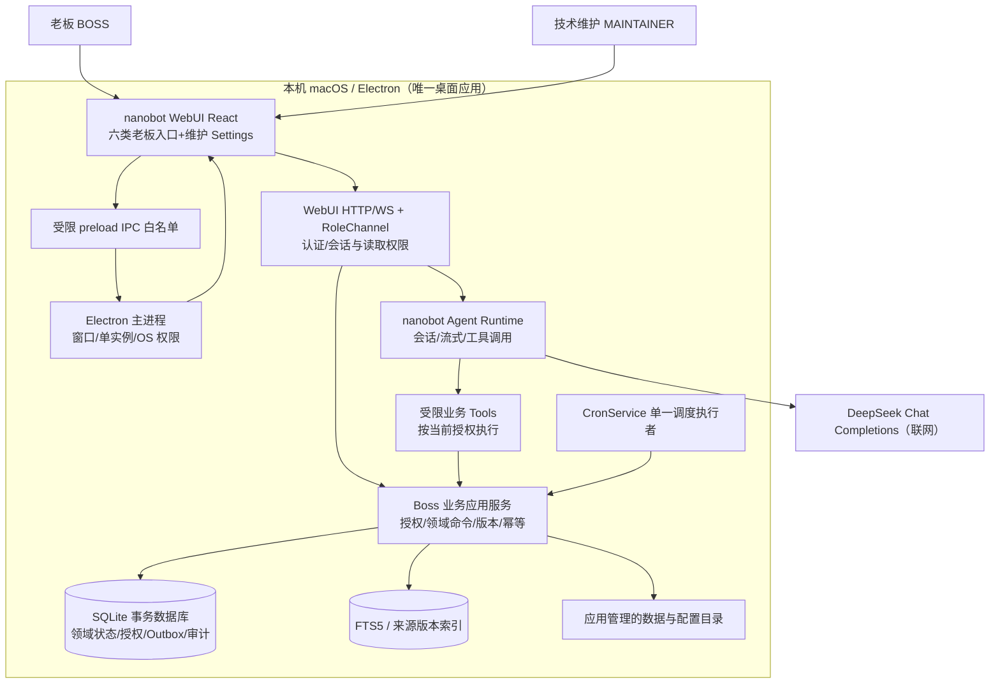
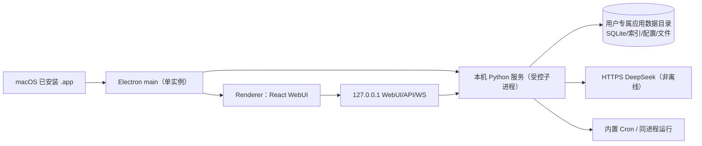
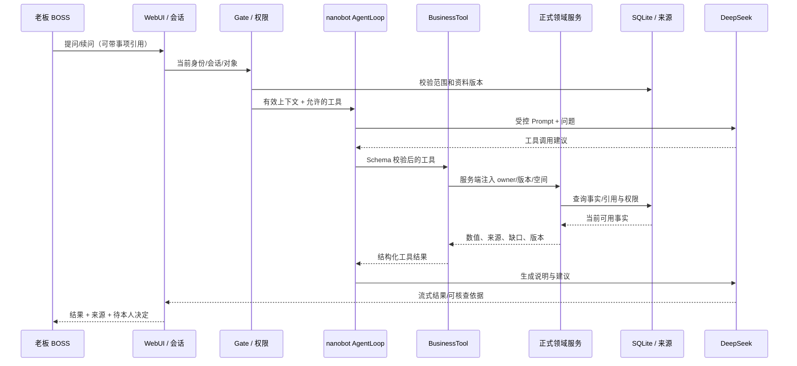
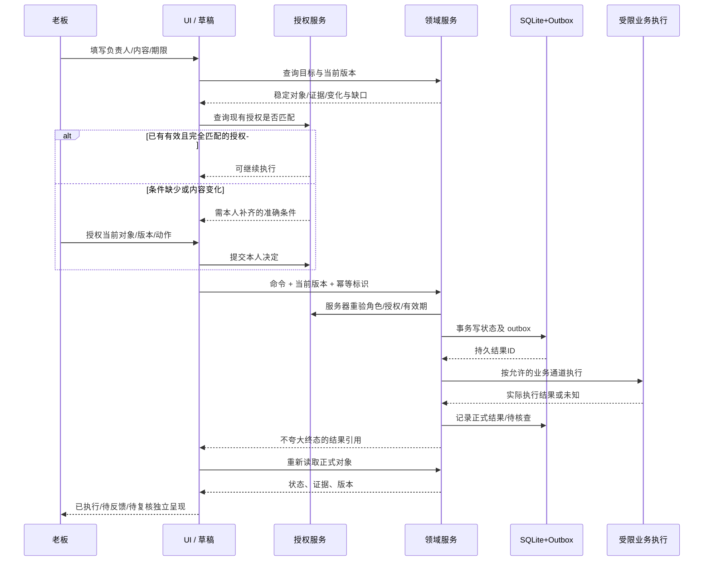

# Boss-Agent 系统高层设计（HLD）

> **版本**：1.0.0 · **基准日期**：2026-10-22 · **任务**：T04 / A04 · **性质**：最终版架构设计基线（非代码或功能验收）  
> **优先级**：已确认项目决定 > PRD V1.2.0 的业务/验收语义 > 本 HLD 的技术决策 > 72 页映射的页面责任 > 后续 T05—T08 的专业 LLD。任何冲突回溯原始需求与决策，不默默扩大权限或开发范围。

## 当前实现核查：2026-10-28

doc_id：DOC-HLD；当前实现核查采用 `9cd9888490521242def326f475c93823a68ec95b`及未提交修改。维护责任为当前主执行者。本文保留完整架构设计，设计基线日期为2026-10-22；本次核查入口、模块职责和实际调用，未完整复验的设计与NFR保持 NEEDS_REVIEW。

| 架构部分 | 当前实现与验证边界 |
|---|---|
| 页面与交互 | Desktop v7，72个设计主视图；老板使用五个主要工作入口，个人设置从账号菜单进入；结构、业务、视觉与用户验收分别记录 |
| 本机宿主 | 通用 Electron 桌面与独立浏览器候选共用 Python 产品服务；当前仿真候选入口及制品见[运行环境](运行环境.md) |
| 公共接口 | `AccountRoleChannel`、`RoleChannel`、`BossPageAPI`、`BossCommandAPI`，复用原生认证、ClientProvider及WebSocket |
| Agent | 单一 nanobot AgentLoop；FeatureProvider采用当前启用的外部模型或显式模拟Provider，已有DeepSeek限定运行证据 |
| 状态与知识 | ControlStore/Store维护SQLite业务对象、来源、权限、CAS与回执；知识采用FTS5，原生会话采用MemorySessionManager |
| 交付 | 当前源码包含未提交内容，完整产品、正式安装分发、视觉及用户验收均继续保留未完成要求 |

字段和当前业务调用见[集成指南](开发者集成指南.md)、[数据字典](当前数据字典.md)与[Agent说明](Agent六要素设计与实现说明.md)。任务状态仅采用[唯一正式状态](../specs/feature-delivery.json)。

## 0. 结论与交接

Boss-Agent 是运行于**本机桌面**、只服务**一个老板业务主体**的 Agent 软件。一个 nanobot Runtime 执行模型、工具、会话；老板使用今日工作、聊天交办、经营关注、会议与资料、任务与承诺，个人设置采用账号菜单。技术维护者使用独立授权维护入口。部门人员只作为联系人、资料作者、反馈对象，不获得登录身份，不新增部门 Agent。当前真实模型记录采用 DeepSeek，模型配置与实际请求分别核查。业务输入采用明确模拟资料与具有公开出处的经营基准，真实模型调用与模拟业务执行分别记录。

固定采用：**HKUDS/nanobot v0.3.5**（commit 1bb712d3488915ca4ed9ccc1a93067ff722f5ab9）、上游 React 18/TypeScript/Vite/Tailwind 3/shadcn/ui 用户 WebUI 与 Settings、**Electron 45.0.0**、**Python 3.12**、**SQLite + FTS5**、nanobot CronService、DeepSeek 的 deepseek-flash Chat Completions。其可行性已有 T02 实证，但尚无覆盖 72 个页面的正式业务产品或正式安装交付。只有 T02 的选型可行性状态可引用 ACCEPTED；T18/T19/T20/T24/T25 的产品验收仍为未执行。

**页面实现冻结物**：
- [72 页人类可读实现映射](HLD-72页面实现映射.md)（72/72 页面、每页设计源、逻辑路由、拟实现 React 组件、真实上游复用锚点、语义读写、角色及任务责任）。
- [72 页结构化架构契约](../specs/hld-72-page-map.json)（T04 设计阶段唯一机器可读映射；不是 T06 OpenAPI 或 T08 page-service-map 的替代品）。
- [设计与交互预览](../Boss-Agent-Desktop-Complete-v7/index.html)；[设计 Token](../Boss-Agent-Desktop-Complete-v7/design-tokens.json)。
- 权威业务语义、权限、FR-01—FR-32、AD01—AD16、状态与验收仍由 [PRD](PRD.md)、[交互与页面规范](交互与页面规范.md) 管理。

**实施授权更新（D21）**：HLD 最初冻结时 D19 暂停开发；2026-10-22 用户后续明确批准基于固定开源基础开始实施。D19 保留为历史决策，当前实际开发权限按 D21 执行。完整 PRD 和视觉验收不因授权变化视为通过。

## 1. 业务目标、范围与边界

| 维度 | 固定范围 | 明确排除 / 限制 |
|---|---|---|
| 主要用户 | 一个老板主体（BOSS），支持多个会话、任务、个人计划 | 其他部门独立 Agent、员工业务工作台、客户账号、真实协作门户 |
| 技术维护 | 一个独立维护身份（MAINTAINER），承担配置、模拟资料、可观测与评测 | 不可代老板批准、完成、发送、修改私人记忆，不可默认访问私人正文 |
| 入口 | 老板五个主要工作入口及个人设置，维护AD01—AD16；全部原业务能力、登录、详情/弹窗与异常要求保留 | 手机专属端、平板专属端、独立部署给外部用户的 Web 产品 |
| 需求 | FR-01—FR-32；13 秘书任务、10 农业专题及共通能力 | 增加新业务角色/新产业执行系统需要新的明确决策 |
| 设计 | Desktop v7共72主视图、561条状态关联、大鹏素材与六种动效；用户最新交互要求共同适用 | 设计资源存在不能证明业务、视觉和用户验收通过 |
| 数据 | SIMULATED 的农业经营、联系人、会议、任务与材料；真实模型/工具运行记录 | 未授权接入企业 ERP/OA、真实外部联系人发送、线上客户生产数据 |
| 网络 | 本机 UI 与业务状态可运行；DeepSeek、语音和外部来源依赖获准网络服务 | 不宣称模型、转写或外部检索离线可用 |
| 验证设备 | T02 已核验的 macOS 13.7.8 / Intel x86_64 | Apple Silicon、Windows、Linux 与最低兼容系统版本未通过验证 |

本 HLD 冻结架构责任与逻辑边界，不提前冻结真实接口字段、数据库类型、技术配额及未经验证的平台能力。NFR 的数值阈值需按 D05 等决策确定；未知记录为 null 或 NOT_SET，不填经验值冒充验收指标。

## 2. 固定开源基础和复用原则

| 分层 | 上游 / 当前验证入口 | 正式产品维护方式 |
|---|---|---|
| WebUI 与维护 Settings | nanobot 0.3.5：webui/src/ 下的 Sidebar、ThreadShell/Composer/Messages、GenericToolRun、SettingsPage/SettingsView、ModelsSettings、AppsSettings、SkillsCatalogSettings、AutomationsSettings 等 | 扩展同一WebUI源码体系；Desktop v7由React业务视图和公共组件承载，HTML作为设计来源 |
| 会话、流与恢复 | nanobot/agent/loop.py；nanobot/session/manager.py、webui_turns.py、recovery.py；session/thread 正式 API 与 WebSocket | 保留上游会话事件/持久投影，增加老板业务结果关联；不重新造第二套 SDK 会话 |
| 模型 | OpenAICompatProvider、nanobot SDK；当前 DeepSeek deepseek-flash/Chat Completions，thinking disabled | 仅 DeepSeek 受控调用，凭据在服务端；型号、协议或内部适配器升级必须复验 |
| Tools | ToolRegistry + 业务 Tool 扩展；T02 已验证 query_metrics、read_evidence、create_assignment、send_assignment、read_assignment | 业务 Tool 只接受白名单参数；owner、执行空间、授权、幂等与资料版本由服务端注入/校验 |
| 业务服务 | validation/application.py、business.py、controls.py、service.py及product_*/boss_*为当前产品入口与领域实现 | 通过实际调用核查权限、版本和持久化；目录名称不表示内容仅供测试，完整生产交付仍需正式验收 |
| 本地存储 | SQLite、FTS5、事务、原始精度 Decimal；T02 的业务与控制 Store | 明确域对象、源版本、执行空间与迁移方案；数据字典由 T05 固定 |
| 调度 | nanobot CronService、应用级 FileLock、业务事件及规则 | 同一进程只有一个实际调度执行者；Cron 承载调度机制，不创建第二套自主业务计划 |
| 桌面宿主 | validation/desktop/main.cjs、preload.cjs、Electron BrowserWindow | T11/T25 产品化为安装目录、资源路径、Python 打包、数据目录、权限和正式安装器；不得依赖开发者绝对路径 |

T02 已获得 [选型验证](选型验证.md)、[选型环境](选型环境.md)、[上游源码锚点与 hash](../evidence/T02/reuse-source-map.json)。上游源文件 hash 与具体路径的验证只对应固定 commit；升级必须重新核对入口、许可证、私有 API 和场景断言。nanobot MIT 不代表全部第三方依赖都采用同一许可证；分发前由 T25 完成传递依赖许可核查。

## 3. 逻辑组件架构

**信任解释**：浏览器渲染进程、模型文本、附件、搜索结果、模拟反馈均是不可信输入。身份和授权在 Gate/App/Tool 服务端核查；渲染器无法通过修改 URL、参数或 contact_id 获得 BOSS 身份。Agent 工具也不能直接写数据库或获取 shell/file/spawn 能力。Electron IPC 只提供明确批准的操作，不把 Node API、任意文件系统或模型密钥暴露给 WebUI。维护端看到的对象元信息必须经过独立投影，不能先下发私人正文再在前端隐藏。

### 3.1 逻辑服务与唯一责任

| 组件 ID | 职责、入口、唯一拥有者 | 禁止的双重来源 | T02 现状 / 下游任务 |
|---|---|---|---|
| C-HOST | Electron 主进程：生命周期、单实例、OS 权限、窗口、文件选择和外部打开 | React/LLM 不直接操作 OS；无后台常驻默认值 | main.cjs/preload.cjs 验证；T11/T17/T20/T25 |
| C-UI | React WebUI：展现 72 页面设计、可访问导航、输入、事件投影与返回上下文 | UI 本地变量不是真实任务/授权/送达状态 | 上游 Shell/Settings 验证；T08/T18/T19 |
| C-GATE | RoleChannel + 正式 WebUI API/WS：认证、角色、范围、token、事件下发 | contact_id 非身份；独立维护凭据不可通行老板接口 | RoleChannel 验证；T06/T08/T11/T24 |
| C-AGENT | 一个 nanobot AgentLoop：规划/语言、工具选择、流式与取消 | 无第二套 Agent 主体、计划调度或事实状态 | 两次 DeepSeek 任务验证；T07/T16 |
| C-TOOLS | ToolRegistry 中的业务白名单：读取、创建、发送/查询 | 未经过 C-APP 的写入；模型自行猜授权 | 五工具验证；T06/T07/T16 |
| C-APP | 老板业务域服务：申请、交办、反馈、决策、提醒、数据质量、授权、审计、Outbox | Agent 会话或 UI 状态不可替代领域正式结果 | controls.py/business.py 验证；T05/T06/T12—T17 |
| C-KB | 来源登记、版本、有效性、可检索索引、撤销传播 | FTS 命中不自动证明资料当前有效 | FTS5 验证；T05/T07/T15 |
| C-SCHED | CronService + 事件处理者 + 进程排他锁 | 不能再建一个会并行发起业务动作的独立 scheduler | Cron 与 FileLock 验证；T11/T17 |
| C-STORE | SQLite：领域事务、会话引用、版本、决定、个人记忆、持久 Outbox/Run 投影 | 模拟事件不能覆盖真实模型请求或老板批准记录 | SQLite 事务/重启验证；T05/T11/T14 |
| C-OBS | 运行/费用/评测：真实事件、脱敏审计、来源与断言引用 | 不记录密钥、内部推理或擅自补齐缺失费用 | 验证证据已存在；T09/T19/T24 |

### 3.2 单一来源（Source of Truth）表

| 状态或对象 | 唯一正式维护来源 | 可以派生的投影 | 必须禁止的做法 |
|---|---|---|---|
| 身份和角色 | 服务端身份/角色校验与会话发放（C-GATE） | 当前 UI 角色和菜单 | 从 URL、联系人表、模型文本推定已登录 |
| 老板会话消息 | nanobot SessionManager 的持久会话/turn 投影；引用 C-APP 的业务结果 | WebSocket 流与消息列表 | 聊天显示“已完成”即改正式任务状态 |
| 老板交办、反馈、完成、审批 | C-APP + SQLite 领域表，版本与授权关联 | 卡片、提醒、会话工具活动、发件箱列表 | 维护反馈等于老板完成；重复发送造成第二条实际写入 |
| 授权及其撤销 | C-APP 授权记录（动作+对象+内容+版本+有效期+owner） | 审批确认框、授权历史 | Prompt、SOP 或维护配置扩大当前授权 |
| 长期个人记忆 | C-APP 中经老板确认的 memory 版本 | 当前任务 context、索引及采用记录 | nanobot 自动 dream/compact 另存同一记忆；删除后旧记忆继续注入 |
| 模型有效配置 | 服务端唯一有效 runtime config + 启用版本/采用记录 | Settings 草稿、状态和运行快照 | 模拟配置表与 Runtime 配置同时可决定模型参数 |
| 业务规则与日程 | C-APP 有版本的规则、老板计划/授权定义 | CronService 的 job/下一次触发时间、通知 | Cron job 内容独立产生新老板规则或老板授权 |
| 资料及知识索引 | C-APP 的 source registry、有效版本/访问范围 | FTS5 索引、文档片段、引用 | 被撤销文档仍进入新回答或跨范围搜索 |
| 模拟数据及反馈 | C-APP 分 dataset/version/execution_namespace 持久化 | 运行演示及查询结果 | 把模拟发送与真实企业通知混淆 |
| 运行和成本 | 实际 Runtime/Tool/HTTP 记录 + 价格来源的不可篡改关联 | Dashboard 统计和费用估算 | 缺 usage 或计价就显示 0，或以展示值当账户账单 |

会话投影与业务状态**不同所有者**；通过稳定关联标识回查，不复制维护两套业务终态。数据库中数据迁移、字段和索引的约束由 T05 确定；不得根据本表自创生产表名。

## 4. 运行部署及进程生命期

**已验证布局（仅 T02）**：127.0.0.1:8872 原生 WebUI/API/WS，127.0.0.1:8871 模拟业务 HTTP；Electron main 启动/停止 application.py；127.0.0.1 约束、RoleChannel 分权、Python FileLock 与 Electron 单实例已做范围内验证。8871 是验证工程端口，正式产品应由 Gate 代理或服务端内聚业务路由，避免 renderer 直接暴露第二套公共业务凭据或跨角色接口。端口不是可用公网地址，也不是正式产品不变的端口契约。

**产品化部署契约**（T11/T25 实现、当前未实现）：
1. 应用使用安装内的固定资源、可定位 Python Runtime/依赖，而非 validation/.venv、开发者绝对路径或默认网络安装。
2. 用户可写资源（数据库、索引、附件、配置及日志）进入 OS 约定的私有应用数据目录；程序升级不覆盖数据。密钥在服务端受限存储/安全引用，权限与迁移由 T11 安全验收。
3. 主进程创建单实例锁、受控服务子进程和窗口；仅在服务健康且角色验证后展示业务 UI；端口、origin、preload IPC 来源与 session 权限都固定到当前实例，不使用动态外部页面。
4. 默认关闭最后窗口即请求完整退出；没有启用后台常驻、自启动或自动更新。关闭前通过 UI 提示未保存输入并确认；关闭/退出不是老板任务完成。
5. 退出停止新任务投递、持久化已确认状态、把在途未明执行记为待核查、停止 Cron/Python、关闭音频与 IPC；重启从数据库和发件箱恢复，不重新发送未知结果。
6. macOS 13.7.8 Intel x86_64 是**已检查验证环境**，不是宣称支持的全部设备；签名、公证、最低系统、卸载/迁移由 T25 实测与决定。

## 5. 系统信任边界、角色和访问控制

| 边界 | 允许 | 强制检查及故障响应 |
|---|---|---|
| BOSS / UI → WebUI Gate | 读取本人获准对象、开始会话、申请经授权操作、确认/撤销个人记忆 | 逐请求验证会话角色、owner、dataset、namespace、对象版本、资料范围、有效授权；401/403 隐藏正文，刷新不会自动重放写入 |
| MAINTAINER → Gate/维护 API | 模型、SOP、Skills、资料模拟、规则、调度技术状态、运行元信息与评测 | 独立身份+白名单投影；默认不准读私人正文、调用老板发送/完成/审批或改老板记忆；服务器必须拒绝 |
| 联系人与反馈作者 | 数据集内被明确标识的收件人、作者、模拟回复来源 | 只有稳定对象 ID，不生成账号/token；来源署名不可变身为请求者 |
| 模型/资料文本 → Tool/APP | 用于理解需求、定位事实、生成待核查草稿 | 资料视为不可信；模型输出不改变服务端业务身份、权限、工具注册、有效期及白名单 |
| Renderer → Electron IPC | 状态、麦克风授权、获准文件、获准外部来源、系统通知、退出 | 仅主 frame + 当前可信 origin + 允许 action/形状/身份；禁用 nodeIntegration，启用 contextIsolation/sandbox/webSecurity/CSP |
| Localhost / 本地文件 | 当前应用进程必要访问 | 服务仅监听 loopback，禁止意外 LAN 暴露；私有文件路径非 renderer 可枚举值；数据库文件与备份单独限制 |
| 运行记录 / 评测 | run_id、数据/模型/工具版本、授权元信息、结果和 usage | 隐去密钥与私人正文；评测期望答案不向模型上下文注入；访问、导出和日志都校验权限 |

**授权交集**＝主体角色允许 ∩ 当前对象可见/可写 ∩ 工具白名单 ∩ 内容/对象/动作/版本/时效有效的本人授权 ∩ 当前数据集及执行空间状态。服务端必须检查这一完整交集，而不是让模型或 UI 只确认“用户刚点击过”。

录音、私人日程、消息正文等敏感内容不进入 URL 查询参数、系统通知文案、普通日志、分析报表、维护元信息或错误堆栈。文件读取仅对获准所选文件及目录边界进行核查；开放外部 URL 仅允许合法 HTTPS 与配置准入来源，阻止任意 scheme 和任意文件路径。

## 6. 领域数据和引用边界

| 数据类别 | 最小实体关系与约束 | 正式源 |
|---|---|---|
| Identity & Profile | boss_id/owner_id、角色、目标、可见范围、有效期 | C-GATE / C-APP |
| Business Scope | dataset_id、dataset_version、execution_namespace、模拟标识、seed、业务时间 | C-APP |
| Commitment & Assignment | task_id、责任人 stable contact_id、期限 IANA 时区、证据、版本、授权、反馈与决策 | C-APP |
| Conversation & Run | session_id、run_id、request_id、工具/模型/配置版本、真实时间、stop_reason、业务结果引用 | nanobot 会话 + C-OBS，任务终态由 C-APP |
| Evidence & Knowledge | source_id、source_type、作者、版本、位置、observed_at/received_at、valid_from/valid_until、撤销与索引状态 | C-APP source registry |
| Metric & Agriculture | 经营维度、法人归属、期间、单位/币种、原始 Decimal、公式/版本、观察方法、样本/覆盖/估计标记 | C-APP 的模拟事实及独立计算 |
| Memory & Decision | 个人已确认记忆、历史决定与当时有效的来源；采用/撤销版本 | C-APP |
| Schedule & Notification | event_id、trigger_id、rule_version、时区、去重键、抑制/恢复原因、当前任务状态独立字段 | C-APP + Cron 执行投影 |
| Audit & Evaluation | 角色决策元信息、幂等、HTTP/Tool/模型尝试、费用估算来源与覆盖、断言结果 | C-OBS，不得回灌模型评分预期 |

全域记录使用稳定 ID、owner_id、版本、来源与真实创建更新时间；按 PRD 12.1 将观察时间和接收时间分离，用户业务时钟不得覆盖物理执行时间。不同批次、不同用途的农业指标只通过有证据的关系关联；例如 FR-19 的肉禽、蛋禽、乳畜、肉用牛羊不相互混算。

**删除/撤销**：即时停止将撤销内容用于新任务，清理索引和适用派生内容；历史决定仅保留必要且获准的当时版本引用。备份恢复不可重新启用删除数据。保留期限、备份加密算法、自动清理时限与容量上限当前未知；T05/T11 明确实现选型并实测，不声称已有合规认证或备份恢复保证。

## 7. 模型、SOP、知识库及工具管道

1. **Prompt**：技术维护者通过版本生命周期保存、校验、启用；只规定职责、风格与任务方法，不授予业务权限。
2. **Workflow/SOP**：按老板任务建立输入→完整性→工具查询→证据→老板必要决定→执行→结果重读的显式状态；变化参数时重查，不复用过期事实。
3. **Knowledge Base**：采用有来源范围和版本的 FTS5 检索作为已验证基线；Embedding/Reranker 尚未实际采用，不提前声称向量召回能力。
4. **LLM**：DeepSeek 唯一 Provider，当前 deepseek-flash 和已验证 Chat Completions；模型故障明确失败，无备用模型/固定伪回答。
5. **Tools**：以真实 Schema/当前授权和业务数据服务承载，基础五类已验证操作可作为示例；全部农业专题/生产接口另有实现与验收任务。
6. **Evaluation**：预期答案/阈值独立保存，不进入模型输入；同初始快照多次执行，记录全部成功与失败尝试。

### 7.1 老板动作的事务序列

任意服务写入都需 current_version/CAS 与 idempotency_key；同一幂等键的不同内容拒绝，旧版本拒绝；已写业务结果后模型或 UI 失败不可补造失败回滚或重复发送。没有外部成功回执时显示 RECONCILING/待核查，不把网络异常等同于未执行。

### 7.2 时间与调度

- 真实墙钟用于运行时长、请求/审计时间、费用及系统权限；模拟业务时间用于业务事件、数据时间与测试时钟，两者不能互相覆盖。
- 计划的业务定义由 C-APP 管理、CronService 负责唯一实际触发。规则区分生效时间、IANA 时区、冷却、免打扰、暂缓、取消、升级与提醒已读。提醒知晓或关闭**不会**改变任务期限或完成状态。
- 文件锁与桌面单实例只防重复进程，不代替 DB 幂等。重启读取计划与 outbox，对过期/撤销/已完成事件不得重放。

## 8. 桌面 UI 和 72 页实现方案

**实现技术**：延续 nanobot 同一 React 18 + TypeScript + Tailwind/shadcn 项目；复用 WebUI Sidebar、Thread、Source Preview、Settings/Models/Skills/Automations/Apps、TokenUsage 真实源码。需要业务专属视图的页面在上游壳内新增 React 组件。设计预览中的静态 HTML、预填字符串、sessionStorage 模拟按钮**仅作视觉与交互依据**，不可导入正式业务状态逻辑。

**路由**：映射表的 /app/boss/{pageId}、/app/maintain/{pageId}、/app/auth/{pageId}、/app/shared/{pageId} 是统一**逻辑路由标识**；T08 将其绑定实际同源 SPA/桌面导航和可恢复深链。T02 未发现独立上游 /admin 路由，不能臆造现有后台 URL。不同身份必须使用服务器验证后的 API/WS 令牌；前端路由守卫只是 UX，不能提供安全保证。

**页面模型**：
- F：32 个老板/运维功能主页面，按 source meta 的 technical 判断身份归属；F25/F30/F31/F32 属维护，F27 的语音功能由 T20 另行完整验收。
- N：12 个入口/导航/概览，N01 是未认证入口、N12 是维护运行概况，其余为老板区域。
- D：9 个抽屉、弹窗或访问异常页；D06 未保存编辑与 D07 访问拒绝是共用安全规则，D08 负责重新认证。关闭后恢复调用者上下文与焦点，拒绝时不可泄露正文。
- A：16 个维护能力，不以组件存在代替配置实际采用证据。
- V19：3 个 FR-19 用途变体 V19-BEEF/EGG/MILK；F19 基准为肉禽 BROILER，四种用途**共用 AgriScenarioPage 模板**并采用独立查询口径与数据范围。

**状态设计**：F 组 32 页 + A 组 16 页 + V 组 3 页，共 51 页 × S00—S10 = 561 条设计入口；N 组 12 页 + D 组 9 页，共 21 页无单页状态索引，继承通用加载、缺少资料、错误、访问受限、并发冲突和 E01—E06；全站另遵循 SYS-STARTUP/CLOSE/EXIT/RESTORE/NETWORK/NOTIFICATION/MICROPHONE/FILE。页面的设计态 S00—S10 是 UI 表达要求；真实业务状态必须来自领域服务，不能模拟状态切换得出已执行结论。

**视觉基线（不可降级）**：以 v6 design-tokens.json 为权威：brandBlue #005BAC、deepBlue #073B70、brandGreen #5CA63B、actionBlue #0968EA，正文 16/24、说明 14/22、8px 节奏、卡片 14px 圆角、输入 9px 圆角、2px 焦点和至少 44px 主控件。设计素材复用 boss-logo-from-reference.png、dapeng-front/side/think/execute.png 与 animation 的待机/倾听/思考/执行/确认/提醒六组 WebP/MP4。动画状态只映射真实 UI 事件、尊重 prefers-reduced-motion，不因动效完成擅自改变业务状态。素材知识产权/正式品牌许可仍需核查。

**适配验收**：1440×1024 主稿、1280×800、1024×768 和 200% 缩放；鼠标/键盘/屏幕阅读器、来源侧栏、长文本、焦点可达、滚动与未保存状态恢复。业务数字、来源和提交按钮不可被截断；对应截图差异与 DOM/实际 API 证据分别审查。

## 9. 服务契约、事件和错误模型

本阶段把页面映射的 semantic_read_contracts/semantic_command_contracts 固定为**业务接口意图**，不是可直接调用的真实 HTTP 路径。只有 T02 明确实证的上游 API/WebSocket 和验证程序操作可以标注为“已有验证”：原生 GET /api/sessions、GET /api/sessions/{key}/webui-thread、WebSocket 消息/工具事件、Provider/Settings 配置事件、Cron 接口，以及验证业务工具 query_metrics / read_evidence / create_assignment / send_assignment / read_assignment 等。验证工程操作也不代表完整产品 API 已上线。

D04/D05 的本地选择、D06 的未保存编辑提醒及 N12 的筛选作为 client_only_intents 留在前端，不生成伪业务接口；若原页面明确支持“保存草稿”，也需走该页经授权的保存 API。T06 必须为每类**服务端**语义契约提供 operationId、身份/资源范围、请求/响应与错误 Schema、版本及幂等；T08 才可生成 page-service-map.json，把真实路由、组件、动作、服务操作和事件一对一绑定。浏览器业务读写建议通过同源 WebUI/RoleChannel Gate 暴露，不直接把 8871 模拟服务凭据交给 renderer。

| 类别 | 规范意图 | 请求/结果与恢复 |
|---|---|---|
| Query | 当前 owner+dataset+namespace+过滤+资料版本 | 数值和来源/覆盖/时效同时返回；缺失为 UNKNOWN，公式不可比拒绝虚假结论 |
| Command | 当前本人授权+对象版本+幂等键+限定动作参数 | 持久 result_id、正式状态、授权关联；重复提交得同一结果/冲突 |
| Task & Outbox | create、send、read、feedback、defer、complete、cancel 独立 | PENDING/SENT/WAITING_FEEDBACK/RESULT_SUBMITTED/COMPLETED 等在 PRD 的允许状态转换内执行 |
| Run & Session | run_id、session_id、请求版本、事件类型、stop_reason | 流断开重读 run_id，不重放原 write；允许取消未执行步骤，不回退已持久结果 |
| Admin Configuration | draft、validate、activate、adopt 独立记录 | 仅允许维护身份在配置域保存；新任务采用版本由真实任务日志证明 |
| Knowledge & Memory | source_id/memory_id、owner、有效版本、撤销状态 | 旧版本历史可追溯；新任务检索必须排除已撤销正文 |
| Desktop IPC | 本地受控能力 + 当前可信 origin/主 frame + 角色 | 结果逐项成功/拒绝/撤销；无任意 shell 或 renderer 文件路径访问 |

**异常统一协议（T06/T08细化）**：UNAUTHENTICATED、FORBIDDEN、NOT_FOUND_OR_REDACTED、VALIDATION_FAILED、VERSION_CONFLICT、AUTHORIZATION_REQUIRED、AUTHORIZATION_REVOKED、SOURCE_STALE、UPSTREAM_UNAVAILABLE、TIMEOUT、CANCELLED、RECONCILING。错误不能泄露不该知晓的对象存在信息；产品 UI 提供恢复路径，保留合法草稿，禁止自动二次发送。这里的枚举为设计约定，HTTP 状态码由 T06 决定。

## 10. 故障恢复与正确性

| 场景 | 状态维护与处理 | 实证边界 / 最终验收 |
|---|---|---|
| 主进程/服务异常退出 | 已确认写入在 SQLite；下次启动检查 in-flight run、Outbox、授权与 job 版本，未确定执行先查询 | T02 重启重读通过，系统全量故障恢复待 T24/T25 |
| 模型调用失败或超时 | 工具已持久结果不回滚；记录实际 stop_reason、有效 usage 与未知 usage | T02 部分执行/取消通过，更多异常变体待 T16/T24 |
| 断网/恢复 | UI 可呈现既有数据及未完成状态；联网后认证并重读，不承诺离线产生新模型结论 | 设备断网再联网流程未验证 |
| 重复请求/并发冲突 | 领域服务事务+版本 CAS+幂等键+Outbox 去重；相同请求重读同一结果 | 验证范围内通过，完整变体待 T12/T24 |
| 已撤销资料/授权 | 新模型任务不采用；已有执行、历史记录及撤销元信息可查 | T02 部分通过，严格资料撤销及并发场景待 T15/T24 |
| 系统休眠/唤醒 | 记录事实中断并重新查询计划、权限和时间有效性；不赶发已取消/过期事件 | 待 T17/T24/T25 |
| 权限拒绝/撤销 | 语音与文件能力停用，文字路线正常；角色越权在服务端拒绝 | 系统授权允许/拒绝/撤销完整实机组合待 T20/T25 |
| 配置升级/迁移 | 采用可回滚版本、迁移前备份与数据校验，不能恢复被删除正文 | 产品迁移与卸载待 T11/T25 |

RPO/RTO、缓存上限、单次请求/文件/录音/上下文大小、吞吐、通知延迟以及硬性费用阈值目前都是 **NOT_SET**，不可在测试报告中标为“达标”。由 T04 冻结持久与恢复策略，由 T05/T09/T11/T24 基于设备和用户决定写入可量测目标和实测数据。

## 11. 可观察性、成本与产品价值

基础关联键：execution_namespace、dataset_id/version、owner_id、session_id、run_id、request_id、tool_id、authorization_id、source_version、model/config_version、decision_id、idempotency_key、business_time、wall_time。运营界面读取权限最小化后的投影，不读取原始凭据或链路私密正文。

按 PRD 12.4 与 specs/value-validation.json 的 M01—M17 进行采集：任务开始/结束、事实与引用独立断言、老板核查与修改时间、请求/工具真实耗时、重复写入、访问拒绝、模型/知识/语音真实 usage 与公开价格生效日期、人工工作量、配置采用、真实使用观察。费用必须区分峰/谷、已知小计、缺少覆盖、不同币种；缺少用量或价格总额为 null。当前 T02 因部分失败/取消 usage 缺口，总费用未知；预算与体验阈值引用 D05，不臆填。

## 12. NFR 设计决策与验证责任

| NFR | 架构保障 | 应验证的真实证据 | 任务 |
|---|---|---|---|
| 01 性能 | 流式进度、长任务状态与取消、耗时分解 | 首个有用进展/整体耗时/人工核查修改；阈值待确认 | T09/T24 |
| 02 费用 | 全请求含失败/取消的用量覆盖与价格版本 | 真实 token、计费来源和未知总额 | T16/T24/T26 |
| 03 持久恢复 | SQLite 事务、Outbox、run 重读、Cron 去重 | 断电/重启/重复提交及恢复后正式状态 | T11/T17/T24/T25 |
| 04 身份隐私 | RoleChannel、角色+对象+行为权限、日志最小化 | 401/403、维护越权、联系人伪造、读写导出拒绝 | T11/T18/T19/T24 |
| 05 来源计算 | Decimal、版本公式、有效引用、覆盖与估计 | 独立重算、来源原文、农业关系和单位匹配 | T13/T21—T24 |
| 06 可访问性 | 共用语义组件、键盘与焦点、公共状态 | DOM、键盘、读屏、200% 缩放、失败可恢复 | T08/T18—T20 |
| 07 兼容 | 固定 T02 平台与依赖；升级触发复验 | 安装/窗口/唤醒/系统权限实机证据 | T11/T20/T25 |
| 08 可观察性 | run/配置/授权/工具/领域结果完整关联 | 缺口/错误保留、机密信息扫描 | T16/T19/T24 |
| 09 调度可靠 | 单一 Cron 实例、业务幂等、版本重读 | 重复时钟、暂停/取消、恢复、免打扰 | T17/T24 |
| 10 数据安全 | 服务端机密持有、限制 IPC/网络、访问范围 | 密钥暴露/日志/本地权限/备份与恢复校验 | T11/T24/T25 |
| 11 容量限制 | 受控配额与拒绝，不让模型自行扩大 | 文件/语音/轮数/并发边界与超限说明 | T05/T06/T20/T24 |
| 12 维护证据 | 版本锁、页面映射、ADR、开发记录与验收 | 产物复现、许可审查、真实运行与个人贡献 | T10/T25/T26 |

本次 A04 检查**仅覆盖以上机制的架构完整性**，不使任何 NFR 从未验证变为运行 PASS。

## 13. 架构决策记录（ADR）

| ADR | 已固定决定及依据 | 不采纳方案 / 升级条件 |
|---|---|---|
| ADR-01 | 单一 BOSS Agent + MAINTAINER 技术维护身份，联系人只有对象 ID（D11） | 不建设多个部门 Agent；变更须重新批准范围 |
| ADR-02 | nanobot v0.3.5 commit 固定，Runtime、原生用户及 Settings 三层共同复用（D03/D16/T02） | 不是只复用 SDK，也不再另接不兼容的第三套前端 |
| ADR-03 | Electron 45.0.0 桌面宿主，macOS Intel 先验设备（D17/T02） | 不把浏览器预览当桌面交付；扩 OS 必须实测 |
| ADR-04 | 模型只用 DeepSeek deepseek-flash/Chat Completions（D04） | 不自动降级、替换、伪造模型结果；改型号需复验 |
| ADR-05 | 领域正式状态集中在 C-APP/SQLite，nanobot 只维护自身会话投影 | 不以会话/工具消息作为交办完成或审批事实 |
| ADR-06 | 长期个人记忆只采用老板已确认的 C-APP 版本；Dream 和自动 compact 暂停 | 不由维护者或自动总结生成另一份隐式有效记忆 |
| ADR-07 | 单 Runtime 有效配置、单业务规则定义、单 Cron 执行者 | 不允许后台设置和模拟配置成为两个独立生效源 |
| ADR-08 | 源材料版本+范围+有效期+撤销传播，FTS5 起步 | 不冒称 Embedding/Reranker 已验证 |
| ADR-09 | 业务命令服务端权限+CAS+幂等+Outbox+重新查询 | UI 点击/LLM 决定不能绕过老板授权，也不能乐观宣称已发送 |
| ADR-10 | WebUI 单源渲染 + 受控 IPC，凭据不进入 renderer | 不把 72 个 HTML 嵌成最终产品，不开放 shell 与任意 FS |
| ADR-11 | 默认应用退出停止本地 Python/Cron，无后台常驻/自启/自动升级（D17） | 新生命周期能力须获准、设计并另行实测 |
| ADR-12 | Desktop v6 视觉不降级；72 主视图+561 独立设计态索引由结构化文件约束 | N/D 21 页公共状态不伪造 231 张页面状态图 |
| ADR-13 | 冻结语义页面路由与组件责任，API 路径及数据结构待 T05—T08 绑定 | 不把 T04 的语义契约冒充已存在接口或正式 operationId |
| ADR-14 | 模拟资料与真实模型/工具运行证据分离，真实企业效果保持未知 | 不以合成案例、演示数值和静态截图推断实际经营收益 |

ADR 状态均为 **ACCEPTED_FOR_HLD_DESIGN**，不等于对应实现和产品验收通过。涉及身份、运行模型、上游版本、业务对象生命周期、72 页范围、视觉系统及接口读写语义的更改，需先更新决定与影响分析，随后提高 HLD/页面映射版本；不得在某页暗中分叉。

## 14. T04 设计验收和 T05—T26 交接

| 下游 | 必须接收并落地的约束 | 允许细化但不得擅自改变 |
|---|---|---|
| T05 数据 LLD | 本 HLD 第 3/6/10 节，PRD 12.1 和模拟环境 | 字典、事务、版本/删除/Outbox、数据库迁移与索引 |
| T06 后端 LLD | 第 5/7/9/10 节、72 页 semantic contracts | OpenAPI operationId、Schema、错误码、服务边界、服务端授权与幂等 |
| T07 Agent LLD | 第 3/5/7/11 节、T02 工具与模型证据 | 提示词/SOP/Skills 生命周期、工具输入、领域任务能力 |
| T08 前端 LLD | 第 8/9 节、72 页映射、v6 设计与源资源 | React 实际 import 与路由、操作→API/WS、弹窗/返回、状态/视觉验收 |
| T09/T10 | NFR、风险与静态约束、任务依赖 | 可执行验收用例、实际工程目录和运行命令，不臆填实测 |
| T11—T17 | 受控桌面进程、业务存储、权限、配置、Cron、模型 | 验证代码迁移为产品；每项用实际测试与开发记录证实 |
| T18—T20 | 老板 72 页中负责的功能、AD 后台、语音 | 真实 DOM/API/模型或转写、设计像素对比与系统授权 |
| T21—T23 | 十个农业专题与 FR-19 用途变体 | 独立场景、来源、计算口径、反馈与复查 |
| T24—T26 | 安全、异常、完整业务流、安装与交接 | 真实状态复验、许可、安装包/校验和、现有与未验证证据的明确边界 |

**A04 的静态通过条件**：① 单老板边界；② Runtime、身份、授权、会话、记忆、领域业务、模型配置、资料、调度和日志都有单一维护责任；③ Electron/服务/SQLite 部署关系可执行性已由 T02 范围内证据支撑；④ 安全/恢复/费用/NFR 有明确未验证项和任务归属；⑤ 72 页与 v6 原始文件一一对应，561 状态数量不夸大；⑥ 后续接口/源码路径从架构意图下沉，不冒充已实现。结构与来源审查的记录放入 evidence/T04/，运行/系统产品测试不属于本次 A04。

正式 HLD 仍然是业务架构基线。D21 已授权首批 React 业务界面和交办事务切片；其与 72 页架构的当前绑定、11 个部分开发视图、61 个占位页面及未验证项统一读取 [`specs/page-service-map.json`](../specs/page-service-map.json)，不可根据原冻结时的 `NOT_BUILT` 标识否认已提交的代码，也不能把部分代码标为 T18/T19 产品通过。完整页面、Mac 本机启动、系统权限、像素对比及完整 PRD 验收继续按原任务执行。
