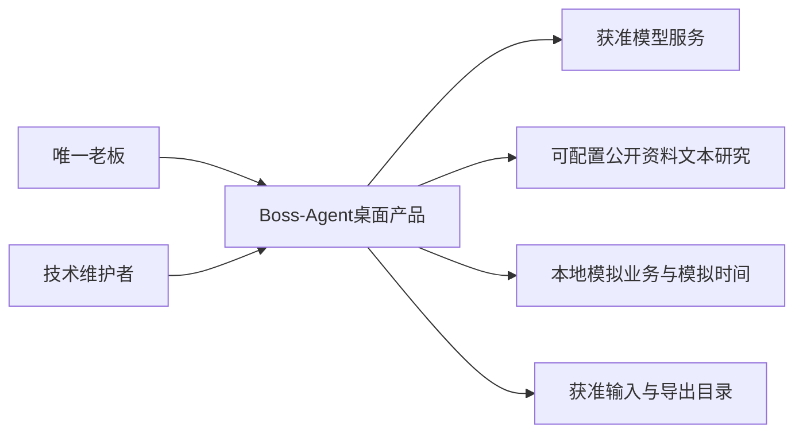
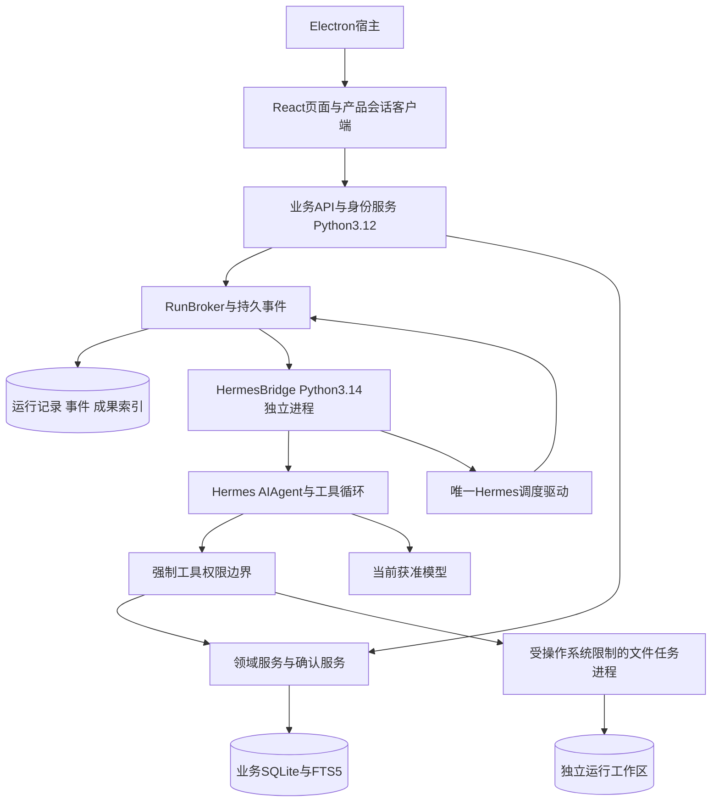
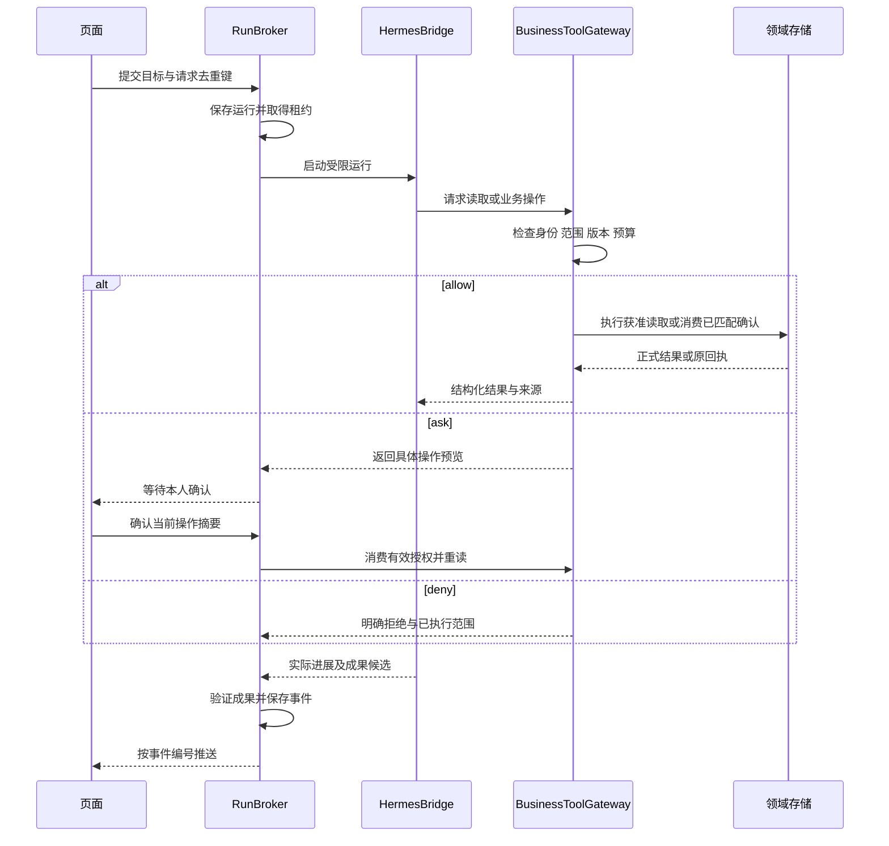

# Boss-Agent 系统高层设计 2.0

doc_id：DOC-HLD-2；版本：2.0.0；日期：2026-10-30；任务：UPGRADE-2-DESIGN；维护：S004；状态：IN_REVIEW。目标来源为 [PRD2.0](PRD2.0.md)，当前实现仍为 nanobot；本文组件、接口和迁移均未实施。原 [HLD](HLD.md) 的业务边界、全部页面和未完成要求继续保留。

## 1. 目标、范围与约束

老板通过现有 Electron 和 React 界面提出目标，Hermes 持续调用获准工具，产品保存可重读成果、本人授权和正式业务状态。真实模型、真实工具与模拟企业资料同时使用，分别记录其性质。Hermes 不拥有业务数据库、账号权限或本人决定。

继承 FR-01—FR-32、AD01—AD16、全部72主视图和561条状态关联；FR-27语音继续暂停。当前五个老板主要入口、账号设置、20项管理员常驻入口及 Desktop v7 设计保持。U2-FR-01—12与U2-NFR-01—06全部进入升级验收；没有借助引擎升级缩减既有要求。

| 现状依据 | 升级处理 |
|---|---|
| `validation/application.py` 直接采用 nanobot AgentLoop、SessionManager、CronService与工具注册 | 将执行、会话传输及触发接入产品适配层；保留领域服务行为 |
| `validation/pyproject.toml` 固定Python 3.12；Hermes当前主线依赖面向Python 3.14 | 分别锁定业务环境和Hermes环境，通过本机接口通信 |
| React页面依赖nanobot会话与ClientProvider | 建立产品会话客户端；逐个核查页面订阅、认证与错误处理 |
| Store/ControlStore维护业务与授权，SQLite/FTS5提供检索 | 继续作为业务唯一维护方；新增运行事件与成果索引 |
| 会话工具以读取为主，正式业务服务已有部分写入 | 将获准业务服务接入统一工具边界，复用CAS、幂等及本人确认 |

本文件所有新增路由、数据结构和服务名称均为目标接口。未完成兼容验证前，不登记为生产可用入口。固定上游版本、隔离后端与性能数值采用第8节的阻断条件。

## 2. 系统边界与容器

### 2.1 系统上下文

公开资料研究默认关闭；具体目标、网络范围和来源保存经过配置核查。模拟投递与本地日历回执不能声明外部收件或外部日历同步成功。

### 2.2 进程与容器

HermesBridge通过绑定loopback的认证HTTP与WebSocket通信，不向局域网暴露监听。每次启动生成仅用于进程间的能力凭据，浏览器、模型上下文和子任务均不能获得；产品登录凭据不传给Hermes。使用成熟HTTP、WebSocket及JSON库，业务工具优先采用上游正式MCP接入能力和官方SDK；具体固定版本由兼容任务验证。

独立Python进程仅解决依赖和故障隔离。文件与命令工具还必须经过操作系统级限制：仅挂载当前运行获准文件，禁止访问业务库、账号库、宿主凭据及其他运行目录，网络默认拒绝。所用macOS隔离后端及打包可行性保持待验证；没有满足条件的后端时，不开放该工具集。

2026-11-02，用户批准采用 Apple Virtualization.framework 承载的独立 Debian 13.7 amd64 虚拟机，配置为 2 CPU、2 GiB 内存、6 GiB 系统磁盘和 2 GiB 独立工作区，使用 EFI variable store。安装阶段网络仅限获准的系统与必要依赖来源，安装完成移除网络设备；受认证通信、文件范围、cgroup 资源限制及全部后代退出须实际验证。批准设计不代表系统安装、隔离或正式接入已经完成，实施状态见 U2-03。

技术验证程序、签名权限和安装介质串行配置保存在 [scripts/managed_linux](../scripts/managed_linux/README.md)；编译核查与实际运行分别记录，正式系统重建及隔离验收仍有待完成的条件。

受管客体按运行分配独立 Linux 账号，使用 systemd 服务限制进程资源，并将工作服务关联至客体监督服务和 CPU 监督服务。独立工作区磁盘按配置 UUID、容量、文件系统和挂载选项核查，每次运行的目录在私有命名空间中映射至 `/mnt`；实际客体自启动及磁盘只读时拒绝启动已有技术证据。CPU 监督读取整个工作服务的累计用量，达到额度后通过 `cgroup.kill` 终止所核查的控制组；轮询、调度和终止过程会产生超额，严格上限尚未证明。宿主和客体通过 Virtio Socket 传递双向 TLS 数据，运行授权、宿主与客体工作区关联和文件总额度仍需联合验证，状态见 U2-03。

## 3. 组件责任与数据唯一来源

| 组件 | 责任与输入输出 | 唯一维护方/禁止事项 |
|---|---|---|
| ProductSessionClient | 会话、运行、补充输入、确认、成果及事件重放 | 只提交用户输入，身份与范围由服务端确定 |
| AccountService | 登录、角色、有效会话及退出撤销 | 现有账号服务；不授予Hermes登录管理权限 |
| RunBroker | 目标版本、执行租约、运行状态、事件编号、预算及恢复 | 产品服务；不重复实现模型工具循环 |
| HermesBridge | 配置固定版本AIAgent、接入工具、收集实际事件、取消及会话检查点 | 引擎适配方；禁止直接修改领域对象 |
| BusinessToolGateway | 读取、准备、执行与查询原结果；校验当前主体和授权 | 领域服务；工具参数不能覆盖服务端主体 |
| ConfirmationService | 操作摘要、来源版本、确认范围、期限及一次业务效果 | 现有本人确认语义；MAINTAINER和Agent不能代签 |
| ArtifactService | 文件登记、摘要、格式核查、来源版本、导出和撤销传播 | 产品服务；仅验证完成的文件可发布 |
| MemoryService | 本人记忆候选、确认、冲突、删除及采用日志 | 业务记忆记录；关闭Hermes自由写入个人档案 |
| SkillRegistry | SOP01—SOP13、有效版本、依赖和方法经验候选 | 产品版本记录；候选经校验及获准发布后启用 |
| ScheduleService | 本人计划、时区、范围、停止条件、启停和触发去重 | 业务计划记录；Hermes cron只维护派生触发安排 |
| ContextAssembler | 按权限、来源、记忆、方法和预算形成当次上下文 | 读取各自权威来源；摘要不能成为新事实 |
| Audit与UsageCollector | 工具、授权、辅助模型调用、成本及错误的真实记录 | 产品审计；无价格时费用为null |

### 3.1 存储与生命周期

业务对象、知识、来源资格、账号和凭据继续使用现有维护边界。新增运行记录、事件、意图、成果及调度触发记录，字段和事务规则见 [升级详细设计](升级2.0详细设计.md)。Hermes原生会话数据只作为执行检查点，产品会话和正式结果不依赖原生记录可直接展示。

上下文缓存键包含执行空间、授权版本、来源版本、记忆版本、方法版本、模型配置版本和目标版本。任何一项变化即失效；禁止跨主体共用私人缓存。资料删除或撤销先提升采用版本并阻止新读取，再清除索引、摘要和派生缓存；清理失败明确报告并阻止受影响运行继续。已导出到用户指定目录的文件列入影响清单，不能声明远端副本已删除。

备份包含业务库、账号库、运行记录、有效文件索引和被引用的文件，不包含可直接复用的明文运行能力凭据。恢复须检查版本、文件摘要和最新撤销记录，重新生成进程能力凭据。保留期限、RPO/RTO和空间上限的数值由配置与验收确定，当前未知。

### 3.2 上下文与内部协作

系统限制、当前用户要求、有效本人规则、当前目标、获准资料、有效方法和必要历史按明确顺序装配。工具和外部文档正文仅作为资料，不能修改系统权限。长会话压缩保存来源指针和已完成动作编号，正式数字在继续执行前重新读取。

内部子 Agent仅接收当前任务必需的最小资料，继承后收窄权限、网络与预算；全部消耗计入父运行。研究、文件处理和独立核查分别产出可验证成果。业务写入意图必须回到主运行与ConfirmationService。子任务完成不直接将父运行设为成功。

## 4. 接口、执行与异常

### 4.1 运行与事件

外部产品接口采用版本化`/api/v2`运行与成果资源；内部Bridge接口单独版本化。JSON Schema明确输入、输出及错误；已有OpenAPI保持当前实现描述，实施任务新增目标Schema后才登记路由。统一关联`conversation_id`、`goal_id`、`run_id`、`parent_run_id`、`intent_id`、`artifact_id`与`trace_id`。

事件保存成功后才能推送，断线通过`after_seq`重放。客户端按`run_id + seq`去重；事件流不提供内部推理、凭据或未获准私密正文。相同请求键和相同请求摘要返回原运行，不同摘要返回冲突。终态、授权和业务效果的事实必须持久保存，不依赖WebSocket连接存活。

### 4.2 工具策略

allow用于当前授权内的读取、计算、工作区生成及完全匹配的业务意图；ask仅用于缺少本人决定的具体动作；deny用于身份、范围、来源、预算、版本或工具类别不合法。外部投递、资金和设备等未开放能力直接拒绝。

Hermes hooks负责适配和观测；强制权限检查位于工具服务入口。官方观察类hook可能隔离回调错误，不能单独承担拒绝执行职责。所有业务写入在权限检查和事务提交之间再次校验版本；版本冲突返回错误。模型、解析和工具故障在产生处返回明确失败，不采用替代模型或固定回答；重新执行由新的合法请求建立关联运行。

### 4.3 恢复和取消

运行状态采用PRD的11项枚举。用户取消立即阻止新工具授权；在途只读可停止，在途业务写入核查原意图和回执。结果未知进入RECONCILING，完成查询后再进入CANCELED或其他准确状态。已经完成的业务动作不会因取消被自动撤销。

租约包含`lease_owner`、`lease_epoch`与到期时间，所有事件和工具动作校验epoch；旧进程的迟到请求拒绝。桌面关闭或异常退出使运行进入INTERRUPTED；重启只恢复查询和展示，满足有效授权与继续条件后才重新执行。不得因恢复导致同一业务动作重复提交。

## 5. 模型、配置、调度与迁移

### 5.1 模型与配置采用

保留当前获准DeepSeek配置的产品管理方式，Hermes支持的DeepSeek Provider只证明候选连接入口；当前`deepseek-flash`、工具调用、流式、usage及辅助请求须实际验证。配置版本记录提供商、模型、请求协议、工具集、网络策略、有限预算和引擎摘要。秘密只由有权进程读取，不进入配置投影与日志。

当前运行固定启动时配置；停用凭据、撤销来源和缩减权限即时生效并终止相关动作。配置更新不自动重启用户实例。公开费用缺少、Provider不返回usage等情形分别记录，不能以零值代替未知。

### 5.2 唯一调度

业务计划保存完整目标与授权，Hermes cron驱动保存可重新生成的触发投影。每个执行空间只有一个带租约的调度实例；`schedule_id + revision + occurrence_at`唯一约束防止重复触发。业务模拟时间和UTC物理时间单独记录，模拟推进不能伪造实际运行耗时。

迁移时暂停旧CronService，核对全部计划与已执行发生时间，生成新投影，取得唯一租约后启用新驱动。旧驱动必须确认停止。休眠恢复按计划的`misfire_policy`处理，未配置时暂停并报告；到期本人授权不能由调度自动续期。产品计划不恢复已停止的开发监督。Hermes公开调度扩展能否满足上述条件由兼容验证确定。

### 5.3 迁移与备份恢复

迁移清单包括账号、业务对象、来源及知识、本人记忆、Skills、计划、历史会话、文件、配置和确认回执。每类具有条数、版本、摘要与关联完整性检查；正式迁移前生成一致性备份并实际验证恢复。

历史会话保留`engine=nanobot`及原始只读记录；继续历史目标时创建`engine=hermes`的新运行，关联历史会话和经当前权限筛选的必要摘要。禁止将原始会话全部自动传给新引擎。未完成旧运行先核查原业务结果，旧授权只有完全匹配且有效时才可消费。

新旧服务不得并行消费同一业务写入或计划。迁移失败保留迁移前的完整数据版本与原服务入口，停止新服务后按恢复程序还原备份；不使用Git恢复用户资料。实际切换正在使用的实例需要对应操作授权。本次文档任务不执行迁移。

## 6. 架构决策

| ADR | 决定与依据 | 影响及重新核查条件 |
|---|---|---|
| ADR-U2-01 | 以Hermes为目标执行引擎；官方具备工具循环、方法、记忆和调度扩展 | 属设计选择，兼容未验证；若官方扩展无法满足强制边界，阻断接入并重新审查选择 |
| ADR-U2-02 | 业务Python3.12与Hermes独立环境 | 增加进程管理与打包责任；消除直接混装依赖假设，运行版本须固定commit及锁文件 |
| ADR-U2-03 | 产品保留身份、领域数据、确认和事件的唯一维护权 | 需开发桥接接口；原有经营计算和本人权限连续适用 |
| ADR-U2-04 | 业务记忆与计划为权威来源，原生记忆自由写入关闭，cron仅派生触发 | 需同步和失效传播；避免同一事实或计划由两个来源独立修改 |
| ADR-U2-05 | 桌面页面保留，认证和会话客户端采用产品接口 | 需逐项迁移nanobot UI依赖；全部72页继续保有设计与业务验收 |
| ADR-U2-06 | 操作系统限制、服务端授权、预算共同约束工具 | 增加隔离和依赖打包验证；单独进程与hook不足以证明安全 |
| ADR-U2-07 | 模拟业务数据配合实际模型、文件和本地事务验证 | 保留SIMULATED标识；证据不能扩展为真实ERP、外部联系人或经营收益验证 |

技术决定适用于目标设计，不代替用户对运行切换和业务操作的授权。来源类型与状态采用 [决策记录](项目决策记录.md)。

## 7. 安全、质量与交付

身份边界覆盖桌面、HTTP、WebSocket、MCP、子 Agent及本机Bridge；每个入口执行相同的主体与空间检查。会话退出撤销可执行能力，维护角色的日志默认仅有技术元信息。资料与网页中的指令不能扩展工具、网络或本人授权。

所有运行配置具有有限的模型轮次、工具数、总时限、并发、上下文、文件大小和磁盘配额；数值未配置禁止启动。父子任务共享总额度，工具执行前预留额度并在结果返回后记录实际消耗；超限立即停止新动作并保存已完成结果。辅助模型调用纳入观测，不能只统计主循环。

交付使用固定引擎commit、双环境锁文件、UI制品、文件依赖、数据库迁移和安装清单；MIT候选上游与当前AGPL项目许可分别核查，实际引入时更新第三方声明。CI按依赖顺序执行Schema与迁移、权限与幂等、真实引擎接入、业务与文件、页面和安装恢复检查。凭据依赖测试缺少条件时标记NOT_RUN，不通过替代对象生成成功记录。

技术验收、用户验收、视觉检查及真实企业使用分别记录。当前禁止主动视觉，继续通过源码、结构、键盘与可访问性验证允许范围；视觉状态保持NOT_VERIFIED。详细任务、AC与证据格式见 [执行与验收计划](升级2.0执行与验收计划.md)。

## 8. 待验证项、责任与官方依据

| 编号 | 待验证项 | 阻止的动作 | 责任与完成依据 |
|---|---|---|---|
| U2-Q01 | Hermes发布、commit、Python与Mac构建 | 引擎进入产品依赖 | U2-01；固定源码与可重建环境 |
| U2-Q02 | DeepSeek具体模型、工具、流式、usage和辅助调用 | 启用真实模型运行 | U2-01；获准实际请求及完整结果 |
| U2-Q03 | 公开事件、会话检查点、取消和cron扩展 | 开放持续任务与计划 | U2-01；真实引擎中断、恢复和重复触发验证 |
| U2-Q04 | 文件/命令操作系统限制与打包 | 开放文件和命令工具 | U2-01/U2-04；合法访问及越界拒绝证据 |
| U2-Q05 | 文件依赖、格式与导出兼容 | 发布办公成果功能 | U2-04；五格式实际生成和解析 |
| U2-Q06 | 延迟、预算、容量、保留期、RPO/RTO | 对外声明指标达标；缺少必填预算时启动 | U2-01/U2-09；配置值、运行测量与决策记录 |

官方资料核查日期2026-10-30，当前主线内容不作为固定版本。Hermes项目声明的Python范围与实际依赖条件需要一起核查；当前主线声明`>=3.11,<3.15`，同时说明运行支持面向3.14，不能由声明范围推定3.12可用。

- [Hermes能力](https://hermes-agent.nousresearch.com/docs/user-guide/features/overview)：工具、方法、记忆及调度入口。
- [Python集成](https://hermes-agent.nousresearch.com/docs/guides/python-library/)：`AIAgent`与`run_conversation`；产品Bridge协议由本项目实现。
- [Provider配置](https://hermes-agent.nousresearch.com/docs/integrations/providers)：DeepSeek配置入口。
- [依赖定义](https://raw.githubusercontent.com/NousResearch/hermes-agent/main/pyproject.toml)：Python版本和依赖条件。
- [Hooks](https://hermes-agent.nousresearch.com/docs/user-guide/features/hooks)与[Plugins](https://hermes-agent.nousresearch.com/docs/user-guide/features/plugins)：控制和观测边界。
- [Memory](https://hermes-agent.nousresearch.com/docs/user-guide/features/memory)与[Configuration](https://hermes-agent.nousresearch.com/docs/user-guide/configuration/)：个人档案、记忆写入及Skills候选配置。
