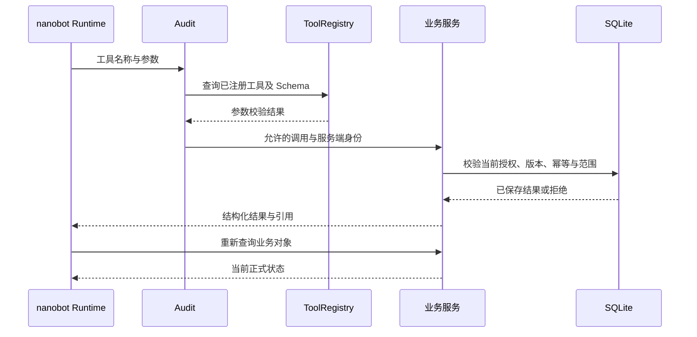

# 老板 Agent 运行设计

版本：0.1.0。日期：2026-10-23。任务 T07 / A07。状态 PENDING_T06。本文件依据当前 PRD V1.2.0、HLD 1.0.0、selection-probe 与基线 63e6295 的源码，记录当前可以核实的运行设计。正式 API、数据字典、事件 Schema 尚未交付，完整设计验收保持未完成；工具扩展等待 W1 确定版本。

## 主体与治理

唯一业务主体 `boss-1`；唯一 Agent 由 nanobot 0.3.5 的 AgentLoop 承载。MAINTAINER 维护技术配置；联系人只作为来源作者、收件人及负责人。模型为 DeepSeek `deepseek-flash`，协议 Chat Completions，thinking disabled。模型服务可用性需要真实请求验证。

| 层级 | 载体与加载 | 强制控制和验证 |
|---|---|---|
| Context | RuntimeContextBlock、已确认 memory、本人目标、有效 Prompt、当前任务输入 | 来源文本作为资料；执行空间、owner、版本可查；不加载评分答案 |
| Action | ToolRegistry、BusinessTool、业务服务 | 服务端白名单、参数 Schema、授权、幂等、当前对象及资料版本 |
| Skill | Prompt 配置及待 T06 接收后的 SOP/Skill 资产 | 技术方法不能产生本人授权；按任务选择有效版本 |
| Control | Audit 的 before_run、before_execute_tools、after_iteration、on_execute_tool_error；业务事务 | 无效工具及参数在执行前拒绝；模型及工具错误明确终止 |
| Isolation | 业务 execution_namespace、nanobot session、独立检查目录 | 不创建额外业务 Agent、部门账号或调度器；重置后的历史空间拒绝写入 |
| Verification | SQLite 重新查询、真实模型请求与独立业务断言 | 目录、启用、上下文加载、模型响应、业务状态、效果分别取证 |

本产品没有已实现的业务 Subagent 调度，不分配不存在的权限或后台代理。大型资料检索通过受限工具取得当前必要片段；开发窗口的 worktree 隔离与产品 Agent 机制分别管理。

## 上下文与缓存

稳定区域依次为系统职责、工具定义、当前有效技术方法与版本。动态区域包含 session、当前已确认记忆、本人目标、任务输入、获准资料与工具结果。实际 nanobot 序列化顺序及 DeepSeek 缓存命中需要请求证据，当前缓存收益与费用均为未知。

资料引用保留 source_id、version、原文位置、日期、权限范围及适用范围。资料缺少、冲突、撤销分别表达。历史会话文本不能作为当前来源有效性的证明。记忆只读取业务服务 `memory/current` 中 CONFIRMED 的当前版本；DELETED 不进入新任务。Dream 与自动 compact 按 HLD 关闭。历史决定保留当时版本引用，不能重新赋予已撤销资料当前效力。

Prompt 当前生命周期为草稿、静态校验、启用、停用。Runtime 使用 `load_runtime_prompts` 在同一 SQLite 事务选择并记录有效版本。上下文记录只有 identifier、摘要、时间和计数；加载记录不能证明模型遵从。进行中任务使用启动时取得的内容，业务写入前重新查询当前授权与对象版本。

压缩与续接须保留任务目标、资料引用、当前有效授权引用、已执行业务对象、未完成决定、错误和预算状态；不保存内部推理。会话内容与正式业务状态通过 identifier 查询关联。当前自动压缩保持关闭，不能宣称已有自动续接机制通过验收。

## 工具与业务采用

| 当前 tool_id | 输入输出的正式来源 | 权限、副作用及采用 |
|---|---|---|
| query_metrics | selection-probe 中同名 operation 的 input_schema/output_schema | 本人范围只读，业务程序执行 Decimal 计算；模型解释结果 |
| read_evidence | 同上 | 只读取当前范围的资料和明细；保留版本及原文定位 |
| create_assignment | 同上 | 当前本人授权及幂等键由服务端注入；保存后取得 task_id |
| send_assignment | 同上 | 当前内容、收件人及任务版本获准后写入模拟发件箱；不表示外部送达 |
| read_assignment | 同上 | 查询已保存任务与 message_ids；反馈和本人确认完成分别表达 |

BusinessTool.parameters 从成熟 JSON Schema 读取定义，模型不能填写 envelope、authorization_id、idempotency_key。Tool 执行结果来自业务 Store.invoke。当前 UI 业务 mutation 与模型 Tool 的覆盖不同，其他秘书能力尚需 T06/T16 映射，不把 UI 动作名称视作已注册模型工具。正式 operationId、错误码、事件和字段版本等待 T06，资产文件保留依赖状态。

## 十三类秘书 SOP

所有方法遵循输入完整性检查、当前资料查询、必要本人决定、获准执行、结果重读和后续复查。缺少必要条件进入等待，不能猜测授权或专业结论。

| SOP | 输入与资料 | 结果及结束条件 |
|---|---|---|
| SOP01 今日工作 | 本人目标、日历、承诺、有效事件、本人次序 | 有依据的事项排序；本人次序以业务服务保存结果为准 |
| SOP02 经营提醒 | 当前指标、规则、通知要求、已有交办 | 说明参与原因；知晓、暂缓、关闭分别保存，不能完成交办 |
| SOP03 经营查询 | 区域、产品、期间、单位、币种与明细 | 确定性数值、可复算明细、日期、来源和未知范围 |
| SOP04 会前准备 | 会议版本、参会人、历史承诺、资料 | 带出处的材料与缺口；会议信息变化后要求复核 |
| SOP05 会议纪要 | 获准会议记录、分类、决定与行动项 | 本人确认纪要；各项交办分别授权并查询结果 |
| SOP06 交办跟进 | 负责人、目的、期限、证据、反馈 | 延期需要本人决定；完成只能依据当前结果及本人确认 |
| SOP07 待审材料 | 申请与版本、材料、缺口、本人决定 | 保存当前版本的决定；不执行专业放行或资金交易 |
| SOP08 沟通 | 稳定联系人、收件人、草稿版本和授权 | 查询模拟发送记录；内容变化后重新确认 |
| SOP09 战略研究 | 问题、范围、截止日期、获准原文 | 引文与事实、意见、推断、待验证问题分别呈现 |
| SOP10 人员会面 | 联系人职责、目标、历史事实和承诺 | 会面问题与资料；同名人员必须按稳定 ID 确认 |
| SOP11 出行接待 | 目的、参与人、时间和 IANA 时区 | 冲突及影响、准备清单；日历变更取得当前授权 |
| SOP12 私人安排 | 本人私人内容、工作忙碌窗口、分享范围 | 正文访问受控；分享只包含获准忙碌信息 |
| SOP13 历史与记忆 | 本人当前确认、历史决定和有效引用 | 保存当前版本；修改删除后新会话及重启停止旧内容采用 |

十个农业专题使用相同老板主体和上述方法，保留来源作者与专业确认条件；肉禽、蛋禽、奶畜、肉用牛羊采用各自单位、阶段和观察期。确定性计算使用 W1 的 T13 接口。专题明细当前缺少，不能生成新的演示数值或专业结果。

## 预算、状态与终止

当前应用默认 maxToolIterations=12、maxTokens=4096；实际启用配置及 Runtime 快照为运行依据。RecordedProvider HTTP timeout=120 秒，max_retries=0。SDK 检查具有独立任务超时；正式产品总运行超时、Token 总预算、费用预算及无进展检测等待 T06/T16 明确定义与实现。未知预算不能被登记为已强制执行。

运行状态引用 PRD 的 QUEUED、RUNNING、WAITING_INPUT、SUCCEEDED、FAILED、CANCELED、TIMED_OUT，正式传输字段与事件顺序等待 T06。缺少必要输入停止依赖该输入的动作；参数或授权拒绝停止对应工具调用；模型错误保存真实失败；取消和超时停止后续调用。模型失败不能清除已经保存的业务结果，不得再次发送同一意图；不确定结果查询原请求回执及业务对象。

## 检索、摄取与语音

当前来源为已有获准 SIMULATED 资料；知识摄取维护作者、原文位置、版本和索引，FTS5 为当前检索基础。Markdown 文件使用 markdown-it-py；其他格式的成熟解析依赖与获准文件需要在实际接入时确定。Embedding 和 Reranker 尚未采用，不声明相关能力。公开原文摄取需保存来源许可、获取日期、有效范围与原文定位。

录音使用明确本人操作和系统权限，真实 STT 配置与录音当前缺少。转写文本由本人核查、修改或取消，确认后进入相同业务过程；转写响应不能自动授权发送。客户端当前限制 60 秒和 3MB；服务端限制、真实费用、取消与重复提交继续由 T20/W3 验证。原始录音与正文不进入维护诊断。

## 验证与交接

| 验证对象 | 必需证据与当前条件 |
|---|---|
| A07 | T05/T06 确定版本、全部 SOP/工具映射、独立语义审阅；当前 PENDING |
| A15 | 摄取、引文回查、更新撤销、删除、新会话和重启，维护拒绝正文 |
| A16 | 同初始条件两次真实 DeepSeek 多轮工具、写入重读、取消超时及写入后失败 |
| A19 | 十六类维护能力的配置保存、校验、启用、重读、新任务采用及权限拒绝 |
| A20 | 获准录音、真实转写、本人核查、重复提交、费用及后续业务 |
| A21a—A23d | 十个专题及四种禽畜用途，来源与独立复算、本人协调、反馈和复查 |

评分预期与独立断言保存在评测路径，不传入 Prompt、SOP、检索索引或工具描述。所有运行保存配置、模型、来源和代码版本，缺少用量或价格的总费用保持 null。T08 接收上下文展示与必要输入状态；T16 接收实际工具映射；T24 核查业务采用与完整异常。当前依赖和接入要求见各 Txx 主记录。
