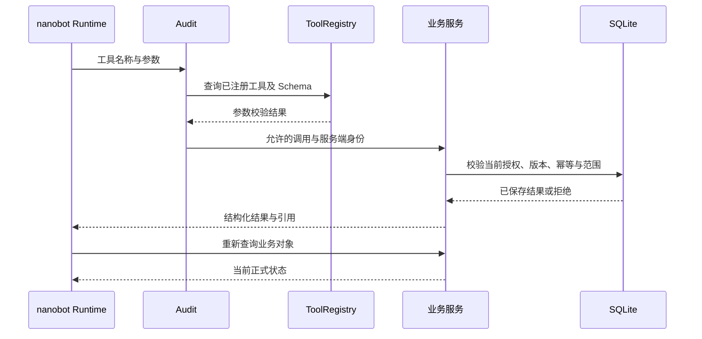

# 老板 Agent 运行设计

版本：0.5.0-draft。日期：2026-10-23。任务T07 / A07。状态PENDING_A06_A07_ACCEPTANCE。代码为W2提交1d13d77及本轮维护组件和规范接收修改，正式规范引用W1提交fc4b2b5e88f9178312f6a7116e160ceeb03e160b的T05/T06 1.4.1。输入SHA256由T07检查报告保存。Tool与会议独立领域检查已验证至5b34dcf/1.3.1；1.4.1复验因实际W1源码已有未提交修改停止在版本检查。公共应用接收、独立审查者签署及完整设计验收保持未完成。

## 主体与治理

唯一业务主体 `boss-1`；唯一 Agent 由 nanobot0.3.5的 AgentLoop 承载。MAINTAINER 维护技术配置；联系人只作为来源作者、收件人及负责人。模型为 DeepSeek `deepseek-flash`，协议 Chat Completions，thinking disabled。当前凭据已通过真实服务连通性与五工具任务检查，范围见 T16。

| 层级 | 载体与加载 | 强制控制和验证 |
|---|---|---|
| Context | RuntimeContextBlock、已确认 memory、本人目标、有效 Prompt、当前任务输入 | 来源文本作为资料；执行空间、owner、版本可查；不加载评分答案 |
| Action | ToolRegistry、BusinessTool、业务服务 | 服务端白名单、参数 Schema、授权、幂等、当前对象及资料版本 |
| Skill | Prompt配置及已映射业务操作的SOP/Skill设计资产 | 技术方法不能产生本人授权；完整Runtime注册及按任务采用待验证 |
| Control | Audit 的 before_run、before_execute_tools、after_iteration、on_execute_tool_error；业务事务 | 无效工具及参数在执行前拒绝；模型及工具错误明确终止 |
| Isolation | 业务 execution_namespace、nanobot session、独立检查目录 | 不创建额外业务 Agent、部门账号或调度器；重置后的历史空间拒绝写入 |
| Verification | SQLite 重新查询、真实模型请求与独立业务断言 | 目录、启用、上下文加载、模型响应、业务状态、效果分别取证 |

本产品没有已实现的业务 Subagent 调度，不分配不存在的权限或后台代理。大型资料检索通过受限工具取得当前必要片段；开发窗口的 worktree 隔离与产品 Agent 机制分别管理。

## 上下文与缓存

稳定区域依次为系统职责、工具定义、当前有效技术方法与版本。动态区域包含 session、当前已确认记忆、本人目标、任务输入、获准资料与工具结果。实际 nanobot 序列化顺序及 DeepSeek 缓存命中需要请求证据，当前缓存收益与费用均为未知。

资料引用保留 source_id、version、原文位置、日期、权限范围及适用范围。资料缺少、冲突、撤销分别表达。历史会话文本不能作为当前来源有效性的证明。记忆只读取业务服务 `memory/current` 中 CONFIRMED 的当前版本；DELETED 不进入新任务。Dream 与自动 compact 按 HLD 关闭。历史决定保留当时版本引用，不能重新赋予已撤销资料当前效力。

Prompt 当前生命周期为草稿、静态校验、启用、停用。Runtime 使用 `load_runtime_prompts` 在同一 SQLite 事务选择并记录有效版本。上下文记录只有 identifier、摘要、时间和计数；加载记录不能证明模型遵从。进行中任务使用启动时取得的内容，业务写入前重新查询当前授权与对象版本。

压缩与续接须保留任务目标、资料引用、当前有效授权引用、已执行业务对象、未完成决定、错误和预算状态；不保存内部推理。会话内容与正式业务状态通过 identifier 查询关联。当前自动压缩保持关闭，不能宣称已有自动续接机制通过验收。

## 工具与业务采用

| 当前 tool_id | 输入输出的正式来源 | 权限、副作用及采用 |
|---|---|---|
| query_metrics | selection-probe 中同名 operation 的 input_schema/output_schema | 本人范围只读，业务程序执行 Decimal 计算；模型解释结果 |
| read_evidence | 同上 | 只读取当前范围的资料和明细；保留版本及原文定位 |
| create_assignment | 同上 | 当前本人授权及幂等键由服务端注入；保存后取得 task_id |
| send_assignment | 同上 | 当前内容、收件人及任务版本获准后写入模拟发件箱；不表示外部送达 |
| read_assignment | 同上 | 查询已保存任务与 message_ids；反馈和本人确认完成分别表达 |

BusinessTool.parameters从成熟JSON Schema读取定义，模型不能填写envelope、authorization_id、idempotency_key。Tool执行结果来自业务Store.invoke。T06 1.3.1的x-tool-operations确定五项operationId及既有输入、输出、错误Schema和Store方法；agent-assets.json逐项匹配，没有新增模型Tool。query_metrics同事务保存query及query_source_binding；read_evidence重查当前访问范围、来源版本、完整元信息和明细摘要，版本或元信息变化、旧查询缺少绑定时返回409。调用方重新query_metrics取得新query_id后读取当前原文；WITHDRAWN/EXPIRED返回410，其他非当前状态409，范围或类型错误403。现有Audit遇到工具错误明确终止当前尝试，后续新请求才重新查询；不自动重放业务写入。

创建交办在实际业务事务校验来源、负责人及期限，并保存assignment_source_binding。发送和完成前重新检查创建时来源版本和完整摘要；缺少绑定或来源变化时返回409，要求本人核查。授权由Store.require_current_authorization检查owner、namespace、BOSS签发者、动作、目标、内容版本、完整参数、撤销和真实时间窗口。一份创建授权只产生一项任务，一份发送授权只产生一项发件箱结果；原请求和原内容读取已提交回执，不生成新执行。read_assignment返回原始Schema声明的字段，业务服务仍保留来源或纪要扩展字段。

具备RuntimeBinding时，BusinessTool将服务端请求及会话ID关联到业务envelope，保持原有owner、namespace和授权检查。经营查询和原文结果释放给模型前重新核查当前来源。新规则要求W3同时接收W1 5b34dcf的业务模块、W2实际Tool与Runtime模块，并在同一集成版本复验；本目录独立组合检查不表示现有公共Runtime已经使用1.3.1。当前UI mutation与模型Tool的覆盖不同，其余SOP操作仍需Runtime注册、服务端授权绑定及实际业务验证。

十三项 SOP 的后端操作引用维护在 `sop_backend_bindings`。每项包含读取和命令 operationId，结构检查同时查询 T06 的 HTTP、WebSocket 与 Tool 定义。DESIGN_ONLY 表示存在接口定义，尚未注册为模型 Tool。十四类模拟接口当前为 DESIGN_NOT_MOUNTED，各自资料缺口由 T06 记录；SI09/SI10 没有可用的获准业务资料，不能返回完整业务结果。

## 十三类秘书 SOP

所有方法遵循输入完整性检查、当前资料查询、必要本人决定、获准执行、结果重读和后续复查。缺少必要条件进入等待，不能猜测授权或专业结论。

| SOP | 输入与资料 | 结果及结束条件 |
|---|---|---|
| SOP01 今日工作 | 本人目标、日历、承诺、有效事件、本人次序 | 有依据的事项排序；本人次序以业务服务保存结果为准 |
| SOP02 经营提醒 | 当前指标、规则、通知要求、已有交办 | 说明参与原因；知晓、暂缓、关闭分别保存，不能完成交办 |
| SOP03 经营查询 | 区域、产品、期间、单位、币种与明细 | 确定性数值、可复算明细、日期、来源和未知范围 |
| SOP04 会前准备 | 会议版本、参会人、历史承诺、资料 | 带出处的材料与缺口；会议信息变化后要求复核 |
| SOP05 会议纪要 | 获准会议记录、分类、决定与行动项 | 本人确认纪要；各项交办分别授权并查询结果 |
| SOP06 交办跟进 | 负责人、目的、期限、证据、反馈 | 延期需要本人决定；完成只能依据当前结果及本人确认 |
| SOP07 待审材料 | 申请与版本、材料、缺口、本人决定 | 保存当前版本的决定；不执行专业放行或资金交易 |
| SOP08 沟通 | 稳定联系人、收件人、草稿版本和授权 | 查询模拟发送记录；内容变化后重新确认 |
| SOP09 战略研究 | 问题、范围、截止日期、获准原文 | 引文与事实、意见、推断、待验证问题分别呈现 |
| SOP10 人员会面 | 联系人职责、目标、历史事实和承诺 | 会面问题与资料；同名人员必须按稳定 ID 确认 |
| SOP11 出行接待 | 目的、参与人、时间和 IANA 时区 | 冲突及影响、准备清单；日历变更取得当前授权 |
| SOP12 私人安排 | 本人私人内容、工作忙碌窗口、分享范围 | 正文访问受控；分享只包含获准忙碌信息 |
| SOP13 历史与记忆 | 本人当前确认、历史决定和有效引用 | 保存当前版本；修改删除后新会话及重启停止旧内容采用 |

十个农业专题使用相同老板主体和上述方法，保留来源作者与专业确认条件；肉禽、蛋禽、奶畜、肉用牛羊采用各自单位、阶段和观察期。确定性计算使用 W1 的 T13 接口。专题明细当前缺少，不能生成新的演示数值或专业结果。

## 预算、状态与终止

当前应用默认 maxToolIterations=12、maxTokens=4096；实际启用配置及 Runtime 快照为运行依据。RecordedProvider HTTP timeout=120 秒，max_retries=0。SDK 检查具有独立任务超时；正式产品总运行超时、Token 总预算、费用预算及无进展检测等待 T06/T16 明确定义与实现。未知预算不能被登记为已强制执行。

运行状态引用PRD的QUEUED、RUNNING、WAITING_INPUT、SUCCEEDED、FAILED、CANCELED、TIMED_OUT。T06事件1.4.1描述webui_response、message、delta、stream_end、turn_end、recovery_state、retry_status、context_compaction；request_id关联传输回执，chat_id/turn_id/stream_id关联上游会话与回答片段，client_request_id关联业务幂等。没有全域sequence，断线后通过持久会话及原请求回执查询，不能直接重放写入。

SDK 的 completed 只说明模型运行结束，error 和 max_iterations 各自保存原因；显式取消表现为 CancelledError，外部任务超时表现为 TimeoutError。当前真实检查覆盖这些行为，见 T16。runtime_run 的 run_id、配置版本、用量及业务结果引用仍需 W3 与实际持久运行记录关联；不能根据 UI 文本生成正式状态。缺少必要输入停止依赖该输入的动作；参数或授权拒绝停止对应工具调用；模型错误保存真实失败；取消和超时停止后续调用。模型失败不能清除已经保存的业务结果，不得再次发送同一意图；不确定结果查询原请求回执及业务对象。

`boss_runtime_records.RuntimeRecorder` 使用当前SQLite的objects/runtime_run保存技术观察。context在同一事务核查当前配置、实际模型参数、已注册工具范围及有效Prompt版本，再提供当前任务上下文。hook_factory只读取服务端RequestContext.attributes中的RuntimeBinding；observe_transport将每次真实HTTP请求、服务响应ID、完整已观察用量和工具定义摘要关联到该运行。模型请求ID与业务request_id分别保存，服务响应头request_id保留原意。工具实现使用实际源码SHA256标识，不保存指令正文、原始参数或模型回答。

每个新任务重新核查配置；未实际采用的新配置导致拒绝。进行中任务保留启动时Prompt快照；工具定义在执行中变化时明确拒绝。真正的外部deadline由调用方提供deadline_expired回调，保留SDK的cancelled原因并标记TIMED_OUT；没有该实际条件时记为CANCELED。产品总预算仍未定义，不根据这项能力声明已经强制执行。失败和取消的全部计费用量未知时cost_total保持null；用量范围明确为HTTP_REQUESTS_OBSERVED_ONLY。WAITING_INPUT需明确服务端输入等待事件，当前不能从模型文字推断。

获准原文的新Runtime已实际确认当前Prompt、配置版本和工具定义进入请求；领域检查确认真实业务query_id及请求身份关联。当前新增运行记录的四项真实异常均已通过，覆盖写入后模型失败保留OPEN任务、CANCELED、TIMED_OUT及max_iterations，并重开数据库验证。取消和超时请求缺少完整用量时保持PARTIAL及费用null。公共application、RoleChannel、运行页面投影及扩展数据字段由W3/W1接收，具体接口、身份与验证入口见T16/T19。

`runtime_records_query.read_runtime_records`提供技术元信息的受控查询，校验角色、执行空间、参数及RFC3339范围，在全部记录内筛选后使用真实started_at/run_id游标分页。`MaintainerRuntimeRecords`提供A15独立内容组件，包含实际筛选、列表、记录详情、配置和工具版本、业务对象引用、用量及覆盖范围；取消仅中止读取。五组真实DOM与只读API检查通过，输入来自实际DeepSeek运行SQLite，没有新增模型请求或业务对象。完整桌面入口、RoleChannel、关联任务操作与视觉验收继续待W3接入验证。

`boss_memory_runtime.OwnerMemoryContext` 在一致读取事务中复用W1 1.3.1的confirmed_memory，核查当前记忆与确认授权。记忆原记录及历史仍保留，已撤销确认不进入新任务；新的本人确认采用新的版本。Provider只向本人上下文提供有效正文，并将不含正文的boss_memory_reference放入服务端RequestContext.attributes供RuntimeRecorder关联。MAINTAINER只读取同一判断产生的future_context_eligible。获准样本的确认有效、撤销后停止采用及新确认后三个独立Runtime均已通过真实DeepSeek检查，见T19；不能扩大为历史会话清理或物理擦除通过。

## 检索、摄取与语音

当前来源为已有获准 SIMULATED 资料；知识摄取维护作者、原文位置、版本和索引，FTS5 为当前检索基础。Markdown 文件使用 markdown-it-py；其他格式的成熟解析依赖与获准文件需要在实际接入时确定。Embedding 和 Reranker 尚未采用，不声明相关能力。公开原文摄取需保存来源许可、获取日期、有效范围与原文定位。

`boss_source_policy.source_validity(document, business_at)` 使用当前执行空间的业务时钟检查来源。`valid_from` 未提供时，发布日期作为可采用时间下界；`valid_until` 为排除结束边界。日期使用当前业务时区零点，时间必须包含时区。未来来源为 RECEIVED，到期来源为 EXPIRED，明确的 INCOMPLETE/CONFLICTED/SUPERSEDED/WITHDRAWN 不参与当前事实依据；未知状态和非法时间明确报错。该政策只处理来源有效性，身份、owner、来源类型与版本仍由调用处验证。

当前研究输出将 VALID 原文放入 matched_sources，冲突原文放入仅供本人核查的 conflicted_sources，失效元信息放入 source_issues；冲突原文的 eligible_as_current_evidence=false。事实确认仍为空值。Prompt 的保存、校验、启用和下一任务选择采用相同有效性政策；技术诊断只返回版本及排除原因，不返回正文或增加采用计数。W1/W3 需要在公共来源检查、受控检索、会前材料和会面资料中采用相同规则，并维护新增有效期/状态字段与研究投影规范。

`boss_agent_read_tools.BossResearchSourcesTool` 将已准备研究的当前引用提供给模型，operationId为bossWorkspaceRead，projection仅允许research，角色仅允许BOSS。工具从实际页面服务重新读取，输出不包含联系人、个人记忆或其他投影。获准finance-note的DeepSeek真实检查覆盖原始版本、更新版本、明确冲突及撤销后四个独立Runtime和新会话，全部通过；原始证据见T15。公共Runtime注册和应用重启验收由W3完成，不能根据独立检查登记公共入口已启用。

五项Tool与十三项SOP的语义核对见 `evidence/T07/w2-20261023-semantic-review.md`。既有真实模型记录的28项Tool结果通过1.3.1声明Schema校验；W2 Adapter与W1确定源码的独立实际调用已通过旧查询409、新查询版本2、六种非当前来源拒绝、缺少绑定拒绝、授权一次使用、原回执及交办来源变化停止发送。实际当前会议四动作和五个读取投影同样通过。新增组合检查没有发送模型请求，不扩展为全部SOP已被模型采用。四种TypedDict事件已匹配安装版本字段，公共事件流、内部推理过滤与持久运行关联继续由W3验证。

录音使用明确本人操作和系统权限。用户已提供 Doubao 凭据引用，`boss_transcription.DoubaoTranscriptionProvider` 使用已核查的官方极速版 HTTP 接口及 `volc.bigasr.auc_turbo`，音频通过 base64 直接提交。FFmpeg 解码和重采样，标准 wave 库封装 WAV；服务端核查源文件3MB、解码时长60秒、15秒解码超时及90秒请求超时，没有自动重试。凭据与文字不进入对象展示，未知费用保持 null。用户授权选择公开真实语音样本验证服务，实际转写与公开应用接入继续分别验证。

转写文本由本人核查、修改或取消，确认后进入相同业务过程；转写响应不能自动授权发送。客户端当前限制60秒和3MB。W3 接入保持已认证 BOSS 身份、录音授权、取消传播、资源释放及重复提交检查。原始录音与正文不进入维护诊断。

## 验证与交接

| 验证对象 | 必需证据与当前条件 |
|---|---|
| A07 | T05/T06 确定版本、全部 SOP/工具映射、独立语义审阅；当前 PENDING |
| A15 | 摄取、引文回查、更新撤销、删除、新会话和重启，维护拒绝正文 |
| A16 | 同初始条件两次真实 DeepSeek 多轮工具、写入重读、取消超时及写入后失败 |
| A19 | 十六类维护能力的配置保存、校验、启用、重读、新任务采用及权限拒绝 |
| A20 | 获准录音、真实转写、本人核查、重复提交、费用及后续业务 |
| A21a—A23d | 十个专题及四种禽畜用途，来源与独立复算、本人协调、反馈和复查 |

评分预期与独立断言保存在评测路径，不传入 Prompt、SOP、检索索引或工具描述。所有运行保存配置、模型、来源和代码版本，缺少用量或价格的总费用保持 null。T08 接收上下文展示与必要输入状态；T16 接收实际工具映射；T24 核查业务采用与完整异常。当前依赖和接入要求见各 Txx 主记录。
