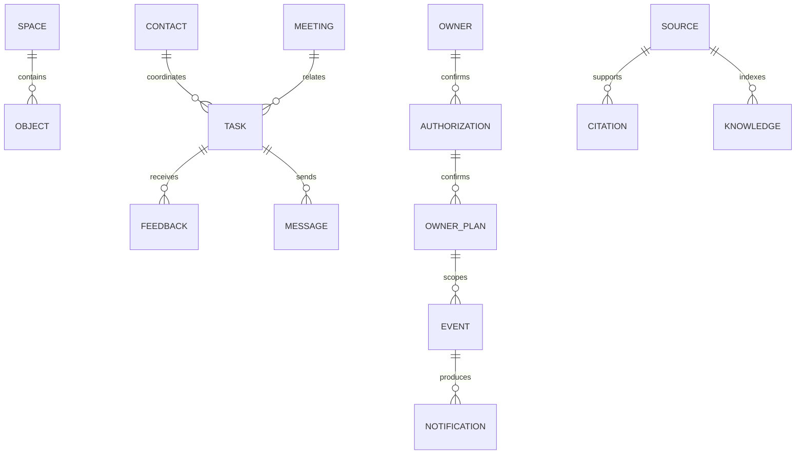

# Boss-Agent 数据设计

版本 `1.0.0-draft`；2026-10-23；T05/A05；依据 PRD V1.2.0、HLD 1.0.0、共同代码 `63e6295`。字段清单为 `specs/data-dictionary.json`。本文件为 DESIGN，A05 尚未通过；新增领域行为以 T17/T18 的真实检查为依据。

## 数据归属与物理存储

同一老板的正式业务状态由 `business.Store` / `controls.ControlStore` 维护。nanobot SessionManager 维护会话，不修改任务终态。运行身份由 RoleChannel 验证，联系人没有认证字段。

| 物理表 | 主键与列 | 职责 |
|---|---|---|
| objects | `(namespace TEXT, kind TEXT, id TEXT)`；body TEXT NOT NULL | JSON 业务对象，按领域 kind 区分；使用 json 库读写 |
| spaces | namespace TEXT PRIMARY KEY；active INTEGER；snapshot TEXT | 空间身份、有效状态、初始快照 SHA256 |
| idempotency | `(namespace, operation, key)`；digest TEXT；result TEXT | 相同请求与相同内容读取原结果；不同内容拒绝 |
| audit | id INTEGER PRIMARY KEY；namespace、operation、input、output、created_at TEXT | 技术元信息；禁止私人正文、凭据和内部推理 |
| knowledge | FTS5(namespace UNINDEXED, source_id UNINDEXED, content) | 按空间检索获准原文；撤销同事务删除对应索引 |

`objects` 复合主键支持当前按空间/类别/ID读取；新增查询索引须取得实际查询计划和容量依据。没有既有证据时不设置吞吐、恢复时间或留存达标结论。数据库连接超时10秒，启用 WAL 和 foreign_keys；JSON 关系仍需领域服务明确校验。

## 实体与关联

owner_id 固定绑定当前空间的 initial/snapshot，不能信任浏览器输入。dataset_id/version 与 namespace 保持独立：相同获准事实可以用于不同空间，业务动作与运行历史不能混用。每个领域对象以稳定 ID 关联，version 使用十进制字符串；版本增加只发生于已提交事务。当前部分对象从 initial/snapshot 继承 owner/dataset，完整产品写入须补足归属检查，不能把缺少字段当作跨空间许可。

| 对象 | 当前位置 | 生命周期与使用方 |
|---|---|---|
| 老板档案 | initial/snapshot.boss_profile | 初始资料仅为样本；本人目标通过 owner_goals_draft/active 确认后采用 |
| 联系人 | initial/snapshot.contacts | contact_id、职责及有效期；同名保持不同 ID；F08/F10 和工具检查 |
| 本人设置 | owner_goals_*、owner_notice_* | 草稿、确认、替代、到期；撤销确认授权后停止当前采用 |
| 授权 | authorization | action、target_id、content_version、scope、payload、valid_from/until、revoked；保存决定与将来持续采用分别校验 |
| 交办 | task、feedback、outbox | OPEN→WAITING_FEEDBACK→IN_PROGRESS/RESULT_SUBMITTED；本人完成或取消终止催办；延期申请独立 |
| 本人承诺 | self_commitment、self_commitment_revision | ACTIVE→COMPLETED_CONFIRMED/CANCELED；独立于对他人交办 |
| 会议 | initial/snapshot.meeting、meeting_brief、meeting_minutes | 日程、会前材料、纪要和逐项交办分别保存；当前资料版本变化要求复核 |
| 审批 | application、application_revision、application_decision | 材料缺少、待决定、本人决定分别维护；不执行资金或专业放行 |
| 消息 | message_draft、message、outbox、message_reply | 草稿、模拟发送、送达与回复分别维护，使用 stable recipient_id 和正文版本 |
| 私人安排 | private_calendar、calendar_share | 正文 BOSS_ONLY；busy 分享只含获准字段；当前授权撤销后预览拒绝 |
| 研究/会面/行程 | research、people、travel 相关领域对象 | 原文版本、对象与范围由现有领域处理函数维护；所有字段仍需逐项纳入正式字典 |
| 知识 | document、knowledge | 作者、来源属性、原文位置、版本、有效时间和撤销；FTS5 只承载索引 |
| 个人记忆 | memory/current | PROPOSED/CONFIRMED/SUPERSEDED/DELETED；删除停止新任务采用，历史决定不反向改变 |
| 技术调度 | schedule、rules、scheduler_draft | 维护配置保存/校验/启用分别记录；CronService 唯一执行 |
| 本人计划 | owner_plan、owner_plan_revision | ACTIVE/PAUSED/CANCELED；event_ids 与 event_versions 绑定；取消保留历史 |
| 事件与通知 | event、reminder、dispatch、delivery、notification | 业务事件状态、提醒处理与内部通知保存分别维护；去重按 event_id/version |
| 今日次序 | today_order，以业务日期为 ID | 完整当前事项 ID 集合；snapshot_sha256 和 expected_version 同时校验；重启后采用 |
| 查询 | query | 公式版本、明细引用、参数、原始精度和来源时效；参数改变重新查询 |

表内未展开的已有领域对象表示字典仍需补充，不能据此宣布 A05 完成。

## 数值、单位、期间与农业关系

金额和数量以十进制字符串传输，计算使用 Decimal；JSON number 不承载财务原始精度。CNY 金额、吨数量与 CNY/吨分开；零值有明确来源时保留，缺少值为 null。比率通过汇总分子分母计算，分母为零返回未定义，禁止平均分组比率。展示舍入不能覆盖原始结果。百分点变化为两个百分数直接相减，增长率为 `(current-base)/base*100`，零基期返回 null。

现有获准经营明细仅包含 region-1、product-1/2、两个十日期间、EXTERNAL_SALES、CNY。现有期间与单位边界继续显式验证。新增事实须附来源和许可，不能增加合成农业数据。

农业正式模型必须保留 legal_entity_id、customer_id、ownership_type、asset_owner_id、cost_owner_id、species、purpose、stage、unit_id、batch_id、cycle_id、transfer_id、parent_batch_id、source_id/version。数量转移使用独立关系记录，不按相同名称推断；自营、客户及合作数量与费用分列。FR-19 分别使用 BROILER、EGG、MILK、BEEF，指标及阶段不可互换。内部耗用与外销使用 trade_type 区分。质量状态、结算状态和专业确认状态分别保存。

海外金额同时保存 amount_local/currency、exchange_rate、exchange_rate_date、exchange_rate_source/version、amount_reporting；汇率缺少时折算金额为 null。产能按工段/产品/期间匹配。试验保存 treatment/control、sample_size、denominator、observation_window、conditions、review_source，缺少对照时不能形成确定效果。

## 时间与生命周期

| 字段 | 含义 |
|---|---|
| observed_at | 原始观察发生时间 |
| received_at | 本服务收到资料的真实时间 |
| published_at | 作者发布时间 |
| valid_from / valid_until | 资料或授权可采用区间 |
| business_at / clock.at | 获准模拟业务时间 |
| created_at / updated_at / read_at | 实际运行时间，含时区 ISO8601 |
| due_at / not_before | 业务期限或本人计划最早执行时间，保留 IANA timezone |

时区转换使用 datetime/ZoneInfo。没有结束时间时，冲突范围为未知；不能补造完整会议时长。当前本人计划配置限于已经验证的 Asia/Shanghai 事件/时间条件，完整晨间模型执行尚需 W2/W3 接入。

资料更新形成新版本并使旧引用 NEEDS_REVIEW；撤销在同一事务移除索引，查询和新上下文排除正文。保留当时版本引用和必要元信息；删除后的资料不能通过重启或备份恢复重新启用。当前通用上下文与 memory 的撤销传播仍需 W2/W3 共同核查。

## 检索与存储适用性

关系查询与事务采用 SQLite；关键词检索使用已有 FTS5。向量召回和 Reranker 尚无已验证服务，保持未采用；不能宣称已有语义召回。批次关系用显式关系字段和关系表表达，当前规模无独立图数据库依据。新增 Embedding/图数据库须分别完成许可、隐私、删除传播及真实召回检查；不能用存储数量代替业务完整性。

## 事务、重置与恢复

所有写入在 BEGIN IMMEDIATE 内读取空间有效性、幂等回执、当前对象和授权，再保存对象、关联、授权、回执及最小审计。CAS 失败拒绝，不重复执行。原请求回执读取不产生新授权或动作。本人计划与技术调度采用同一数据库和唯一派发函数。

重置创建新 namespace 并将旧空间设为 inactive；当前 initial_materials 的 generator_version、seed 和 snapshot_sha256 作为获准初始事实版本。历史空间继续只读归属；旧请求不能修改新空间。旧库迁移前使用 SQLite backup API 产生权限受控备份，并核对 namespace、snapshot、对象数量、撤销标识及 integrity_check。当前新增对象 kind 无 DDL 迁移；现有库不会自动创建业务计划或本人次序。回退代码只通过文件编辑，数据恢复仍须验证删除和撤销记录。

## 全部需求的数据责任

R01—R13 分别由今日投影/计划、事件通知、query 明细、meeting_brief、meeting_minutes、task/feedback、application_decision、message/contacts、document/research、contacts/people、travel/calendar、private_calendar/share、memory/历史决定承载。

R14—R23 分别要求原料合同与库存/配方、季节与养殖周期、苗种批次/运输接收、专业观察确认、生猪同周期结算、四种禽畜用途、养殖单元/设备关系、食品加工追溯、海外币种工段、研发对照评审。当前获准明细不足，新增关系 Schema 与来源核查继续由 T12/T21—T23 完成。

R24 为 nanobot run/session/tool 和配置引用；R25 为 space/initial/clock/event/reset；R26 为角色投影；R27 为真实 STT 记录；R28 为 authorization/source scope；R29 为版本、幂等和原请求回执；R30 为真实时间/usage/price version；R31 为独立验收记录；R32 为源码/数据/迁移/恢复身份。真实 STT、完整 Runtime、专题数据、全域字段枚举及迁移恢复检查尚未完成，A05 保持未验收。
