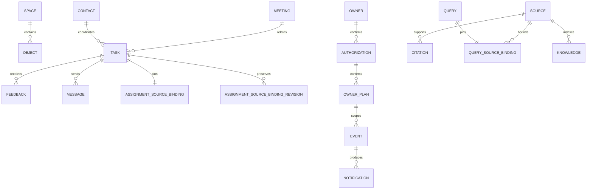
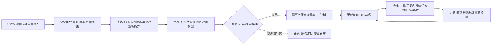

# Boss-Agent 数据设计

版本 `1.6.0`；2026-10-23；T05/A05；依据PRD V1.2.0、HLD1.0.0、共同代码63e6295。字段清单为specs/data-dictionary.json，状态FROZEN_FOR_IMPLEMENTATION，供W2/W3引用。本文件为DESIGN，A05尚未通过；字段版本固定与正式业务验收分别管理，新增行为以T12/T13/T14/T17/T18检查为依据。

## 数据归属与物理存储

同一老板的正式业务状态由 `business.Store` / `controls.ControlStore` 维护。nanobot SessionManager 维护会话，不修改任务终态。运行身份由 RoleChannel 验证，联系人没有认证字段。

| 物理表 | 主键与列 | 职责 |
|---|---|---|
| objects | `(namespace TEXT, kind TEXT, id TEXT)`；body TEXT NOT NULL | JSON 业务对象，按领域 kind 区分；使用 json 库读写 |
| spaces | namespace TEXT PRIMARY KEY；active INTEGER；snapshot TEXT | 空间身份、有效状态、初始快照 SHA256 |
| idempotency | `(namespace, operation, key)`；digest TEXT；result TEXT | 相同请求与相同内容读取原结果；不同内容拒绝 |
| audit | id INTEGER PRIMARY KEY；namespace、operation、input、output、created_at TEXT | 技术元信息；禁止私人正文、凭据和内部推理 |
| knowledge | FTS5(namespace UNINDEXED, source_id UNINDEXED, content) | 按空间检索获准原文；撤销同事务删除对应索引 |

`objects` 复合主键支持当前按空间/类别/ID读取；新增查询索引须取得实际查询计划和容量依据。没有既有证据时不设置吞吐、恢复时间或留存达标结论。数据库连接超时10秒，启用 WAL 和 foreign_keys；JSON 关系仍需领域服务明确校验。

## 实体与关联

owner_id 固定绑定当前空间的 initial/snapshot，不能信任浏览器输入。dataset_id/version 与 namespace 保持独立：相同获准事实可以用于不同空间，业务动作与运行历史不能混用。每个领域对象以稳定 ID 关联，version 使用十进制字符串；版本增加只发生于已提交事务。当前部分对象从 initial/snapshot 继承 owner/dataset，完整产品写入须补足归属检查，不能把缺少字段当作跨空间许可。

| 对象 | 当前位置 | 生命周期与使用方 |
|---|---|---|
| 老板档案 | initial/snapshot.boss_profile | 初始资料仅为样本；本人目标通过 owner_goals_draft/active 确认后采用 |
| 联系人 | initial/snapshot.contacts | contact_id、职责及有效期；同名保持不同 ID；F08/F10 和工具检查 |
| 本人设置 | owner_goals_*、owner_notice_* | 草稿、确认、替代、到期；撤销确认授权后停止当前采用 |
| 授权 | authorization | action、target_id、content_version、scope、payload、valid_from/until、revoked；保存决定与将来持续采用分别校验 |
| 交办 | task、feedback、outbox | OPEN→WAITING_FEEDBACK→IN_PROGRESS/RESULT_SUBMITTED；本人完成或取消终止催办；延期申请独立 |
| 本人承诺 | self_commitment、self_commitment_revision | ACTIVE→COMPLETED_CONFIRMED/CANCELED；独立于对他人交办 |
| 会议 | initial/snapshot.meeting、meeting、meeting_draft、meeting_brief、minutes | 初始来源、当前安排与待确认草稿分别保存；会前材料、纪要和逐项交办引用当前会议版本 |
| 审批 | application、application_revision、application_decision | 材料缺少、待决定、本人决定分别维护；不执行资金或专业放行 |
| 消息 | message_draft、message、outbox、message_reply | 草稿、模拟发送、送达与回复分别维护，使用 stable recipient_id 和正文版本 |
| 私人安排 | private_calendar、calendar_share | 正文 BOSS_ONLY；busy 分享只含获准字段；当前授权撤销后预览拒绝 |
| 研究/会面/行程 | research、person_brief、travel_plan | 字典定义原文版本、引用、当前内容、待确认方案、有效性与关联会议；正文BOSS_ONLY |
| 知识 | document、knowledge | 作者、来源属性、原文位置、版本、有效时间和撤销；FTS5 只承载索引 |
| 个人记忆 | memory/current | PROPOSED/CONFIRMED/SUPERSEDED/DELETED；删除停止新任务采用，历史决定不反向改变 |
| 技术调度 | schedule、rules、scheduler_draft | 维护配置保存/校验/启用分别记录；CronService 唯一执行 |
| 本人计划 | owner_plan、owner_plan_revision | ACTIVE/PAUSED/CANCELED；event_ids 与 event_versions 绑定；取消保留历史 |
| 事件与通知 | event、reminder、dispatch、delivery、notification | 业务事件状态、提醒处理与内部通知保存分别维护；去重按 event_id/version |
| 今日次序 | today_order，以业务日期为 ID | 完整当前事项 ID 集合；snapshot_sha256 和 expected_version 同时校验；重启后采用 |
| 查询 | query | 公式版本、明细引用、参数、原始精度和来源时效；参数改变重新查询 |
| 查询来源绑定 | query_source_binding，以query_id为ID | 与query同一事务保存owner/dataset、来源版本/完整JSON摘要及每项明细摘要；读取当前原文前逐项验证 |
| 交办来源绑定 | assignment_source_binding，以task_id为ID | 与交办同一事务保存owner/dataset、来源版本和完整摘要；纪要产生的交办另保存原始纪要来源摘要，发送或完成前重验 |

字典同时定义本人目标/通知、Prompt、配置、查询、本人计划和今日次序。Runtime记录接收W2的RuntimeRecorder实际生产字段，规范为runtime-records.schema.json；voice_transcript引用W2现有TranscriptionResult，产品核查和确认字段等待对应业务接口。修订对象复用原实体字段，仍保留原版本和归属。

运行观察保存在objects/runtime_run，以run_id为ID、namespace为执行范围。SessionManager继续独立维护获准会话正文；Runtime记录及BOSS/MAINTAINER读取投影只含技术元信息。request_id_source区分MESSAGE、TURN及SERVER_GENERATED，chat_id/turn_id保持真实可空状态，不把运行UUID当作传输编号。configuration_id/version、实际runtime参数、Prompt版本/摘要、Tool Schema及实现摘要在创建时记录；model_requests保存真实请求摘要、HTTP状态、服务响应ID、用量和结束原因；tool_results保存已重读确认存在的query/task/outbox引用。

memory_reference由当前OwnerMemoryContext提供记忆ID、版本、确认状态及采用资格，没有提供器时显式为null；不保存正文。当前生产者使用CurrentRuntimeRun并保存dataset_id/version及memory_reference；读取既有记录使用RuntimeRun，旧记录缺少这些字段时保持缺少，不能从当前配置推测历史采用。数据集字段成对出现。source_type=RUNTIME_RECORD属于读取投影，objects中的原始运行对象没有此字段。

status来自实际Hook；SUCCEEDED只表示SDK正常结束，独立业务完成继续查询业务对象。WAITING_INPUT需要明确服务端等待事件，当前没有基于回答文字的自动状态。finished_at为终态实际时间，外部deadline确实到期时termination_source为CALLER_DEADLINE_EXPIRED。usage按实际已观察请求汇总，缓存Token缺少时保持未知；COMPLETE_OBSERVED_REQUESTS只说明已观察请求的覆盖，model_attempts_coverage明确为HTTP_REQUESTS_OBSERVED_ONLY。未核查价格和全部尝试时cost_total/price_version为null。上述字段与原始证据对应，不能推定完整费用、模型质量或企业收益。

会议采用当前对象覆盖读取，`meeting_materials(db,data)`保留原始snapshot并校验当前meeting的owner_id和meeting_id。既有数据库没有meeting对象时使用原始会议，投影标记DRAFT和未知结束时间；首次确认安排才写入当前对象及meeting_revision。meeting_draft具有独立版本，保存和修改不改变当前会议。确认时绑定会议/草稿版本、联系人、来源内容与版本、私人占用、已确认行程及缓冲、业务时钟；变化后停止采用旧核查结果。HELD/CANCELED保持终态；取消不改变独立交办和历史消息。全部新增对象继续受namespace隔离和SQLite同一事务约束。

个人记忆采用读取在同一SQLite只读事务中检查当前版本及对应确认授权。既有确认事务把memory_id作为target_id，授权content_version/expected_version保存前置版本，当前记忆保存递增版本；这些字段与owner、scope和BOSS身份共同确定唯一对应确认。撤销后停止新上下文采用，原CONFIRMED状态、正文和历史决定保留。新确认递增版本，只采用新版本对应的确认；显式authorization_id存在时还需相同标识。初始获准记忆继续保留原始来源确认，独立验证入口的直接维护与产品新增确认分别管理。

本人目标与通知采用在调用方当前namespace读取active、authorization、clock及采用记录。读取前检查spaces.active；确认授权的owner、scope、BOSS身份和签发者、动作、target、前置active版本、draft版本及content_sha256必须与当前对象逐项相符，摘要同时验证完整content。业务有效期和撤销控制后续采用，原提交窗口到期不取消已确认持续设置。Runtime上下文采用记录也保存在当前namespace，重置后不采用旧空间设置或增加旧空间采用次数。唯一通知调度传入其当前namespace，保持技术规则与本人规则的独立作用。

来源有效性采用W2的`source_validity(document,business_at)`，接收来源为提交`224fbe00b03df312791856f3e76850cd55baa848`中的`validation/boss_source_policy.py`，SHA256为`6565c180348dc23f60c80e9b4947ab4e46c1e4a83a0fd0ee22d2d1bd0d681896`，维护责任为W2。W1的`require_current_simulated_source`同时检查当前老板访问范围、当前获准SIMULATED类型及有效状态。只有VALID进入当前引用；WITHDRAWN/EXPIRED停止采用，其他非当前状态要求复核。日期精度按来源保留，日期端点使用当前业务时间的时区解释；valid_until可空，缺少终点明确显示未知。

当前五项Tool保持原输入与结果字段。query_metrics将来源实际版本、定位和当前版本声明的发布时间写入来源结果，business_as_of由获准CURRENT期间终点与初始档案的时区计算；read_at始终为实际读取时间。source_updated_at对应该当前版本声明的published_at，不把读取时间作为来源更新时间。query_source_binding保存完整document和实际明细的SHA256；read_evidence在当前事务中重验访问范围、有效性、版本和摘要，来源或明细改变后要求重新查询。旧库查询缺少绑定时明确返回409；不会根据当前内容为旧查询补造历史绑定。

assignment_source_binding与新交办在同一事务保存；确认纪要产生的交办还保存origin_source的标识、版本和完整摘要。本人通过AssignmentSourcesAPI独立复核后，以当前完整来源更新采用绑定，并把实际存在的旧绑定保存在assignment_source_binding_revision；缺少旧绑定时不生成历史版本。复核绑定保存本次授权、确认时间、递增后的任务版本、核查摘要、本人依据及已知前版摘要。当前task.source_versions表示本人当前确认采用范围；task.origin_source_version继续表示原始纪要创建任务时的历史版本，当前纪要来源采用binding.origin_source。复核不修改纪要、目的、期限、负责人、业务状态、反馈证据及已发消息。备份恢复逐对象保留绑定及撤销状态；旧结果证据仍需独立重新提交。read_assignment只输出原始Tool声明字段，服务端扩展记录继续保存。

反馈在提交时另存evidence_versions、evidence_fingerprints和evidence_states，覆盖每项evidence_refs；新增反馈在当前事务检查来源，普通反馈只能采用当前有效资料。取消后的迟到反馈可保留失效证据的实际标识与当时状态，类型、source_id和owner范围仍需相符，historical_only保持true。完成决定同时核查交办创建时来源及结果提交时证据，不能用较新的同名资料代替旧证据。旧结果缺少完整证据绑定时409，重新提交产生独立feedback_id并保留原记录。

模拟申请附件的published_at记录该模拟版本的实际生成时间，valid_from采用当次模拟业务时钟，valid_until未知时为null；新版本独立记录这些字段，旧版本保持历史。VALID表示当前材料可读取，资金执行、申请批准和专业确认仍使用各自独立状态。会前材料保存来源完整摘要和有效时间，来源到期或同版本元信息变化时显示NEEDS_REVIEW，并停止返回旧引用正文及旧指标缓存。

## 数值、单位、期间与农业关系

金额和数量以十进制字符串传输，计算使用 Decimal；JSON number 不承载财务原始精度。CNY 金额、吨数量与 CNY/吨分开；零值有明确来源时保留，缺少值为 null。比率通过汇总分子分母计算，分母为零返回未定义，禁止平均分组比率。展示舍入不能覆盖原始结果。百分点变化为两个百分数直接相减，增长率为 `(current-base)/base*100`，零基期返回 null。

现有获准经营明细仅包含 region-1、product-1/2、两个十日期间、EXTERNAL_SALES、CNY。现有期间与单位边界继续显式验证。新增事实须附来源和许可，不能增加合成农业数据。

农业正式模型必须保留 legal_entity_id、customer_id、ownership_type、asset_owner_id、cost_owner_id、species、purpose、stage、unit_id、batch_id、cycle_id、transfer_id、parent_batch_id、source_id/version。数量转移使用独立关系记录，不按相同名称推断；自营、客户及合作数量与费用分列。FR-19 分别使用 BROILER、EGG、MILK、BEEF，指标及阶段不可互换。内部耗用与外销使用 trade_type 区分。质量状态、结算状态和专业确认状态分别保存。

海外金额同时保存 amount_local/currency、exchange_rate、exchange_rate_date、exchange_rate_source/version、amount_reporting；汇率缺少时折算金额为 null。产能按工段/产品/期间匹配。试验保存 treatment/control、sample_size、denominator、observation_window、conditions、review_source，缺少对照时不能形成确定效果。

## 时间与生命周期

| 字段 | 含义 |
|---|---|
| observed_at | 原始观察发生时间 |
| received_at | 本服务收到资料的真实时间 |
| published_at | 作者发布时间 |
| valid_from / valid_until | 资料有效区间与授权提交窗口；持续设置另以当前对象的业务期限、状态和撤销控制 |
| business_at / clock.at | 获准模拟业务时间 |
| created_at / updated_at / read_at | 实际运行时间，含时区 ISO8601 |
| due_at / not_before | 业务期限或本人计划最早执行时间，保留 IANA timezone |

时区转换使用 datetime/ZoneInfo。没有结束时间时，冲突范围为未知；不能补造完整会议时长。当前本人计划配置限于已经验证的 Asia/Shanghai 事件/时间条件，完整晨间模型执行尚需 W2/W3 接入。

资料更新形成新版本并使旧引用 NEEDS_REVIEW；撤销在同一事务移除索引，查询和新上下文排除正文。保留当时版本引用和必要元信息；删除后的资料不能通过重启或备份恢复重新启用。当前通用上下文与 memory 的撤销传播仍需 W2/W3 共同核查。

## 检索与存储适用性

关系查询与事务采用 SQLite；关键词检索使用已有 FTS5。向量召回和 Reranker 尚无已验证服务，保持未采用；不能宣称已有语义召回。批次关系用显式关系字段和关系表表达，当前规模无独立图数据库依据。新增 Embedding/图数据库须分别完成许可、隐私、删除传播及真实召回检查；不能用存储数量代替业务完整性。

### 来源登记与输入处理

| 来源 | 当前输入与批准依据 | 读取、更新及质量条件 | 敏感范围与限制 |
|---|---|---|---|
| 既有模拟经营与关系资料 | business.initial_materials；T02-3、seed20261022、D02 | JSON原生对象，snapshot_sha256绑定；重置重新生成同参数事实 | SIMULATED显式标识；没有企业收益真实性结论 |
| 老板业务输入 | 已认证BOSS命令与授权记录 | 当前对象/内容版本、期限/时区、联系人ID与证据校验；提交事务成功后生效 | 私人正文只在本人领域对象，普通审计只留标识与摘要 |
| 模拟反馈 | MAINTAINER注入已发送任务的署名反馈 | 核对task_id/version、作者、类型、证据；取消后的反馈仅存历史 | 不授予老板身份，不自动完成或批准延期 |
| 维护知识输入 | 当前sim-doc来源生命周期 | 标题、作者、日期、内容、source_id/version及索引状态；新材料仍需获准来源 | 本轮不新增农业材料；公共来源不得冒充模拟明细 |
| 真实Runtime记录 | W2的Provider/工具/运行观察 | 真实request/response ID、时间、配置版本和usage；覆盖未知单独记录 | 服务端凭据不进入renderer或普通日志；评分资料独立 |
| 真实语音 | W2 TranscriptionResult | 真实录音、实际服务、source_sha256、时长及费用覆盖；本人核查后提交 | 当前产品确认链路与保存期限待W2/W3，不读取本机私人录音 |
| 农业与外部原文 | 当前不足的专题资料 | source_registration登记所有者、位置、许可、允许用途、敏感级别、版本、校验和、保留状态和更新频率 | SOURCE_REQUIRED；许可、来源或专业关系不足时停止该项摄取 |

没有新外部来源采集任务时，不执行无关网络寻源。实际原文采用W2获准来源；现有初始样本的真实运行位置为独立.work目录中的SQLite，不能将文档中的Schema示例当作新增事实或已经摄取的原文。

| 阶段 | 输入与结果 | 校验、幂等、失败与责任 |
|---|---|---|
| 登记 | source_id/version、来源位置、许可与用途→登记记录 | W2摄取；同ID/version不覆盖不同正文；缺少授权停在来源检查 |
| 解析 | 获准文件/JSON/Markdown→原文与结构 | 使用成熟库，保留原始位置；不可读文件明确失败，不填替代文本 |
| 标准化 | 原始日期/数值/单位→有明确语义字段 | Decimal、ZoneInfo、Schema；不隐式换算币种或用途；未知为null |
| 去重和关系 | 稳定ID/版本/校验和→唯一来源和有据关联 | 联系人同名不合并，批次/运输/追溯只用证据关系；冲突需复核 |
| 权限与隐私 | 主体/资料范围→允许采用内容 | BOSS正文与MAINTAINER元信息分别读取；未知许可不发布 |
| 发布和索引 | 审核可用版本→document与FTS5当前内容 | 同事务更新正文与索引；索引失败不显示成功；回执记录实际结果 |
| 应用引用 | 当前授权/来源/版本→可回查原文位置 | 每次读取重新验证有效性，不能用曾经检索过证明现在有效 |
| 失效与重放 | 更新/撤销/删除→停止后续采用 | 删除索引、使派生产物需要复核；恢复不重新启用已删除正文；不得自动重放外部写入 |

### 四类存储与检索职责

| 访问模式 | 一致性、规模及当前依据 | 当前采用与索引 | 验证和使用方 |
|---|---|---|---|
| 正式业务/关系查询 | SQLite事务内强制CAS与幂等；容量实测未知 | objects复合主键、spaces、idempotency；关系由稳定ID和领域校验维护 | API/工具/页面重读；T12/T14/T24 |
| 原文关键词 | 当前获准小规模中文原文，原文版本与权限必须一致 | SQLite FTS5，按namespace过滤，返回source_id后重验document | W2摄取检索、会前材料与研究；T15/T24 |
| 向量语义召回 | 尚无采用服务、模型维度、语料评测和删除传播依据 | 当前不建立向量索引；模型/维度/相似度阈值保持未设定 | 增加时由W2提供真实服务、版本、许可与质量检查 |
| 图关系查询 | 批次、转移、主体和专业关系需要明确出处 | 当前由SQLite对象关系表达；无独立图数据库规模依据 | 农业专题按source/version核查关系，缺少关系保持未知 |

当前小型文档以完整source/version作为可引用单元；引用位置由研究的quote_start/quote_end或纪要source_anchor保留。没有单独持久chunk表或向量块，不把派生标识当作已保存记录。较大文件需由W2以标题、表格和段落边界制定分块，稳定chunk_id同时绑定source_id/version及页码/位置；块长、重叠和Top-K由获准语料的真实评测确定，当前均不填造。

多路检索的设计顺序为权限与有效期过滤→精确source/对象ID读取→FTS5关键词和确定性关系查询→按来源/版本/原文位置去重→回查当前原文→返回缺口。当前研究实现另外使用明确问题的原文匹配，并标记没有语义检索或公开搜索。不存在已验证的向量融合或Reranker分数；来源冲突并列保留，位置/分数不能单独证明结论成立。资料换版和撤销后索引与所有当前引用均需重新检查，历史引用只保留必要版本和失效标记。

### 数据质量与实际消费

| rule_id | 检查表达与处理 | 依据、责任与当前证据 |
|---|---|---|
| DQ01 | namespace有效且owner/dataset匹配；不符拒绝写入 | PRD BR-28/BR-C04；Store.active/invoke与角色检查 |
| DQ02 | 相同record_id不能重复参与汇总；期间/区域/法人/交易范围一致 | PRD BR-03；aggregate_metrics真实明细检查 |
| DQ03 | Decimal有限数值；缺少字段/空记录返回未知；零分母未定义 | PRD BR-03；T13独立复算与未知检查 |
| DQ04 | 资料ID/版本/权限当前有效，正文位置可以回查 | PRD BR-C03；会前材料/纪要/研究与来源撤销回归 |
| DQ05 | 客户/自营/合作、动物用途/阶段/单位和批次关系可追溯 | PRD BR-C05；农业Schema已定义，实际资料和完整运行仍需T21—T23 |
| DQ06 | 版本CAS、请求digest和当前授权一致 | PRD BR-C02/04；原请求重读、冲突、撤销与事件版本检查 |
| DQ07 | 删除与撤销后新任务不采用；恢复不重新启用 | PRD FR-13/28；领域检查已执行，真实Runtime/完整恢复由W2/W3验证 |
| DQ08 | Token/价格/计费覆盖缺少时总额null | PRD FR-30；实际Provider与STT计费由W2核查 |

阈值仅使用Schema上限和批准业务规则；未知性能、质量统计阈值或保留期限继续标记未设定。质量问题交给对应来源/领域维护方，受影响数据停止发布或明确需要复核，不吞掉错误或用另一份数据替代。

业务使用责任：BOSS命令产生任务/授权/本人设置，后续页面、工具及Cron按当前版本读取；MAINTAINER只产生获准模拟资料、反馈与技术配置；资料换版或撤销使会前材料、纪要引用、研究、人员会面和计划需要复核；通知知晓、关闭与暂缓不改变任务期限及完成状态。具体接收动作与acceptance_id分别见T06、T12—T18及T21—T24。

## 事务、重置与恢复

### FC02 正式经营边界场景

FC02-BI-1 使用 specs/bi-scenarios.json 的固定参数与seed=20261024生成六类明确SIMULATED输入。维护通过BIScenarioAPI载入独立bi_scenario对象，不替换selection/1初始八条明细。场景保存owner、dataset、namespace、版本、生成参数摘要、用途、来源ID及严格Schema记录；资料作者明确为本地确定性生成器，没有真实企业或第三方授权声明。来源使用独立document及版本历史、访问范围、有效期与原文，只有当前允许资料进入新查询。query_source_binding为场景查询保存scenario_id、全部采用的document_snapshots及明细摘要；当前来源、明细或定义变化后拒绝采用，历史结果与原回执保持。不同财务/业务口径可以使用同期间、指标与单位分别查询准确来源，不根据职位选择数值。载入、CAS、幂等回执、来源历史与FTS更新在同一事务保存；普通审计仅记录动作和版本元信息。公开注册、维护界面及场景选择由N3接收。

### SI09/SI10 外部资料模拟输入

当前1.8.0的material_cost_report按成本种类、明确报告范围、成本口径及同归属/单位/币种区分入库与实际领用。asset_owner_id与cost_owner_id分别保存，成本归属须符合明确库存批次；未知成本归属保留null并停止跨期比较。所有权沿用COMPANY/CUSTOMER/COOPERATION。quantity与total_cost保存原报告，单价由确定性计算得到。期间必须完整、已报告且不晚于来源观察时间，相同范围的有效期间不得重复或重叠；冲销报告不参与计算。报告属于外部事实输入，不执行采购、财务记账或库存扣减。完整原料成本和因果贡献不根据局部报告推断。

FC01.C05 当前查询扩展：SI09/SI10 支持 cost_owner_id 及完整 period_start/period_end 日期。期间采用本人业务时区，从起始日期零时至结束日期次日零时，只选择期间完整包含的报告；缺少期间的记录不进入该期间结果，不分摊跨界报告金额。维护使用相同 SQL 条件选择独立元信息，正文保持不可见。SI07/SI08 继续要求获准明细的完整期间。SupplyQualityAPI 的完整计算投影仍仅接受 interface_id，筛选记录通过 SimulationAPI.query/query_http 读取，不得将完整投影标注为已筛选。

依据原始项目计划13.18，外部资料采用SIMULATED输入完成内部功能，当前确定接收版本为1.8.0。原initial_materials与已批准初始校验和保持，新增资料写入当前空间独立objects记录及document来源。输入定义、用途和模拟标识保存在data/simulation/supply-quality-v1.yaml，由已有PyYAML解析，随后使用JSON Schema验证实际请求；数据仅用于当前业务功能，不代表真实企业、报价、生产或专业结论。

外部记录采用record_id/entity_type/version、owner/dataset/execution_namespace、source_type、simulation_definition、record_state、observed_at/received_at、valid_from/valid_until、author_contact_id、source_id/source_version及data。data按对应实体Schema校验，禁止客户端指定权限、服务端版本和来源绑定。来源ID由实体类别与稳定业务ID确定，每次成功更新保存新document版本、完整原文摘要和实际存在的旧版本。external_record_binding另存自身及明确引用对象的来源版本与完整摘要；引用变化后当前投影要求复核，不自动采用新版本。

维护身份导入外部记录和失败结果，不能签发本人授权、发送消息或确认协调任务完成。外部专业作者使用明确的模拟联系人资料，属于业务数据，不产生登录账号。采购成交、配方发布、生产排程、专业处置和质量放行只记录外部资料报告的状态，不提供相应执行动作。报价、合同价格、库存余额、耗用及计划分别保存，不相互替代；未知数值保持null，待检/受限/在途/过期库存不能计入当前可用量。覆盖天数由相同材料、法人、单位及明确日耗用假设计算，零分母或假设不足返回未知及缺少项。

批次关系由明确来源、稳定ID和CONFIRMED/POSSIBLE/MISSING/CONFLICTED状态提供。投入、产出和损耗只有完整且同单位时检查数量平衡；同一processing_id的已知数量与批次关系必须一致，明确流向不重复，流向总量不得超过已知产出。查询每个加工编号仅计算一次数量，各流向分别保留。数量、客户或关系未知时不补充零值或推断关联。Decimal计算使用80位上下文，输出十进制字符串，报价变化和计划假设分别提供；缺少实际成本的基期和本期来源时不计算实际成本变化。

关系与传递引用由SQLite递归CTE读取；FTS5采用前检查来源有效性、版本及完整摘要。修改、撤销、重置和重新打开数据库的实际检查已记录于T12；当前接收包括36项领域检查、React/happy-dom与实际SQLite组件交互。外部记录采用状态独立于原文有效状态：关联资料变化返回NEEDS_REIMPORT，来源复核不能恢复该记录的采用资格，需要显式导入当前版本。正式数据、完整业务范围及专业质量验收单独保留。

十四类模拟查询由SimulationAPI在同一只读事务取得唯一active空间，当前获准范围为boss-1及selection/1。统一Record区分对象ID、类别、实际可空版本/状态、正文状态和引用状态；data复用当前实体或已经保存的快照，STORED_RECORD不表示当前业务授权或完整上下文确认，business_authorization_granted始终false。来源失效、绑定或缓存上下文变化使data为null，版本和失效原因仍可查询。私人安排和记忆删除后不返回初始正文，本人档案使用当前适用的已确认目标。维护投影独立选择JSON元信息，不调用本人读取方法，也不加载私人正文或缓存快照。

SI07/SI08直接读取获准明细，并按完整期间、区域、产品、法人、客户、CNY及来源版本筛选。已保存query仅在其全部明细符合筛选范围时返回，并核查真实query_source_binding及明细摘要；不产生新查询或替换历史结果。SI09/SI10支持材料、法人、归属、产品、客户、批次、币种与记录自身来源版本；批次同时匹配明确的投入、产出与事件批次关系。维护筛选在独立SQL中完成。SI13另外支持来源版本；不支持的字段400。SI09/SI10没有当前有效导入资料时返回UNAVAILABLE及具体缺少范围。Schema和完整读取责任见simulation-query.schema.json与LLD-backend。

所有写入在 BEGIN IMMEDIATE 内读取空间有效性、幂等回执、当前对象和授权，再保存对象、关联、授权、回执及最小审计。CAS 失败拒绝，不重复执行。原请求回执读取不产生新授权或动作。本人计划与技术调度采用同一数据库和唯一派发函数。

重置创建新 namespace 并将旧空间设为 inactive；当前 initial_materials 的 generator_version、seed 和 snapshot_sha256 作为获准初始事实版本。历史空间继续只读归属；旧请求不能修改新空间。旧库迁移前使用 SQLite backup API 产生权限受控备份，并核对 namespace、snapshot、对象数量、撤销标识及 integrity_check。当前新增对象 kind 无 DDL 迁移；现有库不会自动创建业务计划或本人次序。回退代码只通过文件编辑，数据恢复仍须验证删除和撤销记录。

## 全部需求的数据责任

R01—R13 分别由今日投影/计划、事件通知、query 明细、meeting_brief、meeting_minutes、task/feedback、application_decision、message/contacts、document/research、contacts/people、travel/calendar、private_calendar/share、memory/历史决定承载。

R14—R23 分别要求原料合同与库存/配方、季节与养殖周期、苗种批次/运输接收、专业观察确认、生猪同周期结算、四种禽畜用途、养殖单元/设备关系、食品加工追溯、海外币种工段、研发对照评审。当前获准明细不足，新增关系 Schema 与来源核查继续由 T12/T21—T23 完成。

R24为nanobot run/session/tool和配置引用；R25为空间/初始资料/时钟/事件/重置；R26为角色投影；R27为voice_transcript真实STT记录和本人确认；R28为authorization/source scope；R29为版本、幂等和原请求回执；R30为真实时间/usage/price version；R31为独立验收记录；R32为源码/数据/迁移/恢复身份。机器映射在requirement_entities，全部32项引用已校验。真实STT产品过程、完整Runtime、获准专题资料和迁移恢复尚未完成，A05保持未验收。
