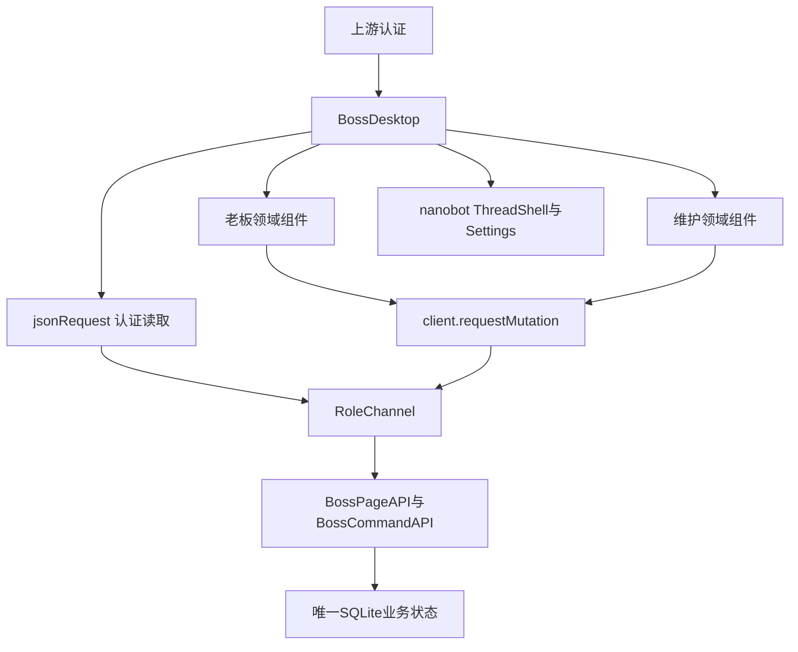

# Boss-Agent 前端设计

版本：0.4.8；日期：2026-10-23；T08/A08；状态：IN_REVIEW。已接收T05/T06 1.7.0，T07现有设计为0.6.4-draft；公共Runtime扩展0.2.0、方法扩展0.3.0及本机账号扩展0.1.0等待正式接收，源码版本`8292824`及W3公共接入。本文件记录已核查工程与设计要求；完整字段、全部页面及状态审查和T03视觉仍未完成，A08保持NOT_RUN。

## 1. 资产与工程映射

PRD V1.2.0维护FR-01—32、AD01—16及AC。HLD 1.0.0维护唯一身份、Runtime、数据库与Cron责任。`specs/hld-72-page-map.json`维护完整72页面架构；`specs/page-service-map.json`维护当前真实源码、读取路径和写入动作。本文件引用该全量集合，不另设页面数量或缩减功能范围。

固定前端为nanobot commit `1bb712d3488915ca4ed9ccc1a93067ff722f5ab9`的React 18、TypeScript、Vite工程。`scripts/prepare_boss_webui.py`把`app/webui/`加入同一认证Shell。构建目录为本worktree的`.work/product/nanobot`，正式dist位于其`nanobot/web/dist`。构建manifest记录上游和页面元数据摘要。静态HTML承担设计预览，产品使用React业务组件。

实际导航使用`?bossPage=<page_id>`与浏览器history；`NATIVE`用于上游会话。N01/D08 通过版本化认证修改接入 `BossLogin`。页面ID与角色必须同时通过`allowed`及服务端身份检查；客户端路径不授予权限。技术页面由MAINTAINER访问，业务页面由BOSS访问，D06/D07使用认证后的公共状态。

N01/D08采用T27的账号密码表单及专用CSS，默认本人，下方提供维护和帮助入口。AccountRoleChannel包装当前RoleChannel并使用同一nanobot会话；密码不进入onSecret、URL或浏览器存储，原生bootstrap保存API token。公共构建保留完整Shell及业务组件，加入已提交的扑翼图集。原生Electron采用Boss Agent应用名称、窗口标题和品牌图标；正式安装仍由T25验证。认证接口见独立`specs/product-auth.openapi.yaml`0.1.0，完整T06接收保持待完成。

## 2. 身份、数据与副作用

`RoleChannel`从bootstrap秘密建立API与WebSocket token对应角色；`/api/boss/identity`返回当前服务端角色。渲染入口只能使用该结果。联系人identifier、payload.role、owner_id及URL不能替代认证。维护请求业务正文和本人确认动作必须被服务端拒绝。

领域状态只由SQLite事务维护。读取采用当前认证token、`cache:no-store`和AbortController；组件显示服务器返回的source_type、对象ID、版本与日期。写入通过上游`client.requestMutation`、稳定`client_request_id`及服务端CAS。保存、校验、启用和下一任务采用分别显示。未知结果先查询原回执，不自动生成新动作。

F14/F21使用BossSupplyQualityView，分别读取SI09/SI10当前资料。A03通过MaintainerSupplyQuality显式载入版本化SIMULATED输入，维护检查完整JSON并确认后保存；SUCCESS、EMPTY、FAILED、TIMED_OUT及WITHDRAWN分别展示。502/504使用已保存原回执核查状态。本人协调保存独立任务，F06导航携带实际task_id；任务完成与专业记录、质量放行分别处理。Shell按当前client/token保存两项协调表单及维护输入，离开时D06保护；结果未确定的原请求跨页面保留，原请求核查不依赖当前资料读取成功。身份变化清理这些编辑状态。

A06方法目录和版本读取同时提供实际缺少工具与缺少工作投影。静态正文校验、当前目录资格和模型采用分别显示；启用与继续原启用重新检查当前工具及投影，原回执仍可查询。公共原文、知识、纪要和研究检查当前传递来源，不能仅凭原文自身VALID状态采用正文。

私人正文、录音及Prompt不进入通用遥测、URL或前端持久缓存。浏览器仅保留完成当前交互所需本地状态。登出及身份改变后清除业务投影、草稿和选择；异步回调需确认当前身份、对象与请求版本。服务错误显示当前失败位置和已执行结果；模型输出不更新正式状态。

## 3. Token与可访问性

权威值为`Boss-Agent-Desktop-Complete-v6/design-tokens.json`，公共映射为`app/webui/boss-v6.css`。全部领域组件继承相同字体、颜色、间距与焦点规则。

| Token | 值 | 使用位置 |
|---|---|---|
| brandBlue/deepBlue | #005BAC / #073B70 | 品牌与导航 |
| brandGreen/actionBlue | #5CA63B / #0968EA | 正常状态与操作 |
| background/surface | #F5F7FA / #FFFFFF | 页面与卡片 |
| text/secondaryText | #172B4D / #52647A | 正文与说明 |
| error/focus | #B42318 / #0A64E8 | 错误与键盘焦点 |
| typography | 16px/24px、14px/22px | 正文与辅助内容 |
| spacing | 8px单位、18—24px卡片内边距 | 共享布局 |
| radii | 14px卡片、9px输入框 | 卡片与表单 |
| accessibility | 44px操作目标、2px焦点 | 键盘和指针 |

字体使用Noto Sans CJK SC / PingFang SC。遵循prefers-reduced-motion。需要在1024×768、1280×800、1440×1024和200%缩放验证内容、长文本、表单错误、弹窗与滚动区域。没有批准的独立深色设计，完整界面遵循v6设计参数。视觉结果NOT_RUN。

## 4. 类型与状态所有权

已有类型以`BossDesktop.tsx`及对应领域组件为当前源码来源；T06 Schema确定后逐项核对序列化。本阶段不新增未经定义的API字段。

```typescript
type Role = "BOSS" | "MAINTAINER";
type Identity = { role: Role | null; owner_id: string | null };
type SourceAnchor = { source_id: string; version: string; start: number; end: number };
```

| 状态 | 维护者与来源 | 恢复与失效 |
|---|---|---|
| role | 服务端identity，Shell读取 | 失效token需要重新认证 |
| page | URL与BossDesktop | 刷新按当前角色检查page_id |
| selectedTaskId、sourceAnchor | BossDesktop | 跨页面保留稳定ID和来源版本 |
| assignmentDraft、settingsDirty | 表单及Shell | 离开前确认；未经确认不发送 |
| dashboard、tasks、meetings | 服务端投影 | 刷新重新读取，旧请求不得覆盖新对象 |
| query产品、期间及日期 | 查询组件 | 请求绑定筛选快照，条件变化使旧结果失效 |
| chat_id、turn_id、events | nanobot客户端 | 使用原生事件关联、恢复和取消 |
| mutation结果 | 服务器回执 | 重连查询同一client_request_id |

S00—S10适用性继承561条状态关联及N/D公共状态要求。加载、空内容、运行、等待输入、结果、失败、权限、来源变化、恢复核查和取消各自有明确反馈。页面状态不能推导交办完成、外部送达或专业结果。

## 5. 组件与接口职责



| 组件 | 输入/输出与责任 | 副作用及检查 |
|---|---|---|
| BossDesktop | getToken、onLogout、onStartChat、children；导航与对象选择 | 身份查询、页面读取、未保存提示 |
| BossLogin | mode、failed、expired、message、onSecret | 真实 bootstrap 与 identity、提交限制、过期认证与退出 |
| BossToday | TodayProjection、onCommand、onNavigate、onDirtyChange | 当前事项与本人次序、快照 CAS、保存后重读 |
| BossOwnerPlans | OwnerPlanProjection、onCommand、onDirtyChange | 本人范围与时间、暂停恢复取消、原请求回执查询 |
| BossMeetingArrangement | MeetingArrangementProjection、onCommand、onReload、onDirtyChange | 草稿与当前会议分别保存，四项本人动作、当前影响摘要与独立授权 |
| BossMeetingBrief.refreshVersion | 公共Shell请求版本 | 重新读取当前会议及来源，保留当前页签与本地输入 |
| MaintainerRuntimeRecords | 稳定getToken、onOpenTask(taskId,runId) | 真实记录查询、分页、详情重读、取消读取和费用未知状态 |
| RuntimeTaskTechnicalView | taskId、runId、getToken | 重新核查运行中task引用与维护身份获准task_refs，仅展示当前技术元信息 |
| ProductRuntimeConfiguration | getToken、onCommand、onDirtyChange、onReload | A08当前配置与独立草稿，保存、静态校验、启用和停止新任务；原请求回执、CAS与D06 |
| BossAssignmentSourceReview | 当前task_id、Projection、onCommand、onReceipt、onOpenSource、onDirty | F06本人独立确认当前来源，业务状态保持；来源与交办切换受D06保护 |
| MaintainerMemoryStatus | getToken、onNavigate(page,run_id) | A12当前确认、删除传播及实际上下文选择，只读取技术元信息；关联记录进入A15筛选 |
| MaintainerSkillVersions / MaintainerSkills | 原生ClientProvider、token、当前方法、草稿与历史、原回执、全局待恢复状态 | A06正文保存、校验、启用、历史恢复与原操作恢复；技术目录采用同一原生方法、配置锁及Runtime；D06、身份和异步范围保护 |
| MaintainerSimulationInspect | 原生ClientProvider、当前simulation-query Schema、接口及参数 | A02十四类技术检查、实际响应、取消和离线恢复；不读取本人正文，不执行业务动作 |
| BossAssignmentFlow等老板组件 | 当前任务、版本、来源及导航回调 | 本人授权、回执、CAS、刷新重读 |
| BossWorkspaceView | page_id、角色和读取函数 | 通用只读投影；完整映射见page-service-map |
| MaintainerPromptVersion、Scheduler等 | 服务端维护配置和当前版本 | 保存/校验/启用/采用分别核查 |
| BossVoiceAssignment | 麦克风权限、实际转写、核查文本 | 本人确认文本后提交共同流程 |
| Panel、Tag、Value、StatusLine | 展示数据与语义状态 | 无业务写入 |

每个页面的`component_file`、`role_gate`、`verified_http_read_routes`、`code_wired_write_actions`、未完成动作及验证状态以page-service-map逐项交接。新组件进入构建白名单后才能被当前dist采用。领域props和接口更新必须同时核对调用方与拒绝路径。

## 6. 事件、恢复与性能

实际传输为WebSocket。无需新增SSE传输；事件使用nanobot原生解码与消息存储，成熟Markdown组件呈现模型文本，不渲染未经处理的HTML。事件关联chat_id、turn_id、request_id；工具结果与模型完成分别呈现。取消只停止尚未执行的步骤，已写入回执保留。

| 条件 | 保留内容 | 页面动作与核查 |
|---|---|---|
| 401/登录失效 | 当前page_id和安全对象标识 | 重新认证并查询正式状态 |
| 403 | 无正文的拒绝信息 | 返回当前身份可访问入口 |
| 409 | 本人输入和旧版本 | 读取当前版本，核查后提交 |
| 断流/响应未知 | client_request_id、对象ID | 查询原回执，禁止重复发送 |
| 来源撤销/版本变化 | 历史引用及失效标记 | 停止当前采用，显示NEEDS_REVIEW |
| 页面/对象切换 | 目标对象上下文 | 取消旧读取，拒绝过期结果 |
| 未保存离开 | 当前草稿和焦点 | 留在原页面或明确放弃 |
| 服务重启 | 服务端正式状态 | 新bootstrap，重新读取对象 |

流式文本复用上游增量呈现与批量更新；目录搜索及可产生网络请求的筛选需要防抖。操作反馈和取消不延迟。性能数值阈值引用D05，当前未知；记录实际构建、请求耗时及渲染表现，不宣称达到未知阈值。中文IME组合期间Enter不得提交；必须验证composition与原生会话行为。

D06使用项目固定Radix Dialog提供焦点约束、Tab循环和Escape关闭，Portal保留v6主题上下文。关闭后恢复导航触发元素焦点；返回继续编辑保留输入，明确放弃后才进入目标页面。真实隐藏Electron已验证三个尺寸和100%/200%缩放的内容边界；检查仅输入现有获准原文，没有保存会议或调用模型。浏览器history、完整对象选择、筛选与滚动恢复继续单独核查。

A08采用维护专用运行配置投影与四项boss.runtime动作，字段与序列化见`specs/product-runtime.openapi.yaml`。保存或静态校验不表示模型质量通过；明确启用后读取实际admission_ready、当前版本、工具范围与进行中数量。已有运行继续原配置，变更启用等待运行结束，停用只停止新任务。实际本人首页任务与A15查询、明细、关联交办、退出和重启已通过，证据见T11；页面整体及全部管理状态仍保持partial。

F06通过`GET /api/boss/ui/assignment-source-review?task_id=...`读取唯一来源绑定。本人核查后通过`boss.assignment.sources.confirm`、task_version和review_sha256独立确认，任务业务状态保持，发送继续使用独立授权。`bossTask`保存当前选择，查看原文后返回和刷新恢复同一交办；未保存的核查依据在切换来源或交办时进入D06。当前绑定与结果证据分别核查，当前结果证据需要重新提交时明确显示。

A12手动读取维护专用`admin/memory-status`，展示当前版本、本人确认、未来采用资格、最近实际运行的memory_reference及删除各项范围。读取失败清除旧投影，取消终止当前读取，退出卸载组件。页面不提供正文或本人修改能力。本人F13删除后，A12保留历史选择的原版本，新的真实任务记录当前DELETED版本和eligible=false；模型完成观察与模型遵从验证分别展示。历史会话、备份及物理擦除保持NOT_VERIFIED。

A06通过维护专用`GET /api/boss/ui/admin/skills`读取本应用workspace/skills中的十三项原生方法。`skill.update`只允许技术维护身份、准确方法名、明确布尔状态和当前正文摘要；原生HTTP修改入口被拒绝。用户独立确认后在同一原生配置文件锁内保存disabled_skills，执行原生skill_state_action并采用同一Runtime快照。其他模型设置保持不变，启停不签发业务授权。参数、依赖或摘要无效时明确拒绝；结果未知时读取当前状态，不使用业务回执接口推断原生操作结果。

MaintainerSkillVersions是A06主要编辑组件，使用维护专用sop-method、sop-history及sop-operation-status读取，以及八项boss.sop命令。保存、校验、启用分开确认；草稿保存保持当前原生文件，历史恢复形成新草稿。待恢复操作在全部方法页面显示，并暂停全部新上下文采用；维护明确继续或取消。当前公开接口没有prepare写入动作。未保存内容接入D06，bossSop记录当前方法选择；A15只显示核查上下文，正式运行记录没有sop_id筛选，方法与模型运行关联保持未验证。

A02通过`GET /api/boss/ui/simulation-inspect`人工检查SI01—SI14的当前对象、类别、版本、状态及缺少范围。接口选择来自当前Schema；对象编号使用重复object_ids，JSON筛选通过成熟JSON.parse读取，字段和类型按当前定义检查，完整期间、维度、权限及数量由服务端核查。Input/Output Schema和实际请求、响应及耗时可读取，没有调用结果时显示接口未调用。维护响应的data始终null，正文不进入状态或界面；本人通过独立`simulation-query`角色读取获准范围。参数编辑、身份改变和读取取消使旧异步结果失效，读取错误不保留旧结果。工具映射进入A09的实际目录。

十四类查询由同一SimulationAPI读取唯一有效执行空间，客户端不选择owner、namespace或数据集。当前存在资料明确返回PARTIAL；缺少资料返回UNAVAILABLE及具体缺少项，不据接口存在推断全部专业资料或写入能力已经完成。全部接口读取均不产生业务授权、外部调用或模型请求。

方法上下文使用固定SkillsLoader识别本人明确引用，再由BossSkillCatalog检查当前版本、启停和实际工具依赖；相同原生上下文只加入一次。方法正文编辑、草稿、历史恢复和全部SOP业务结果继续待完成。外部API当前按项目计划13.18使用显式SIMULATED模式，不安排新增真实模型请求；本地方法状态和上下文使用实际实现验证。

## 7. 验收与接收条件

### FC07 当前交办与承诺

优先迭代入口保留F01采购记录，通过同一task_id进入F06或N05。BossTaskCenter分别管理他人交办和本人承诺；本人承诺采用当前来源、原定期限、独立完成证据、版本及提醒历史。目的、唯一负责人、期限/时区、产物、当前版本、署名反馈、证据版本及模拟消息正文均来自正式页面投影。

BossAssignmentPreparation通过boss.assignment.prepare读取当前任务及来源；assignmentPreparation和assignmentPreparationTask绑定原查询与对象，其他任务不采用该编号。准备不签发本人授权。延期申请读取assignment-extensions；APPROVE/REJECT分别展示申请、旧/新期限、理由和当前版本，经独立确认提交boss.assignment.extension.decide。结果提交保持RESULT_SUBMITTED，完成确认依赖当前充分证据；取消后的反馈显示为历史。

useTransaction按assignment、commitment、feedback保存原动作、对象和client_request_id，URL不保存私人正文。未知结果禁止新提交和Escape关闭，刷新后仅查询原operation-status。来源确认采用sourceReviewRequest/sourceReviewTask恢复原编号。身份和对象变化使旧读取失效；未保存编辑使用现有D06，原文读取保持bossSource/bossReturn与bossTask。原生Client对boss.assignment.*、boss.commitment.*及boss.simulation.feedback禁止连接恢复重发。

当前构建采用canonical组件、同一ClientProvider和原生Client，独立fc07-n3-dist保留MVP冻结制品。公开字段见specs/product-assignment.openapi.yaml；实际结果见docs/feature-delivery/FC07。DOM检查覆盖F06/N05三种窗口和100%/200%缩放，正文16/24；视觉及用户验收未执行。

T08正式接收必须包含：72页面各自组件、真实读写与事件、角色、对象/版本、全部状态、返回上下文、焦点恢复及源码位置；完整561状态与公共状态责任保留。T03提供视觉和素材结果，T05/T06提供字段及operationId，T07提供工具/事件和上下文采用；完整设计验收仍未完成。

已接收的局部接口与字段如下；正式设计验收继续独立执行。

| 接口/字段 | 序列化与消费 | 实际检查 |
|---|---|---|
| todayRead：items、item_id、order_version、snapshot_sha256 | TodayAPI → BossPageAPI → TodayProjection → BossToday | 原始顺序、本人调整、保存及重读 |
| todayReorder：expected_version、snapshot_sha256、item_ids | scopedCommand → BossCommandAPI → TodayAPI.reorder | 当前完整集合与 CAS，原请求编号保持 |
| ownerPlansRead：plans、events、results、dispatches、technical_schedule | OwnerPlansAPI → BossPageAPI → OwnerPlanProjection | 事件范围、计划状态及唯一执行责任 |
| ownerPlanSave/Pause/Resume/Cancel：plan_id、expected_version、client_request_id | BossOwnerPlans → scopedCommand → OwnerPlansAPI | 创建 ACTIVE、PAUSED、ACTIVE、CANCELED，版本与重启连续性 |
| identity.role 与 bootstrap.api_token | BossLogin 核验服务端身份 → 原生 App 保存当前认证 | 入口范围错误拒绝、401/403、过期及退出 |
| memory technical status | MAINTAINER-only 读取 → BossDesktop A12 | 无正文、无外部范围参数，身份拒绝与技术重读 |
| prompt-versions.runtime_eligibility | MAINTAINER-only 读取 → BossDesktop A05 | 当前来源版本、排除原因与采用条件；读取不记录上下文采用 |

本机工程构建、413项回归与30项相关公共入口检查已通过；完整回归11项条件检查跳过。当前真实Electron59项技术记录覆盖N01/D08、角色、三个尺寸及200%缩放、F01次序、N09计划、A05/A12、刷新及重启。70个认证后页面完成72次角色/页面组合DOM检查，没有renderer异常、失败读取或整页横向滚动。结果见T11主记录。全部动作及561状态、IME、跨页焦点和滚动、完整来源撤销、系统权限与视觉验收仍待执行。T09据完整FR/AC建立独立断言；T24在相同集成版本验证持久化及后续采用。构建通过不修改A08状态。
## FC04 经营提醒公共采用

CURRENT，2026-10-24。F02/N06从同一notifications投影接收business_alerts正式Read，经营详情按当前event/version、来源状态及review_sha256确认；generated_by=BUSINESS_ALERT_INPUT不进入旧提醒操作。原文只按当前领域结果显示，失效来源停止事实和原文采用。指标截至时间与业务观察时间分别显示；未知规则、持续时间和影响金额保持未知。

BossBusinessAlerts显示当前事实、比较期间、参与条件、来源版本、已有措施、经营/技术/本人通知版本、汇总/通知、恢复和抑制记录。知晓、暂缓、关闭、会议关联及交办分别确认，交办OPEN与原F06独立发送相接。经营规则保存、校验、启用/停用独立确认；维护A13只配置获准固定演示定义与正式观察输入，不读取本人自定义正文。

新增alerts、alertRules、alertInput、scheduler范围继续使用useTransaction；Client不重放新写入。URL只保留动作/原编号/安全对象，结果未知期间阻止重复写入和编辑；身份变化清除内容及确认。当前身份只能主动GET原回执，不能恢复授权或自动继续动作。Shell对F02/N06/A13的未保存内容采用原D06与beforeunload保护。普通技术记录仅保存实际规则/事件/来源编号、版本、状态和摘要。

原生notify_event/notification_status/retry_notification按当前本人身份及服务端安全目标核查；系统只显示通用事项类别与返回入口。显示失败、明确拒绝、系统未知、内部保存分别表达；点击返回重新验证当前身份和事件。当前系统拒绝显示的实际结果保持DENIED_BY_SYSTEM，系统成功显示/点击仍未确认。F02正文16/24、辅助14/22、操作最小44px，键盘与窗口检查独立记录，视觉未执行。

## UI01 已交付导航与登录

CURRENT，2026-10-24。delivered-navigation.ts从FC01/FC02限定签收及MVP01/FC07/FC04开发交付派生当前可用页面；侧栏、目录、搜索、移动目录、通知和快捷入口共用该映射。未交付直接链接进入UNAVAILABLE，保留返回与退出操作。流程依赖只按当前完成能力可达，目录不以组件存在推断完成。

登录采用原Token及Logo/大鹏，CSS增加蓝绿白层次；两个触发按钮共用同一尺寸样式，帮助正文独立。明确授权的run_ui01.command本机演示模式才能显示测试账号注入，Electron主进程同时核查窗口/主frame/来源/模式/角色及受控文件范围、所有者和权限。仅填充表单，密码仍经原服务认证；入口变化清空输入，异步返回核查代次。普通模式拒绝该能力，凭据不进入静态制品、日志、URL或浏览器持久存储。必要DOM/实际认证/权限与资料保持证据见UI01交付记录，视觉与用户验收单独登记。

## UI02 公共框架与原生功能

当前范围依据 D-UI-INTEGRATION-20261024 和 UI02 八项工单。BossDesktop 同时承载已交付业务页面、本人“大鹏会话”和维护“应用设置”；原生 App 不显示第二组主侧栏、窗口工具区和页面标题。会话选择、新建和搜索使用原生 sessions、onCreateChat、onSelectChat；Settings 分类使用原生控制器，保留保存、校验及原有错误。角色由同一服务端 identity 确定，维护不渲染本人 ThreadShell，/api/sessions 和本人业务继续由原服务拒绝。

BossDesktop 的 children(role, visible)、onOpenNative(role)、onBeforeLeaveNative(leave) 传递已核查身份、页面可见性和离开保护。原生组件保持挂载，切换业务页面保留未发送输入及当前会话；ThreadVisibilityContext 跟随实际页面。业务对象继续使用 bossTask 等安全标识，会话使用原生 hash，刷新仍读取正式服务结果。退出及身份过期通过 clearPrivateNativeState 清除私人界面、进程内 WebuiThreadCache 和原生待发送队列的浏览器记录；正常刷新保留同一认证的原生恢复规则。既有认证与传输不变，transcriptionEnabled=false 保持当前原生语音输入及其快捷键暂停。

未保存业务输入采用 D06，原生会话切换及 Settings 编辑采用同一 Radix Dialog。Settings 先核查编辑和保存状态，再改变分类或离开；明确保留编辑离开后返回仍有输入。实际提交首条会话消息时，sending 仅区分当前输入已经提交的页面移动，不影响业务授权。刷新保护使用 beforeunload。未知业务写入继续按原 client_request_id 查询，页面切换不重新执行写入。

页面目录共用已交付映射与 Radix 焦点约束；Meta/Control+K 打开唯一目录，Escape 关闭并恢复焦点。原生快捷键仅在原生页面生效，会话搜索保留明确按钮。所有页面复用当前 v6 字体、蓝绿白颜色及共享语义 Token；正文 16px/24px，卡片 14px，输入 9px，键盘焦点 2px。短窗口采用紧凑标题和原生内容内滚动，输入与分类保持可操作。原生默认语言为 zh-CN，已有语言选择继续保存。

UI02 的上游增量保存在 app/webui/nanobot-ui02-shell.patch，适用于 UI01 预备源码，通过文件编辑工具维护；准备目录与正式 BossDesktop/CSS 必须一致。当前构建输出 ui02-n3-dist，来源及静态制品摘要由 UI02 inventory 核查。独立启动器 run_ui02.command 使用 ui02-experience 和 10411/10412/20411，不操作当前体验资料。全部外部 SIMULATED_FIRST，STT 暂停，视觉与用户验收独立登记。当前结果及准确版本引用 UI02 主记录与原始正式状态。

## MENU-F01 今日工作

CURRENT，2026-10-25，需求为D-MENU-DELIVERY-20261024、D-UI-FIDELITY-20261024及完整MENU-F01.C01—C18。F01使用BossMorningView；采购成本协调继续使用独立MVP01入口。可信identity、认证、原生ClientProvider和Electron宿主权限沿用已接收依赖。同一authenticated client的token续期保留当前输入及编辑；退出与新身份清除私人状态。

布局采用原v6实际加载home：主列日期范围、三类Tabs与紧凑事项、自然语言；右列选中关联对象、保存与返回。完整详情、会议承诺、冲突、来源覆盖、目标和查询记录提供展开入口。三类计数与筛选使用同一View，每页10项，保存始终提交完整事项集合。BossToday采用compact呈现，children提供分类控件；onDiscuss/discussEnabled绑定当前事项和明确输入，统一鼠标排序与Alt+方向键继续调用既有CAS接口。宽屏右列310px，≤1250px为260px，≤1050px单列；区域间距14px、列内13px，Panel内距18px/20px，≤700px为15px。Panel采用原加载CSS15px圆角及双层阴影。具体依据及测量见docs/menu-delivery/F01/design-rework.md；视觉验收独立。

Morning View 1.1.0 的 input_coverage、category_counts、source_statuses[].data_as_of、risk_evaluations、related_meetings、timezone/location 及 current_order.state 贯穿公开读取和组件类型。provided_count 仅表示已提供范围，reported_total 未知保留 null。业务日期、对象时区、资料截至和读取时间分别呈现；非法日期或 IANA 时区显示当前输入错误，数量保持待读取。原保存清单保留查询版本，当前本人排序使用 current_order 的独立版本与撤销状态。

MorningConversationRequest 将 question、date/timezone、可选成对 list_id/item_id 交给原生 App。新会话由现有 new_chat 创建；boss.morning.bind 通过已认证 WebSocket、当前连接附加会话和稳定 client_request_id 建立服务端绑定。每次发送前重新核查连接、当前快照、来源和本人排序版本；原生消息仍由既有传输进入同一 AgentLoop。NativeMorningAdapter 将当前 message_id、输入摘要和可信会话绑定为一次公开晨间请求，Provider 与生命周期采用同一 MorningRequest，实际工具保持 todayRead/morningListRead/morningDetailRead/morningSourceRead。本人确认、排序保存和业务写入不进入模型工具。

绑定写入加入原生 Client 禁止重放清单。响应未知时只读取 /api/boss/ui/morning/binding 的原编号回执；读取不恢复授权、不记录上下文采用、不自动发送保留问题。本人明确提交后才使用恢复绑定进入原生会话。会话交接通过独立 AbortSignal 保护未发送问题；本人取消后，原绑定响应仍可核查，App 和 Shell 不自动提交问题或打开会话。原生正在运行的轮次使用既有停止响应操作，/stop 交给原生命令处理，不创建晨间查询。后续讨论保留同一 chat/session，选中事项变化建立独立绑定；Runtime 与工具结果保留 list/item/source 版本和 run_id。技术记录只含编号、版本、状态和摘要。question、私人正文及账号不进入 URL、静态资源、普通持久缓存或技术日志。

详情和来源读取以 generation、AbortController、当前 list/item/source/版本共同判定。较早响应不能覆盖新选择。关联会议只读取当前详情明确提供的同版本 meeting 引用，通过现有 Radix Dialog 提供当前必要共享入口，关闭恢复触发焦点。prepare 传递 MorningReference 与实际 source_ids/meeting_id/event_ids；F06 重新核查当前正式详情，只有现有受支持业务输入才能采用。缺少必要输入明确阻止创建。本人核对具体内容、勾选确认并提交后才正常保存交办，发送仍是独立操作。

F01在跨页时保持挂载，date/timezone、选择、来源、分类及返回坐标使用安全URL参数morningDate/morningTimezone/morningItem/morningSource/morningCategory/morningScroll/morningFocus；问题正文仅保存在当前进程。返回重新读取当前正式对象，再恢复分类、滚动和可用触发焦点；D06关闭焦点与异步详情完成共同触发恢复。刷新恢复当前对象和已保存分类，没有分类参数时显示全部事项。继续讨论没有文字时聚焦输入，明确提交时才交接会话。F01顶部开始对话使用业务D06，明确放弃后通过morningDiscardVersion重新挂载以清除未提交编辑，并读取原编号与当前正式资料；未知回执仍保持只读核查。排序采用实际CAS，失败保留编辑；已保存历史结果不作为当前完整资料使用。

自然语言字段使用可见本次需求标签作为可访问名称，输入为88px高度、10px 12px内距、16px/24px及字重600；按钮、Tabs与事项标题采用各自原字号和24px行高，说明保持14px/22px。F01顶部采用原布局分布、SVG和逐个控件间距。来源与会议沿用Radix Dialog，按原公共Modal采用min(580px,94vw)、16px圆角、24px内距及viewport减40px高度限制；实际定位容器采用grid、place-items:center和20px内距，遮罩没有背景模糊。44px关闭目标、2px蓝色焦点，以及Escape、关闭按钮、外部点击和返回焦点由当前真实Dialog检查核查。

源码增量保存在 app/webui/nanobot-menu-f01.patch；准备目录的 BossDesktop 与正式源码必须相同。独立制品 menu-f01-n3-dist、启动入口 scripts/run_menu_f01.command、数据目录 validation/.work/menu-f01-experience 使用10611/10612/20611，不操作现有 UI02 或 MVP 体验。初次准备采用获准 SIMULATED 输入及既有业务初始化，后续启动使用同一 SQLite 和 credentials，不重新配置或清空。显式本机模式的受控账号填充仅填写表单，手动登录仍使用正常服务认证。准确来源、实际安装 Nanobot、制品及证据摘要由当前 inventory 登记。

## MENU-N02 聊天交办

CURRENT；2026-10-25；D-MENU-DELIVERY-20261024、D-UI-FIDELITY-20261024及完整26项工单。N02候选8e135b8已登记26/26开发覆盖，视觉与用户验收独立。当前唯一活动菜单为F01必要设计修订，其新制品与N02已冻结体验独立。

BossDesktop的children(role,visible,ConversationActions)提供当前本人/维护身份、可见性及原有共享导航。ConversationActions包含onOpenTask/onOpenSource/onOpenMessages/onReturn，调用仍经过既有未保存输入保护。N02为本人会话入口，原NATIVE地址兼容；维护NATIVE继续为Settings。BossConversationWorkspace使用真实topicSessions及原生新建/选择/搜索，连续消息和输入由同一ThreadShell处理；业务切换保持原生组件挂载，ThreadVisibilityContext跟随实际可见性。

N02使用原稿外框、204/174/60导航宽度、64px顶部区域、146/124标题区、主列与310/260右列及≤1050单列。六项主导航和快捷操作保留，语音暂停。原HTML历史区域参考213px，由明确历史按钮展开；默认收起以保持loaded chat的对话宽度，展开后采用原历史区域及窄窗口重排。18组实际控件记录发送按钮均84×44px、输入字重600、键盘焦点和2px外距；背景与内层标题采用原稿。全部状态及完整设计仍待必要复核，不能据框架检查登记完整还原通过。

四项只读webui_request为boss.conversation.read/artifact/messages/attachments，另有原轮次request和当前会话requests。服务端核查当前BOSS认证连接与订阅chat，session_id由原生映射产生；消息历史为OWNER_MESSAGE_HISTORY。实际Runtime和context_references提供原/当前版本、作者/时间/范围及支持关系。关联运行选择保持本人阅读；查询详情展示正式条件、完整值、公式、定义版本、比较限制及资料缺口。原请求包括尚无Runtime的失败或取消，读取不重放。异步读取由当前client/token/chat和代次限制，身份/会话变化使迟到结果失效；失败清除当前投影并允许明确重读。

共享来源、消息及交办入口记录当前会话、选中运行、工作区滚动和触发焦点，业务页面提供返回原会话。仅可见性变化保留当前选择及原生线程，身份或会话变化清除关联投影。共享F08的未保存编辑采用D06；保存、明确模拟发送、送达核查和reply_to回复独立。新建共享交办使用空表单，既有任务按实际ID及版本读取，晨间创建引用由其原流程核查。共享路径不登记后续整套菜单完成。

Conversation附件Schema1.1.0包含可空stored_name/original_name/mime_type、当前size_bytes/content_sha256、上传时recorded_size_bytes/recorded_content_sha256、processing_state及可空user_message_index。位置只有在唯一原生user.media能够确认时提供，不能充当稳定消息ID。STORED仅表示文件保存；MISSING、CHANGED与REFERENCE_UNAVAILABLE分别呈现，当前内容未经业务来源核查不能采用。可信record_upload仅在原生实际上传成功后内部调用，没有模型/客户端路径入口；内部文件引用和正文不进入公开元信息。

ComposerDraftController由原生ThreadComposer注册到当前会话，hasDraft包括文字、实际附件、引用及排队输入。继续编辑保留内容，明确放弃调用控制器清除；beforeunload覆盖仅附件及队列。本人会话persistQueuedPrompts=false，排队正文只保存在当前进程。原生组件及App增量保存在app/webui/nanobot-menu-n02.patch，正式BossDesktop/BossConversationWorkspace/boss-n02.css与准备源码一致；新构建使用独立menu-n02-n3-dist，不覆盖任何F01/UI02/MVP体验资料或制品。

ProductConversation在同一AgentLoop中采用六项正式读取与query_metrics；后者使用ConversationQueryTool、实际Fc02Context及本轮允许参数摘要。必要条件从实际输入补充，连续查询复用正式父产物并仅改变明确字段。Runtime Schema1.12.0严格区分SIMULATED业务结果和仅conversationRead允许的RUNTIME_RECORD元信息。实际公开连续检查包含共享消息/交办、原请求、14条严格运行记录和同库重启；必要证据见N02主记录。全部状态、完整设计和26项尚未完成，正式状态由原始specs/feature-delivery.json维护。
