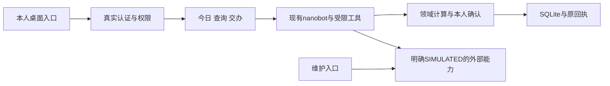
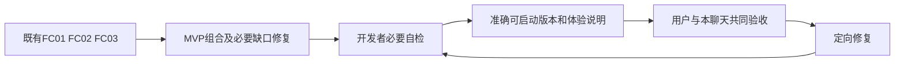

# Boss-Agent产品需求规格说明书

## 当前决定：显示全部菜单并提交推送main

2026-10-25，decision_id=D-ALL-MENUS-MAIN-20261025，来源EXPLICIT，状态CONFIRMED。用户明确要求“显示全部菜单，然后commit & push 代码到main”。本人和维护身份分别显示其完整菜单及现有合法页面入口，菜单可见范围采用本决定；页面能力、权限、暂停状态、完整开发和用户验收继续按当前正式记录表达。完整菜单显示不增加开发完成数，不替代逐菜单补全和高保真核查。

由N3完成导航及相关消费者的必要修改、适用非视觉验证和准确提交，主聊天合并原始main并推送origin/main。提交保留当前产品源码、必要规范与开发记录；本机凭据、用户体验资料和未选择的运行产物不纳入。既有用户体验不自动替换，本次没有扩大测试自动认证、初始化维护认证、外部模型请求或视觉授权。

## 当前决定：所有菜单必须高度还原高保真设计稿

2026-10-24，decision_id=D-UI-FIDELITY-20261024，来源EXPLICIT，状态CONFIRMED。用户体验后明确指出，包括F01今日工作在内，现有界面与设计稿仍有较大差距，要求在任务中强调高度还原。共同要求见docs/menu-delivery/高保真还原执行要求.md。完整核查公共框架、导航和正文宽度、区域顺序与比例、信息层级、间距、字段文案、组件尺寸、字体/颜色/图标及交互状态；当前UI02 Shell和开源默认布局不构成接受设计差距的批准依据。

F01进入必要设计返修范围，原18项业务证据按版本继续保留，设计还原及用户验收不得登记通过；N02的原26项同时采用本要求。N3自然阶段结束后接收反馈并维护正式状态，进入N03前完成F01必要设计返修，始终一个活动实施菜单。N4可先只读复核F01准确候选及原设计，输出有来源的差距清单。运行窗口不追加消息或中断，禁止主动视觉保持，当前F01/UI02/MVP用户体验与资料不得替换或用于验证。

## 当前决定：按照菜单逐项补全PRD和高保真界面

2026-10-24，decision_id=D-MENU-DELIVERY-20261024，来源EXPLICIT，状态CONFIRMED。用户要求后续按菜单推进，依据PRD和高保真UI逐个菜单开发补全，允许现有窗口协作。当前采用MENU_COMPLETION：以一个设计页面菜单为交付单位，完成该菜单的业务行为、原页面信息结构、适用状态及连续操作，再推进下一菜单。功能范围和页面结构以本节、docs/PRD完整产品后续需求.md相应FR/BR/AC、当前Desktop v6页面及规范共同确定；MVP采购流程保持已有成果，不继续作为全部首页或全部产品的范围上限。

规划入口specs/menu-plan.json和docs/菜单开发总计划.md，第一项MENU-F01“今日工作”，完整工单docs/menu-delivery/F01.md。F01恢复原设计的自然语言入口、待决定/待协调/需要知晓、本人事项、当前详情、会议与承诺、时间冲突、来源及覆盖缺口，保留当前日期/时区/排序与返回要求。采购成本协调作为关联业务保持，不替代今日工作。未完成菜单继续隐藏，当前菜单可在独立开发候选中核查全部合法入口；已交付旧能力保持访问，不用占位或通用字段列表代表完成。

开发完成必须同时具备完整限定业务证据、逐区域设计结构与样式核查、适用窗口/缩放/键盘/异常行为和准确可启动交付。设计结构依据包含布局区域、层级、字段、动作顺序、文案、尺寸和Token，不以品牌颜色或16px字号单独代替还原。禁止主动视觉/截图/图像查看继续有效，DOM、计算样式、元素尺寸/位置及原设计HTML对照允许；视觉体验待用户确认，不声明像素还原或相似度通过。业务验证、设计结构核查、视觉与用户验收分别记录，未确认不登记用户通过。

本次逐菜单授权接续UI02后的等待条件。一次一个菜单，窗口可协作同一菜单；N1领域/数据、N2Agent/工具与Runtime、N3高保真页面/公共集成/准确交付、N4需求与设计差距核查及必要定向验证，监督维护规划/验收证据。正式状态唯一由N3维护。准确当前菜单全部必需检查通过且无影响本菜单的必要缺陷后，记录开发完成待共同验收，建立下一菜单完整工单并继续；不等待反复开发许可，不恢复旧FC队列独立并行。

全部外部SIMULATED_FIRST，不新增真实外部请求，STT/F27/FC28保持用户暂停；本次不扩大账号注入敏感授权或本人确认权限。保护用户当前UI02的ui02-experience/desktop-ui02-experience及10411/10412/20411和原MVP体验，禁止自动终止、重启、切换或用于验证。开发和验证采用独立候选、端口、SQLite与构建。运行中聊天仅只读，自然空闲复查后具体续接并登记防重复。每30分钟简洁汇报继续。

## 当前决定：UI01完成后优先统一开源界面与Boss-Agent体验

2026-10-24，decision_id=D-UI-INTEGRATION-20261024，来源EXPLICIT，状态CONFIRMED。用户要求UI01任务结束后，优先进行开源项目UI与Boss-Agent UI兼容优化，使操作过程保持同一产品的连续体验。当前UI01完整七项继续执行，完成必要验证和准确交付后接续docs/UI02开源界面统一体验工单.md；同一时刻仅一个活动任务，不提前并行实施UI02。FC06及其他业务队列继续暂停，UI02完成后等待用户。

UI02覆盖当前已交付可达的nanobot原生会话、Settings及Boss-Agent页面之间的应用框架、导航、角色入口、主题Token、组件和状态交互。连续使用时保持当前会话和返回位置，不出现重复导航或要求无故再次登录；正常退出、身份过期和本人/维护权限继续有效。沿用现有ClientProvider、原生传输和服务端权限，不新增第二套认证或业务状态。具体入口清单由当前准确UI01版本和实际可达页面核实，未交付能力继续隐藏；完整八项见UI02工单。DOM、计算样式和实际行为验证继续执行，视觉体验由用户判断，禁止主动截图或图像查看。

当前用户桌面与资料保持；N3运行中只读，不追加消息或打断，最新优先级在自然空闲且依赖满足时一次接续。UI01账号注入授权按其独立审批结果执行，本次UI兼容要求不扩大敏感读取权限。开发交付和用户验收分别登记。

## 菜单与登录页要求

2026-10-24，decision_id=D-UI-PAUSE-20261024，来源EXPLICIT，状态CONFIRMED。用户要求当前任务验收完成后暂停，界面只显示已完成功能菜单；优化登录页背景，增加“测试账号注入”按钮，“技术维护”和“认证帮助”按钮大小一致，移除“本机桌面 · 身份分别核验”。当前任务为FC04，继续完成已经安排的必要验证和相关缺陷处理；不自动建立或开发FC06。用户共同验收结果仍独立记录，不能把本次界面反馈登记为FC04已验收。

FC04完成当前验证并自然空闲后，仅执行docs/UI01菜单与登录页调整工单.md。菜单完成含义为有准确版本和必要开发证据的可体验功能；待实现、部分实现和仅映射项不展示，必要共用页面只开放已交付操作，不将整个大模块视为已完成。登录背景在现有蓝绿白、Logo/大鹏及nanobot融合内增加层次，不更换品牌；“测试账号注入”仅在显式本机演示模式响应本人点击，填入当前入口已有测试账号，随后仍通过正常账号密码认证，不授予业务权限。完整行为和验收见UI01工单。

UI01完成后接续UI02开源界面统一体验，随后等待用户，不自动恢复业务迭代。用户正在体验的桌面及资料保持，不自动退出、重启或替换运行版本；新界面以独立运行和准确启动入口交付。运行中聊天保持只读，最新决定在下一次自然空闲接续时一次传达，下面的逐项自动推进规则受当前暂停条件限制。

## 当前迭代范围与推进规则

2026-10-24，decision_id=D-ITERATION-20261024，来源EXPLICIT，状态CONFIRMED。用户要求按照需求重要程度逐步迭代，每次完成一个需求闭环后继续下一项。当前执行范围为MVP基线加唯一活动需求；优先顺序及依赖见specs/iteration-plan.json和docs/功能闭环开发计划.md，正式执行状态仍唯一由N3维护specs/feature-delivery.json。

首项FC07：交办与承诺的完整处理，需求依据为docs/PRD完整产品后续需求.md第8.6节FR-06、BR-06、AC-06-S/E，完整本轮范围和稳定验收点见docs/FC07交办与承诺工单.md。从MVP已保存的采购协调任务进入任务详情，完成模拟发送、进展查询、催办、延期决定、结果证据核查、本人确认完成或取消、历史及重读；本人承诺和他人交办分别处理。仅激活当前工单，其余需求按优先队列等待，禁止同时开发多个需求。

开发闭环条件为当前需求全部必需行为具有准确集成版本的必要证据、实际页面可连续使用、没有影响当前需求的未解决缺陷，并提供可启动版本、步骤和限制。满足后N3登记DEVELOPED_PENDING_USER_ACCEPTANCE并自动建立下一项工单和推进，无需再次请求开发许可。用户与本聊天的产品验收单独记录，未实际确认不能登记用户通过；MVP01十二项仍保持待共同验收，不因本次继续开发改变结果。N4仅处理当前变更的必要定向验证，不恢复常驻全量独立验收门槛。

全部外部继续SIMULATED_FIRST，不新增真实外部请求；真实本地身份、权限、来源、对象版本、CAS、幂等、本人确认、保存重读和未知原编号恢复继续验证。STT保持暂停，视觉保持未执行，现有Desktop v6及nanobot融合要求继续适用。下列第1至13节定义MVP基线；其中停止后续迭代的范围限制由本节当前决定接续，MVP范围和验收分母保留。

## 1. 版本与批准范围

版本MVP-1.0，日期2026-10-24，需求决定CONFIRMED，decision_id=D-MVP-20261024。来源为用户明确指令：“可以，那就调整需求，只要mvp版本需求，其他降级先不做，然后继续推进开发”。需求批准不表示实现或验收通过。

本文是当前需求入口；specs/mvp-scope.json登记范围，N3维护specs/feature-delivery.json的执行状态。完整产品需求保存在[后续需求参考](PRD完整产品后续需求.md)，本轮不继续全部FC01—FC31。旧28项任务、23项父任务和192检查点保留历史，范围调整不增加任何已完成或已验收数量。

## 2. 文档目的与名词

MVP只交付一条采购成本协调流程：登录→查看今日事项→查询采购成本变化→查看依据→本人确认协调交办→重新打开查看保存记录。直接复用FC01、FC02和FC03候选，按真实缺口完成组合。

SIMULATED表示外部业务、模型和资料能力的明确模拟来源；本地账号、权限、计算、实际工具、状态、SQLite和回执重读真实执行。“开发完成”“待共同验收”“已验收”分别记录。最终产品验收由用户和本聊天共同完成。

## 3. 用户、目标与成功条件

业务使用者为一位老板；维护身份只配置本地运行和获准模拟资料。联系人和负责人属于资料对象，不新增部门账号。

目标为本人连续完成上述流程，结果有依据、记录能够重读、失败有明确提示。成功条件为第12节12项均有准确版本的必要开发证据，并完成用户共同验收；当前完成数待核实。真实经营收益、真实模型质量、真实外部投递及语音效果不在本轮通过声明中。

## 4. 应用与数据职责

沿用现有nanobot、Electron、Client/Provider和服务，不新增框架、外部服务或第二套状态。身份、owner、namespace、当前来源和对象版本由可信服务端确定；维护和模型不能生成本人授权。

## 5. 使用路径与异常状态

本人登录进入今日事项，选择已有采购成本相关事项；在同一个获准场景比较两个期间成本，阅读本次结果绑定的来源、时间、版本与原文位置；进入协调交办准备，核查负责人、内容、期限、依据和当前对象，明确确认后实际保存；刷新、重登及同库独立服务重启后可查看同一查询、任务和回执。

沿用现有正式状态枚举。尚未提交、执行中、等待补充、成功、失败、未知、来源失效和无权限明确区分。收到反馈不自动代表任务完成。部分覆盖和无数据如实显示，较早响应不覆盖新选择；失败停止依赖动作，已保存结果保留。未知写入只读取同一client_request_id，不生成新编号或重放。

## 6. 已有设计与工程复用

本轮为现有产品范围调整，不新增竞品研究、技术选型或全量原型。当前流程继续遵守Desktop v6 Token、蓝绿白、Logo/大鹏和nanobot开源UI融合；只补齐当前页面及必要共享内容，已有其他页面保留，未完成入口明确暂未开放。

平台保持现有本机电脑桌面应用，提供实际可启动入口、准确版本与运行说明。多平台发行、自启动、自动更新、设备权限/休眠完整矩阵为后续事项。禁止操作用户正在查看的桌面和预览进程及其数据。

## 7. P0功能与本轮边界

| ID | 用户结果 | 复用依据及边界 |
|---|---|---|
| MVP-F01 | 登录访问本人范围 | 现有认证/Shell；FR-26/28必要部分，单老板与维护分权 |
| MVP-F02 | 查看采购相关今日事项 | FC03及FR-01必要部分；正式日期/时区、详情和已有排序恢复，不扩展全部秘书事项 |
| MVP-F03 | 查询两个期间成本变化 | FC02及FR-03必要部分；一个现有获准采购成本场景，不增加专题或样本规模 |
| MVP-F04 | 阅读同一结果依据 | FC01/02/03；来源/版本/原文位置与缺少条件，失效停止当前采用 |
| MVP-F05 | 本人确认协调交办 | FC01及现有F06、FR-06必要部分；当前负责人/内容/期限/依据和明确授权 |
| MVP-F06 | 重读查询与交办记录 | 当前历史/任务/回执；刷新、重登、同库重启及未知原编号恢复 |
| MVP-F07 | 使用必要模拟和运行配置 | 复用现有维护入口及Runtime，只保留本流程所需配置 |
| MVP-F08 | 使用可体验桌面版本 | 当前高保真页面、必要交互及启动说明，由用户共同验收 |

未列入本表的完整会议、审批、消息、出行、私人日历、长期记忆、研究、其余农业专题、语音、高级调度管理、全量评测与多平台发行均DEFERRED，本轮不主动开发、不扩充数据、不作为MVP前置。已有公共安全及持久化机制继续复用。

## 8. 页面规则与BDD验收

| 功能 | 元素与正式来源 | Given / When / Then及异常结果 | 验收 |
|---|---|---|---|
| MVP-F01 | 当前登录/身份/Shell | Given真实本人账号；When登录；Then进入本人范围。匿名、维护业务读取、伪造主体及跨空间拒绝，错误不泄露正文 | C01/C09 |
| MVP-F02 | 日期、事项、来源状态、选中详情；MorningAPI | Given当前采购场景和正式日期/时区；When打开或切换日期；Then实际范围正确。非法日期拒绝，缺少资料不冒充完整空日，旧响应不覆盖新选择 | C02/C08 |
| MVP-F03 | 问题、已有范围/期间、状态及指标；实际SDK和确定性计算 | Given同一获准场景与两个可比期间；When查询；Then结果/单位/公式/范围一致，比例使用正式规则，未知数字保留未知。条件缺少等待补充，异常明确失败 | C03/C08 |
| MVP-F04 | 来源、原文、作者/时间/版本/位置；当前结果绑定 | Given已保存查询或事项；When打开依据并返回；Then匹配当前对象并保留选择。来源撤销/换版停止当前采用，合法历史按原资格读取，不恢复失效私人正文 | C04/C09 |
| MVP-F05 | 当前对象、负责人/内容/期限/依据、确认按钮和回执；现有交办服务 | Given当前对象与来源有效；When本人核查并明确确认；Then真实保存一项协调交办。准备不自动写入；模型confirmed=true、维护身份、旧版本、失效授权或同编号异内容均不能写入 | C05/C09 |
| MVP-F06 | 历史查询、任务详情及原编号恢复 | Given已保存或交付中断；When刷新/重登/同库独立重启后重读；Then仍为同一记录。重复点击保持同一意图；未知只查原编号，不宣称未执行或自动重发 | C06/C07 |
| MVP-F07 | 现有维护配置、模拟来源和错误提示 | Given批准配置；When运行；Then真实Registry/工具采用当前版本，外部明确SIMULATED，未知费用null。未启用工具拒绝；问题/私人正文/凭据不进入普通技术记录 | C10 |
| MVP-F08 | 现有桌面入口、导航/焦点/键盘/加载/未保存提示 | Given准确版本；When按第5节体验；Then流程可连续完成，界面遵守v6和开源融合，错误可理解。DOM/计算样式允许，禁止主动视觉/截图，视觉由用户体验判断 | C11/C12 |

表内Cxx完整编号为MVP.Cxx；正式状态和字段复用现有Schema，不另造业务枚举。

## 9. AI与数据规格

全部外部模型、STT、业务系统和资料API统一SIMULATED_FIRST，本轮不新增真实外部请求；旧DeepSeek授权保留供后续真实验证，STT继续暂停。模拟事件必须消费实际工具结果，不使用预设成功、吞掉错误或自动转模拟成功。

只复用当前批准Schema、场景生成器与已有资料，不补造来源许可、数值、作者或同步状态。真实本地身份、权限、计算、CAS、幂等和保存仍须验证。未知usage/cost保持null，不生成模型质量、投递或经营收益评分。

## 10. 实施依赖与必要自检

已有领域/接口/Agent设计直接采用；真实语义缺口才更新相关HLD/LLD，不重做全套设计。N3负责公共集成；N1/N2只处理其责任范围的MVP缺陷；N4不再承担常驻全量独立验收门槛，当前运行自然结束后只处理必要验证或缺陷定位。运行中不追加消息或中断。

## 11. 权限与本人确认

| 主体 | 允许动作 | 禁止动作 |
|---|---|---|
| 本人 | 当前范围查询、查看依据、明确确认交办、重读记录 | 跨空间或用失效版本写入 |
| 维护身份 | 必要模拟/Runtime配置和安全技术诊断 | 默认访问私人正文、代签本人确认 |
| 模型/工具 | 批准范围内读取及既有合法授权执行 | 自定主体/来源、签发本人授权、重放未知写入 |

继续采用BR-C02等现有规则的相关部分；MVP缩小业务范围，本地权限与数据正确性要求保持。

## 12. 质量与共同验收清单

| ID | 可观察完成条件 |
|---|---|
| MVP.C01 | 本人真实登录本机桌面，维护业务入口与匿名拒绝 |
| MVP.C02 | 今日页面显示采购相关事项、正式日期/时区及真实来源状态，可进入当前对象 |
| MVP.C03 | 同一采购场景完成两个期间成本查询，结果/单位/公式/范围可核查 |
| MVP.C04 | 阅读匹配原文及版本/位置，返回保留选中事项或查询 |
| MVP.C05 | 本人核对负责人/内容/期限/依据并明确确认，真实保存一项协调交办；准备不自动写入 |
| MVP.C06 | 刷新、重登及同库独立重启后重读同一查询、交办和回执 |
| MVP.C07 | 同意图幂等，响应中断或未知仅查询原编号，无重复写入 |
| MVP.C08 | 无数据、缺少条件、失败及旧响应明确处理，无伪造成功或覆盖新选择 |
| MVP.C09 | 伪造/跨空间/维护越权、失效来源/授权及旧版本拒绝，无私人内容泄露 |
| MVP.C10 | 实际SDK/Registry采用当前配置和工具，外部明确SIMULATED，日志安全、未知费用null |
| MVP.C11 | 当前页面保持v6/Logo/大鹏/nanobot融合，导航/键盘/状态可用，正文16/24辅助14/22，必要视口与200%无整页溢出 |
| MVP.C12 | 准确代码/制品/本机启动入口和体验步骤可查，用户共同验收逐项记录，未验收不登记通过 |

baseline_id=boss-mvp-coverage-20261024-v1。12项只用于当前MVP，独立于旧FC03二十二项及192检查点；初始完成数待核实。提交、文档和检查数量不计为功能完成。无新增性能承诺阈值，保留实际等待、取消和错误反馈。开发者执行本次改动所需业务、权限、幂等、持久化、共享消费者及必要严格构建检查，按准确版本复用有效结果，不重复无变化全量检查或新增评测系统。

## 13. 交付与后续迭代

开发连续推进本轮必要任务，不等待每项独立全量验收。交付只说明完成什么、哪里启动、怎样操作、已知限制。最终由用户和本聊天共同确认。MVP开发完成、待共同验收和已验收分别记录，不能因范围调整宣布完整产品完成。

MVP完成后不自动恢复FC04—FC31；后续范围等待用户指定迭代。已有其他代码、数据及全部历史证据保留，正式发行与真实外部接入继续列为后续事项。
