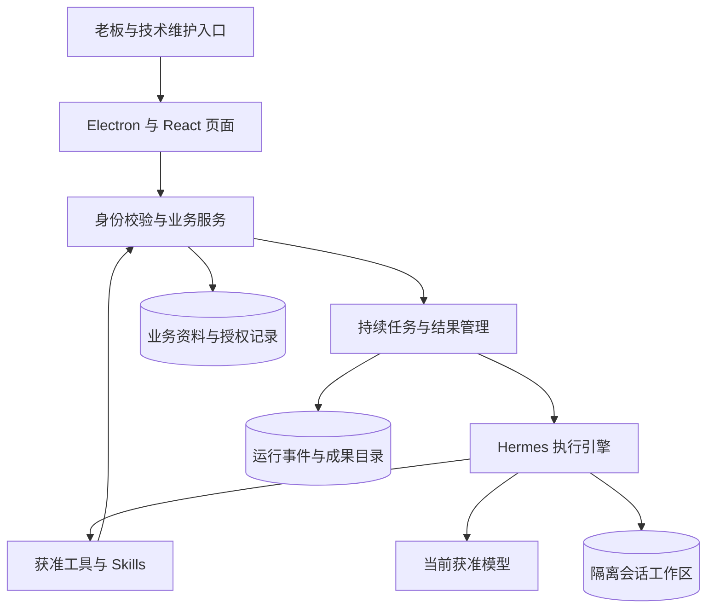
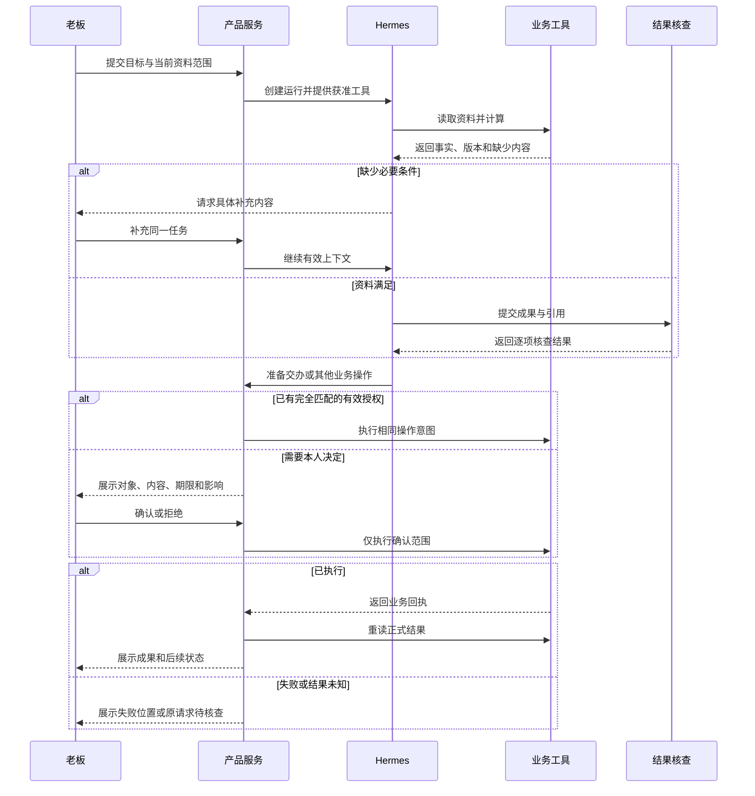
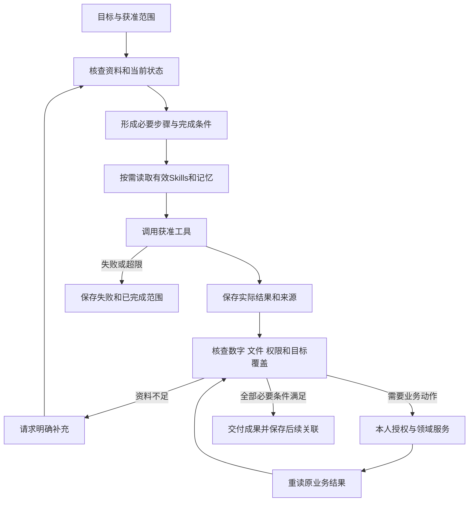

# Boss-Agent 产品需求规格说明书 2.0

doc_id：DOC-PRD-2；版本：2.0.0；日期：2026-10-30；状态：IN_REVIEW；任务：UPGRADE-2-DESIGN；维护：S002。本文件定义升级目标，当前运行代码仍采用 nanobot，Hermes 接入状态为 NOT_IMPLEMENTED。实施及用户验收状态仅从 [唯一正式状态](../specs/feature-delivery.json) 读取。

## 1. 版本记录与来源

| 日期 | 版本 | 当前有效内容 | 来源与状态 |
|---|---|---|---|
| 2026-10-30 | 2.0.0 | 模拟业务资料、Hermes 执行引擎、持续任务、成果文件、记忆与方法、完整迁移和验收 | 用户要求制定升级 PRD、HLD 和相关文档；文档已编写，产品未实施 |

| 决策 | 来源类型 | 内容与适用范围 | 状态 |
|---|---|---|---|
| D-V2-DOC-20261030 | EXPLICIT | 制定 PRD2.0、更新 HLD 与相关文档 | CONFIRMED；文档授权 |
| D-V2-DATA-20261030 | EXPLICIT | 没有真实企业数据，继续使用模拟数据 | CONFIRMED |
| D-V2-ENGINE-20261030 | INFERRED | 承接 Hermes 推荐后的升级指令，以 Hermes 为目标执行引擎 | PROPOSED；作为完整设计采用，运行兼容尚未验证 |

决策详细来源、影响与重新核查条件见 [项目决策记录](项目决策记录.md)。文档编写不产生安装依赖、切换实例、启动定时监督、扩大外部请求或提交发布的授权。

## 2. 文档说明与范围

目标产品仍服务一位 BOSS；MAINTAINER 维护技术配置及获准模拟资料；联系人与负责人是资料对象。保留老板五个主要入口、账号内个人设置、20项管理员常驻入口、Desktop v7 全部72主视图和561条状态关联。页面集合采用 [菜单目录](../specs/menu-plan.json) 与 [设计配置](../Boss-Agent-Desktop-Complete-v7/meta/页面配置.json)。

[完整产品需求](PRD完整产品后续需求.md) 的 FR-01—FR-32、对应 BR/AC、AD01—AD16、NFR-01—NFR-12、E01—E06及既有用户标注要求全部继承。本文件 U2-FR/BR/AC 为升级增量，不能替代原验收分母。FR-27语音继续暂停，原承诺保留。

| 名称 | 含义 |
|---|---|
| 业务任务 | 正式交办、本人承诺及其负责人、期限、反馈和本人验收状态 |
| Agent 运行 | 一次或持续多轮的执行过程；运行完成不改变业务任务的本人验收要求 |
| 成果 | 可重读的简报、来源清单、文件、操作草稿或正式业务回执 |
| 模拟业务 | 获准且有版本的企业记录和接口执行；明确标记 SIMULATED |
| 真实执行 | 实际模型请求、实际工具调用、实际文件生成、实际本地事务和重读 |
| 方法经验 | 可复用的执行步骤及适用条件，以 Skills 候选和发布版本管理 |

目标升级包括持续执行、资料与工具、任务确认、成果、记忆、方法、调度、隔离协作、维护观测与交付恢复。真实 ERP/OA 接入、真实外部联系人投递、采购成交、资金交易、质量放行、设备控制、独立员工端和新增平台承诺不在本次升级范围。网页文本研究作为可配置能力；默认不启用外部网络访问，视觉和语音限制继续生效。

## 3. 背景、价值与成功指标

当前实现具有真实 DeepSeek 和本地领域调用证据，但普通会话工具主要覆盖读取；页面业务动作、持续跟进、成果文件和方法复用尚需连续集成。依据为 [application.py](../validation/application.py)、[会话范围](../validation/conversation_agent/__init__.py)、[仿真验证](development/SIMULATION-20261028.md)。

用户结果：老板提出目标后，可以看到实际工作进展、阅读可核查成果，在必要位置确认业务动作，并在后续会话继续同一事项。企业资料是否模拟与执行过程是否真实分别记录。

| 指标 | 定义与数据来源 | 完成要求 |
|---|---|---|
| 有效任务完成率 | 满足全部验收条件的运行数 / 全部已开始运行数；失败、取消、超时均保留 | 与固定输入、引擎及模型版本一起报告；提升幅度 UNKNOWN |
| 关键事实引用完整性 | 每项关键数字、业务状态和事实可定位获准来源版本 | 验收集合内逐项通过 |
| 成果可用性 | 文件可打开、字段内容正确、保存后重读且可在业务页面继续采用 | 每个要求文件的场景均通过 |
| 本人操作负担 | 每项工作必要确认数、补充信息次数、人工修订时间 | 采集实际值；有效授权不重复确认 |
| 执行正确性 | 未授权写入、重复业务动作、跨范围读取、错误数值、伪造来源或完成状态 | 验收集合内零项；出现即判定失败 |
| 时间与成本 | 首个有效进展、总耗时、模型及辅助请求 usage、人工复核耗时 | 完整采集；未知金额为 null，数值上限保持 UNKNOWN |

## 4. 应用与数据架构

物理进程、通信、版本和数据唯一维护方采用 [HLD2.0](HLD2.0.md)。图中 Hermes 和升级组件均为目标设计。

## 5. 业务流程与状态流转

### 5.1 跨角色连续流程

### 5.2 运行状态

U2-BR-LIFE：QUEUED → RUNNING → SUCCEEDED；运行可以进入 WAITING_INPUT、WAITING_CONFIRMATION、CANCEL_REQUESTED、RECONCILING、FAILED、CANCELED 或 INTERRUPTED。状态是升级运行对象的目标枚举，不替换既有领域枚举。

| 状态 | 进入条件 | 后续行为与用户反馈 |
|---|---|---|
| QUEUED | 请求与范围已保存，等待执行容量 | 可以取消；尚无模型成功声明 |
| RUNNING | 获得有效执行租约 | 展示实际事件；允许补充要求和请求取消 |
| WAITING_INPUT | 必要数据或用户选择不足 | 显示具体缺少条件；补充后重新核查版本 |
| WAITING_CONFIRMATION | 具体操作缺少匹配授权 | 显示完整预览；确认后执行，拒绝后按剩余目标继续或取消 |
| CANCEL_REQUESTED | 本人已要求终止后续动作 | 阻止新工具，核查已开始动作；不能立即宣称全部取消 |
| RECONCILING | 业务操作结果未知 | 仅查询原请求；查明后进入符合实际结果的状态 |
| SUCCEEDED | 必要成果有效，要求执行的操作已重读核实 | 显示成果；若目标仅为草稿，明确草稿范围 |
| FAILED | 模型、工具或结果核查失败 | 保留部分成果及错误；重新执行须有新运行编号和原因 |
| CANCELED | 已停止后续执行且在途动作已核查 | 显示取消前已完成的业务操作 |
| INTERRUPTED | 进程退出或连接中断导致执行归属失效 | 重启后查询原结果并由合法请求继续，禁止自动重发未知写入 |

终态不接受迟到事件改写；业务任务、提醒、文件和运行各自保存状态。对象发生变化时，新授权和新计算必须采用当前版本。

## 6. 产品参考与采用边界

核查日期：2026-10-30。能力来自官方文档，适配效果尚未实测；不执行截图。

| 项目 | 可核查能力 | 对本产品的用途 | 必须独立验证 |
|---|---|---|---|
| [Hermes](https://hermes-agent.nousresearch.com/docs/user-guide/features/overview) | 记忆、Skills、工具、定时任务、隔离子 Agent | 目标执行引擎 | DeepSeek、取消、持久事件、权限与既有业务服务接入 |
| [Codex](https://developers.openai.com/blog/codex-as-a-platform) | 开源执行核心与产品集成入口 | 执行过程、成果和确认体验参考 | 具体版本及产品嵌入条件 |
| [WorkBuddy](https://www.workbuddy.cn/docs/workbuddy/) | 自主办公、文件成果与任务交互 | 老板办公结果体验参考 | 仅采用公开产品能力描述，不推定其内部源码可复用 |

本产品的业务状态、来源资格、本人确认和模拟标识由自身领域服务负责。通用引擎的功能列表不构成经营正确性证据。

## 7. 功能概览与原需求追溯

所有升级功能均属于2.0完整交付范围。优先级表示依赖与验证顺序，不减少最终验收。

| ID | 功能 | 页面与角色 | 原需求 | 优先级 |
|---|---|---|---|---|
| U2-FR-01 | 持续任务、补充要求与恢复 | N02、F24、F29；BOSS | FR-08/24/29 | P0 |
| U2-FR-02 | 获准资料、经营分析与引用 | F01、N03、F09、F14—F23、D01；BOSS | FR-01/02/03/09/14—23/28 | P0 |
| U2-FR-03 | 业务操作准备、确认与重读 | F03—F08、F11—F13、F28、N05、N10、D02；BOSS；A14维护投影 | FR-03—08/11—13/28/29 | P0 |
| U2-FR-04 | 办公成果与文件工作区 | N04、F04、F05、F07、F09、F24；BOSS | FR-04/05/07/09/24/28/32 | P0 |
| U2-FR-05 | 跨会话记忆与资料撤销传播 | F13、N07、A12；BOSS/MAINTAINER | FR-13/28/29 | P0 |
| U2-FR-06 | SOP 自动选择与方法经验 | N02、A05、A06；BOSS/MAINTAINER | FR-08/24/30/31 | P1 |
| U2-FR-07 | 持续复查、提醒与计划 | N06、N08、N09、A13；BOSS/MAINTAINER | FR-01/02/06/25/26 | P0 |
| U2-FR-08 | 内部任务协作与核查 | N02、F24、F30；BOSS/MAINTAINER | FR-08/24/30/31 | P1 |
| U2-FR-09 | 完整模拟资料和关联事件 | A02—A04、F25；MAINTAINER | FR-01—26/28—32 | P0 |
| U2-FR-10 | 配置采用、观测与质量评估 | A05—A10、A15、A16、F30、F31 | FR-24/30/31 | P0 |
| U2-FR-11 | 桌面迁移、备份与故障恢复 | F26、F32、D03、D08 | FR-26/29/32 | P0 |
| U2-FR-12 | 全页面连续业务与交互 | 全部72主视图及适用状态 | FR-01—FR-32，FR-27暂停 | P0 |

FR-10人员会面、FR-11出行和FR-12私人日历继续完整适用；会议资料、联系人和任务通过已有ID关联。原16类管理能力全部保留，管理员只读投影与原有获准维护动作分别验收。

## 8. 详细功能与 BDD 验收

全部功能继承 U2-EX：无数据、输入不完整、权限拒绝、资料撤销、并发版本变化、重复操作、断网、上游失败、取消和恢复。每项异常记录错误位置、已保存结果和允许后续动作；禁止固定回答、替代模型结果、隐藏失败或自动重复写入。

### 8.1 U2-FR-01 持续任务

用户故事：老板希望提交一个明确目标后，能够看到执行过程并持续补充要求。U2-BR-01：目标、范围、运行、父运行和验收条件持久关联；同一会话的补充按接收顺序应用；范围变化建立新版本，不把旧结果自动用于新范围。

| 元素 | 类型 | 数据与规则 | 必填/默认 |
|---|---|---|---|
| 目标及当前对象 | 输入与对象卡片 | 服务端保存文本和来源范围 | 目标必填；范围继承当前合法选择 |
| 实际进展、补充、停止、继续 | 事件列表与按钮 | 仅展示已发生事件；继续读取原运行 | 进展为空时显示排队 |

U2-AC-01-S：Given 有效BOSS及模拟会议范围；When 要求准备会议资料并补充关注事项；Then 两次输入均关联同一目标，最终成果覆盖最新要求且可重读。

U2-AC-01-E：Given 工具已保存结果后连接中断；When 刷新并继续；Then 查询原运行和回执，无重复业务动作。停止后不再启动工具，已开始动作核查后才显示取消。

### 8.2 U2-FR-02 资料与分析

用户故事：老板希望经营判断具有可以打开的依据。U2-BR-02：原始精度计算、期间、法人、币种、单位、禽畜用途和来源版本由工具校验；模型不得补造因果或缺少数值。资料检索、全文读取、计算与结论形成均留真实事件。

| 元素 | 类型 | 数据与规则 | 必填/默认 |
|---|---|---|---|
| 资料范围与期间 | 选择器 | 当前已授权资料及业务时间 | 经营分析必填 |
| 事实、原因假设、建议、引用 | 成果与原文入口 | 逐项链接来源版本和位置 | 未确定原因明确显示待核查 |

U2-AC-02-S：Given 两个可比期间的模拟记录；When 分析成本变化并追问关联任务；Then 数值可复算、关联具有记录支持、引用能打开，专题用途不混用。

U2-AC-02-E：Given 原文撤销、单位不同或原因资料缺少；When 生成结论；Then 排除无效依据并说明准确缺少内容，无编造贡献率。外部研究未启用时明确能力状态。

### 8.3 U2-FR-03 业务动作

用户故事：老板希望分析成果能够形成实际交办。U2-BR-03：读取和准备草稿按现有权限执行；确认检查主体、动作、对象、内容摘要、版本、范围和有效期；已有匹配授权直接采用。模型与维护身份不能签发本人授权。

| 元素 | 类型 | 数据与规则 | 必填/默认 |
|---|---|---|---|
| 操作预览 | 确认卡片 | 负责人、内容、期限、来源、影响及模拟标识 | 业务必需字段完整后可确认 |
| 确认、拒绝、查询原结果 | 按钮与回执 | 稳定意图编号、CAS与幂等 | 未确认不得执行相应动作 |

U2-AC-03-S：Given 当前纪要和联系人；When 提取待办并由本人确认；Then 创建正式本地交办、保存授权和回执，任务页与会话读取同一记录，模拟发送单独标识。

U2-AC-03-E：Given 重复确认、旧版本、维护请求或结果未知；When 请求执行；Then 重复请求返回原结果，其他不合法请求拒绝，未知仅查询原编号。模拟反馈不产生本人完成决定。

### 8.4 U2-FR-04 文件成果

用户故事：老板希望会议简报、经营表格和演示材料可以打开、保存和继续修改。U2-BR-04：支持 Markdown、PDF、DOCX、XLSX、PPTX 的适用读取与生成；采用成熟第三方库和版本化 Skills；源文件、生成文件、资料引用、摘要和内容核查关联同一运行。

| 元素 | 类型 | 数据与规则 | 必填/默认 |
|---|---|---|---|
| 输入文件与目标格式 | 文件选择、格式选择 | 仅获准目录、大小和格式 | 使用文件时必填；无默认全盘访问 |
| 成果列表、预览与导出 | 文件卡片 | 文件ID、版本、格式、校验状态与来源 | 未生成显示无成果 |

U2-AC-04-S：Given 当前模拟经营和会议资料；When 分别生成五类目标格式；Then 实际文件存在且由对应解析库重新读取，数字、章节或工作表满足任务，界面可打开和导出。

U2-AC-04-E：Given 损坏文件、越界路径、磁盘容量不足或中途取消；When 读取或保存；Then 明确失败，未完成文件不标为有效成果，不覆盖已确认版本。扫描资料需要视觉/OCR时显示当前未启用状态。

### 8.5 U2-FR-05 个人记忆

用户故事：老板希望已确认要求在后续工作持续生效，并可删除。U2-BR-05：个人事实与习惯的唯一来源仍为业务记忆记录；Hermes 原生自由写入个人档案关闭。会话摘要用于恢复，不自动产生长期要求。

| 元素 | 类型 | 数据与规则 | 必填/默认 |
|---|---|---|---|
| 记忆候选和适用范围 | 预览与确认 | 完整内容、来源、冲突和有效期 | 候选默认未确认 |
| 修改、删除、传播状态 | 按钮与状态 | 数据库、索引、会话、摘要及文件派生引用 | 删除后立即停止新采用 |

U2-AC-05-S：Given 本人确认阅读要求；When 新会话处理资料；Then 使用当前有效版本并记录采用，当前明确指令优先。

U2-AC-05-E：Given 记忆被删除或资料撤销；When 继续旧会话、调用子 Agent或恢复备份；Then 不再采用被删除内容，失败时阻止相关上下文继续使用并显示具体错误。

### 8.6 U2-FR-06 SOP与方法经验

用户故事：老板希望重复工作采用已经验证的方法。U2-BR-06：继承SOP01—SOP13；按任务语义、工具依赖和资料范围加载适用方法。Hermes 生成的经验进入候选，技术校验及获准发布后才能成为有效版本；涉及本人规则的变化仍需本人确认。

| 元素 | 类型 | 数据与规则 | 必填/默认 |
|---|---|---|---|
| 方法采用记录 | 标签与详情 | 方法ID、版本、采用原因、运行结果 | 未采用不显示成功 |
| 候选、校验、启用与停用 | 管理操作 | 适用条件、依赖、版本、验证证据 | 新候选默认未启用 |

U2-AC-06-S：Given 已启用会议准备方法；When 用不同措辞提出同类目标；Then 记录实际方法读取及工具执行，成果满足方法要求。

U2-AC-06-E：Given 依赖缺少、候选含无依据规则或方法停用；When 新运行启动；Then 不采用无效版本；已有运行重新核查受影响权限，不能由方法扩展授权。

### 8.7 U2-FR-07 计划与持续复查

用户故事：老板希望对已确认事项按指定时间持续复查。U2-BR-07：计划保存目标、来源范围、时区、触发时间、预算、停止条件和授权；唯一调度者触发，重复事件只产生一次业务效果。模拟业务时间与物理运行时间分别保存。

| 元素 | 类型 | 数据与规则 | 必填/默认 |
|---|---|---|---|
| 复查目标、时间与停止条件 | 表单与确认 | 当前对象和本人授权 | 必填；默认不启用新计划 |
| 暂停、恢复、取消与最近结果 | 按钮与列表 | 持久计划及真实运行引用 | 读取当前状态 |

U2-AC-07-S：Given 本人确认的模拟任务复查计划；When 业务时间到达；Then 查询当前资料并生成提醒，通知只引用实际变化，应用中可重读。

U2-AC-07-E：Given 计划取消、授权到期、休眠或重复启动；When 恢复运行；Then 排除无效事件，无重复执行；没有有效模型请求时不伪报已分析。本项目开发监督保持停止。

### 8.8 U2-FR-08 内部协作

用户故事：老板希望复杂工作能够分别查资料、处理文件并核查结果。U2-BR-08：唯一业务主体仍为BOSS；内部研究与核查子任务仅有继承后收窄的权限。业务确认由主运行提交产品服务；子任务不能签发授权或直接操作正式业务库。

| 元素 | 类型 | 数据与规则 | 必填/默认 |
|---|---|---|---|
| 子任务与成果归属 | 过程列表 | 父运行、目标、工具范围、预算、结果引用 | 无子任务时不显示模拟步骤 |
| 合并与核查状态 | 状态卡片 | 成功、失败、冲突、取消分别表达 | 未返回保持执行中 |

U2-AC-08-S：Given 可独立处理的会议资料与指标核查；When 主运行调用内部子任务；Then 独立上下文返回可引用成果，主运行核查后交付。

U2-AC-08-E：Given 子任务失败、超预算或父运行取消；When 汇总；Then 显示未完成范围，停止新增工作，不以部分返回宣称全部成功。

### 8.9 U2-FR-09 模拟业务资料

用户故事：维护者希望全部功能使用一致且可重复建立的演练企业。U2-BR-09：沿用现有初始化器与公开基准；覆盖14项接口、10个农业专题及禽畜四种用途；保留作者、对象关系、业务日期和来源版本。重复初始化保留本人操作。

| 元素 | 类型 | 数据与规则 | 必填/默认 |
|---|---|---|---|
| 数据集、版本、业务时钟 | 只读摘要及获准维护入口 | 正式模拟空间 | 当前有效版本 |
| 模拟事件与来源 | 列表与详情 | 真实保存的模拟记录及效果 | 未执行保持未执行 |

U2-AC-09-S：Given 获准独立空间；When 初始化并跨页面、Agent查询；Then 对象ID、金额、日期和状态一致，模拟标识完整。

U2-AC-09-E：Given 本人已经修改任务或数据版本变化；When 重复初始化或继续旧请求；Then 保留本人操作，拒绝采用失效快照。不得用 mock、预设模型回答或替换工具返回证明通过。

### 8.10 U2-FR-10 配置与评估

用户故事：维护者希望准确知道当前执行使用了什么配置及产生什么结果。U2-BR-10：引擎、模型、Prompt、Skills、工具、资料和预算分别版本化；草稿、校验、启用、实际采用分开记录；普通日志不得含私人正文或凭据。

| 元素 | 类型 | 数据与规则 | 必填/默认 |
|---|---|---|---|
| 当前配置及采用记录 | 摘要与版本详情 | 服务端运行快照 | 未验证模型标记未验证 |
| 运行、错误、费用和评估 | 列表及明细 | 所有实际主调用、子调用和辅助调用 | 未知usage或金额为null |

U2-AC-10-S：Given 获准模型配置；When 校验、启用并执行任务；Then 运行记录匹配实际模型、工具和方法版本，管理员只读取允许的元信息。

U2-AC-10-E：Given 模型失败、配置冲突或费用缺少；When 展示结果；Then 保留错误和未知费用，不自动切换模型或显示模拟成功。评估预期不得进入Agent上下文。

### 8.11 U2-FR-11 升级与恢复

用户故事：老板希望升级后原有资料、决定和任务可以继续使用。U2-BR-11：迁移前后核查身份、对象ID、授权、来源和业务终态；当前实例不自动切换；同一空间仅一个引擎承担新运行和调度。旧会话通过明确的历史读取和新运行关联保留。

| 元素 | 类型 | 数据与规则 | 必填/默认 |
|---|---|---|---|
| 版本、迁移和备份报告 | 状态与明细 | 源码、制品、Schema、资料摘要 | 无证据不得显示迁移完成 |
| 重启、异常恢复与重新认证 | 桌面状态 | 当前实例与原运行回执 | 未知结果显示待核查 |

U2-AC-11-S：Given 独立副本和完整升级制品；When 安装、迁移、重启并重读；Then 既有对象、决定、来源和关联一致，新增成果可用。

U2-AC-11-E：Given 迁移中断、模型失败或引擎退出；When 恢复；Then 不损坏原数据、不重复调度、不重新启用已删除资料；不使用Git恢复用户代码。

### 8.12 U2-FR-12 全产品连续体验

用户故事：老板希望从任一入口继续同一工作，技术维护者能够维护获准能力。U2-BR-12：保留全部原业务要求、设计页面与用户标注；以页面实际操作、存储重读和Agent结果证明完整能力。专业执行保持模拟，原语音任务暂停。

| 元素 | 类型 | 数据与规则 | 必填/默认 |
|---|---|---|---|
| 五个主要入口与个人设置 | 导航及返回 | 原页面ID、权限和上下文 | 当前合法选择 |
| 管理菜单、共用弹窗与错误页 | 配置及状态 | 原管理能力、字段和当前服务 | 加载、空数据和失败分别呈现 |

U2-AC-12-S：Given 完整模拟空间；When 完成今日事项→经营分析→会议材料→确认交办→反馈→本人验收；Then 全程采用同一关联对象，全部必要步骤可重读，来源与成果可返回原位置。

U2-AC-12-E：Given 页面切换、身份切换、旧响应、长文本或200%缩放；When 连续使用；Then 无越权正文、旧结果覆盖或未保存内容误提交；视觉与用户验收单独登记。

## 9. AI规格与质量判定

使用真实 Hermes、实际获准 DeepSeek 和正式业务工具；保留模型名称与协议的实测结果。当前 deepseek-flash 仅有 nanobot 路径证据，Hermes 路径为 NOT_RUN。训练、微调、外部私人资料采集均未授权。

| 维度 | 检查方法 | 判定 |
|---|---|---|
| 工具选择 | 检查任务所需读取、计算、生成和重读事件 | 每条必要步骤有实际结果 |
| 事实与计算 | 独立读取原始记录及Decimal复算 | 数字、单位、范围、版本逐项一致 |
| 原因与建议 | 检查事实、待核查原因、建议之间的表达 | 无来源原因不得表述为已证明 |
| 文件 | 第三方解析库重新打开并核对内容 | 目标格式及任务内容全部满足 |
| 方法与记忆 | 检查实际加载和新会话采用 | 当前有效版本，删除后不可采用 |
| 业务动作 | 核对本人授权、事务回执与正式对象 | 未授权、重复或状态错误即失败 |
| 泛化 | 同一业务对象的不同提问方式与信息缺少情形 | 保存全部尝试；质量提升阈值UNKNOWN |

## 10. Agent执行逻辑

动态选择工具由Hermes完成；身份、来源、预算、允许动作和完成判定由产品明确约束。内部协作按可独立核查的任务使用，不增加部门身份。自我改进仅生成方法候选，不自动修改本人规则或运行配置。

## 11. 用户角色与权限

| 资源/操作 | BOSS | MAINTAINER | 主运行/子任务 |
|---|---|---|---|
| 业务资料与来源 | 当前获准范围 | 允许的技术及模拟投影 | 当前运行授权交集 |
| 确认、发送、延期、完成 | 按有效本人决定 | 禁止代签 | 通过业务服务消费匹配授权 |
| 私人正文与记忆 | 本人查看、确认、修改、删除 | 元信息；禁止默认读取正文 | 按当前有效范围采用 |
| 技术模型、工具和Skills | 查看影响及必要决定 | 原有获准维护动作 | 只读采用，经验进入候选 |
| 文件 | 选择、查看、导出本人获准成果 | 允许的技术元信息 | 仅任务工作区与获准输入 |
| 计划 | 确认目标、范围和停止条件 | 维护技术能力 | 消费有效计划，不自行扩大 |

## 12. 观测与非功能需求

| ID | 要求 | 度量与依据 |
|---|---|---|
| U2-NFR-01 | 真实进展、取消与连续输入 | 记录接收、首次有效事件、模型、工具、结束时间；延迟目标UNKNOWN |
| U2-NFR-02 | 持久恢复与幂等 | 断开、重启、重复请求和未知回执逐项验证；RPO/RTO数值UNKNOWN |
| U2-NFR-03 | 运行与业务隔离 | 最小权限工作区、限定网络、独立身份和资料版本；拒绝路径与合法路径均检查 |
| U2-NFR-04 | 成本与容量 | 每个配置必须有有限轮数、时限、并发、上下文和文件限制；具体值由兼容实测确定，未配置禁止启动 |
| U2-NFR-05 | 桌面与可访问性 | 1024×768、1280×800、1440×1024及200%；完整键盘与状态行为，视觉未验证单列 |
| U2-NFR-06 | 可重建与可观测 | 固定上游commit、依赖、制品和迁移版本；运行事件与结果具有稳定关联 |

观测事件包括目标接收、补充采用、工具开始与结束、授权请求与消费、成果发布、取消、恢复、调度触发和配置采用。运行记录保存数据版本、模拟业务时间与物理时间、模型/引擎/方法版本、真实usage和错误，不保存凭据及内部推理。资料保留期限UNKNOWN，不宣称长期留存合规已验收。

## 13. 实施、验收与交付

完整依赖、任务ID、允许目录、完成条件及恢复步骤见 [升级执行与验收计划](升级2.0执行与验收计划.md)。全部12项升级FR的24项正常/异常AC为新增最低检查集合；原业务验收、管理能力、状态和非功能要求继续执行，不合并成虚增完成率。

当前未知项：固定Hermes发布与commit、目标Mac对Python运行环境和隔离后端的兼容、deepseek-flash工具/流式协议、完整取消与重连事件、文件转换依赖、容量及性能数值。各项由升级兼容任务取得实测依据，均保持未验证。

交付必须具备源码、锁定依赖、完整制品摘要、安装入口、迁移及备份恢复证据、连续操作结果和明确限制。设计完成、实现完成、技术验收、视觉检查与本人验收分别记录；本文件不将任何产品能力标记为已交付。
