# Boss-Agent 完整产品后续需求参考

文档属性：完整产品需求来源。当前依据D-ITERATION-20261024及specs/iteration-plan.json按重要程度逐项激活，当前需求唯一入口为PRD.md及正式状态指定工单，首次为FC07与本文第8.6节。未激活范围保持排队，不作为当前功能前置；每项激活时保留其完整限定业务规则和验收。已有代码、数据和历史证据保留。

## 1. 版本记录与修订

| 日期 | 版本 | 说明 | 责任 |
|---|---|---|---|
| 2026-10-22 | V1.2.0 | 电脑桌面应用范围、窗口与系统权限、生命周期及下游验证；保留全部功能线框与两端开源复用 | S002 当前执行者 |

文档 ID：PRD-T01。模式：DRAFT / CONTINUOUS_DELIVERY。文档状态：IN_REVIEW；用户批准状态：未登记。任务与验收状态唯一来源为 [delivery-ledger.json](../delivery-ledger.json)。A01 评价设计交接，业务运行由对应实现任务及 T24 验证。使用者访谈、真实企业收益和视觉质量均未验证。

## 2. 文档说明

### 2.1 依据与维护责任

| 来源 | 读取范围 | 用途与证据属性 |
|---|---|---|
| [需求输入](Boss-Agent需求输入.md) | 全文，第 1—16 节 | EXPLICIT：范围、任务与模拟授权；其中角色习惯和业务情境属于演示假设 |
| [项目计划](Boss-Agent项目计划.md) | 第 1—2、6、8—12 节及 T01—T03 工单 | R01—R32、A01、PRD-0、任务交接与完整验收分母 |
| [value-validation](../specs/value-validation.json) | VV-T00，全量目标、假设、指标、协议、阈值及资源 | G01—G04 已确认；H01—H37 保留原有证据状态；测量定义唯一来源 |
| [项目决策记录](项目决策记录.md) | D01—D17，重点 D02、D05、D07、D08、D11、D16、D17 | 本人授权、来源属性、未知服务与数值、老板专属范围、两端开源复用和电脑桌面应用 |
| 用户 T01 指令及审查要求 | 2026-10-21 | EXPLICIT：交付两个产物、执行 A01、交接 T02/T03；逐功能线框、六类 Agent 组件、用户端及管理端基于开源项目扩展 |

本文件维护业务语义、FR、BR、AC、数据属性与用户结果；T03 维护交互表达，T04 维护组件与版本选择，T05—T08 维护字段、API、Agent 和前端设计。T02 使用 [selection-probe.json](../specs/selection-probe.json) 验证共同任务，文件只包含方法及预期断言。实际工程尚未建立，当前没有可用于证明业务实现的开发记录。

### 2.2 名词与证据

| 名称 | 定义 |
|---|---|
| 老板 | 唯一业务使用者；演示为合成董事长兼总裁，个人习惯与授权由本人配置 |
| 技术维护身份 | 配置同一个老板 Agent、模拟环境和运行服务；业务决定及私人正文默认禁止 |
| 外部联系人 | 作者、收件人、统筹负责人或专业确认人等资料对象；没有产品账号、登录能力或独立 Agent |
| SIMULATED | 获准模拟接口提供的业务事实与专业反馈；需要实际生成、保存和查询 |
| PUBLIC_SOURCE | 有公开出处、日期、版本与原文位置的材料；不作为合成金额的明细 |
| RUNTIME_RECORD | 实际模型、工具、检索、配置和状态变化的记录 |
| 交办完成 | 老板依据当前结果与证据明确确认完成；收到回复仅为反馈事件 |
| 专业状态 | 来源材料声明的专业判断及执行进展，保留作者与适用范围 |
| BR / AC | 业务规则 / 可观察验收标准；AC 的通过需独立检查事实和正式状态 |

EXPLICIT、INFERRED、UNKNOWN 分别表示明确来源、设计推断、未知；设计规则的默认参数标为 INFERRED，置信度不代表统计概率。所有源于 PRD-0 的未知实测值继续为 null。

## 3. 项目背景与目标

### 3.1 用户问题与范围

老板需要从分散的日程、经营资料、沟通与历史决定中识别本人事项，持续跟进交办，并控制私人信息和动作授权。应聘作品需要以可检查的工具过程、状态与贡献材料证明产品和工程能力。现有人工过程来自需求第 6.5 节的基准设计，尚无真实秘书访谈。

范围包含 13 类秘书任务、10 个农业专题、9 项共同能力；六类老板入口、十六类技术管理能力与十四类模拟业务接口全部必需。一个老板 Agent 可以维护多个会话和任务。D11 排除部门 Agent、部门账号、部门工作台和专业业务执行系统；采购成交、配方发布、用药、设备控制、质量放行、生产排程及资金交易均由外部资料表达进展。本产品可保存老板的协调交办、日程变更、消息发送及本人审批决定。

### 3.2 目标、假设与测量引用

当前产品形态为电脑桌面应用，老板入口和技术管理入口均由桌面窗口承载，引用 D17。交付包含目标设备的安装包与启动入口。手机、平板专属适配及独立浏览器产品不属于当前交付；开源项目内部采用 Web 页面时仍需完成桌面宿主、权限与生命周期验证。R01—R32、13 类秘书任务、10 个农业专题和 48 个线框保持完整，窗口及运行要求见第 10.5 节。

用户端、管理端及 Agent Runtime 均基于经 T02 验证的开源项目扩展，引用 D16。T02 必须定位实际复用的上游页面、组件、管理 API 和源码目录；仅采用 SDK 或通用 UI 组件库不足以满足两端复用要求。优先采用同一项目已有的两类入口；需要组合项目时记录身份、配置、状态、许可证及升级责任。新增代码用于老板业务、模拟服务、农业资料与已有功能的必要适配。原型定义业务信息与操作，T03 将其映射至上游可复用页面，不要求重新建设全部页面。

| goal_id | 已确认目标 | 本文件对应规则 | 证据条件 |
|---|---|---|---|
| G01 | 可运行作品及个人贡献可验证 | FR-01—FR-32；BR-31、BR-32 | 全部必需用例、DeepSeek、变体与贡献证据；当前效果 NOT_RUN |
| G02 | 识别本人事项，减少查找、核查、修改与重复处理负担 | FR-01—FR-13、FR-26、FR-27；BR-C01 | M01、M04—M10，人工配对；H35 真实采用为 INSUFFICIENT_EVIDENCE |
| G03 | 有效依据、本人决定与私人信息控制 | FR-02—FR-23、FR-28、FR-29；BR-C02—BR-C05 | M02、M03、M11、M12 及正式状态重读 |
| G04 | 配置、重复运行、维护和交接可核查 | FR-24—FR-32；BR-C06、BR-C07 | M08、M09、M13—M16，当前效果 NOT_RUN |

任务完成率 M01 为核心结果指标，同时受 TH-QUALITY 的逐项质量要求约束；任何平均值均不能抵消错误数值、来源属性错误、未授权动作、重复写入、隐私违规或错误完成状态。价值指标的公式、单位、分母、采集位置及限制直接引用 PRD-0 第 11.9.1 节与 value-validation 的 metrics、common_protocol、protocols、thresholds，不建立另一套计算口径。

| 指标引用 | 本产品采集用途 | 判定边界 |
|---|---|---|
| M01、M02、M03 | 完成、独立断言、来源支持关系 | 开始后的失败计入分母；链接存在不足以通过 |
| M04、M05、M06、M07 | 本人核查、修改、遗漏、重复动作 | 语音核查计入；重要遗漏单列；实际写入与工具尝试分别计数 |
| M08、M09、M10 | 等待、服务费用、人工总投入及配对节省 | 使用真实时间；重叠区间取并集；失败费用计入；不完整费用总额 null |
| M11、M12 | 未授权动作与隐私访问 | 正式状态和正文访问均检查；样本内必须为零 |
| M13、M14、M15、M16 | 重复运行、建设工时、贡献证据、准备维护 | 记录数据及配置版本；工时分类不重复计入 |
| M17 | 真实采用、放弃和人工接管 | 当前无真实使用观察；代演结果单列，不推导企业收益 |

### 3.3 跨需求假设

| hypothesis_id | goal_id | 需求与规则 | metric_id | 责任、状态及验收 |
|---|---|---|---|---|
| H33 | G01 | FR-24—FR-27、FR-31、FR-32；BR-C07 | M14、M16 | D06，两天与本地资源约束；T02/T04/T10/T25/T26，NOT_RUN |
| H34 | G04 | FR-24、FR-27、FR-30、FR-32；BR-C07 | M08、M09、M14、M16 | D05/D06/D07；费用完整性和预算适配分开判断，NOT_RUN |
| H35 | G02 | FR-01—FR-23、FR-27；BR-31 | M01、M02、M04—M10、M17 | VP-USER，T24/T26 核对证据状态；INSUFFICIENT_EVIDENCE；真实试用需相应授权 |
| H36 | G01 | FR-24、FR-31、FR-32；BR-32 | M13、M15 | T02/T25/T26；复用与个人产物逐项可定位，NOT_RUN |
| H37 | G04 | FR-09、FR-13—FR-23、FR-25、FR-27；BR-C03、BR-C07 | M02、M03、M06、M14、M16 | D07/D09；资料准备、关系核查及真实摄取，NOT_RUN |

## 4. 应用与数据架构图

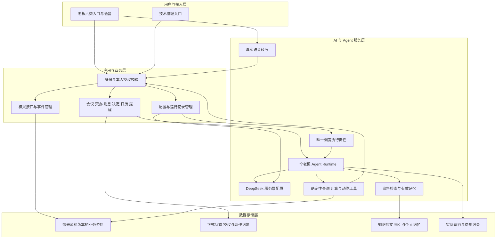

图中为产品职责，服务进程、数据库和开源适配位置由 T02/T04 决定。正式状态由业务服务维护，模型输出不直接修改状态。Knowledge Base、Personal Memory、Task State 分别管理；模型用量和运行事件来自实际调用。部门人员仅在 Facts 中作为资料对象存在。

## 5. 业务流程与状态流转

### 5.1 用户旅程与跨角色过程

| 旅程 | 入口与前置 | 老板输入与动作 | 结果与结束 | 异常与恢复 |
|---|---|---|---|---|
| J01 连续经营日 | 今日；当前数据集、目标和日历有效 | 查看本人事项→追问指标与客户周期→准备会议→授权交办→检查反馈→确认完成 | 同一事件、会议、任务、消息和证据可查询；下次复查继续检查经营状态 | 缺少资料进入 WAITING_MATERIAL；接口失败展示已完成步骤与未执行步骤 |
| J02 临时变化 | 会议/任务；已有安排或待确认内容 | 更改时区、会议时间、收件人或审批版本→核查影响→授权当前内容 | 新版本可重读；历史版本与授权保留 | 当前版本改变时停止旧版本写入；补充有效决定后继续 |
| J03 持续记忆 | 通知与设置；本人认证 | 确认或修改要求→新会话查询→删除→重启后查询 | 只采用当前有效记忆；历史决定仍可按权限查阅 | 索引或保存失败明确显示未生效；不能显示更新成功 |
| J04 技术维护 | 后台；维护认证 | 生成资料→人工调用→启用配置→运行→重读→注入反馈/推进时钟 | 配置与运行版本一致，专业反馈作为模拟来源可查 | 维护业务决定请求拒绝；反馈不会自动确认交办完成 |
| J05 语音交办 | 聊天语音入口；录音授权与服务可用 | 录音→真实转写→本人核查修改文本→提交 | 与文字交办共用授权及业务状态 | 无声、不可识别、上传或服务失败显示原因，不生成预设文本 |

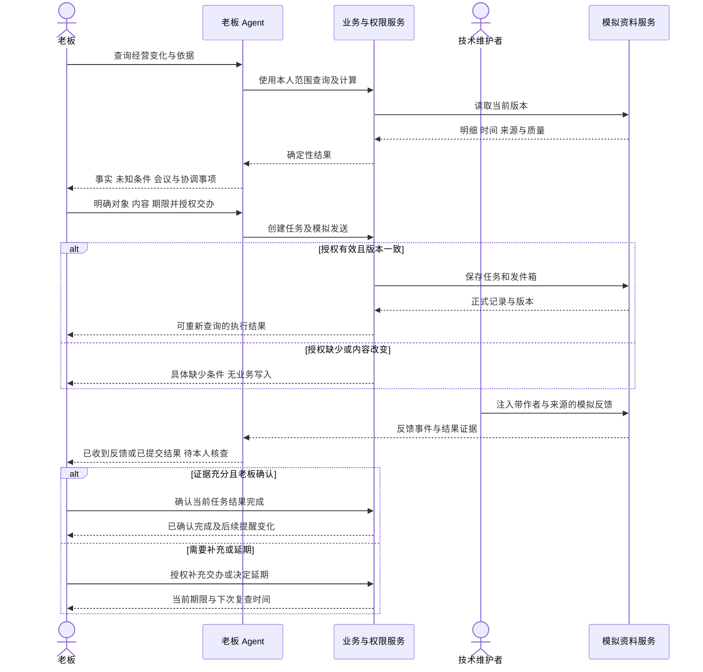

### 5.2 交办状态

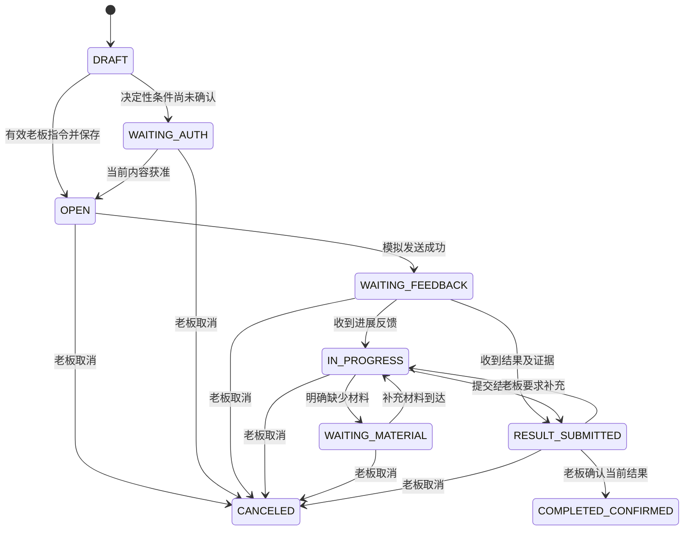

交办的 overdue 是由有效期限和业务时钟计算的属性，extension_request 独立记录 PENDING/APPROVED/REJECTED；进展反馈不会更改有效期限。延期批准需要当前任务版本、老板授权和新期限；原期限保留历史。取消后到达的反馈存入历史，不能重新激活催办。COMPLETED_CONFIRMED 与 CANCELED 为终态；新增工作建立关联交办。OPEN 仅表示已保存，发送状态单独查询。草稿取消进入 CANCELED。

### 5.3 各对象的独立状态与转换

| 对象 | 状态与含义 | 触发、校验与目标状态 | 异步消息、失败与恢复 |
|---|---|---|---|
| 消息 | DRAFT、WAITING_AUTH、READY、SENDING、SENT、FAILED、CANCELED | 草稿内容与收件人获准→READY；提交→SENDING；模拟发件箱保存成功→SENT；未写入且报错→FAILED | message.sent 只证明模拟发送；确认接收单独记录 delivery_state；reply 以新消息关联原消息；无法确定写入结果时 execution_state=RECONCILING，重新查询后确定，禁止重复发送 |
| 审批决定 | WAITING_MATERIAL、PENDING_DECISION、EXECUTING、APPROVED、REJECTED、SUPPLEMENT_REQUESTED、FAILED、CANCELED | 材料完整→PENDING_DECISION；老板针对版本选择同意/拒绝/补充→EXECUTING；服务保存相应决定后进入对应结果 | approval.decided；失败保留执行记录；补充材料形成新申请版本和 PENDING_DECISION；申请变更使旧授权失效；已保存决定不能通过取消抹除 |
| 会议安排 | DRAFT、SCHEDULED、HELD、CANCELED | 老板授权完整时间/时区/参会对象→SCHEDULED；到会记录或本人确认→HELD；本人取消→CANCELED | meeting.changed 使相关准备材料 NEEDS_REVIEW；仅修改获准日历对象，不推定联系人已接受 |
| 会议材料与纪要 | EMPTY、PREPARING、READY_FOR_REVIEW、CONFIRMED、NEEDS_REVIEW、FAILED | 检索成功→READY_FOR_REVIEW；本人确认对应内容版本→CONFIRMED；来源或参会信息变化→NEEDS_REVIEW | minutes.confirmed 可触发已获准的任务创建；保存纪要、创建交办分别留结果；会议结束不会自动确认纪要 |
| 提醒 | PENDING、DELIVERED、ACKNOWLEDGED、SNOOZED、CLOSED、CANCELED、FAILED；suppression_reason 独立 | 规则满足→PENDING；通知中心实际保存→DELIVERED；老板知晓→ACKNOWLEDGED；暂缓指定时间→SNOOZED；本人关闭→CLOSED | reminder.changed；免打扰/冷却期间记录抑制原因；到暂缓时间重读规则和事项；源事件恢复发出规则允许的恢复通知，不改写交办完成 |
| 外部专业资料有效性 | RECEIVED、VALID、INCOMPLETE、CONFLICTED、SUPERSEDED、WITHDRAWN、EXPIRED | 接口输入→RECEIVED；必需来源及版本有效→VALID；缺少/冲突保留对应状态；版本更新/撤销/过期停止当前采用 | source.changed 使引用产物 NEEDS_REVIEW；历史保留当时引用与失效标记；VALID 只表示可用资料，不等于专业结论已确认 |
| 外部专业进展 | OBSERVED、PENDING_REVIEW、PROFESSIONALLY_CONFIRMED、ACTION_REPORTED、FOLLOWUP_PENDING、REVIEW_RESULT_REPORTED | 仅按来源材料中的专业作者、适用范围和证据更新；缺少确认时保持 PENDING_REVIEW | 专业进展来自模拟接口；老板确认交办不能改变专业结论；复查结果不能自行证明周期已结算 |
| 业务事件与周期 | 事件 OPEN/UNDER_REVIEW/HANDLING/RECOVERED/CLOSED；周期 PLANNED/ACTIVE/PARTIALLY_SETTLED/SETTLED | 来源更新及适用证据驱动；事件恢复与周期结算分别提供记录 | 已完成解释任务仍可关联 OPEN 事件与 ACTIVE 周期；继续使用有效复查计划 |
| 运行 | QUEUED、RUNNING、WAITING_INPUT、SUCCEEDED、FAILED、CANCELED、TIMED_OUT | 有效输入启动；缺少必要决定等待；运行结束记录 stop_reason | 运行失败不覆盖已执行的业务动作；SUCCEEDED 仅说明本次运行目标，不替代老板完成确认 |
| 记忆与配置 | 记忆 PROPOSED/CONFIRMED/SUPERSEDED/DELETED；配置 DRAFT/VALIDATED/ENABLED/DISABLED/INVALID | 本人确认记忆才可持续采用；配置校验通过后启用版本 | 新任务读取有效版本；在途任务保留启动快照，但写入前重新校验当前授权和对象状态 |

全部状态转换保存主体、来源事件、旧版本、新版本、真实时间和业务时间。状态写入与可重读记录共同构成成功依据；异步事件不得作为另一主体的授权。失败后可以由有效指令发起新尝试，必须先查询既有执行结果。

## 6. 竞品分析

核查日期：2026-10-21。使用 web 搜索及官方页面全文进行文本研究，没有执行产品统一任务或视觉检查；页面参考不构成开源选型决定。

| 序号 | 产品 | 定位与官方能力 | 可借鉴的模式 | 适用限制与本产品验证重点 | 参考 |
|---|---|---|---|---|---|
| 1 | Claude Cowork | 跨选定文件与工具完成多步骤工作，呈现过程，支持定期任务 | 目标交办、可检查产物、持续任务与访问控制 | 官方材料说明套餐和管理配置影响能力；本项目需要独立验证农业指标、老板授权和正式状态，未作能力优劣排名 | [官方产品页面](https://claude.com/product/cowork)，发布日期未标明，核查 2026-10-21 |
| 2 | Microsoft Copilot Researcher | 将有权访问的工作资料与网页用于多步骤研究，生成带来源的报告 | 明确研究范围、提供引用与组织跨资料问题 | 官方说明深入研究需要更多处理时间；本项目的会议交办及完成确认需要业务验证，页面能力未证明本项目用例效果 | [官方介绍](https://learn.microsoft.com/en-us/microsoft-365/copilot/researcher-agent)，更新 2026-08-18，核查 2026-10-21 |

以上设计启发属于 INFERRED。价格、节省时间、市场份额和生产可靠性不作为本 PRD 指标依据。固定开源版本及实际能力继续由 D03/T02 确认。

## 7. 功能说明概览与需求映射

P0 表示共同基础，P1 表示连续演示，P2 表示秘书分支，P3 表示农业专题。全部优先级均为必需范围，沿用 PRD-0 第 11.8 节。每行 FR-nn 对应 BR-nn、AC-nn-S、AC-nn-E，另继承第 8 节共同规则和异常检查。metric_id 指向 VV-T00 中同名定义，场景采集还须继承 common_protocol。

| R | FR / 功能与模块 | 入口 | goal_id | hypothesis_id | metric_id | 顺序 | 下游验收 |
|---|---|---|---|---|---|---|---|
| R01 | FR-01 晨间安排 | 今日/聊天 | G01 G02 | H01 | M01 M02 M03 M04 M05 M06 M08 M09 M10 | P1 | A18 A24 |
| R02 | FR-02 经营提醒 | 经营/通知 | G02 G03 | H02 | M01 M02 M03 M04 M06 M07 M08 M09 M10 | P1 | A17 A19 A24 |
| R03 | FR-03 BI 连续查询 | 经营/聊天 | G01 G03 | H03 | M01 M02 M03 M04 M05 M08 M09 M10 | P1 | A13 A16 A24 |
| R04 | FR-04 会前准备 | 会议/聊天 | G02 G03 | H04 | M01 M02 M03 M04 M05 M06 M08 M09 M10 | P1 | A14 A15 A16 A18 A24 |
| R05 | FR-05 会后纪要 | 会议/聊天 | G02 G03 | H05 | M01 M02 M03 M04 M05 M06 M07 M10 M11 | P1 | A14 A16 A18 A24 |
| R06 | FR-06 交办与承诺 | 任务/聊天 | G02 G03 | H06 | M01 M02 M03 M04 M05 M06 M07 M10 M11 | P1 | A14 A17 A24 |
| R07 | FR-07 文件与审批 | 今日/资料 | G02 G03 | H07 | M01 M02 M03 M04 M05 M06 M10 M11 | P2 | A14 A15 A16 A24 |
| R08 | FR-08 沟通与关系 | 聊天/任务 | G02 G03 | H08 | M01 M02 M03 M04 M05 M07 M10 M11 | P2 | A14 A16 A24 |
| R09 | FR-09 战略与行业研究 | 资料/聊天 | G02 G03 | H09 | M01 M02 M03 M04 M05 M06 M08 M09 M10 | P2 | A15 A16 A24 |
| R10 | FR-10 人员会面 | 会议/聊天 | G02 G03 | H10 | M01 M02 M03 M04 M05 M06 M10 M12 | P2 | A14 A15 A16 A24 |
| R11 | FR-11 出行与接待 | 今日/会议 | G02 G03 | H11 | M01 M02 M03 M04 M05 M06 M07 M10 M11 | P2 | A14 A16 A24 |
| R12 | FR-12 私人安排 | 今日/设置 | G02 G03 | H12 | M01 M02 M04 M05 M06 M10 M11 M12 | P2 | A11 A14 A24 |
| R13 | FR-13 长期决定与记忆 | 设置/聊天 | G02 G03 | H13 | M01 M02 M03 M04 M05 M06 M10 M12 M13 | P1 | A15 A19 A24 |
| R14 | FR-14 原料与饲料 | 经营/会议 | G01 G03 | H14 | M01 M02 M03 M04 M05 M06 M08 M09 M10 | P3 | A21a A24 |
| R15 | FR-15 水产季节 | 经营/会议 | G01 G03 | H15 | M01 M02 M03 M04 M05 M06 M08 M09 M10 | P3 | A21b A24 |
| R16 | FR-16 苗种批次 | 经营/任务 | G01 G03 | H16 | M01 M02 M03 M04 M05 M06 M08 M09 M10 | P3 | A21c A24 |
| R17 | FR-17 动保与技服 | 经营/任务 | G01 G03 | H17 | M01 M02 M03 M04 M05 M06 M08 M09 M10 M11 | P3 | A22a A24 |
| R18 | FR-18 生猪合作 | 经营/会议 | G01 G03 | H18 | M01 M02 M03 M04 M05 M06 M08 M09 M10 | P3 | A22b A24 |
| R19 | FR-19 禽类与反刍 | 经营/会议 | G01 G03 | H19 | M01 M02 M03 M04 M05 M06 M08 M09 M10 | P3 | A22c A24 |
| R20 | FR-20 公司水产养殖 | 经营/任务 | G01 G03 | H20 | M01 M02 M03 M04 M05 M06 M08 M09 M10 M11 | P3 | A23a A24 |
| R21 | FR-21 食品与品质 | 经营/任务 | G01 G03 | H21 | M01 M02 M03 M04 M05 M06 M08 M09 M10 M11 | P3 | A23b A24 |
| R22 | FR-22 海外业务 | 经营/会议 | G01 G03 | H22 | M01 M02 M03 M04 M05 M06 M08 M09 M10 | P3 | A23c A24 |
| R23 | FR-23 研发应用 | 资料/会议 | G01 G03 | H23 | M01 M02 M03 M04 M05 M06 M08 M09 M10 | P3 | A23d A24 |
| R24 | FR-24 Runtime 与 DeepSeek | 聊天/后台 | G01 G04 | H24 | M01 M02 M08 M09 M11 M13 M15 | P0 | A02 A04 A07 A16 A24 |
| R25 | FR-25 模拟环境 | 后台 | G01 G04 | H25 | M01 M02 M03 M07 M13 M16 | P0 | A05 A06 A12 A19 A24 |
| R26 | FR-26 老板与维护入口 | 全部入口 | G01 G02 G04 | H26 | M01 M02 M04 M05 M08 M10 M12 M16 | P0 | A03 A08 A18 A19 A24 |
| R27 | FR-27 语音交办 | 聊天/设置 | G01 G02 | H27 | M01 M02 M04 M05 M08 M09 M10 M11 | P2 | A07 A08 A20 A24 |
| R28 | FR-28 身份与授权 | 全部入口/工具 | G01 G03 | H28 | M01 M02 M07 M11 M12 | P0 | A01 A06 A09 A11 A14 A24 |
| R29 | FR-29 异常与未知输入 | 全部入口/工具 | G01 G03 G04 | H29 | M01 M02 M06 M07 M08 M09 M11 M12 | P0 | A09 A12 A14 A16 A24 |
| R30 | FR-30 运行与费用 | 后台/任务结果 | G01 G04 | H30 | M02 M03 M08 M09 M15 M16 | P0 | A11 A16 A19 A24 |
| R31 | FR-31 独立评测 | 后台/全部老板任务 | G01 G04 | H31 | M01 M02 M03 M04 M05 M06 M07 M08 M09 M10 M13 M15 | P0 | A09 A21a A21b A21c A22a A22b A22c A23a A23b A23c A23d A24 |
| R32 | FR-32 运行与交接 | 本地运行/文档 | G01 G04 | H32 | M01 M02 M13 M15 M16 | P0 | A10 A11 A25 A26 |

每项来源位置与项目计划第 2 节同编号 R 保持一致；第 8 节再次注明具体需求章节。业务价值采用本表 goal_id、hypothesis_id 及 PRD-0 同编号价值映射，不能将预期改善登记为实测收益。

## 8. 详细功能描述与 BDD 验收

### 共同规则、页面状态与异常验收

| BR | 适用行为 |
|---|---|
| BR-C01 | 老板事项显示事实、截至时间、影响范围、处理人、缺少材料、本人参与原因、可选动作与期限；读取、查询、草稿在既有交办范围内继续 |
| BR-C02 | 写入校验身份、owner_id、action、target_id、内容版本、授权范围和有效期；明确授权继续有效；对象/收件人/正文/金额/时间改变才重新取得必要决定 |
| BR-C03 | 每项事实保留 SIMULATED/PUBLIC_SOURCE/RUNTIME_RECORD、来源版本、时间、范围；未知不填零；原文指令不获得权限；当前引用排除失效与无权资料 |
| BR-C04 | 同一业务意图与相同内容重复提交返回原结果；相同幂等标识携带不同内容拒绝；并发使用当前版本校验；写入后重读；模型失败不抹除已执行动作 |
| BR-C05 | 农业结论检查品种、用途、阶段、批次、归属、单位、时间、覆盖与估计；因果必须有证据；专业意见保留作者，专业执行范围遵守 D11 |
| BR-C06 | 任务、消息、审批、会议、提醒、专业资料独立维护状态；配置、记忆与调度有唯一有效维护位置；取消、暂停及重启不能重复执行已完成动作 |
| BR-C07 | 费用、时延、资源与采用按 VV-T00 测量；数值阈值未知不宣称达标；预算未知不等于零或无限；本地与两天约束不减少验收范围 |

所有 FR 均继承下表 E01—E06。每项 AC-nn-E 包含该功能专有异常及这六项适用检查；读操作也必须检查越权、并发资料变化、重复请求和上游失败。没有业务写入的功能验证零业务变更，失败结果与历史成果分别展示。

| 异常 ID | Given / When | Then 与观察位置 | 依据 |
|---|---|---|---|
| E01 断网与中断 | 有效输入后连接中断或流式输出中断 | 页面显示中断及 run_id，重连查询正式结果；未确认执行状态进入 RECONCILING，禁止盲目重发 | R29，需求 10.4—10.5 |
| E02 并发与版本 | 正在读取或确认时对象/资料/权限更新 | 读取固定快照并显示版本；写入校验失败无新变更，重新展示当前内容；历史引用标明需要复核 | R28/R29 |
| E03 权限 | 未认证、维护越权、联系人伪造或工具范围不足 | 明确拒绝；检查无正文暴露、无业务写入，日志仅含获准摘要 | D11，R12/R28 |
| E04 重复 | 双击、重复工具请求、重复事件或重启续接 | 相同意图单一业务结果；冲突内容报错；通知和发件箱可独立核对 | R02/R25/R29 |
| E05 上游失败 | 模型、检索、转写、资料接口不可用或超时 | 失败在发生位置记录，依赖动作终止；不更换模型、不填预设答案，缺少材料明确 | D02/D07，R24/R29 |
| E06 下游失败 | 保存、发送、索引或通知失败，或写入后模型失败 | 分项显示已执行/未执行；重读确认现状；结果不会伪报全部成功；后续操作检查既有记录 | R06/R24/R29 |

页面通用状态：未加载、加载中、空内容、运行中、待输入、完成、失败、无权限；正文较长时分页或展开，完整内容可访问，禁止静默截断。输入大小、文件格式及服务限制采用已验证能力配置，超限在提交前明确提示；具体数值由 T02/T05/T08 确定。无内容不自动解释为零经营结果。表中“条件必填”指对应动作启用前必须具备，不适用于纯查询。

线框版本 WF-1.1：每个 FR 对应一个 WF-FR-nn，每项管理能力对应一个 WF-ADnn。Mermaid 外框表示页面内的功能区域，矩形表示导航、字段、内容、操作与状态；不可见连线仅用于排列位置。各图均为信息布局，数据由实际服务提供，未预填运行结果。按钮动作、必填条件与授权继承本节元素表和 AC；运行中允许取消未执行步骤，失败区展示原因及已执行结果，无权限时不显示受限正文。各功能可以复用同一页面的页签或详情区域；T03 保留全部功能及状态，按开源页面结构决定排版。当前未执行视觉检查。

### 8.1 FR-01 晨间安排

来源：R01，需求 4.2—4.4、13.5。用户故事：作为老板，希望查看今日本人事项及依据，安排时间和决定。

| 维度 | 规则 |
|---|---|
| 输入与资料 | “今天有哪些事情需要我处理”；老板目标、日历、本人承诺、截止时间、待决定申请、事件和已有措施 |
| BR-01 | 按待决定、待协调、需要知晓分类，显示排序理由；同一事项使用关联记录合并；即时风险按有效规则提升显示顺序；私人安排只在本人权限内呈现 |
| 本人授权 | 汇总采用已有查询授权；排序调整保存本人设置；交办和变更分别使用 BR-C02 |
| 结果与结束 | 今日清单、冲突、准备材料和操作入口已生成可查询版本；查询完成不结束关联交办 |
| 异常 | E01—E06；缺少目标显示未设置，缺少某来源显示覆盖缺口，不能声称当日没有事项 |

#### 8.1.1 页面元素与规则

| 元素 | 控件 | 来源/规则 | 必填 | 默认 |
|---|---|---|---|---|
| 日期与时区 | 日期选择 | 老板时区与业务日期 | 是 | 当前模拟日期、Asia/Shanghai |
| 本人事项 | 分类列表 | 目标、期限、参与原因、来源及状态 | 系统返回 | 待决定优先显示 |
| 调整次序/交办 | 操作按钮 | 显示对象和结果去向 | 条件必填 | 无自动写入 |

#### 8.1.2 线框与 BDD 验收

##### WF-FR-01 晨间安排线框

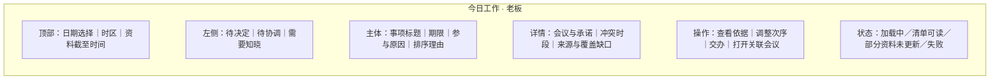

- AC-01-S：Given 当前目标、会议、承诺与经营事件有效；When 老板从今日提交晨间问题；Then 清单包含所有需本人处理项、排序依据、时间冲突与引用，打开事项可读取同一版本，老板调整次序后重载保留设置。
- AC-01-E：Given 一个区域来源未更新且存在私人日历；When 汇总并执行 E01—E06；Then 显示未更新范围，维护身份无法获得私人正文，同一事件不重复建项；错误不会显示完整覆盖。

### 8.2 FR-02 经营提醒

来源：R02，需求 5.3—5.5。用户故事：作为老板，希望在需要本人协调时收到可处理的提醒。

| 维度 | 规则 |
|---|---|
| 输入与资料 | 关注规则、指标更新、事件或期限到达；目标、已有措施、负责人权限、通知与复查计划 |
| BR-02 | 同时判断影响、持续时间、可信程度、处理人及本人参与条件；一般进展进入汇总；跨职责资源不足或有效升级条件满足才即时通知；恢复、冷却、免打扰、合并分别留记录 |
| 本人授权 | 本人设定关注与计划；维护仅配置技术参数和获准演示规则，不能扩大老板授权 |
| 结果与结束 | 通知中心出现可查询提醒及规则版本；知晓、暂缓、加入会议、交办、关闭各自保存；源事件保持来源状态 |
| 异常 | E01—E06；重复事件、暂停、取消、重启和迟到事件均按当前事项状态及同一事件标识处理 |

#### 8.2.1 页面元素与规则

| 元素 | 控件 | 来源/规则 | 必填 | 默认 |
|---|---|---|---|---|
| 触发依据 | 只读卡片 | 数值、持续、规则版本、参与原因、处理人 | 是 | 不隐藏未知条件 |
| 知晓/暂缓/关闭 | 动作组 | 暂缓必须指定新提醒时间，不改变任务期限 | 条件必填 | 未处理 |
| 规则参数 | 配置表单 | 第 12.3 节演示配置；保存、启用分开 | 是 | 可读取有效版本 |

#### 8.2.2 线框与 BDD 验收

##### WF-FR-02 经营提醒线框


- AC-02-S：Given 已启用规则及需跨职责协调事件；When 推进业务时钟并触发更新；Then 实际调度产生一个提醒，包含本人参与原因；暂缓后到期重读状态，恢复时按规则形成恢复记录。
- AC-02-E：Given 重复事件、冷却或免打扰期间、暂停计划及已取消交办；When 分别触发并重启；Then 抑制原因可查，零重复发送，暂停和取消持续有效，期限及原始事件未被关闭提醒修改；检查 E01—E06。

### 8.3 FR-03 BI 连续查询

来源：R03，需求 5.1—5.2、5.6、13.2。用户故事：作为老板，希望连续追问经营变化并查看可复算依据。

| 维度 | 规则 |
|---|---|
| 输入与资料 | 指标、地区、产品、期间或上下文追问；明细、公式、单位、目标版本、币种、结算状态与数据覆盖 |
| BR-03 | 确定性工具计算；聚合比例重新汇总分子分母；匹配期间和业务范围；区分百分点与百分比、内部耗用与外销；零分母返回未定义；未同步范围保持未知 |
| 本人授权 | 查询在授权范围内；改变维度重新查询；解释不自动授权交办或发送 |
| 结果与结束 | 答案、原始精度、展示舍入、明细、公式、读取/更新时间及来源可查；原因仅引用证据，未解释部分列材料需求 |
| 异常 | E01—E06；不可比期间或币种不直接计算差值；财务与业务口径冲突并列说明，不能按职位选数值 |

#### 8.3.1 页面元素与规则

| 元素 | 控件 | 来源/规则 | 必填 | 默认 |
|---|---|---|---|---|
| 查询范围 | 筛选表单/自然语言 | 有效维度、期间及业务范围；歧义需补充 | 是 | 显示继承的上下文 |
| 指标与明细 | 数值表/引用 | 定义版本、单位、精度、覆盖和模拟属性 | 是 | 原始结果不截断 |
| 追问 | 输入框 | 新参数覆盖明确指定的旧参数 | 否 | 保留可见上下文 |

#### 8.3.2 线框与 BDD 验收

##### WF-FR-03 BI 连续查询线框


- AC-03-S：Given 需求 13.2 的授权模拟明细；When 查询销量、收入、毛利率及单吨毛利并改为产品维度追问；Then 独立复算得到增长 20%、增长 20%、毛利减少 4%、毛利率减少 2 个百分点、单吨毛利减少 20%，新追问出现新的查询参数与匹配明细。
- AC-03-E：Given 缺少成本原因明细、部分地区未同步或可比条件不成立；When 查询原因并执行 E01—E06；Then 不编造原因，不将缺少范围计零，不平均地区比率，错误范围不产生确定数值结论。

### 8.4 FR-04 会前准备

来源：R04，需求 4.5—4.6、13.5。用户故事：作为老板，希望进入会议前获得承诺、冲突与待决定内容。

| 维度 | 规则 |
|---|---|
| 输入与资料 | 指定会议或“下午与负责人会面”；日历、参会人、历史纪要、目标、交办、指标、汇报和附件 |
| BR-04 | 根据会议标识关联材料，列出历史承诺状态、共识、冲突、缺少资料、准备期限与本人决定；引用固定版本；来源变化标明 NEEDS_REVIEW |
| 本人授权 | 获准材料可持续整理；索取材料或修改参会安排需有效动作授权 |
| 结果与结束 | 会前材料 READY_FOR_REVIEW 可打开原文，关联会议与交办；准备完成不代表会议举行 |
| 异常 | E01—E06；同名参会人无法确定时请求身份信息；附件不可读保留缺口 |

#### 8.4.1 页面元素与规则

| 元素 | 控件 | 来源/规则 | 必填 | 默认 |
|---|---|---|---|---|
| 会议与参与人 | 对象选择 | 稳定标识、职责、日程与时区 | 是 | 当前选定会议 |
| 议题与证据 | 文档视图 | 决定、承诺、冲突和资料清单 | 是 | READY_FOR_REVIEW |
| 请求资料 | 草稿动作 | 显示缺少项、收件人和发送授权 | 条件必填 | DRAFT |

#### 8.4.2 线框与 BDD 验收

##### WF-FR-04 会前准备线框


- AC-04-S：Given 有历史承诺、最新指标及待决定申请的会议；When 准备会前材料；Then 可逐项打开参会人、未完成承诺、当前指标和议题依据，生成的资料清单与会议版本一致。
- AC-04-E：Given 会议改期、附件失效或参会人变化；When 重新查看并执行 E01—E06；Then 显示 NEEDS_REVIEW 和受影响内容，旧材料仍标示原版本，无授权不会发送资料请求。

### 8.5 FR-05 会后纪要

来源：R05，需求 13.4—13.5。用户故事：作为老板，希望将会议记录形成可核查的决定及交办。

| 维度 | 规则 |
|---|---|
| 输入与资料 | 会议记录、参会人、关联事项与本人明确决定 |
| BR-05 | 意见、建议、已明确决定与交办草稿分别标识；责任人、期限、产物和检查方式不可猜测；纪要与任务用关联标识连接 |
| 本人授权 | 本人已明确的决定和交办在内容版本有效时保存；其余等待必要确认；确认纪要不隐含发送所有草稿 |
| 结果与结束 | 已确认纪要、决定和获准任务可重读；每项保存/发送结果分别呈现 |
| 异常 | E01—E06；责任人或期限歧义保留 WAITING_AUTH，部分动作成功后模型失败保留实际记录 |

#### 8.5.1 页面元素与规则

| 元素 | 控件 | 来源/规则 | 必填 | 默认 |
|---|---|---|---|---|
| 原始会议记录 | 资料选择 | 来源、版本、参会人 | 是 | 无选中资料 |
| 纪要/决定/交办 | 分类编辑器 | 每条关联原文与对象、期限、证据要求 | 条件必填 | 草稿 |
| 保存与发送 | 分项动作 | 显示对应授权和实际结果 | 条件必填 | 不默认全部选择 |

#### 8.5.2 线框与 BDD 验收

##### WF-FR-05 会后纪要线框


- AC-05-S：Given 会议记录及明确老板决定；When 整理并执行获准保存；Then 决定指向原记录，交办包含负责人、期限和产物，任务页面重读一致，发送仅执行获准项。
- AC-05-E：Given 讨论意见尚无决定或版本改变；When 要求形成纪要并执行 E01—E06；Then 意见保持意见，缺少条件可见，未授权任务没有正式写入；重复确认无重复任务。

### 8.6 FR-06 交办与承诺

来源：R06，需求 4.5—4.6、13.4。用户故事：作为老板，希望持续查询进展并亲自决定延期、取消和完成。

| 维度 | 规则 |
|---|---|
| 输入与资料 | 任务目的、唯一负责人、期限、所需证据；原消息、反馈、附件与延期申请 |
| BR-06 | 创建任务关联授权、会议与事件；区分本人承诺和对他人交办；进展回复进入 IN_PROGRESS，结果证据进入 RESULT_SUBMITTED；只有老板确认进入 COMPLETED_CONFIRMED |
| 本人授权 | 创建、催办、期限变更、取消、确认完成各自校验；有效明确指令直接执行；延期申请不改变当前期限 |
| 结果与结束 | 任务、模拟发件箱、反馈与证据可互相查询；老板确认或取消后停止对应催办，业务事件与周期状态保持独立 |
| 异常 | E01—E06；取消后迟到回复仅进入历史；缺少附件时提示补充，不能确认有充分完成证据 |

#### 8.6.1 页面元素与规则

| 元素 | 控件 | 来源/规则 | 必填 | 默认 |
|---|---|---|---|---|
| 交办内容 | 表单 | 目的、负责人 ID、期限/时区、产物、证据、关联事项 | 是 | DRAFT |
| 进展与申请 | 时间线 | 作者、原期限、新期限申请、证据和来源 | 系统返回 | 无反馈 |
| 完成/延期/取消/催办 | 动作组 | 当前版本及授权；催办显示具体消息 | 条件必填 | 无预选决定 |

#### 8.6.2 线框与 BDD 验收

##### WF-FR-06 交办与承诺线框


- AC-06-S：Given 老板明确交办及期限；When 保存并模拟发送、注入进展、延期申请和结果；Then 原期限保持直到老板批准，反馈与 RESULT_SUBMITTED 可查；老板确认当前结果后才进入 COMPLETED_CONFIRMED，重读及下一次提醒采用新状态。
- AC-06-E：Given 结果缺少证据、重复反馈或取消与回复并发；When 处理并执行 E01—E06；Then 无自动完成、无重复任务/催办，取消后反馈不能恢复任务，已发送消息保留记录。

### 8.7 FR-07 文件与审批

来源：R07，需求 10.4—10.5、13.3、13.5。用户故事：作为老板，希望理解待审材料及版本差异，并记录本人决定。

| 维度 | 规则 |
|---|---|
| 输入与资料 | 申请 ID、附件、依据、金额与币种、版本、既有决定和本次操作 |
| BR-07 | 展示申请摘要、逐项差异及缺少资料；审批只记录老板决定，不执行资金交易或专业放行；金额、收件对象与版本变更使对应旧确认失效 |
| 本人授权 | 同意、拒绝、请求补充均由本人指令产生；无默认自动批准；缺少决定必需资料保留 WAITING_MATERIAL |
| 结果与结束 | 模拟审批记录保存当前版本及老板授权，后续读取显示决定；补充申请等待新材料 |
| 异常 | E01—E06；损坏附件显示不可读；旧版本确认拒绝，不能用旧金额执行 |

#### 8.7.1 页面元素与规则

| 元素 | 控件 | 来源/规则 | 必填 | 默认 |
|---|---|---|---|---|
| 申请与附件 | 原文/差异视图 | 来源版本、金额币种、缺少项 | 是 | 当前有效版本 |
| 决定 | 选择与意见 | 同意、拒绝、补充；显示适用范围 | 条件必填 | 未选择 |
| 执行结果 | 状态卡 | 决定、授权、实际写入版本 | 系统返回 | 待决定 |

#### 8.7.2 线框与 BDD 验收

##### WF-FR-07 文件与审批线框


- AC-07-S：Given 完整有效申请和老板对当前版本的决定；When 执行审批动作；Then 记录金额、币种、版本、本人授权与决定，可重读且无实际资金交易。
- AC-07-E：Given 缺少附件或确认前金额改变；When 提交旧决定并执行 E01—E06；Then 明确缺少项或版本冲突，申请不进入 APPROVED；维护身份操作拒绝。

### 8.8 FR-08 沟通与关系

来源：R08，需求 4.2、13.5。用户故事：作为老板，希望正确识别待回复事项并发送获准消息。

| 维度 | 规则 |
|---|---|
| 输入与资料 | 收件箱、联系人职责、组织、历史消息、关联承诺、本人表达要求及发送指令 |
| BR-08 | 按稳定联系人 ID 发送，同名时使用上下文核查；身份仍不明确则等待补充；草稿、发送、送达、回复分别呈现 |
| 本人授权 | 草稿可持续生成；发送必须匹配收件人、正文、附件与当前授权；明确发送指令有效时无需重复确认 |
| 结果与结束 | 草稿可编辑；模拟发件箱存在后才能显示 SENT；收到回复创建关联消息并更新任务进展 |
| 异常 | E01—E06；发送超时先查询发件箱，不能把失败请求当未发送直接重发 |

#### 8.8.1 页面元素与规则

| 元素 | 控件 | 来源/规则 | 必填 | 默认 |
|---|---|---|---|---|
| 收件人与关联事项 | 对象选择 | ID、姓名、职责、组织与历史上下文 | 发送必填 | 无猜测选择 |
| 正文与附件 | 编辑器 | 本人有效表达要求及资料权限 | 发送必填 | DRAFT |
| 消息结果 | 时间线 | 发件箱、送达、回复各自记录 | 系统返回 | 待发送 |

#### 8.8.2 线框与 BDD 验收

##### WF-FR-08 沟通与关系线框

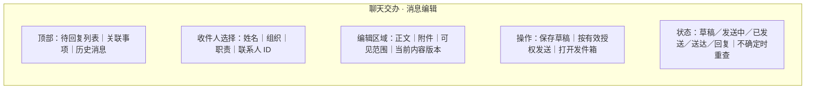

- AC-08-S：Given 收件人、正文与发送动作明确；When 老板提交；Then 只向该联系人生成一次模拟发送记录，后续回复通过 reply_to 关联，任务和消息页面显示一致。
- AC-08-E：Given 两名同名联系人或正文变更；When 尝试发送并执行 E01—E06；Then 无法确定身份时不发送，旧内容授权不应用于新正文；发送失败与已发送状态依据重读确定。

### 8.9 FR-09 战略与行业研究

来源：R09，需求 6.4、13.5。用户故事：作为老板，希望取得有来源、日期和限制的专题材料。

| 维度 | 规则 |
|---|---|
| 输入与资料 | 研究问题、范围、截止日期、公开或合成资料；本人关注目标、相关业务记录 |
| BR-09 | 实际解析、摄取、检索和引用定位；分别标明事实、人员意见、模型推断与待验证因果；行情和天气只有匹配业务关系及时段后才能提出具体影响 |
| 本人授权 | 只读取获准资料；来源正文不能要求修改权限或读取私人信息；后续消息单独授权 |
| 结果与结束 | 专题材料含来源、日期、版本、原文位置、适用范围与待核查问题；无证据的结论保持未知 |
| 异常 | E01—E06；过期、撤销和冲突资料不作为当前确定依据，历史产物显示失效引用 |

#### 8.9.1 页面元素与规则

| 元素 | 控件 | 来源/规则 | 必填 | 默认 |
|---|---|---|---|---|
| 研究范围 | 输入/资料选择 | 问题、期间、国别、业务关系 | 是 | 本次明确问题 |
| 结论与证据 | 引用文档 | 每项断言对应原文及属性 | 是 | 区分事实与假设 |
| 缺少资料 | 清单 | 未覆盖部分及可继续核查的问题 | 系统返回 | 无自动补造 |

#### 8.9.2 线框与 BDD 验收

##### WF-FR-09 战略与行业研究线框


- AC-09-S：Given 获准公开与合成资料；When 研究并追问一项结论；Then 能打开支持该结论的原文位置、日期和版本，模拟内容标识保持，假设与事实分别表达。
- AC-09-E：Given 资料被撤销、冲突或含越权指令；When 新会话检索并执行 E01—E06；Then 无效资料不作为当前依据，冲突可查看，工具范围不变化。

### 8.10 FR-10 人员会面

来源：R10，需求 4.2、13.5。用户故事：作为老板，希望围绕获准工作事实准备与负责人的沟通。

| 维度 | 规则 |
|---|---|
| 输入与资料 | 联系人、会面目的、目标、历史交办、承诺、汇报和当前反馈 |
| BR-10 | 按职责有效期和对象 ID 组织工作事实、待回答问题与本人判断；不推断未提供的私人特征；作者观点保留来源 |
| 本人授权 | 读取获准工作资料；沟通决定由本人作出；联系人没有系统操作权 |
| 结果与结束 | 有出处的会面材料及需要本人判断的问题可查，可关联已有会议 |
| 异常 | E01—E06；历史职责与当前负责人不同需说明；受限材料只显示无权读取 |

#### 8.10.1 页面元素与规则

| 元素 | 控件 | 来源/规则 | 必填 | 默认 |
|---|---|---|---|---|
| 会面对象与目的 | 对象/文本 | 联系人稳定标识、当前职责 | 是 | 未选择 |
| 工作事实与问题 | 材料列表 | 目标、交办、反馈及作者版本 | 是 | 获准内容 |
| 加入会议 | 操作 | 对应会议范围及本人授权 | 条件必填 | 不创建新账号 |

#### 8.10.2 线框与 BDD 验收

##### WF-FR-10 人员会面线框


- AC-10-S：Given 负责人目标、未完成承诺和当前汇报；When 老板准备会面；Then 每项工作事实可回查原文，当前职责与历史责任分别显示，待讨论问题关联原事项。
- AC-10-E：Given 同名人员、职责已调整或资料受限；When 查询并执行 E01—E06；Then 不混合身份、不读取受限正文，缺少依据保持明确。

### 8.11 FR-11 出行与接待

来源：R11，需求 4.2、13.5。用户故事：作为老板，希望知道行程变化对会议和准备事项的影响。

| 维度 | 规则 |
|---|---|
| 输入与资料 | 日期、地点、IANA 时区、交通/预订资料、天气来源、会议、接待对象和准备期限 |
| BR-11 | 使用确定性时间换算；保留本地时间与绝对时间；识别行程缓冲、冲突及受影响准备事项；相对时间基于明确业务时钟 |
| 本人授权 | 查询与建议可持续完成；日程变更按当前时间、对象及内容授权；模拟变更不承诺真实购票或预订 |
| 结果与结束 | 行程、冲突、准备清单和获准变更结果可重读；受影响会议材料标记复核 |
| 异常 | E01—E06；夏令时重复/不存在时刻、缺少时区或交通信息需说明，禁止猜测 |

#### 8.11.1 页面元素与规则

| 元素 | 控件 | 来源/规则 | 必填 | 默认 |
|---|---|---|---|---|
| 起止时间与地点 | 日期/时区/文本 | IANA 时区、跨日、显示本地和老板时间 | 是 | 老板时区仅用于显示 |
| 冲突与准备事项 | 列表 | 日历、交通资料及准备期限 | 系统返回 | 未检查 |
| 确认变更 | 操作 | 显示所有受影响对象与当前版本 | 条件必填 | 不自动改期 |

#### 8.11.2 线框与 BDD 验收

##### WF-FR-11 出行与接待线框

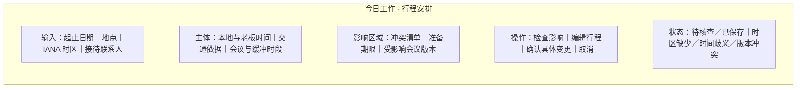

- AC-11-S：Given 跨时区会议和行程；When 老板修改行程并授权变更；Then 时间换算、冲突和准备期限独立检查正确，获准对象更新可重读，关联材料显示变化。
- AC-11-E：Given 时区缺少、歧义时间或日历并发改变；When 提交并执行 E01—E06；Then 指出具体条件，无错误时间写入、无重复安排。

### 8.12 FR-12 私人安排

来源：R12，需求 4.3、11.4、13.5。用户故事：作为老板，希望协调私人和工作时间并控制分享内容。

| 维度 | 规则 |
|---|---|
| 输入与资料 | 本人主动提供的私人日程、正文、时段、访问对象和分享范围 |
| BR-12 | 默认仅本人及此次获准工具读取正文；对外分享默认为占用时间；标题、地点、附件和派生摘要均受正文权限约束 |
| 本人授权 | 本人查看、修改、删除、选择分享范围；维护技术权限不赋予正文读取或私人设置变更权 |
| 结果与结束 | 本人可处理冲突；获准接收方仅得到许可字段；授权撤销后查询、检索与导出均受限制 |
| 异常 | E01—E06；授权范围改变在读取和发送时重新校验；拒绝记录不包含私人正文 |

#### 8.12.1 页面元素与规则

| 元素 | 控件 | 来源/规则 | 必填 | 默认 |
|---|---|---|---|---|
| 私人时段与正文 | 私有编辑器 | owner_id、时区及可见字段 | 是 | 本人可见 |
| 分享范围 | 字段选择 | 接收对象、用途、到期时间 | 分享必填 | 仅占用状态 |
| 冲突处理 | 操作组 | 选择获准变更的具体安排 | 条件必填 | 不自动取消 |

#### 8.12.2 线框与 BDD 验收

##### WF-FR-12 私人安排线框

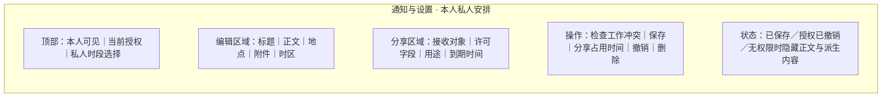

- AC-12-S：Given 私人与工作日程冲突；When 老板查看并授权分享占用时间；Then 老板可见正文、接收材料仅含时段，变更后冲突结果及授权可重读。
- AC-12-E：Given 维护身份、联系人 ID 或已撤销授权；When 请求正文、附件、检索摘要及导出并执行 E01—E06；Then 全部拒绝，正式状态未改写，日志不暴露正文。

### 8.13 FR-13 长期决定与记忆

来源：R13，需求 6.2、11.2、13.5。用户故事：作为老板，希望查询历史依据并控制后续任务采用的个人要求。

| 维度 | 规则 |
|---|---|
| 输入与资料 | 本人目标、表达要求、历史决定、当时依据和后续条件；查看、确认、修改、删除指令 |
| BR-13 | 短期交办不自动成为长期习惯；持续采用仅限 CONFIRMED 且有效记忆；记忆与知识及正式任务状态分别维护；历史决定引用当时版本 |
| 本人授权 | 修改和删除由老板决定；维护不得代改本人要求；系统提出的候选保持 PROPOSED |
| 结果与结束 | 保存后重新读取版本，新会话及重启采用当前要求；删除后检索、上下文摘要与派生索引均不再采用对应内容 |
| 异常 | E01—E06；删除传播尚未完成时禁止采用并显示处理状态；历史资料失效不改写历史决定依据 |

#### 8.13.1 页面元素与规则

| 元素 | 控件 | 来源/规则 | 必填 | 默认 |
|---|---|---|---|---|
| 记忆条目 | 列表/编辑 | 内容、来源、确认、有效期、访问范围、版本 | 保存必填 | 候选未生效 |
| 历史决定 | 时间线 | 决定、当时假设及来源版本 | 系统返回 | 按本人权限 |
| 确认/修改/删除 | 动作组 | 当前版本和授权，显示采用状态 | 条件必填 | 无自动确认 |

#### 8.13.2 线框与 BDD 验收

##### WF-FR-13 长期决定与记忆线框


- AC-13-S：Given 老板已确认简报要求；When 修改要求、创建新会话并重启；Then 后续任务实际采用新版本并显示来源；查询历史决定仍展示当时依据。
- AC-13-E：Given 已删除记忆或撤销资料；When 新会话检索、重启与执行 E01—E06；Then 删除内容不进入回答或上下文，维护修改被拒绝，保存失败不宣称已经生效。

### 8.14 FR-14 原料与饲料

来源：R14，需求 13.7 原料与饲料、14.3。用户故事：作为老板，希望理解原料变化对产品及交付的影响并处理资源协调。

| 维度 | 规则 |
|---|---|
| 输入与资料 | 报价上涨问题；报价/产地/供给天气、合同、在途、批次检验、可用库存、日均耗用假设、有效配方、生产批次、订单及成本 |
| BR-14 | 行情、合同价格、入库成本及实际领用成本分别表达；库存排除待检及限制使用量；配方按有效时间匹配生产；按已配置公式计算覆盖天数和交付缺口；不把行情变化直接写为实际成本变化 |
| 本人参与与授权 | 采购、产品与工厂之间出现超出当前安排的资源申请；老板授权协调交办，工具不执行采购成交或配方发布 |
| 结果与结束 | 可复算影响、假设、未解释部分、会议材料与交办可查；协调任务按 FR-06 完成，供应恢复继续读取专业资料 |
| 异常 | E01—E06；缺少配方或排产时列资料需求；生效时间变化必须重算 |

#### 8.14.1 页面元素与规则

| 元素 | 控件 | 来源/规则 | 必填 | 默认 |
|---|---|---|---|---|
| 原料/产品/时间 | 查询选择 | 稳定 ID、期间和法人 | 是 | 当前问题范围 |
| 成本与供应依据 | 明细表 | 单位、质量、生效时间、公式、估计条件 | 是 | 不填未知值 |
| 协调事项 | 任务表单 | 统筹负责人、期限、证据、老板授权 | 创建必填 | DRAFT |

#### 8.14.2 线框与 BDD 验收

##### WF-FR-14 原料与饲料线框

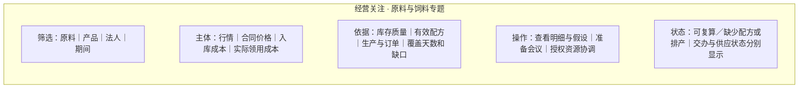

- AC-14-S：Given 完整合同、库存质量、配方和排产；When 老板查询涨价影响并交办协调；Then 影响可由原始数量和成本复算，会议资料与任务引用同一依据，反馈和老板完成分别可查。
- AC-14-E：Given 待检库存、到货延期或有效配方缺少；When 重查并执行 E01—E06；Then 待检量不算可用，条件不足不生成损失金额，禁止采购成交及配方发布。

### 8.15 FR-15 水产季节

来源：R15，需求 13.7 水产季节、14.3。用户故事：作为老板，希望理解订单变化并决定是否协调供应或服务资源。

| 维度 | 规则 |
|---|---|
| 输入与资料 | 区域订单减少；同品种周期、季节曲线、天气、投苗投喂、渠道库存、客户批次、技服反馈、订单回款及观察覆盖 |
| BR-15 | 比较同品种、阶段、区域及可比周期；预测、计划与已执行需求分别显示；客户收益与公司销售应收分别计算；局部回访不代表全量，天气与订单同时变化仅为待核查联系 |
| 本人参与与授权 | 区域提出供应调整或服务资源请求；老板选择会议、核查或授权交办 |
| 结果与结束 | 比较范围、覆盖、需求事实、反馈及原因证据明确；统筹负责人、复查日期和协调任务可查；周期未结束保持观察 |
| 异常 | E01—E06；观察延迟、混养、转塘或周期不同影响可比性，需显示限制 |

#### 8.15.1 页面元素与规则

| 元素 | 控件 | 来源/规则 | 必填 | 默认 |
|---|---|---|---|---|
| 区域与周期 | 筛选 | 品种、阶段、期间及曲线版本 | 是 | 显示比较条件 |
| 需求与覆盖 | 资料表 | 订单、库存、观察日期、回访分母 | 是 | 缺少范围可见 |
| 复查安排 | 日期/任务 | 统筹人员、时间、待核查原因 | 协调必填 | 未安排 |

#### 8.15.2 线框与 BDD 验收

##### WF-FR-15 水产季节线框

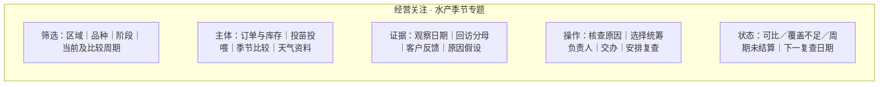

- AC-15-S：Given 同品种可比周期及供应申请；When 老板询问并授权协调；Then 显示季节比较、客户覆盖、事实与假设，任务及下一次复查可重新查询。
- AC-15-E：Given 同时出现天气变化与局部回访；When 追问原因并执行 E01—E06；Then 不建立无证据因果，不外推全部客户，周期未结算不显示最终收益。

### 8.16 FR-16 苗种批次

来源：R16，需求 13.7 苗种批次、14.3。用户故事：作为老板，希望核查共同批次并组织联合调查。

| 维度 | 规则 |
|---|---|
| 输入与资料 | 多位养户反馈；繁育批次、检验、预订、交付、运输损耗、接收、放养条件、养殖批次与回访 |
| BR-16 | 仅按明确关联记录追溯；出苗、接收与后续成活指标分别计算；显示共同批次、不同条件、样本数量及覆盖分母；相似名称不构成关联 |
| 本人参与与授权 | 跨区域联合核查或客户服务协调；老板指定统筹人员和材料要求，不替代专业判断 |
| 结果与结束 | 批次关系、覆盖、条件差异、专业核查问题与后续任务可查；完成条件使用本人确认，专业复查继续独立记录 |
| 异常 | E01—E06；缺少交付关系保持待核查；数量单位不匹配时终止相关汇总 |

#### 8.16.1 页面元素与规则

| 元素 | 控件 | 来源/规则 | 必填 | 默认 |
|---|---|---|---|---|
| 反馈与批次 | 关联清单 | 养户、交付、接收、养殖批次 ID | 是 | 只展示已知关系 |
| 覆盖与条件 | 数值/说明 | 回访范围、单位、观察时间和放养条件 | 是 | 未知保持未知 |
| 联合核查 | 交办表单 | 统筹负责人、专业材料及期限 | 创建必填 | DRAFT |

#### 8.16.2 线框与 BDD 验收

##### WF-FR-16 苗种批次线框

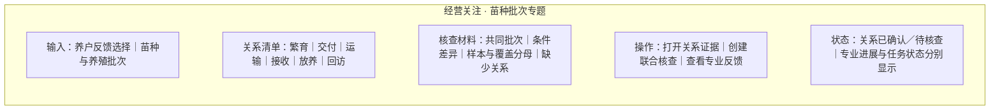

- AC-16-S：Given 有共同苗种交付关系及差异放养条件；When 查询并交办联合核查；Then 已确认关系可回查、回访分子分母正确、专业反馈与任务进展可查。
- AC-16-E：Given 相近批次名称与缺少交付记录；When 查询并执行 E01—E06；Then 不按名称合并，不推断全批次原因，缺少关系进入资料请求。

### 8.17 FR-17 动保与技服

来源：R17，需求 13.7 动保与技服、14.3。用户故事：作为老板，希望知道专业核查进度与专家资源需求。

| 维度 | 规则 |
|---|---|
| 输入与资料 | 健康问题进展；观察、采样、检测、专业作者、确认意见、获准措施、执行记录及下次观察时间 |
| BR-17 | 报告、专业确认、执行与复查按第 5.3 节分别呈现；服务完成与健康结果分开；关联具体批次、覆盖、方法和观察日期；无专业意见不生成用药指令 |
| 本人参与与授权 | 多地共享专家或服务资源需协调；老板只决定协调和资料补充 |
| 结果与结束 | 专业责任、确认程度、证据、缺少资料与下次复查可查；协调完成按 FR-06，专业结果继续观察 |
| 异常 | E01—E06；检测尚未返回、意见冲突或过期保留待确认，不能用模型补充专业结论 |

#### 8.17.1 页面元素与规则

| 元素 | 控件 | 来源/规则 | 必填 | 默认 |
|---|---|---|---|---|
| 专业进展 | 分阶段列表 | 作者、证据、确认、执行及复查 | 是 | 显示来源状态 |
| 资源缺口 | 申请卡 | 区域、批次、专家需求和期限 | 协调必填 | 待核查 |
| 后续复查 | 日期/任务 | 来源指定观察时间与老板交办 | 条件必填 | 不提前判定结果 |

#### 8.17.2 线框与 BDD 验收

##### WF-FR-17 动保与技服线框

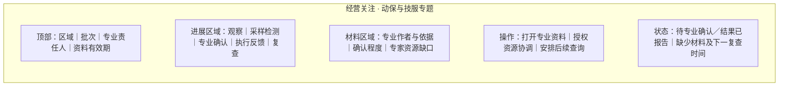

- AC-17-S：Given 观察到复查的专业材料及资源请求；When 老板查询并交办；Then 作者、证据、服务和专业进展分别显示，下一次复查能触发查询，老板确认不修改健康结论。
- AC-17-E：Given 仅有观察且缺少专业确认；When 追问并执行 E01—E06；Then 保持 PENDING_REVIEW，指出缺少材料，零用药指令和专业执行写入。

### 8.18 FR-18 生猪合作

来源：R18，需求 13.7 生猪合作、14.3。用户故事：作为老板，希望理解同批次出栏结果与费用归属。

| 维度 | 规则 |
|---|---|
| 输入与资料 | 批次经营变化；合作关系、仔猪、饲料、服务、人工、存栏转群、出栏重量价格、其他费用和结算 |
| BR-18 | 区分合作农场资产和集团交易；数量满足期初+增加+转入−转出−出售−损耗=期末，估计需误差范围；批次预计、期间利润、已结算结果分开；成本缺项不生成完整利润 |
| 本人参与与授权 | 经营复查、合作争议或资源申请；本人授权核查与会议，不执行资金结算 |
| 结果与结束 | 可复算数量、费用归属、价格影响、未结算项及负责人解释；任务确认与周期结算分别结束 |
| 异常 | E01—E06；数量不平衡时报告差异，不补造交易；转群改变统计范围后重算 |

#### 8.18.1 页面元素与规则

| 元素 | 控件 | 来源/规则 | 必填 | 默认 |
|---|---|---|---|---|
| 批次与合作主体 | 对象选择 | 资产、费用承担及交易关系 | 是 | 同批次 |
| 投入产出与结算 | 明细表 | 数量平衡、金额币种、阶段与估计 | 是 | 未结算项单列 |
| 复查与交办 | 操作 | 负责人解释、证据、期限和授权 | 条件必填 | DRAFT |

#### 8.18.2 线框与 BDD 验收

##### WF-FR-18 生猪合作线框

```mermaid
flowchart TB
  subgraph W["经营关注 · 生猪合作专题"]
    H["筛选：合作主体｜批次｜周期｜结算状态"]
    C["主体：存栏与转群｜出栏重量价格｜投入费用｜数量平衡"]
    R["依据：公司与农场归属｜预计结果｜未结算项目｜负责人解释"]
    A["操作：独立查看明细｜准备经营复查｜授权核查任务"]
    S["状态：结果可复算／数量差异／成本缺项｜周期状态"]
    H ~~~ C ~~~ R ~~~ A ~~~ S
  end
```

- AC-18-S：Given 完整合作批次、转群及成本资料；When 查询出栏变化并授权复查；Then 数量及金额独立复算一致，客户与公司归属清楚，解释和任务可查。
- AC-18-E：Given 未结算费用或数量差异；When 修改数量后重查并执行 E01—E06；Then 显示差异和缺项，预计结果不写成已结算收益，无自动补造或资金交易。

### 8.19 FR-19 禽类与反刍

来源：R19，需求 13.7 禽类与反刍、14.3。用户故事：作为老板，希望按动物、用途与生产阶段讨论产品和区域资源。

| 维度 | 规则 |
|---|---|
| 输入与资料 | 销量变化；肉禽、蛋禽、奶畜、肉用牛羊客户，阶段供料、产出、日龄、观察期和服务记录 |
| BR-19 | 肉禽按体重/出栏，蛋禽按产蛋及合格蛋重，奶畜按产奶及泌乳阶段，肉用牛羊按生长及出栏分别查询；单位使用头、羽、公斤等适用定义；禁止合并不相容指标 |
| 本人参与与授权 | 产品服务或区域资源需要协调；本人授权会面及核查，专业方案作为输入 |
| 结果与结束 | 四类用途均可独立查询；客户需求、覆盖与投入产出范围明确；会议和协调任务按本人决定保存 |
| 异常 | E01—E06；阶段、单位或观察期间不匹配时显示不可比，不用销量替代养殖效果 |

#### 8.19.1 页面元素与规则

| 元素 | 控件 | 来源/规则 | 必填 | 默认 |
|---|---|---|---|---|
| 动物/用途/阶段 | 联动选择 | 适用指标、单位及观察期 | 是 | 不自动混合用途 |
| 客户资料与指标 | 明细表 | 反刍可独立查询，覆盖与来源明确 | 是 | 当前有效资料 |
| 会面与资源事项 | 操作 | 联系人、问题及本人授权 | 条件必填 | 未提交 |

#### 8.19.2 线框与 BDD 验收

##### WF-FR-19 禽类与反刍线框

```mermaid
flowchart TB
  subgraph W["经营关注 · 禽类与反刍专题"]
    H["用途页签：肉禽｜蛋禽｜奶畜｜肉用牛羊"]
    C["筛选与结果：阶段｜客户｜观察期｜供料｜对应产出指标"]
    R["依据：单位｜日龄或泌乳阶段｜资料覆盖｜服务反馈"]
    A["操作：继续查询｜查看明细｜准备会面｜授权资源协调"]
    S["状态：对应用途结果／单位或阶段不可比／资料缺少"]
    H ~~~ C ~~~ R ~~~ A ~~~ S
  end
```

- AC-19-S：Given 四类用途完整资料；When 分别查询肉禽、蛋禽、奶畜和肉用牛羊并准备会面；Then 四份结果使用各自指标、单位与阶段，资源事项可关联到对应客户和负责人。
- AC-19-E：Given 阶段改变、单位不同或覆盖缺少；When 重新查询并执行 E01—E06；Then 不混合不相容数据，不外推全量，明确缺少项及影响。

### 8.20 FR-20 公司水产养殖

来源：R20，需求 13.7 公司水产养殖、14.3。用户故事：作为老板，希望了解设备和环境事件关联批次及协调需求。

| 维度 | 规则 |
|---|---|
| 输入与资料 | 设备或环境事件；自营法人、养殖单元、批次、设备巡检、观察时间、环境方法、投喂、能耗人工、计划和处置记录 |
| BR-20 | 根据实际单元和批次关系关联事件；区分观察、估计影响及专业确认；自营费用独立归属，环境采样与接收时间分别显示；不能按时间相近推定影响范围 |
| 本人参与与授权 | 跨单位设备、人员或供给资源不足；老板授权协调交办，禁止设备控制 |
| 结果与结束 | 当前措施、资料时间、影响条件、交办及专业复查可查；交办完成不等于环境恢复或周期结算 |
| 异常 | E01—E06；旧观察、采样中断、设备关系缺少时保持范围未知 |

#### 8.20.1 页面元素与规则

| 元素 | 控件 | 来源/规则 | 必填 | 默认 |
|---|---|---|---|---|
| 单元/设备/批次 | 关联列表 | 实际关系 ID 与自营主体 | 是 | 已知关联 |
| 观察与影响 | 时间/资料表 | observed_at、received_at、方法与估计 | 是 | 区分确认状态 |
| 协调与复查 | 任务/日期 | 当前措施、资源缺口及授权 | 条件必填 | 待决定 |

#### 8.20.2 线框与 BDD 验收

##### WF-FR-20 公司水产养殖线框

```mermaid
flowchart TB
  subgraph W["经营关注 · 公司水产养殖专题"]
    H["筛选：自营法人｜养殖单元｜设备｜批次"]
    C["主体：事件｜观察与接收时间｜测量方法｜当前措施"]
    R["材料：已知批次关系｜估计影响与条件｜专业确认｜费用归属"]
    A["操作：查看依据｜授权设备人员协调｜查看专业复查"]
    S["状态：观察有效／关系缺少／观察过期｜任务与环境状态"]
    H ~~~ C ~~~ R ~~~ A ~~~ S
  end
```

- AC-20-S：Given 自营单元设备事件与明确批次关系；When 查询并交办资源协调；Then 归属、观察时间、影响依据及专业复查可查，后续读取采用最新来源状态。
- AC-20-E：Given 观察过期或设备关联缺少；When 重查并执行 E01—E06；Then 显示时间和关系缺口，无设备控制动作，无未经证据支持的损失估算。

### 8.21 FR-21 食品与品质

来源：R21，需求 13.7 食品与品质、14.3。用户故事：作为老板，希望获得已确认追溯范围并统筹重要客诉。

| 维度 | 规则 |
|---|---|
| 输入与资料 | 客诉、原料与加工批次、检验、投入产出、库存、仓储运输、交付客户及专业处置 |
| BR-21 | 按批次实际关系核对数量与流向；已确认和可能关联分别标识；待检/已检及结论有效时间分开；追溯缺口保持未知，不按相近名称扩展范围 |
| 本人参与与授权 | 重要事件需要统筹协调与后续检查；老板授权任务，不执行质量放行或专业处置 |
| 结果与结束 | 已确认库存客户清单、缺口、专业结论及交办进展；老板确认协调任务不关闭原始质量事件 |
| 异常 | E01—E06；专业意见更新标明旧材料需复核；无关系不能生成完整追溯结论 |

#### 8.21.1 页面元素与规则

| 元素 | 控件 | 来源/规则 | 必填 | 默认 |
|---|---|---|---|---|
| 客诉与批次关系 | 清单 | 原料、加工、库存、客户和关系证据 | 是 | 已确认范围 |
| 专业意见与缺口 | 材料卡 | 作者、有效期、确认状态 | 是 | 缺口可见 |
| 统筹交办 | 表单 | 统筹责任、专业核查要求和期限 | 创建必填 | DRAFT |

#### 8.21.2 线框与 BDD 验收

##### WF-FR-21 食品与品质线框

```mermaid
flowchart TB
  subgraph W["经营关注 · 食品与品质专题"]
    H["输入：客诉｜原料批次｜加工批次｜查询范围"]
    C["清单：检验状态｜库存数量｜交付客户｜关联证据"]
    R["资料：专业意见｜有效期｜确认范围｜追溯缺口"]
    A["操作：打开原始记录｜授权统筹交办｜查看后续检查"]
    S["状态：范围已确认／缺少关联／需要复核｜原事件状态"]
    H ~~~ C ~~~ R ~~~ A ~~~ S
  end
```

- AC-21-S：Given 有效批次和客户流向；When 老板查询并授权统筹；Then 清单数量可复算、来源可打开，专业状态和老板任务分别更新并可重读。
- AC-21-E：Given 追溯缺口或处置版本变化；When 追问并执行 E01—E06；Then 未知关系保持待核查，旧材料标记复核，无质量放行写入。

### 8.22 FR-22 海外业务

来源：R22，需求 13.7 海外业务、14.3。用户故事：作为老板，希望依据可比经营资料决定海外资源申请。

| 维度 | 规则 |
|---|---|
| 输入与资料 | 增长与交付资金问题；国别、法人、本地订单、工段能力、产品换产、排产、物流、回款、币种、汇率日期、时区及国别资料 |
| BR-22 | 本币与折算金额分列，汇率类型/日期/来源完整；经营变化与折算影响分别计算；产能按工段和产品匹配；本地经营日与集团汇总日分开；国别资料检查适用主体和有效期 |
| 本人参与与授权 | 产能、人员、供应或资金资源申请需本人决定；保存协调决定与跨时区会议，禁止资金交易 |
| 结果与结束 | 供需与交付缺口、资金范围、选项、决定期限及会议可查；相关任务按 FR-06 完成 |
| 异常 | E01—E06；汇率或工段范围缺少时不合并金额或产能；过期国别资料不作当前确定依据 |

#### 8.22.1 页面元素与规则

| 元素 | 控件 | 来源/规则 | 必填 | 默认 |
|---|---|---|---|---|
| 国别/法人/期间 | 筛选 | 本地时区与集团期间 | 是 | 本次明确范围 |
| 供需/金额 | 明细表 | 工段、币种、汇率日期与可比口径 | 是 | 本币分列 |
| 会议与资源决定 | 表单 | 时区、选项、期限与授权 | 条件必填 | 待决定 |

#### 8.22.2 线框与 BDD 验收

##### WF-FR-22 海外业务线框

```mermaid
flowchart TB
  subgraph W["经营关注 · 海外业务专题"]
    H["筛选：国别｜法人｜本地与集团期间｜币种"]
    C["主体：订单｜工段能力｜交付缺口｜回款与资金范围"]
    R["依据：本币与折算值｜汇率日期和来源｜国别资料有效期"]
    A["操作：查看选项｜准备跨时区会议｜记录资源决定"]
    S["状态：可比／汇率缺少／时区待确认｜决定期限"]
    H ~~~ C ~~~ R ~~~ A ~~~ S
  end
```

- AC-22-S：Given 完整订单、产能、回款及汇率；When 查询并准备跨时区会议；Then 缺口和折算金额独立复算一致，会议时刻和决定期限正确，国别资料适用范围可查。
- AC-22-E：Given 汇率日期、币种或时区改变；When 更新查询并执行 E01—E06；Then 使用对应版本重算，旧授权不执行新时间安排，缺少汇率时总额未知。

### 8.23 FR-23 研发应用

来源：R23，需求 13.7 研发应用、14.3。用户故事：作为老板，希望基于试验和专业评审决定项目后续安排。

| 维度 | 规则 |
|---|---|
| 输入与资料 | 推广判断问题；试验目标、对象、条件、对照、样本、观察期、专业评审、应用版本、客户反馈及资源申请 |
| BR-23 | 效果指标按相同试验条件和明确分母计算；区分试验观察、专业评审、适用场景和未验证条件；客户反馈不自动外推总体或改变专业结论 |
| 本人参与与授权 | 本人选择继续验证、调整项目或采纳已评审安排；记录项目决定和核查要求，不自动发布专业应用方案 |
| 结果与结束 | 有适用范围的解释、限制、后续验证要求和老板决定可查；任务完成与研发效果证明分别记录 |
| 异常 | E01—E06；对照缺少或条件改变时保留未知，旧评审不能自动适用于新场景 |

#### 8.23.1 页面元素与规则

| 元素 | 控件 | 来源/规则 | 必填 | 默认 |
|---|---|---|---|---|
| 试验与评审 | 资料选择 | 对象、样本、对照、期间及专业作者 | 是 | 当前有效版本 |
| 效果与限制 | 数值/说明 | 原始结果、分母、条件与未验证范围 | 是 | 不外推 |
| 项目决定 | 操作与意见 | 决定、证据版本、负责人和复查 | 条件必填 | 未选择 |

#### 8.23.2 线框与 BDD 验收

##### WF-FR-23 研发应用线框

```mermaid
flowchart TB
  subgraph W["经营关注 · 研发应用专题"]
    H["输入：项目｜试验版本｜专业评审｜本次决定问题"]
    C["主体：试验条件｜对照｜样本分母｜观察期｜效果指标"]
    R["依据：评审意见｜客户反馈｜适用范围｜未验证条件"]
    A["操作：打开原文｜继续验证｜调整项目｜记录已评审安排"]
    S["状态：证据可查／缺少对照／条件不适用｜老板决定与任务"]
    H ~~~ C ~~~ R ~~~ A ~~~ S
  end
```

- AC-23-S：Given 完整试验、对照与专业评审；When 老板阅读并决定后续验证；Then 数值及范围可核查，决定与评审版本、交办和复查日期关联可重读。
- AC-23-E：Given 新场景条件不同或缺少对照；When 追问推广效果并执行 E01—E06；Then 不宣称已验证新场景，明确需要的材料与专业评审，无自动专业发布。

### 8.24 FR-24 Runtime 与 DeepSeek

来源：R24，需求 6、8、12。用户故事：作为老板，希望同一任务由实际模型和工具执行，并能取消、查询进度与结果。

| 维度 | 规则 |
|---|---|
| 输入与资料 | 老板交办、固定版本 Runtime、DeepSeek 配置、工具定义、有效知识和个人记忆 |
| BR-24 | 按第 10.3 节组合 Prompt、Workflow/SOP、Knowledge Base、LLM/DSLM、Tools、Evaluation；模型理解、规划和组织表达；确定性工具计算、校验授权并写入；真实多轮调用、Streaming、超时、取消和轮数限制必须有可观察事件；每次运行固定配置版本 |
| 本人授权 | 模型不能扩大任务授权；维护配置模型及连接；凭据仅由服务端引用 |
| 结果与结束 | 每种模型分别形成真实请求、工具过程、内容、用量、stop_reason 和状态重读；T02 采用共同验证定义 |
| 异常 | E01—E06；不兼容、额度不足、无凭据、模型失败明确终止对应运行，不自动换模型；已写入结果保持 |

#### 8.24.1 页面元素与规则

| 元素 | 控件 | 来源/规则 | 必填 | 默认 |
|---|---|---|---|---|
| 模型连接配置 | 后台表单 | Provider、API 类型、model_id、凭据引用、能力、限制、版本 | 启用必填 | 未验证 |
| 执行进度 | 事件列表 | 真实步骤、错误及已执行动作；不展示内部推理 | 系统返回 | QUEUED |
| 取消与结果 | 操作/产物 | 取消尚未执行步骤，结果重读 | 条件必填 | 当前正式状态 |

#### 8.24.2 线框与 BDD 验收

##### WF-FR-24 Runtime 与 DeepSeek 线框

```mermaid
flowchart TB
  subgraph W["聊天交办 · 实际运行详情"]
    H["顶部：任务目标｜当前状态｜开始时间"]
    C["主体：可观察步骤｜查询与工具结果｜待输入条件"]
    R["产物区域：引用资料｜已执行动作｜重新查询的结果"]
    A["操作：补充输入｜取消未执行步骤｜打开结果"]
    S["状态：排队／运行／等待／结束｜失败位置与已执行结果"]
    H ~~~ C ~~~ R ~~~ A ~~~ S
  end
```

- AC-24-S：Given 相同初始资料、授权和固定版本；When DeepSeek 在两个独立执行空间分别执行查询、读取依据、保存交办、重读；Then 实际模型和工具记录支持相同事实及业务状态，流式进度与结束原因可查询，Prompt/SOP/知识版本与工具采用可定位，独立 Evaluation 核查正式状态；未采用可选组件时说明任务依据。
- AC-24-E：Given 不兼容配置、超时、轮数到限、取消或写入后模型失败；When 执行 E01—E06；Then 停止依赖步骤，不换模型，保留已执行动作和实际费用，新查询不会重复写入。

### 8.25 FR-25 模拟环境

来源：R25，需求 9—10、11.3。用户故事：作为技术维护者，希望用有关联的模拟事实反复执行老板任务。

| 维度 | 规则 |
|---|---|
| 输入与资料 | 数据集、seed、数量、期间、生成器版本、业务时钟、事实关系、场景与接口参数 |
| BR-25 | 第 12.2 节十四类接口共用实体与版本；明细决定汇总；同参数可重现事实；人工调用与 Agent 使用相同服务；事件和回复经接口实际保存；评分答案与场景结论不进入模型 |
| 本人授权 | 维护可生成模拟材料、专业反馈与业务事件；不能注入“老板已授权”替代本人认证决定；老板个人要求由本人控制 |
| 结果与结束 | 数据、接口调用、事件、专业反馈和关系可查询；重置生成新 execution_namespace，隔离事项、会话、记忆、计划、发件箱；历史运行保留旧归属 |
| 异常 | E01—E06；关系不合法或数值不平衡在生成位置报错；重置与运行并发时暂停相关任务并拒绝旧 namespace 写入 |

#### 8.25.1 页面元素与规则

| 元素 | 控件 | 来源/规则 | 必填 | 默认 |
|---|---|---|---|---|
| 数据生成配置 | 表单 | seed、范围、时间、版本和关系 | 是 | 显式 SIMULATED |
| 接口目录与调用 | 参数编辑/结果 | 请求响应定义、权限、实际返回 | 调用必填 | 未调用 |
| 事件/回复/重置 | 操作组 | 显示受影响数据集与运行，保存结果 | 条件必填 | 不影响其他数据集 |

#### 8.25.2 线框与 BDD 验收

##### WF-FR-25 模拟环境线框

```mermaid
flowchart TB
  subgraph W["技术管理 · 模拟中心"]
    H["顶部：数据集｜版本｜seed｜业务时钟｜执行空间"]
    C["主体：生成参数｜关系检查｜接口目录｜事件与回复"]
    R["返回区域：实际请求与响应｜保存对象｜当前模型运行"]
    A["操作：生成或载入｜人工调用｜注入事件｜推进时钟｜重置"]
    S["状态：待生成／有效／关系错误／重置中｜旧执行空间提示"]
    H ~~~ C ~~~ R ~~~ A ~~~ S
  end
```

- AC-25-S：Given 有效统一资料关系；When 生成、人工调用十四类接口、推进时钟并注入反馈；Then 查询实际返回保存资料，明细与汇总一致，Agent 读取同一版本；同参数重置后事实一致且执行空间独立。
- AC-25-E：Given 无效关系、接口错误或旧运行与重置并发；When 执行 E01—E06；Then 明确报错，无预设成功，旧运行不能写入新数据集，历史结果不会被当作当前证据。

### 8.26 FR-26 老板与维护入口

来源：R26，需求 11。用户故事：作为老板或技术维护者，希望在对应入口完成职责内操作并取得真实状态。

| 维度 | 规则 |
|---|---|
| 输入与资料 | 老板六类入口与维护十六类能力；当前身份、对象、配置、来源及运行版本 |
| BR-26 | 电脑桌面应用内的用户端与管理端基于经验证开源项目的现有页面和管理能力扩展，遵守 D16/D17；老板界面表达业务事实、后果及动作；后台表达配置和运行信息；页面与聊天读取同一正式状态；配置保存、校验、启用及下一任务实际采用分别展示；桌面宿主不能授予额外业务权限 |
| 本人授权 | 老板决定在老板身份下执行；后台可管理连接和模拟输入，仅展示获准个人资料；维护设置技术能力不能扩大业务授权 |
| 结果与结束 | 所有入口可导航至依据及后续结果；配置重载一致，启用后运行记录指向有效版本；单项能力有唯一维护位置 |
| 异常 | E01—E06；空内容、加载、运行、完成、失败、无权限分别表达；长期操作可取消，页面刷新不重复提交 |

#### 8.26.1 页面元素与规则

| 元素 | 控件 | 来源/规则 | 必填 | 默认 |
|---|---|---|---|---|
| 老板导航 | 六类入口 | 今日、聊天、经营、会议资料、任务承诺、通知设置 | 是 | 今日 |
| 维护能力目录 | 分类导航 | AD01—AD16，能力可共用页面 | 是 | 运行概况 |
| 配置生命周期 | 表单/状态 | 保存、校验、启用版本、采用运行 | 条件必填 | DRAFT |

#### 8.26.2 线框与 BDD 验收

##### WF-FR-26 老板与维护入口线框

```mermaid
flowchart TB
  subgraph W["应用入口 · 当前身份明确显示"]
    H["顶部：当前身份｜当前工作区｜退出登录"]
    B["老板导航：今日｜聊天｜经营｜会议资料｜任务承诺｜通知设置"]
    M["维护导航：档案与访问｜模拟中心｜Agent 配置｜运行与评测"]
    C["主内容：当前获准页面｜对象详情｜相关结果入口"]
    S["状态：加载／空内容／运行／完成／失败／无权限"]
    H ~~~ B ~~~ M ~~~ C ~~~ S
  end
```

老板与维护导航按实际登录身份分别呈现；此图展示两类入口的共同布局，不授予跨身份访问能力。两端继承已选开源项目的导航、会话与管理页面，逐功能增补业务区域。

- AC-26-S：Given 老板与维护分别认证且两端复用来源可定位；When 在实际桌面应用内遍历六类入口及 AD01—AD16，保存重载并启动下一任务，检查第 10.5 节窗口尺寸与键盘路径；Then 操作结果和正式状态一致，每类配置有保存与实际采用/查询证据，引用可打开，界面可访问状态明确；复用矩阵逐项指向上游版本、源码路径、页面或正式 API、桌面宿主、适配代码与实际验证，不能仅引用 Runtime 或通用 UI 库证明两端复用。
- AC-26-E：Given 维护请求老板确认、修改个人记忆、读取私人正文或经桌面宿主请求未授权本地能力；When 执行并检查 E01—E06；Then 拒绝且无正文泄露或业务写入；未启用配置不会冒充当前配置；桌面入口切换及 IPC 请求不能绕过身份和动作授权。

### 8.27 FR-27 语音交办

来源：R27，需求 4.2、12.4。用户故事：作为老板，希望核查真实转写文本后交办任务。

| 维度 | 规则 |
|---|---|
| 输入与资料 | 获准真实录音、录音设备、语言、时长、服务配置及文字核查结果 |
| BR-27 | 实际上传及转写；状态为 RECORDING/UPLOADING/TRANSCRIBING/REVIEW_REQUIRED/SUBMITTED/FAILED/CANCELED；人名、金额、时间和动作核查后使用确认文本进入共同流程；原始转写与修改版本保留权限 |
| 本人授权 | 录音同意与业务动作授权分别记录；语音内容经过本人核查，已有明确动作授权不重复询问；维护无默认录音正文权限 |
| 结果与结束 | 确认文本、服务请求、语音费用及关联任务可查；提交后的业务结束条件使用目标 FR |
| 异常 | E01—E06；无声、无法识别、上传失败或服务缺少明确失败，不使用预设文本；取消后不自动交办 |

#### 8.27.1 页面元素与规则

| 元素 | 控件 | 来源/规则 | 必填 | 默认 |
|---|---|---|---|---|
| 录音与上传 | 音频输入 | 授权、格式、时长与已验证服务限制 | 是 | 未录音 |
| 转写核查 | 文本编辑 | 原始/修改文本、关键对象与时间 | 提交必填 | REVIEW_REQUIRED |
| 提交/取消与费用 | 操作/状态 | 当前文本版本、任务 ID、独立用量 | 条件必填 | 不自动提交 |

#### 8.27.2 线框与 BDD 验收

##### WF-FR-27 语音交办线框

```mermaid
flowchart TB
  subgraph W["聊天交办 · 语音输入区域"]
    H["输入：录音授权｜开始与停止录音｜上传音频｜时长"]
    C["转写区域：实际转写文本｜服务进度｜原始文本版本"]
    R["核查编辑：人名｜金额｜时间｜动作｜修改后文本"]
    A["操作：确认文本并提交｜取消｜查看关联任务"]
    S["状态：录音／上传／转写／待核查／已提交／失败｜独立用量"]
    H ~~~ C ~~~ R ~~~ A ~~~ S
  end
```

- AC-27-S：Given 获准真实录音和真实服务；When 转写、修改人名或时间并提交；Then 业务服务只采用确认文本，任务可重读，语音服务用量、核查修改时间和费用独立记录。
- AC-27-E：Given 桌面麦克风权限拒绝或撤销、无声录音、服务失败或取消；When 执行 E01—E06；Then 明确当前原因并保留文字入口，停止录音，无预设转写、无未确认业务写入，失败用量保持实际值，维护无法读取录音正文。

### 8.28 FR-28 身份与授权

来源：R28，需求 1.1、4.1、11.4—11.5，D11。用户故事：作为老板，希望有效指令顺利执行并保护本人决定和资料。

| 维度 | 规则 |
|---|---|
| 输入与资料 | 请求身份、owner_id、资源、动作、对象、内容版本、授权范围、期限和撤销记录 |
| BR-28 | 服务端同时核查认证、对象范围及工具权限；Agent 使用受限执行身份，不能扩大本人授权；联系人 ID 仅标识资料对象；每个写入绑定老板有效指令 |
| 本人授权 | 已明确对象、内容和动作且仍有效直接执行；决定性字段改变或缺少才提出具体问题；维护没有老板业务决定权 |
| 结果与结束 | 合法动作实际保存并重读；拒绝结果可查且零写入、零正文暴露；撤销阻止尚未执行动作 |
| 异常 | E01—E06；并发撤销在业务提交点重新校验；文档正文、反馈或技术配置不能授予权限 |

#### 8.28.1 页面元素与规则

| 元素 | 控件 | 来源/规则 | 必填 | 默认 |
|---|---|---|---|---|
| 身份与能力 | 状态 | 当前认证与可用业务范围 | 是 | 未认证禁止访问 |
| 授权内容 | 确认卡 | 对象、动作、正文/金额/时间、版本和后果 | 写入必填 | 不扩大范围 |
| 授权管理 | 列表/撤销 | 本人有效授权及已执行记录 | 条件必填 | 按本人控制 |

#### 8.28.2 线框与 BDD 验收

##### WF-FR-28 身份与授权线框

```mermaid
flowchart TB
  subgraph W["老板入口 · 动作授权详情"]
    H["顶部：本人身份｜目标事项｜当前版本"]
    C["授权内容：对象｜动作｜正文或金额｜时间｜可见范围"]
    R["检查结果：有效指令｜执行后果｜缺少或已变化的条件"]
    A["操作：提交必要决定｜撤销授权｜取消未执行动作｜查看记录"]
    S["状态：授权有效直接执行／等待必要输入／已撤销／拒绝"]
    H ~~~ C ~~~ R ~~~ A ~~~ S
  end
```

- AC-28-S：Given 老板明确当前对象内容及动作；When Agent 执行；Then 无重复确认，授权与写入绑定，结果重读一致，私人查询遵守本人范围。
- AC-28-E：Given 未认证、维护越权、联系人伪造、撤销授权或正文注入；When 尝试读写并执行 E01—E06；Then 服务端拒绝，状态、日志、检索和响应均无越权结果。

### 8.29 FR-29 异常与未知输入

来源：R29，需求 10.4—10.5、13.6、14。用户故事：作为老板，希望知道真实失败位置和已经执行的动作，并能够改变问法继续工作。

| 维度 | 规则 |
|---|---|
| 输入与资料 | 空输入、未知问法、变更维度、同名联系人、冲突资料、服务错误、并发及当前状态 |
| BR-29 | 依据当次输入规划，不能根据场景标签返回答案；信息足够继续处理，必要条件缺少才等待；错误就地报告，依赖该结果的动作终止；调用成功与业务成功分别检查 |
| 本人授权 | 错误恢复不能扩大授权；取消只阻止未执行动作；已执行结果需要新的获准变更 |
| 结果与结束 | 可查询错误类型、run_id、已执行/未执行动作和继续条件；新尝试关联原意图且核对实际状态 |
| 异常 | E01—E06 全部必须；写入结果不确定时查询执行记录，在确认前禁止重复动作；无自动模型替换 |

#### 8.29.1 页面元素与规则

| 元素 | 控件 | 来源/规则 | 必填 | 默认 |
|---|---|---|---|---|
| 失败说明 | 状态卡 | 业务可理解原因、已执行结果与缺少条件 | 出错必填 | 不显示成功 |
| 补充/取消/重查 | 操作组 | 当前任务、授权和版本 | 条件必填 | 不自动重发 |
| 运行详情 | 获准链接 | 原始错误和执行记录，正文受控 | 系统返回 | 当前 run_id |

#### 8.29.2 线框与 BDD 验收

##### WF-FR-29 异常与未知输入线框

```mermaid
flowchart TB
  subgraph W["聊天与页面 · 任务异常详情"]
    H["顶部：本次问题｜当前任务｜失败或待输入状态"]
    C["主体：具体原因｜已执行动作｜尚未执行动作"]
    R["继续条件：缺少对象或材料｜当前正式状态｜关联运行记录"]
    A["操作：补充信息｜重新查询状态｜发起获准新尝试｜取消"]
    S["状态：未知问法正常处理／条件不足等待／执行结果核查中"]
    H ~~~ C ~~~ R ~~~ A ~~~ S
  end
```

- AC-29-S：Given 相同事实但更换问法、产品、期间并组合事件；When 老板查询；Then 实际工具参数响应新问题，结果可独立复算，不读取预期答案和评分标签。
- AC-29-E：Given 空输入、损坏资料、旧版本、工具成功后模型失败及 E01—E06；When 执行并重查；Then 缺少信息明确、实际写入保留、未执行动作不伪报成功，错误不会导致重复业务动作。

### 8.30 FR-30 运行与费用

来源：R30，需求 6.2、11.2、12。用户故事：作为技术维护者，希望解释一次任务使用的资料、动作、模型和费用。

| 维度 | 规则 |
|---|---|
| 输入与资料 | run_id、实际 Provider 请求、工具结果、数据/Prompt/Skill/索引/配置版本、状态变化与用量 |
| BR-30 | 记录请求开始结束、真实耗时、Token、缓存、计价日期币种和估算范围；模型、检索、语音分项；缺少价格或用量时总额 null，保留已知小计；失败请求计费纳入 |
| 本人授权 | 后台只访问获准运行元信息；正文另行授权；密钥和模型内部推理不进入普通日志 |
| 结果与结束 | 一次回答可关联实际模型、工具、资料及动作；费用与 M09 定义一致，运行记录可重读 |
| 异常 | E01—E06；日志写入失败不能伪造可追溯成功；缓存计费类别不得重复相加 |

#### 8.30.1 页面元素与规则

| 元素 | 控件 | 来源/规则 | 必填 | 默认 |
|---|---|---|---|---|
| 运行检索 | 筛选/列表 | run_id、模型、数据集、真实时间、状态 | 是 | 最新获准运行 |
| 动作与版本 | 详情表 | 工具输入结果、来源、授权引用及状态 | 系统返回 | 正文按权限 |
| 用量与费用 | 分项表 | 实际用量、价格版本、币种、覆盖与未知项 | 系统返回 | 未知为 null |

#### 8.30.2 线框与 BDD 验收

##### WF-FR-30 运行与费用线框

```mermaid
flowchart TB
  subgraph W["技术管理 · 运行与用量详情"]
    H["筛选：run_id｜Provider｜真实日期｜数据集｜状态"]
    C["主体：模型请求｜工具输入结果｜授权与业务状态｜配置版本"]
    R["费用表：模型｜检索｜语音｜失败请求｜已知小计｜未知范围"]
    A["操作：查看获准证据｜重读业务状态｜查看计价来源"]
    S["状态：记录可读／日志受限／用量缺少｜不完整总额为 null"]
    H ~~~ C ~~~ R ~~~ A ~~~ S
  end
```

- AC-30-S：Given 实际完成和失败的运行；When 查询记录并复核费用；Then 请求、工具、状态、版本一致，真实与模拟时间分别保存，计费分类无重复。
- AC-30-E：Given 用量或价格缺少、日志受限及 E01—E06；When 查询；Then 总费用 null、已知小计明确，密钥和未授权正文不可见，不能以零值宣称免费。

### 8.31 FR-31 独立评测

来源：R31，需求 6.3—6.5、13—14。用户故事：作为演示评测者，希望用独立事实与状态判断完整任务结果。

| 维度 | 规则 |
|---|---|
| 输入与资料 | 固定任务、未知变体、相同初始材料、人工基准、授权、模型版本、预先定义断言和实际运行 |
| BR-31 | VP-SECRETARY 覆盖 13 类各正常与变体；VP-AGRICULTURE 覆盖 10 类各完整过程与缺少/变化；R19 四种用途分别验证；共同能力、语音及异常按各自协议；所有尝试保留 |
| 本人授权 | 代演者按老板身份执行获准模拟任务，标记代演；真实观察按 VP-USER 另行授权；评分资料不进入模型 |
| 结果与结束 | 独立复算、状态重读、来源检查、配对计时及费用关联 G/H/M；质量错误逐项失败，阈值未知不判定效率或费用达标 |
| 异常 | E01—E06；人工与 Agent 使用独立初始副本；人工不读取 Agent 答案；失败和中途取消保留在适用分母 |

#### 8.31.1 页面元素与规则

| 元素 | 控件 | 来源/规则 | 必填 | 默认 |
|---|---|---|---|---|
| 评测任务 | 选择/配置 | 输入、版本、授权和预期断言，模型无权读取评分 | 是 | 未运行 |
| 结果与测量 | 表格 | 独立实际断言、M01—M17 与原始证据 | 运行后必填 | 未知为 null |
| 配对与重复运行 | 操作 | 同初始条件、顺序、熟悉程度和数据空间 | 是 | 不选择性展示成功 |

#### 8.31.2 线框与 BDD 验收

##### WF-FR-31 独立评测线框

```mermaid
flowchart TB
  subgraph W["技术管理 · 演示评测"]
    H["选择：任务集｜数据版本｜模型配置｜固定与未知变体"]
    C["方法区域：输入与授权｜独立断言｜人工配对条件"]
    R["结果区域：全部尝试｜逐项状态｜原始证据｜G/H/M 引用"]
    A["操作：启动实际评测｜取消未执行项｜查看证据｜独立重置再运行"]
    S["状态：未运行／运行中／逐项通过或失败／条件不足｜真实采用待验证"]
    H ~~~ C ~~~ R ~~~ A ~~~ S
  end
```

- AC-31-S：Given 完整任务及独立检查集合；When 执行连续演示、全部专题、DeepSeek、人工配对和至少两次独立重置；Then 每次尝试均有同版本证据，数字独立复算，正式状态重读，固定与未知变体分别统计。
- AC-31-E：Given 某项数值错误、无授权写入或 TH-D05 未确认；When 生成评测结论并检查 E01—E06；Then 质量错误不能被平均得分抵消，未知阈值保持待定，H35 无真实观察时仍为 INSUFFICIENT_EVIDENCE。

### 8.32 FR-32 运行与交接

来源：R32，需求 2、14—15。用户故事：作为演示和维护者，希望按当前文档重复启动、恢复与解释作品。

| 维度 | 规则 |
|---|---|
| 输入与资料 | 指定本地设备、实际依赖、固定版本、服务配置、数据、文档、开发记录及贡献清单 |
| BR-32 | 安装、启动、重启、持久化、重置和恢复必须实际验证；每项实现记录当前文件、命令、结果、失败条件及引用；复用和个人贡献分别定位；不把候选能力登记为自建成果 |
| 本人授权 | 使用已授权本地资源和 API；业务演示遵守老板授权；恢复操作保持当前有效资料和权限，不重复执行历史动作 |
| 结果与结束 | T25 按文档完成启动及完整演示，T26 检查全部承诺证据；未知服务或设备能力保持明确 |
| 异常 | E01—E06；缺少依赖或配置就地报告；恢复后重新检查任务、发件箱、记忆、调度及数据归属 |

#### 8.32.1 页面元素与规则

| 元素 | 控件 | 来源/规则 | 必填 | 默认 |
|---|---|---|---|---|
| 运行说明与状态 | 文档/后台链接 | 当前版本、命令、配置引用和健康状态 | 是 | 未执行不能显示通过 |
| 数据恢复/重置 | 维护操作 | 明确数据集、影响范围与执行记录 | 条件必填 | 不混合历史状态 |
| 贡献与证据 | 文档索引 | 开源来源、自建位置、实际验收 | 是 | 逐项可查 |

#### 8.32.2 线框与 BDD 验收

##### WF-FR-32 运行与交接线框

```mermaid
flowchart TB
  subgraph W["技术管理 · 本地运行与交接"]
    H["顶部：应用版本｜开源版本｜设备与服务状态"]
    C["文档目录：安装｜启动｜重启｜重置｜恢复｜演示操作"]
    R["证据区域：实际命令结果｜验收记录｜复用来源｜个人贡献位置"]
    A["操作：打开说明｜查询当前状态｜执行获准维护｜查看交接记录"]
    S["状态：未验证／可运行／缺少依赖或配置｜实际检查时间"]
    H ~~~ C ~~~ R ~~~ A ~~~ S
  end
```

- AC-32-S：Given 指定 OS、版本、架构的设备、实际安装包及交接文档；When 安装并通过桌面入口启动，分别关闭窗口、完整退出、重新启动、休眠恢复并运行完整演示；Then 状态持久、重置隔离有效，第 10.5 节进程与调度行为可核查，重复启动不增加调度执行者，恢复仅处理仍有效事件且无重复发送，复用与个人贡献可定位；全部检查有实际记录。
- AC-32-E：Given 缺少配置、服务失败、网络中断、旧数据版本或未支持系统；When 启动或恢复并执行 E01—E06；Then 明确阻塞位置，不伪报启动或恢复成功，未确认执行结果通过重新查询核查，卸载不得默认删除用户资料；视觉通过须有 D08 对应证据。

## 9. AI / 算法模型规格

| 评估维度 | 定义与检查方法 | 验收阈值或决定 |
|---|---|---|
| 数据与标签 | D02 授权模拟材料、获准公开资料与真实运行记录；评分答案、结果标签只对评测者可见 | BR-C03；零来源属性错误；不要求训练专用模型 |
| 数值与状态 | 独立计算明细、核查授权与正式状态，模型评语只作辅助 | TH-QUALITY；必需用例逐项通过；M02 |
| 引用 | 每个必需有来源断言具有可访问、有效、支持该断言的原文 | M03；链接数量不能代替支持关系 |
| 多轮任务 | 改变地区、产品、期间、对象及问法；真实工具返回进入后续步骤 | FR-03、FR-24、FR-29；不按场景标签返回答案 |
| 未知与不足 | 关键资料缺少、冲突、低把握或不适用时明确指出条件；必要时等待老板输入或专业反馈 | 不使用未经验证的置信度百分比作为自动执行门槛 |
| 模型重复运行 | DeepSeek 在同初始数据、授权和工具定义下至少独立运行两次 | T02/A02、T16/A16；实际请求分别留证；D04 凭据待提供 |
| 语音 | 获准真实录音、实际转写、文本核查及同文本对照 | FR-27，D07；服务、录音数量、识别误差统计阈值待 T09/T20 确定 |
| 性能及成本 | 服务等待、人工核查修改、Token、检索和语音费用分别采集 | D05/TH-D05 均未设数值上限，不虚构达标结论 |
| 真实采用 | 实际使用者观察及现有方法比较 | H35 为 INSUFFICIENT_EVIDENCE；当前 Demo 验收不要求真实企业试用 |

每类秘书任务至少正常和未预先编排变体各一次，每个农业专题至少完整过程与资料缺少/状态变化各一次；数量用于范围覆盖。统计扩展样本及周期由 T09 按波动、预算和 D05 的改善幅度制定。当前没有准确率、费用或时间的实测结果。

## 10. 核心算法逻辑与 Agent 搭建思路

### 10.1 任务处理步骤

1. 感知输入：读取老板身份、当前问题与会话；语音经过真实转写与本人核查；空输入提示必要目标。
2. 确定目标：识别查询、资料整理、会议、交办、本人决定及复查；保留用户新指定的范围、时间和结束条件。
3. 组织步骤：根据资料依赖形成查询、计算、材料与获准动作序列；同一老板 Agent 使用对应 SOP/Skill，不创建部门 Agent。
4. 读取上下文：按权限获取有效知识、本人确认记忆及当前业务状态；排除评分答案、失效资料及越权正文。
5. 执行工具：模型选择获准业务工具，程序验证参数、口径、对象、当前授权和版本；计算与状态更新由工具负责。
6. 检查结果：核查工具返回的来源、覆盖和正式状态；失败终止依赖步骤，已执行动作持续可查。
7. 组织交付：事实、计算、意见、推断和未知分别表达；提供来源、本人参与原因、可选动作、产物与结束状态。
8. 持续复查：按有效计划和事件重新读取资料；本人确认长期要求才写入记忆；任务完成与专业状态保持独立。

### 10.2 Agent 执行流程

```mermaid
graph TD
    Input[老板输入或已授权触发] --> Identity[身份与范围检查]
    Identity --> Context[有效知识 个人记忆与正式状态]
    Context --> Plan[模型理解目标并组织步骤]
    Plan --> Need{必要信息齐全}
    Need -- 缺少 --> Ask[等待具体资料或本人决定]
    Need -- 齐全 --> Gate[工具参数 授权与版本校验]
    Gate --> Query[查询与确定性计算]
    Gate --> Write[获准业务写入]
    Query --> Check[来源与结果检查]
    Write --> Readback[重新读取正式状态]
    Readback --> Check
    Check --> More{目标是否完成}
    More -- 需要后续步骤 --> Plan
    More -- 当前运行完成 --> Result[产物 引用 状态与可选动作]
    Gate -- 拒绝或失败 --> Failure[明确错误与已执行状态]
    Query -- 失败 --> Failure
    Write -- 失败 --> Failure
    Result --> Observe[实际模型 工具 用量与配置记录]
    Failure --> Observe
    Ask --> Observe
```

### 10.3 六类组件与实际采用检查

Prompt 维护老板职责及表达限制，SOP/Skill 维护任务方法，Knowledge Base 维护参考原文与索引，LLM 负责语言理解和工具规划，Tools 负责确定性业务行为，Evaluation 独立检查结果。Runtime 维护多轮运行与取消；业务服务维护正式状态与授权；记忆服务维护当前有效本人要求；调度服务拥有唯一计划与触发责任。T02 必须确认 SDK 与调度实际承载位置，不能将 SDK 能运行推定为计划已经调度。具体框架、存储、协议及服务选择由 T04/T05—T07 定义。

`Prompt + Workflow/SOP + Knowledge Base + LLM/DSLM + Tools + Evaluation` 作为本产品的能力组织方式。每项任务按实际资料和动作需要调用组件，不要求机械执行六个连续阶段。DSLM 表示领域专用语言模型，属于可选能力；当前采用 DeepSeek 配合领域资料和工具，不要求训练领域模型。

| 组件 | 输入、职责与输出 | 后台维护与采用位置 | FR / AC 与下游验证 |
|---|---|---|---|
| Prompt | 秘书职责、表达、引用和权限边界；组装本次有效上下文并约束输出 | AD05；启用版本、适用任务与实际请求关联 | FR-24/FR-26/FR-30；AC-24-S、AC-26-S、AC-30-S；T02/T07/T16 |
| Workflow/SOP | 目标、资料依赖、必要输入、工具步骤、本人授权和结束条件；动态查询服从固定检查 | AD06；方法与工具版本，实际执行步骤及终止原因 | FR-01—FR-23、FR-24；对应 AC；T07/T16/T21—T23 |
| Knowledge Base | 获准原文、指标解释和专业材料；返回有效引用、日期、覆盖与冲突 | AD07；实际摄取、索引、检索和撤销；Personal Memory 单独维护 | FR-09/FR-13—FR-23；AC-09-S/E、AC-13-S/E；T15 |
| LLM/DSLM | 理解输入、规划查询与获准动作、组织解释；数值计算与权限判定交给程序 | AD08；Provider、API 类型、model_id、能力、参数和真实用量 | FR-24/FR-27/FR-30；AC-24-S/E、AC-30-S/E；T02/T16/T20 |
| Tools | 明确用途、输入输出 Schema、权限、副作用、幂等和错误；读取、计算、保存及重读 | AD09；SI01—SI14 对应正式接口及运行记录 | FR-03/FR-06/FR-28/FR-29；对应 AC；T06/T13/T14/T16 |
| Evaluation | 定义独立输入、质量断言、数值复算、来源检查、最终状态与时间费用；全部尝试留证 | AD16；评分材料隔离，失败分析关联 Prompt/SOP/模型及数据版本 | FR-31；AC-31-S/E；T09/T24；G01—G04、M01—M17 |

固定程序负责计算、身份与授权、状态变化、幂等及边界校验；模型在工具范围内依据真实返回结果选择后续查询和表达。多轮运行具有取消、超时、轮数及结束条件。Runtime、Personal Memory、Task State、Scheduler、Permissions、Observability 承载第 6.2 节需求输入所列运行要求；任一组件失败时保留实际状态并停止依赖动作。

方法依据为 Anthropic 的 [Building effective agents](https://www.anthropic.com/research/building-effective-agents) 与 [Demystifying evals for AI agents](https://www.anthropic.com/research/demystifying-evals-for-ai-agents)，2026-10-21 全文文本核查。前者区分固定流程与模型动态选择，强调工具反馈和停止条件；后者强调多次尝试、独立判定与环境最终状态。前文方法页注明工具生态已有变化，本项目只引用方法原则，具体组件及版本由 T02 验证。当前设计与这些原则相符；任务质量、费用和时延需要实际运行证明。

### 10.4 两端及运行项目的复用要求

| 复用范围 | T02 必须提供的来源与证据 | 本项目扩展内容 | 采用条件 |
|---|---|---|---|
| Agent Runtime | 开源仓库、固定 tag/commit、许可证文件、入口及依赖；共同任务真实请求 | 秘书 SOP、工具、业务关系和本人授权连接 | DeepSeek、记忆、重启、调度、取消、权限逐项验证 |
| 用户端 | 实际上游会话、消息、上传、流式事件、设置页面的源码与入口；本地启动及 DOM 操作 | 六类老板入口中的业务卡片、资料、会议、任务、授权与农业查询 | 页面提交真实请求，任务结果可刷新重读；全部六类入口有复用或扩展映射 |
| 管理端 | 实际上游 Provider、Prompt/Skills、知识、Tools、调度、运行管理的页面和 API；本地保存重载与采用记录 | 模拟中心、指标、老板范围和独立验收需要的功能区域 | AD01—AD16 分别标记直接复用、扩展现有能力或新增业务能力，维护位置唯一 |
| 共同依赖 | 身份映射、路由、构建、存储、配置和部署；多项目组合时记录边界与维护责任 | 对象授权、来源属性及业务状态检查 | 不产生第二套个人记忆、调度计划或可相互覆盖的配置来源 |

D03 的 nanobot 保留候选状态。最终选型必须满足用户端、管理端和运行三方面要求；候选尚缺实际证据时，记录待验证能力及其影响。T02 可在已授权候选调查范围内选择满足条件的开源组合；新增付费服务、许可证使用限制或业务范围变更由对应决定处理。T03 可以依据线框定义交互；涉及框架、页面目录和组件 API 的实现绑定，需要 T02 的复用证据。T08 同时接收 T03 交互规范及 T04/T07 的已验证技术设计。

### 10.5 电脑桌面应用与运行条件

平台决定引用 D17，业务授权继续引用 D11/D16。目标 OS、最低系统版本、处理器架构、桌面宿主、安装格式和签名条件由 T02 提供实际依据；当前没有跨系统兼容结论。允许复用开源 Web 页面并由桌面宿主承载，必须保留用户端与管理端的应用源码复用证据。开发浏览器入口仅用于工程检查，正式演示通过已安装桌面应用进行。

| 范围 | 产品规则与可观察结果 | 对应验收与责任 |
|---|---|---|
| 安装与启动 | 安装包注明目标系统、版本、架构及校验和；从应用入口启动老板界面，维护另行认证；重复启动复用既有实例或阻止重复调度执行者；缺少配置及时提示 | AC-32-S/E；T02/T11/T25 |
| 窗口与操作 | 六类老板入口、16 类管理能力及全部功能线框在桌面窗口内可达；鼠标、键盘、复制、文字与语音入口可用；1024×768、1280×800、1440×1024 内容窗口和 200% 缩放为 INFERRED 检查条件，缩放时重排及可访问滚动，不删字段与动作 | AC-26-S；T03/T08/T18/T19 |
| 窗口关闭 | 窗口隐藏与应用完整退出分别显示。默认关闭最后窗口请求完整退出；用户明确启用后台运行且实际平台支持时可保持服务，并显示可达的重新打开与退出入口。关闭前提示未保存编辑；取消关闭保留当前内容 | AC-32-S/E；T02/T04/T08 |
| 完整退出 | 明确显示本地调度将停止；停止接受新任务，停止未执行动作，保存已确认状态；在途结果不确定时记录待核查；不把退出计为业务完成。自启动及后台常驻默认关闭 | AC-24-E、AC-32-S/E；T04/T11/T17 |
| 休眠与恢复 | 唤醒、重新启动及重新联网后读取任务、授权、计划和版本；只处理仍有效的待执行事件，过期授权、已取消计划及已完成事件不执行；同一动作保持幂等，未确认发送先查询；界面表达暂停、恢复与待核查 | AC-02-E、AC-29-E、AC-32-S/E；T02/T17/T24 |
| 系统通知 | 首次需要时请求通知权限，拒绝时显示应用内通知及权限说明；默认系统通知仅含应用名、事项类别与返回入口，私人正文不进入系统通知；打开通知仍检查会话和资源权限，维护不能通过通知访问老板资料 | AC-02-S/E、AC-26-E；T17/T18/T24 |
| 麦克风 | 录音前取得系统权限及本人当前操作，明确录音状态；权限撤销立即停止采集，说明原因并保留文字输入；退出应用停止录音；只将核查确认文本送入业务动作 | AC-27-S/E；T20 |
| 文件与桌面能力 | 上传通过系统文件选择并仅访问选定资料；导出通过获准保存位置；打开外部来源校验目标并保留返回位置；IPC 逐次检查发送方、动作、参数与身份，模型无任意文件、命令和凭据权限；凭据继续由服务进程持有 | AC-26-E、AC-28-S/E；T02/T04/T08 |
| 网络与本地数据 | 模型、检索和语音按实际服务条件联网；断网明确中断，保留已确认结果；离线不声称新模型结果成功。卸载不默认删除用户资料，资料删除由本人明确操作并保留既有权限规则；更新或数据迁移需备份与可核查版本，自动更新默认关闭 | AC-29-S/E、AC-32-S/E；T11/T25 |

桌面状态属于应用运行状态，独立于交办、消息、审批、会议、提醒和专业资料的业务状态。关闭窗口、系统通知已读、退出进程或恢复服务均不产生“老板确认完成”。T02 在共同方法 P15 中验证桌面承载和进程行为，T18—T20/T24/T25 验证完整界面、系统能力与实际安装交接。当前没有桌面包或运行通过证据。

## 11. 用户角色与权限矩阵

### 11.1 主体、资源、动作与条件

| 资源与动作 | 老板 | 技术维护身份 | 外部联系人对象 | 条件与隔离 |
|---|---|---|---|---|
| 本人工作资料查询 | 允许 | 仅获准元信息/正文范围 | 无登录能力 | owner_id、数据集、访问范围逐次校验 |
| 私人日程、录音及正文 | 本人及明确获准工具 | 默认拒绝 | 无产品读取权限 | 读取、检索、导出、摘要、日志一致控制 |
| 交办、日历、消息发送 | 有效本人指令允许 | 禁止代办业务决定 | 可作为收件人/反馈作者 | 对象、内容、版本、动作、有效期匹配 |
| 审批与确认完成 | 本人决定 | 禁止 | 无决定权限 | 仅作用于当前版本；维护模拟反馈不等于老板决定 |
| 目标、私人设置、个人记忆 | 查看、确认、修改、删除 | 维护技术功能，禁止自行修改内容 | 无权限 | 来源与确认状态、删除传播和采用版本可查 |
| 模型、工具连接、技术调度 | 查看能力与费用、管理本人计划 | 配置、验证、启用、暂停、排错 | 无权限 | 维护不能扩大本人授权；凭据服务端持有 |
| 模拟数据、指标与专业材料 | 查询与使用 | 按 D02/D09 配置生成、注入、撤销与重置 | 作为来源属性 | 标为 SIMULATED；与实际运行记录分开 |
| 授权和运行记录 | 查看本人动作和结果 | 获准元信息与故障信息 | 无权限 | 日志与证据不暴露凭据和未授权正文 |

老板 Agent 是服务执行身份，权限为老板有效授权、工具能力和目标资源权限的交集，业务使用者始终为同一老板。产品经理、评测者、面试官等建设视角不新增应用角色；代演者使用明确标记的演示身份。

### 11.2 组织职责与反馈边界

| 对象 | 资料责任 | 权威记录位置 | 共享与失败处理 |
|---|---|---|---|
| 老板 | 当前目标、授权、交办、本人决定与完成确认 | 业务服务正式状态 | 同一老板范围；缺少必要决定由老板补充 |
| 技术维护者 | 服务、连接、模拟事实、规则和运行检查 | 配置及模拟服务 | 元信息获准访问；故障由维护处理，不能替代业务决定 |
| 统筹负责人 | 进展、措施、资源请求、预计时间与完成证据 | 模拟反馈接口，关联任务和消息 | 每事件一名统筹负责人；缺少资料由 Agent 组织获准核查请求 |
| 财务、业务及专业作者 | 口径、明细、核查意见、专业确认与有效版本 | 原始资料及模拟专业记录 | 多作者意见并列，职位高低不替代证据；回复不互相覆盖 |
| 联系人及客户 | 消息对象、关系、观察和反馈来源 | 联系人及来源资料 | ID 只标识对象，不能认证；公司与客户资产、成本和收益分别保存 |

## 12. 数据埋点与非功能需求

### 12.1 数据属性与生命周期

以下为业务语义，实际字段与类型由 T05 维护。所有对象具有稳定标识、owner_id、dataset_id、dataset_version、execution_namespace、版本、来源及真实创建更新时间；纯公开原文可无模拟数据集，但引用必须说明对应资料版本。

| 对象 | 必需属性与关系 | 生命周期与质量 |
|---|---|---|
| 老板档案与授权 | 主体、目标、动作范围、目标对象、内容版本、到期/撤销、来源指令 | 授权变化即时影响待执行动作；私人设置按本人决定 |
| 联系人与职责 | contact_id、姓名、组织、职责有效期、关系类型、资料作者身份 | 同名不合并；无产品账号和凭据字段 |
| 交办/承诺 | task_id、类型、目的、负责人、期限/时区、证据要求、授权、会议/事件/消息关联、version | 进展、延期申请、结果提交、老板完成、取消独立记录 |
| 消息与回复 | message_id、recipient_id、正文版本、附件权限、reply_to、授权、发送/送达/回复时间 | 发件箱为发送依据；重复请求只产生单一结果 |
| 审批决定 | 申请版本、金额币种、附件、缺少项、本人选择、授权和实际结果 | 申请更新影响授权；保存决定不代表外部资金或专业动作 |
| 会议与资料 | 时间/时区、参会 ID、议题、材料版本、承诺、决定和交办 | 日程、材料及纪要状态分别维护；来源变化需复核 |
| 提醒与计划 | trigger_id、event_id、规则版本、对象、去重标识、到期时刻、通知状态、抑制原因 | 暂缓不改任务期限；暂停、取消、重启检查唯一执行 |
| 知识与专业资料 | source_type、作者、发布/观察/接收时间、valid_from/valid_until、版本、位置、范围、索引状态 | 更新/撤销后当前检索排除旧内容；历史引用显示当时版本及失效原因 |
| 个人记忆 | 内容、来源、确认状态、有效期、可见范围、版本、关联决定 | 删除撤除正文与派生索引、摘要采用；审计仅留必要操作元信息 |
| 农业对象 | 法人、客户/合作/自营关系、资产和费用归属、动物、用途、阶段、单元、批次、转移关系 | 关系必须有记录；不得按名称、同时发生或数量猜测关联 |
| 农业观察 | observed_at、received_at、valid_from、source_type、measurement_method、coverage、estimation_status、误差范围 | 观察时间不被刷新时间覆盖；估计与确认分别保存 |
| 经营指标 | 名称、公式、单位、精度、范围、期间、目标/定义版本、币种汇率、结算/延迟状态、明细引用 | 原始精度复算；展示舍入可解释；零分母未定义，缺少值未知 |
| 运行记录 | run_id、request_id、工具与配置版本、实际结果、stop_reason、耗时、用量和计价来源 | 真实时间独立于模拟时钟；秘密及内部推理不存普通日志 |

数据反馈只用于当前获准任务、本人已确认记忆及经验证的任务方法更新；没有模型训练或商业数据获取授权。PRIVATE 资料默认仅本人；工作资料按对象授权；评测预期只对评测检查程序可用。删除、撤销和重置需覆盖查询、索引、缓存、会话派生内容与后续调度，保留必要审计元信息；审计和备份保存期限、文件上限由 D07/D09/D10 关联 T04/T05 确定，未确认前不宣称具备长期留存合规结论。已授权删除即时停止后续采用，备份恢复不得重新启用已删除内容。

### 12.2 接口与管理能力全集

| 接口 ID | 模拟资料与动作 | 消费 FR |
|---|---|---|
| SI01 | 个人档案与组织：职责目标、可见范围 | FR-01 FR-13 FR-28 |
| SI02 | 联系人与关系：职责、会议、历史承诺 | FR-04 FR-08 FR-10 |
| SI03 | 日历与出行：时区、地点、准备、创建变更 | FR-01 FR-11 FR-12 |
| SI04 | 消息与邮件：历史、草稿、模拟发送、反馈 | FR-06 FR-08 |
| SI05 | 会议与资料：议程、纪要、决定、交办关联 | FR-04 FR-05 |
| SI06 | 任务与承诺：创建、进展、延期、取消、完成 | FR-06 |
| SI07 | 销售与经营 BI：明细、目标、维度、更新 | FR-02 FR-03 FR-14—FR-23 |
| SI08 | 财务与应收：现金、账龄、成本、回款、结算 | FR-03 FR-18 FR-22 |
| SI09 | 采购与库存：报价、合同、在途、质量、耗用 | FR-14 FR-15 |
| SI10 | 生产、质量与客诉：事件、影响、专业处置 | FR-14 FR-16—FR-21 |
| SI11 | 审批：申请、附件、版本、本人决定 | FR-07 |
| SI12 | 行业与外部信息：行情、天气、政策和日期 | FR-09 FR-11 FR-14 FR-15 FR-22 |
| SI13 | 知识资料：摄取、检索、原文、更新与撤销 | FR-04 FR-09 FR-13—FR-23 |
| SI14 | 通知中心：生成、送达、知晓、暂缓、关闭 | FR-01 FR-02 FR-06 |

农业资料通过上述接口提供：产品组织、养户渠道合作、动物阶段批次、原料配方生产、种苗、观察技服、动保使用、成本销售、食品追溯、海外研发十个资料域均具备关系查询和状态变更。具体 API 路径由 T06 定义。

| 管理 ID | 能力 | 保存后需要验证的使用方 |
|---|---|---|
| AD01 | 老板档案与访问配置 | 下一次合法查询与拒绝请求；维护不得自行改写本人目标 |
| AD02 | 模拟接口中心 | 参数调用、结果重读与 Agent 工具 |
| AD03 | 模拟数据集 | 生成与重置后的统一事实和执行空间 |
| AD04 | 场景与事件 | 时钟、事件、回复实际进入业务服务 |
| AD05 | Prompt | 新任务采用启用版本 |
| AD06 | SOP 与 Skills | 新任务采用方法、工具范围及版本 |
| AD07 | Knowledge Base | 实际摄取、索引、引用及撤销检查 |
| AD08 | 模型与 Provider | 实际 Provider/model_id/API 类型及费用 |
| AD09 | Tools 与连接 | 请求参数、映射、权限与超时实际生效 |
| AD10 | BI 与提醒规则 | 指标计算、触发、恢复及抑制记录 |
| AD11 | 会议、联系人、事项 | 当前关系、模拟输入及获准正式状态 |
| AD12 | 记忆与个人设置 | 老板确认内容在新会话生效，维护拒绝路径 |
| AD13 | 任务调度 | 时间/事件触发、暂停、取消、手动执行及重启 |
| AD14 | 动作确认记录 | 当前授权内容、版本和真实执行结果 |
| AD15 | 运行与用量 | 请求、工具、数据、错误、计价及未知值 |
| AD16 | 演示评测 | 独立断言、配对测量、全部运行与复现 |

#### 管理能力逐项线框

管理线框归属第 12.2 节 AD01—AD16，继承 FR-26 的保存、校验、启用、重载与采用规则。以下十六个区域按所选开源管理端组织页签，不要求十六个独立页面。每个区域均检查合法操作、失败、未启用及无权限状态。

#### WF-AD01 老板档案与访问配置

```mermaid
flowchart TB
  subgraph W["管理端 · 档案与访问"]
    H["选择：唯一老板档案｜技术维护身份"]
    C["正文区域：获准档案字段｜对象范围｜技术权限"]
    R["只读区域：本人目标确认状态｜私人正文无访问权限"]
    A["操作：保存技术访问配置｜校验｜查看合法与拒绝记录"]
    S["状态：草稿／已启用／权限冲突｜下一次访问结果"]
    H ~~~ C ~~~ R ~~~ A ~~~ S
  end
```

#### WF-AD02 模拟接口中心

```mermaid
flowchart TB
  subgraph W["管理端 · 接口目录"]
    H["左侧：SI01—SI14｜连接状态｜接口版本"]
    C["输入区域：请求定义｜参数编辑｜身份与数据集"]
    R["输出区域：真实响应｜错误｜保存对象｜耗时"]
    A["操作：人工调用｜重新查询｜查看工具映射"]
    S["状态：未调用／运行中／成功／接口失败或参数错误"]
    H ~~~ C ~~~ R ~~~ A ~~~ S
  end
```

#### WF-AD03 模拟数据集

```mermaid
flowchart TB
  subgraph W["管理端 · 数据集"]
    H["选择：数据集｜版本｜当前执行空间"]
    C["输入：seed｜规模｜期间｜生成器版本｜关系配置"]
    R["核查区域：实体关系｜数值平衡｜来源属性｜生成记录"]
    A["操作：生成｜载入｜查看明细｜重置当前执行空间"]
    S["状态：待生成／生成中／可用／关系错误｜历史空间保留"]
    H ~~~ C ~~~ R ~~~ A ~~~ S
  end
```

#### WF-AD04 场景与事件

```mermaid
flowchart TB
  subgraph W["管理端 · 场景与事件"]
    H["顶部：数据集｜业务时间｜当前运行"]
    C["输入：事件类型｜关联事项｜反馈作者｜资料与时间"]
    R["记录：事件保存结果｜触发任务｜模拟执行与 Agent 结果"]
    A["操作：推进时钟｜注入事件｜提供模拟回复｜查看通知"]
    S["状态：待提交／已保存／触发完成／失败｜无老板决定注入入口"]
    H ~~~ C ~~~ R ~~~ A ~~~ S
  end
```

#### WF-AD05 Prompt

```mermaid
flowchart TB
  subgraph W["管理端 · Prompt 版本"]
    H["目录：秘书职责｜表达要求｜任务提示｜启用版本"]
    C["编辑：内容｜适用任务｜引用资料｜变更说明"]
    R["核查：版本差异｜工具权限边界｜关联评测结果"]
    A["操作：保存草稿｜校验｜启用｜查看下一任务采用"]
    S["状态：草稿／校验失败／已启用｜实际请求版本"]
    H ~~~ C ~~~ R ~~~ A ~~~ S
  end
```

#### WF-AD06 SOP 与 Skills

```mermaid
flowchart TB
  subgraph W["管理端 · SOP 与 Skills"]
    H["选择：秘书任务方法｜农业资料方法｜当前版本"]
    C["步骤表：触发｜输入｜工具引用｜授权条件｜输出｜结束条件"]
    R["核查：方法依赖｜权限范围｜关联 FR 与评测"]
    A["操作：保存｜校验｜启用或停用｜查看实际步骤"]
    S["状态：草稿／无效引用／已启用｜新任务采用版本"]
    H ~~~ C ~~~ R ~~~ A ~~~ S
  end
```

#### WF-AD07 Knowledge Base

```mermaid
flowchart TB
  subgraph W["管理端 · Knowledge Base"]
    H["筛选：文档｜来源属性｜版本｜有效期｜索引状态"]
    C["输入：获准文件｜作者｜观察及发布日期｜可见范围"]
    R["核查：原文位置｜摄取结果｜检索命中｜引用与撤销状态"]
    A["操作：摄取｜更新版本｜检索检查｜撤销资料"]
    S["状态：待索引／可检索／解析失败／已撤销｜正文按权限"]
    H ~~~ C ~~~ R ~~~ A ~~~ S
  end
```

#### WF-AD08 模型与 Provider

```mermaid
flowchart TB
  subgraph W["管理端 · 模型连接"]
    H["选择：DeepSeek 配置｜当前启用版本"]
    C["输入：Provider｜API 类型｜model_id｜服务端凭据引用"]
    R["参数：能力｜超时｜轮数｜用量计价｜真实连接记录"]
    A["操作：保存｜实际验证｜启用｜查看共同任务结果"]
    S["状态：未验证／可用／不兼容／缺少配置｜无自动模型替换"]
    H ~~~ C ~~~ R ~~~ A ~~~ S
  end
```

#### WF-AD09 Tools 与连接

```mermaid
flowchart TB
  subgraph W["管理端 · Tools 与连接"]
    H["目录：工具名称｜用途｜当前版本｜连接状态"]
    C["定义：输入输出 Schema｜接口映射｜权限｜副作用"]
    R["执行约束：超时｜幂等｜错误｜真实请求与结果"]
    A["操作：保存｜验证参数与连接｜启用｜查看实际调用"]
    S["状态：未启用／校验失败／启用有效｜业务动作仍核查本人授权"]
    H ~~~ C ~~~ R ~~~ A ~~~ S
  end
```

#### WF-AD10 BI 与提醒规则

```mermaid
flowchart TB
  subgraph W["管理端 · 指标与规则"]
    H["选择：指标定义｜提醒规则｜版本与生效时间"]
    C["指标：公式｜维度｜单位｜精度｜范围｜刷新条件"]
    R["提醒：阈值｜持续｜恢复｜冷却｜免打扰｜老板参与条件"]
    A["操作：保存｜独立复算｜启用｜查看触发及抑制记录"]
    S["状态：草稿／校验失败／已启用｜个人要求等待本人决定"]
    H ~~~ C ~~~ R ~~~ A ~~~ S
  end
```

#### WF-AD11 会议、联系人、事项

```mermaid
flowchart TB
  subgraph W["管理端 · 关联对象"]
    H["目录：会议｜模拟联系人｜事项｜资料关系"]
    C["编辑：模拟来源字段｜职责有效期｜稳定 ID｜关联记录"]
    R["只读：老板交办与决定｜授权引用｜正式状态与历史"]
    A["操作：维护模拟资料｜查询关系｜提供反馈｜打开获准证据"]
    S["状态：资料有效／关系缺少｜联系人无账号｜禁止替代老板决定"]
    H ~~~ C ~~~ R ~~~ A ~~~ S
  end
```

#### WF-AD12 记忆与个人设置

```mermaid
flowchart TB
  subgraph W["管理端 · 记忆技术维护"]
    H["顶部：老板范围｜索引状态｜当前版本元信息"]
    C["只读：确认状态｜有效期｜删除传播｜正文访问限制"]
    R["采用检查：新会话｜记忆版本｜派生索引清理结果"]
    A["操作：检查技术状态｜查看获准记录｜定位保存或索引失败"]
    S["状态：生效／同步失败／停止采用｜本人内容修改入口仅在老板端"]
    H ~~~ C ~~~ R ~~~ A ~~~ S
  end
```

#### WF-AD13 任务调度

```mermaid
flowchart TB
  subgraph W["管理端 · 调度计划"]
    H["目录：计划｜执行责任组件｜当前版本｜下一次时间"]
    C["输入：时间或事件条件｜时区｜规则｜获准任务范围"]
    R["记录：触发与运行｜暂停取消｜重复抑制｜重启后状态"]
    A["操作：保存｜启用｜暂停｜取消｜获准手动执行"]
    S["状态：启用／暂停／取消｜缺少授权／配置冲突"]
    H ~~~ C ~~~ R ~~~ A ~~~ S
  end
```

#### WF-AD14 动作确认记录

```mermaid
flowchart TB
  subgraph W["管理端 · 动作授权记录"]
    H["筛选：任务｜动作｜老板授权状态｜执行时间"]
    C["获准字段：对象｜内容版本｜范围｜授权引用｜到期或撤销"]
    R["核查：工具请求｜已执行对象｜当前正式状态｜拒绝原因"]
    A["操作：查看元信息｜关联执行结果｜重新查询状态"]
    S["状态：有效／已撤销／已执行／拒绝｜无批准或确认完成按钮"]
    H ~~~ C ~~~ R ~~~ A ~~~ S
  end
```

#### WF-AD15 运行与用量

```mermaid
flowchart TB
  subgraph W["管理端 · 运行记录"]
    H["筛选：Provider｜run_id｜真实时间｜数据集｜错误类型"]
    C["详情：实际请求｜工具返回｜配置版本｜业务结果｜终止原因"]
    R["用量：Token｜缓存｜语音与检索｜计价日期｜费用覆盖"]
    A["操作：查询｜打开获准记录｜核查明细｜查看关联任务"]
    S["状态：已记录／资料受限／用量未知｜隐藏凭据和未授权正文"]
    H ~~~ C ~~~ R ~~~ A ~~~ S
  end
```

#### WF-AD16 演示评测

```mermaid
flowchart TB
  subgraph W["管理端 · 评测管理"]
    H["配置：任务集｜数据快照｜模型｜Prompt 与 SOP 版本"]
    C["方法：输入｜授权｜独立断言｜配对条件｜评分资料访问隔离"]
    R["结果：全部尝试｜事实及状态检查｜时间费用｜原始证据"]
    A["操作：开始评测｜独立重置运行｜查看失败｜检查贡献来源"]
    S["状态：未运行／运行中／通过／失败／条件不足｜未知阈值待定"]
    H ~~~ C ~~~ R ~~~ A ~~~ S
  end
```

### 12.3 演示默认参数

这些值为 D09 授权范围内的 INFERRED 演示配置，不代表海大制度、实际老板习惯或 D05 验收阈值。后台可维护技术参数，涉及老板个人目标、通知要求及授权范围的改变由本人确认。

| 参数 | 默认设定 | 保存与检查 |
|---|---|---|
| 老板身份 | 合成老板，不使用真实人物构造内部事件 | 关联唯一 owner_id；联系人无登录权限 |
| 目标与阅读 | 增长质量、现金、重点区域、本人承诺；待决定、待协调、需要知晓 | 本人确认后作为当前要求，来源 SIMULATED |
| 时区与晨间汇总 | Asia/Shanghai；业务日 08:30 | 计划启用时显示时区和下次执行时间 |
| 指标更新 | 模拟业务时间每 5 分钟检查新数据版本 | 原始业务截至时间不改变；无新版本不重复通知 |
| 毛利提醒 | 可比毛利率下降至少 1.5 个百分点，持续 10 个业务分钟 | 可比范围、数据完整及本人参与规则同时满足；质量不足显示待核查 |
| 恢复与冷却 | 降幅小于 1.5 个百分点持续 10 分钟为恢复；同一事件冷却 30 分钟 | 新的重要影响可按有效升级规则重新通知；恢复单独记录 |
| 合并与免打扰 | 同 event_id 与 owner_id 合并；22:00—次日 07:00 免打扰 | 只有本人启用的重要事件升级规则可以即时通知 |
| 暂缓与复查 | 默认提供暂缓 30 分钟选项；专业复查使用资料提供的日期 | 老板提交后生效；没有专业复查日期时等待补充 |
| 对外动作 | 仅模拟发送和本人已授权业务动作 | 无普遍自动发送、自动批准或自动完成授权 |
| 数据规模 | 可配置，不以“数百条”等建议作为固定合格数量 | 以所有关系、状态、13 类任务与 10 专题覆盖验证 |

### 12.4 埋点与测量

| 事件 | 触发条件及关键属性 | 指标与用途 |
|---|---|---|
| task.started / task.finished | 实际开始及结束，task_id、run_id、身份、目标、授权、数据与模型版本、stop_reason | M01、M08、M10；开始后失败计入分母 |
| assertion.checked / citation.checked | 独立评测检查事实、引用、来源、时间与范围 | M02、M03、M06；模型无评分资料权限 |
| user.reviewed / user.edited | 人工活动开始结束、操作者、对象与原因 | M04、M05、M10；核查与修改互斥、活动区间并集 |
| tool.completed / action.persisted | 实际请求与业务重读，幂等标识、授权、对象及版本 | M07、M11；尝试次数与实际重复动作分开 |
| access.checked | 读取、检索、导出及日志范围检查 | M12；仅存必要元信息 |
| service.usage_recorded | 实际 Provider 用量、价格日期、币种、估算范围 | M08、M09；模型、检索、语音分项，未知总额 null |
| dataset.reset / config.adopted | 数据空间变更、保存重载及下一任务采用 | M13、M16；不得混用旧结果 |
| work.time_recorded / claim.checked | 实际建设、维护分类与贡献逐项核对 | M14、M15、M16；不重复计工时 |
| adoption.observed | 仅在真实使用授权后记录采用/放弃/接管及原因 | M17；当前无观察结果 |

### 12.5 非功能需求

| NFR | 类别与要求 | 度量及验收条件 | 来源、责任与状态 |
|---|---|---|---|
| NFR-01 | 性能与体验 | 实际首个可用进展、总耗时、服务等待及人工核查修改；并行区间不重复；上限 null | D05，M04/M05/M08/M10；T02/T09/T24，待测 |
| NFR-02 | 费用与预算 | 全服务真实用量、计价出处及失败费用；缺少计价时总额 null；预算上限 null | D05/D06/D07，M09/M14/M16，T24/T26 |
| NFR-03 | 持久与恢复 | 所有确认写入在服务重启后可重读；已执行动作不重复；重置隔离会话、记忆、任务、计划和发件箱 | R25/R32；T02/T11/T25；RPO/RTO 数值由 D10/T04 确定 |
| NFR-04 | 权限与隐私 | 未认证、维护越权、联系人伪造及工具越权拒绝；读取和写入检查一致；样本内 M11/M12 为零 | D11，TH-QUALITY；T11/T14/T24 |
| NFR-05 | 来源与计算 | 原始精度复算、公式版本、单位、期间、归属、覆盖、估计及有效引用逐项通过 | FR-03、FR-14—FR-23；T13/T21—T24 |
| NFR-06 | 可访问性 | 键盘可操作、焦点顺序、控件可读名称、错误关联、状态播报、长文本可访问；语音失败仍可使用文字入口 | T03/T08/T18—T20，DOM 验证；视觉未验证 D08 |
| NFR-07 | 兼容性 | 指定本地 OS、版本、架构、桌面宿主及其渲染环境、模型协议、转写服务及网络分别验证；检查安装启动、窗口缩放、系统权限与退出恢复；不兼容配置禁止启用 | D03/D04/D07/D10/D17；T02/T04/T20/T25；版本待定 |
| NFR-08 | 运行可观察性 | 模型、工具、配置、数据、授权、错误与结果可关联；不记录密钥及内部推理；未知用量明确 | FR-30，T11/T16/T19/T24 |
| NFR-09 | 调度可靠性 | 唯一计划与执行责任，去重、暂停、取消、时区、恢复及重启可核查；无重复业务写入 | FR-02/FR-24，T02/T17/T24 |
| NFR-10 | 数据安全 | 服务端凭据引用；传输采用已验证安全连接；PRIVATE 数据和备份按访问范围保护；加密与密钥存放方案由 T04 定义并验证 | D10/D11；T04/T11/T24；无合规认证声明 |
| NFR-11 | 容量与限制 | 请求长度、文件大小、音频时长、并发、上下文和最大轮数必须由服务能力配置并明确拒绝超限 | D04/D07/D10；T02/T04/T05；数值 UNKNOWN |
| NFR-12 | 可维护与证据 | 唯一配置来源、固定版本、开发记录、启动命令、贡献及全部验收可定位；当前证据变更后复验 | R32，TH-EVIDENCE；T10/T25/T26 |

### 12.6 未知决定与风险

| ID | 关联决定/假设 | 未知内容与影响 | 处理责任及重新核查 |
|---|---|---|---|
| U01 | D03/D04/D16；H24/H36 | 开源固定版本、两端复用位置、API 类型、模型及凭据可用性；影响实际接入 | T02 检查完整匹配版本资料、两端源码与页面并实际调用；版本变化复验 |
| U02 | D05；H34/H35 | 费用、等待、核查修改、改善幅度、演示时长上限 null；无法判定可接受性 | T09/T24 记录测量并引用本人决定；不把 8—12 分钟建议作为阈值 |
| U03 | D06/D10；H33 | 精确截止、工时、设备和网络容量；影响两天可行性 | T02/T04/T10/T25；范围保持完整，发现缺口记录受影响任务 |
| U04 | D07；H27/H37 | Embedding/Reranker/转写服务、获准录音、限制及价格 | T07/T15/T20 实际验证；缺少条件只阻塞对应服务验证 |
| U05 | D09；H37 | 材料规模、指标公式补充、专业确认和准备周期 | T05/T12/T21—T23 按任务关系生成和核查；不能补造未知专业结论 |
| U06 | D13/D15；H35 | 真实使用者、访谈、采用周期、付费及企业收益 | INSUFFICIENT_EVIDENCE；T24/T26 保留证据状态；真实试用另需授权 |
| U07 | D08 | 视觉效果 | 未验证；T03 依据 T02 复用证据完成桌面高保真、适用状态、预览、设计 PDF 与素材包，T08 接收真实文件 |
| U08 | D17 | 桌面框架与目标 OS | 未选定；T02 核查演示设备并记录系统版本、架构、宿主、安装格式及实际兼容证据，不声明多系统已经支持 |
| U08 | D07/D09/D10 | 数据保留期限、备份方案、输入上限与恢复目标 | T04/T05 明确机制、范围和数值；当前删除与权限规则持续适用 |

### 12.7 需要用户决定的事项

| 确认项 | 需要给出的内容 | 关联决定 | 未确认时的处理与时机 |
|---|---|---|---|
| Q01 费用上限 | 模型、Embedding/Reranker、语音的合计预算；币种、适用期间及单次限制是否需要 | D05，U02 | 继续已获准 API 的兼容检查并记录真实费用；费用是否可接受保持待定；新增购买或超出明确预算前需要决定 |
| Q02 体验与演示节奏 | 可接受的单次任务等待时间、完整演示时长；是否设置人工总投入改善门槛及其数值 | D05，U02 | 按真实记录展示耗时和核查修改投入；未知阈值保持 null，演示验收前确定可接受性 |
| Q03 时间与投入 | 两天目标对应的精确截止日期时间、时区；本人可参与配置核查和演示的时间 | D06，U03 | 既有两天、本地电脑目标持续有效；T10 依据实际依赖安排，不能把可行性假设登记为保证 |

Q01—Q03 属于用户自身约束。开源版本与两端复用位置由 T02 核查，模型与检索语音服务沿用已有资源验证，设备和网络容量由实际环境检查；具体代码和框架选择无需用户逐项决定。演示身份、联系人、专业反馈与默认阈值按 D02/D09 配置，用户需要调整时更新对应决定。实际录音在 T20 使用前取得录音授权；私人资料或真实企业访谈只在相应工作发生前取得适用授权，当前模拟 Demo 不依赖这些资料。

已确认并持续执行：一个老板 Agent、技术维护独立身份、联系人无产品账号、模拟业务、真实模型及工具、电脑桌面应用、本地演示、两端基于开源项目扩展。D08 要求最终提供高保真设计稿及素材包，本次文字更新不调用视觉功能。Q01—Q03 未确认不妨碍当前需求和原型设计交接；D17 的技术选择由 T02 取得设备及复用证据后确定。

RISK-01 对应 PRD-0 F01—F03：输入或服务不足，采用 E01/E05 与 FR-29；RISK-02 对应 F04：数值和因果错误，采用 BR-C03/BR-C05；RISK-03 对应 F05—F07：授权、隐私及错误完成，采用第 5、11 节；RISK-04 对应 F08：评分泄露与来源混用，采用 FR-25/FR-31；RISK-05 对应 F09：总投入未改善，采用 BR-C07。质量错误停止对应通过声明，保存实际状态并修复复验；未知资源不构成删除需求的依据。

## 13. 发布与实施交接

### 13.1 阶段与责任

| 接收任务 | 输入与实施责任 | 验收条件 |
|---|---|---|
| T02 | 本 PRD 权限、状态、NFR、第 10.3—10.4 节及 selection-probe；固定开源版本、两端复用及 DeepSeek 共同任务 | A02 实际模型、运行机制、两端实际页面与复用证据；当前 T01 不填写结果 |
| T03 | 六类入口、AD01—AD16、32 个元素表、48 个 WF-1.1 线框、J01—J05、状态和 AC | A03 文本交互及 DOM 行为定义；框架绑定引用 T02 证据，视觉未验证 |
| T04—T08 | FR/BR/AC、数据属性、唯一责任及当前未知 | A04—A08；字段、API、工具和页面使用相同定义 |
| T09—T10 | 全部验收分母、E01—E06、VV-T00 和本地两天约束 | A09/A10 定义独立用例、命令和完整实施依赖 |
| T11—T20 | 全部共同能力及秘书流程 | A11—A20 实际实现、重读、语音与 DeepSeek 证据 |
| T21—T23 | FR-14—FR-23、专业边界与各自变体 | A21a—A23d 十项独立验收，R19 四类用途分别检查 |
| T24—T26 | 全部范围、质量、配对测量与贡献 | A24—A26；工程效果与真实使用价值分别判断 |

本地演示为 D06/D10 确认的运行目标。发布范围为当前获准本地应用，不增加企业生产连接或部门服务。运行前确认对应检查结果；配置、模型、资料或权限变更后复验受影响用例。错误时停止相关动作，读取已执行状态，使用已验证备份与恢复流程；恢复不能重新发送历史消息或采用已删除记忆。具体恢复命令及检查由 T25 维护。

### 13.2 A01 设计审阅记录

检查对象为 PRD-T01 与 selection-probe；检查类型 STATIC、能力 DESIGN。逐项语义审阅采用完整需求与 PRD-0，自动检查使用成熟 Markdown/JSON 库核对集合、引用、定义和方法约束。实际命令与收据见 `evidence/T01/`，通过状态只在实际检查完成后写入台账。

检查命令：`.planning-checks/venv/bin/python evidence/T01/run_design_checks.py review-wireframes-final`。Python 依赖沿用计划环境；图表检查使用 Node.js、mermaid 11.12.0、markdown-it 14.1.0、jsdom 26.1.0，安装位置为已忽略的 `.planning-checks/`，锁定文件随收据记录校验和。`check_mermaid.mjs` 使用正式解析器核查全部图表语法，不渲染图像。文档结构、语法和引用通过不代表浏览器视觉效果已经验证。

| 审阅项 | 设计依据与可核查位置 | 运行限制 |
|---|---|---|
| 32 项完整范围 | 第 7 节与第 8.1—8.32 节一一对应 R/FR/BR/AC；正常和异常均有可观察结果 | 尚未实现业务用例 |
| 服务主体 | 第 2、4、11 节；一个老板 Agent，老板与维护分别认证，联系人仅资料对象 | 身份运行由 A11/A14/A24 检查 |
| 13 类秘书与 10 个专题 | 第 8.1—8.23 节保留资料、本人参与、结果和结束条件；R19 四种用途 | 专题效果尚未运行 |
| 状态 | 第 5 节；反馈、结果提交与老板完成分别表达，六类核心对象各有转换 | 状态服务由 T14/T17 验证 |
| 来源与数值 | BR-C03/BR-C05、FR-03、各专题及第 12.1 节 | 生成器、计算与摄取需要实际验证 |
| 目标与价值 | G01—G04、H01—H37、M01—M17 与 VV-T00 引用完整 | 无真实访谈、企业收益或实测阈值声明 |
| 异常与授权 | 每个 AC-nn-E 继承 E01—E06，正常合法路径与拒绝路径均定义 | 自动文本检查不代替业务验证 |
| T02 方法 | 输入输出定义、资料关系、步骤、独立运行空间及运行机制断言 | selection-probe 无运行结果；A02 状态引用 delivery-ledger.json |
| T03 交接 | 页面元素、状态、授权后果、结果去向与管理全集；32 个功能线框及 16 个管理线框 | 文字与 Mermaid 结构规范；视觉未验证 |
| 六类 Agent 组件 | 第 10.3 节逐项关联后台、FR/AC 和运行证据；运行支撑能力单独定义 | 设计符合方法原则，效果需要执行检查 |
| 两端开源复用 | 第 3.2、10.4 节、BR-26、AC-26-S、D16 与 T02 共同定义 | 两端源码及实际页面尚待 T02 验证 |

### 13.3 原始需求逐节承接审查

审查范围为需求输入第 1—16 节及本次用户要求。当前设计可以作为 T02 选型验证、T03 交互设计和后续工程设计的输入。功能运行、模型兼容及开源页面适配尚无通过结论；T02—T26 保留对应任务。

| 需求输入章节 | PRD 承接位置与可观察要求 | 后续验证 |
|---|---|---|
| 第 1 节方向与主体 | 第 2、3、11 节；单老板、技术维护、外部联系人和模拟边界 | A01、A11、A24 |
| 第 2 节作品能力 | FR-24/FR-30—FR-32；实际调用、数据、流程、评测、复用及个人贡献 | A02、A24—A26 |
| 第 3 节公开背景及农业关系 | BR-C03/BR-C05、第 12.1 节；公开背景与模拟明细属性独立，主体、资产和费用归属可查 | A05、A12、A21a—A23d |
| 第 4 节秘书职责 | FR-01—FR-13；目标、资料、本人参与、授权、结果和结束条件 | A14—A20、A24 |
| 第 5 节 BI 及农业经营 | FR-02/FR-03/FR-14—FR-23；口径、明细、时间、估计、覆盖、因果与专业职责 | A13、A17、A21a—A23d |
| 第 6 节 Agent 方法与价值 | 第 9、10.3 节、FR-24/FR-31；六类组件、实际状态、独立评测、人工配对 | A07、A09、A16、A24 |
| 第 7 节产品研究 | 第 6 节；官方资料作为交互研究，未声称统一实测或企业收益 | T03；不增加业务范围 |
| 第 8 节开源调查 | 第 10.4 节、FR-24/FR-26/FR-32；固定版本与两端源码、实际页面、运行能力逐项验证 | A02、A04、A18、A19 |
| 第 9 节模拟机制参考 | FR-25、AD02—AD04；接口、数据、场景、时钟、重置和实际调用 | A12、A19；参考项目不作为已运行证明 |
| 第 10 节接口与资料 | SI01—SI14、BR-C03—BR-C06、FR-25/FR-29、第 12.1 节；实体关系和异常保持一致 | A05、A06、A12—A17 |
| 第 11 节入口与后台 | FR-26、AD01—AD16、第 11 节、48 个线框；全部入口、配置采用和本人权限 | A03、A08、A18、A19 |
| 第 12 节模型配置 | FR-24/FR-27/FR-30、selection-probe；D04 规定 DeepSeek、检索与语音、协议和费用分别记录 | A02、A16、A20、A24 |
| 第 13 节演示任务 | J01—J05、FR-01—FR-23、FR-29/FR-31；13 类秘书、10 专题、四类禽畜用途、未知问法 | A13—A24 |
| 第 14 节完成检查 | 全部 AC、第 12.5 节 NFR、第 13.2 节；数字复算、状态重读、权限、重复和真实用量 | A09、A24—A26 |
| 第 15 节建设输入 | 第 12.1、12.6—12.7 节及 T02/T03 交接；模拟材料、API、设备与未知约束 | A02、A05、A12、A20、A25 |
| 第 16 节证据范围 | 第 2.2、3.2、9、13.2 节；H35 保持 INSUFFICIENT_EVIDENCE，访谈及真实收益未知 | A24、A26 |

FR-01—FR-32 每项均保留 BR、资料、授权、元素、线框及 AC-S/AC-E。AD01—AD16 以各自线框表达管理操作，统一继承 AC-26-S/E，并由对应 FR 的业务检查验证；图表数量不替代功能验收。费用及体验阈值仍引用 PRD-0 和 value-validation，不建立新的测量定义。
