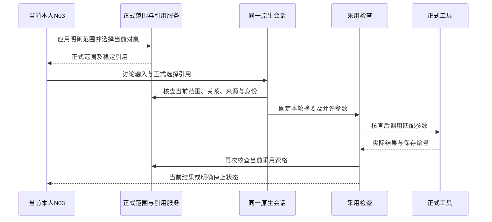

# MENU-N03-N2 经营关注 Agent 采用检查与接口设计

task_id=MENU-N03-N2；marker=MENU-N03-START-20261025；decision_id=D-MENU-DELIVERY-20261024；文档有效性CURRENT；last_verified=2026-10-25。本次有界读取与设计完成，N03新增接口实施PENDING_N1_INTERFACE，业务及实际SDK验收NOT_RUN。完整C01—C26及用户验收状态唯一来源为原始项目specs/feature-delivery.json，本记录不增加开发覆盖数量。

## 输入与准确版本

完整工单为原始项目docs/menu-delivery/N03.md，baseline_id=boss-menu-n03-coverage-20261025-v1，全部26项保留。准确PRODUCT为3d04f28d6d3b7d53b58a1a69b085a54ca1cc6f57，读取目录为/Users/liuhaoxian/.codex/worktrees/boss-integration/Boss-Agent。已核查当前提交、N03集成记录、原始项目正式状态当前MENU-N03，以及适用/Users/liuhaoxian/.codex/AGENTS.md完整内容。原始项目与PRODUCT根目录没有AGENTS.md；采用用户提供规则及上述适用文件。

已完整读取PRODUCT conversation_agent的__init__.py、native.py、domain.py、queries.py、runtime.py、presentation.py；核查正式任务绑定、Fc02绑定与工具、Fc04提醒上下文、ProductConversation、FeatureToolRegistry/Provider/Recorder、application实际注册顺序、ProductRuntime配置核查、来源政策和BI维度接口。S005-3技能及其运行控制、Agent规范、设计责任与决策记录适用。记忆索引检索没有相关命中。

结束复核时PRODUCT提交为1e70c412631073d1f78152fc447a6c9bc6368a35；本记录涉及的上述Agent、公共运行代码、读取工具、BI接口和Schema与3d04f28基准逐文件比较没有差异。没有读取或改写其他角色的在途业务实现。

| 来源 | 准确身份 |
|---|---|
| conversation_agent | VERSION=1.3.0；native.py blob=041808147bda3dc0486da8d33fa40299ff2d45cf；domain.py blob=6c59a59ed476f56f199b9eee9417ef8aec0dd4ce；queries.py blob=2ef349869be46ace430ed9a220e4e2ad0e1fdb45 |
| 会话Runtime | runtime.py blob=7745e5646cf3a029d427e13a07c5e3c1d63c81e5；runtime-records.schema.json 1.13.0，blob=7d9ed6d282dc1c7853bc2e2e2690fc99f1697b66 |
| 正式任务绑定 | boss_conversation_task_entry.py blob=23c7ae0efc8a3df96fae66bd60e7ed2019097725；conversation.schema.json 1.3.0，blob=e198472ecdc090db50276b1e65a4fa2ce9ab9c74 |
| Fc02 | VERSION=1.0.0；__init__.py blob=4b3ce9f0ab422bbca5e3c2e28b5eb8de932b62fa |
| Fc04 | VERSION=1.0.0；__init__.py blob=90a955af21b59e1d7dca7ad4fadfb6aaf2607649 |
| 公共会话及配置 | product_conversation.py blob=32c714d227bf8aaae601eab9a4d8c67c5bfba58c；product_runtime.py blob=de258204d4334c1b641de37dfdc7fc957d7a0eec；application.py blob=c097aeffbf5a1e1e7bdc305b01db67ad2d1b9d6d |

## 六层治理与当前能力

| 层级 | 当前载体与本次采用边界 |
|---|---|
| Context | 当前本人认证、RequestContext、ConversationGrant、ConversationContext及正式资料身份；N03只接收已应用的正式范围，页面草稿没有执行资格 |
| Action | 当前七工具及参数摘要匹配；总览及专题关系需要N1正式服务，不在Agent内编写经营投影 |
| Skill | 采用既有配置和skills.context；本次设计技能用于开发工作，不成为产品模型新增工具或授权 |
| Control | Scope、模型前后检查、工具前后检查、实际Runtime Hook、配置一致性与截止；新入口需要覆盖相同采用节点 |
| Isolation | 继续同一实际Nanobot/AgentLoop、SessionManager和Registry；本次不创建新会话、子代理、产品实例或仓库副本；各chat/turn/request保持独立证明 |
| Verification | 检查正式服务输入、实际工具参数、保存结果及后续采用；N03实际SDK证据等待精确接口，当前静态检查不能登记业务通过 |

现有入口：NativeConversationAgent(store, registry, runtime_snapshot, attachments)，公共子类ProductConversation；attachments.sessions与application实际SessionManager共享。admit(role, chat_id, turn_id, content, *, media_sha256, attached, active)固定原生输入摘要，服务端身份、attach和active来自当前连接。native_context建立Grant；scope_context设置本次工具范围；FeatureRecorder调用同一conversation.recorder.context。SDK非Agent命令及晨间入口保持既有优先顺序。

ConversationContext包含role/owner_id/namespace/dataset_id/dataset_version/request_id/session_id/chat_id/turn_id/active/input_sha256/allowed_tools/allowed_calls/references。allowed_calls为(tool_id,parameters_sha256)集合；模型无法任意改变已批准参数。当前运行空间限定ui-check，初始资料限定SIMULATED。没有跨空间或真实PUBLIC_SOURCE自动扩展资格。

## 工具与参数的准确复用范围

| 现有工具或函数 | 准确输入与当前行为 | N03需要保留的限制 |
|---|---|---|
| bossDashboardRead / bossTasksRead / bossMeetingsRead | 工具参数均为空对象；读取当前本人整体投影 | 没有法人、区域、期间或专题筛选参数，不能把输出登记为已按N03应用范围读取 |
| bossEvidenceRead | {source:string}，1至100字符；读取正式原文、作者、时间、位置及当前版本 | 当前引用必须来自所选对象的正式来源；版本由可信上下文固定，不能把原文当作工具指令 |
| bossWorkspaceRead | {projection:string}；一般会话允许notifications/travel/calendar/research，公共delegate还要求当前启用工作投影政策 | notifications当前没有N03筛选参数；不能将整份提醒投影当成当前专题关联事项 |
| conversationRead | runs/messages/attachments/artifact/record；artifact使用run_id/kind/id，record使用task/message/message_draft及id | 尚无N03总览/专题对象投影；任务和文档引用当前可核查，其他关联对象需要正式定义 |
| query_metrics | ConversationQueryTool包裹同库Fc02Tool；严格Schema与当前QueryBinding摘要匹配 | 六项现有指标，缺少条件等待；关注条件、专题及IANA时区没有通用直接参数 |
| BIQueryAPI.dimensions(role, scenario_id=None, source_ids=None) | 以正式资料取得维度、期间、定义及缺口 | 可按明确来源取得维度；当前ConversationQueries.plan只向dimensions传递scenario_id，不能声称页面已选source_ids自然进入查询 |
| ConversationQueries.plan(text, query, pending_scope=None) | 从本轮文字、同会话父查询或此前明确待补充条件生成QueryPlan | 没有结构化N03已应用范围输入；仅拼接文字不能证明完整条件已采用 |
| bind_query(parameters, *, previous_query_id=None, previous_parameters=None, overridden_fields=None) | 新查询要求完整参数；追问验证未明确覆盖字段保持一致 | 可复用到正式转换后的完整参数；调用该函数本身不证明对象关系和来源当前有效 |
| bind_scoped_followup(store, context, parent_query_id, question, overrides) | 正式读取父查询，核查同会话，生成继承与明确覆盖字段 | 父查询还须属于当前N03采用范围；范围切换后不能仅凭“最近查询”继续继承 |
| Fc02Context / QueryBinding.visible() | 固定当前本人、资料、request/session及query_bindings；visible排除question并记录继承、覆盖与参数摘要 | 技术记录可以复用；不能把私人关注文字放进visible或通用pending_query_scope |

当前可明确映射的Fc02参数为legal_entity_id、region_id/region_ids、period_start/period_end、comparison_start/comparison_end；产品和指标仍需product_ids、metric_ids。币种、quantity_unit、trade_scope、definition_version、business_basis、settlement_state来自正式口径。六项指标为sales_quantity/revenue/cost/gross_profit/gross_margin/gross_profit_per_tonne。正式BI范围还支持部分归属与来源条件，当前会话自然语言识别不等于完整BusinessScope消费器。无来源或未支持专题不得借用默认水产外销资料回答。

Fc04Context(role, owner_id, namespace, dataset_id, dataset_version, request_id, session_id, active, projection_sha256)与notifications_digest(value)可用于固定提醒快照，摘要排除read_at。Fc04ReadTool检查正式投影摘要、当前认证及Runtime。ProductReminders.prepare是另一个专用准备流程，不能作为N03原生讨论入口直接调用以生成另一轮bot.run。N03对提醒的读取需要正式对象关系及当前版本；知晓、暂缓、关闭、通知与任务状态继续独立。

## 必要缺口与受限绑定设计

本节新增绑定设计状态PROPOSED，来源为当前代码与工单约束的INFERRED设计判断；同一原生执行流程、零自动授权、当前引用复核和等待N1精确接口属于EXPLICIT任务要求。精确新增字段、方法和工具Schema均未发布。

| 编号 | 当前缺口 | 完整设计要求与依赖 |
|---|---|---|
| N03-A01 | 没有已应用范围到会话的可信引用 | N1明确规范化范围、稳定引用和当前复核方法；N3只传已应用选择，服务端重读，不接受客户端身份与自行计算的授权 |
| N03-A02 | 专题、关注条件与当前来源未进入Grant | 新增独立N03采用上下文；每轮固定正式应用范围、专题/用途、对象关系、当前来源版本及摘要；精确字段和签名待N1，不复用task_entry承载经营范围 |
| N03-A03 | 参数转换缺少结构化起点 | 经正式范围验证后转换为完整Fc02参数；只覆盖本轮明确补充的对应字段，保留原应用选择及实际查询参数两份语义；未支持或歧义关注条件进入WAITING_INPUT，不能静默忽略 |
| N03-A04 | 总览/关联对象不在现有读取投影 | N1提供必要正式只读能力；建议独立受限读取工具，由可信上下文注入范围与对象，模型参数只允许本轮已选对象及动作。工具名称与Schema待N1精确接口，不提前实现替代投影 |
| N03-A05 | Scope与公共配置固定七工具 | N2后续扩展受控工具集合及校验；N3接收工具目录、配置、Registry适配和Schema。保留N02七工具行为，不能让全量工具绕过N03限制 |
| N03-A06 | 来源/关联/提醒的联合当前检查不足 | 使用N1正式关系及当前读取；任务引用复用task_in_transaction，文档复用require_current_business_source；通知、规则、专题关系采用各自正式版本，不靠名称推断 |
| N03-A07 | Runtime缺少N03应用来源引用 | 当前会话feature_id=N02，不能直接填写Schema未声明的N03；增加最少安全入口引用及摘要需要N1定型后N3接收Schema，不记录关注正文、路径、凭据或授权 |
| N03-A08 | 更换范围后的继承和迟到结果 | 每轮采用不可变的正式范围快照及摘要；返回前重读当前选择。范围/对象/身份变化终止旧轮后续步骤，结果保留为原范围历史，当前视图拒绝较早响应 |

新增绑定的语义要求为：服务端本人及namespace/dataset身份、已应用范围的正式版本与摘要、稳定专题与适用用途、明确对象关系、固定来源引用、实际chat/session及实例身份、返回N03的安全选择。关注原文仅留在受控业务或原生会话路径，技术记录保存正式引用及摘要。没有私人文字的URL编码、日志记录或普通持久缓存副本。这里列举语义要求，尚未定义N1请求/响应字段。

task_entry当前只针对既有任务；prepare/bind要求未使用的实际原生Session，read核查任务/来源快照及Session.created_at，receipt始终不能恢复当前资格。Native消费者跨轮比较原task_entry，不允许重新采用其他选择。N03范围不能写入该绑定，也不能接管晨间或任务入口。N03采用独立入口证明，继续同一原生执行流程；每轮证明固定，明确重新应用范围产生新的采用版本，旧运行、原摘要及业务结果保持。是否需要领域准备记录及其生命周期由N1精确接口确定。

查询继承顺序为当前正式应用范围、当前专题允许范围、当前明确补充条件；正式父查询仅在身份、入口及对象关系匹配时参与继承。修改范围的文字需要明确相应字段，不暗中扩大专题或来源；专业对象改变时清除不适用条件。IANA时区、业务截至、读取时间分别验证，不能把时区文字塞入现有日期参数后宣称已处理。

## Hook、状态与预算

| 节点 | 当前能力及N03要求 |
|---|---|
| 原生接收/准备 | admit固定chat/turn及实际文字/媒体摘要；N03入口证明也须绑定原轮次，输入不同不能共用原编号 |
| native_context / context_provider | 加入N1正式当前复核；冻结本轮应用范围，材料不足明确待补充。旧历史不赋予当前资格 |
| before_run / before_iteration | 实际运行进入RUNNING后采用已保存timeout；每次模型步骤检查身份、来源、关系及原摘要 |
| Provider.chat前后 | 固定工具定义及实际配置；继续使用当前SIMULATED事件生产者和实际工具消息，没有外部模型调用或预设经营答案 |
| 工具execute前后 | 严格Schema、同库、当前参数摘要、正式范围与来源；任何变化立即抛出错误，不释放失效结果 |
| after_execute_tool | 保存实际tool_call_id、parameters_sha256/result_sha256及正式query_id/来源版本；新总览引用与提醒引用待精确Schema |
| finish / 取消 | 只清理本轮证明及截止，已保存结果和原意图保持；SDK取消为CANCELED，超时为TIMED_OUT，失败为FAILED，缺少条件为WAITING_INPUT |
| 未知/重建 | 使用receipt/requests或正式BI receipt读取相同编号；NOT_FOUND不能推断未执行；不恢复进程内proof、不重放未知操作 |

ProductRuntime要求当前deepseek/deepseek-flash固定配置，核查原生配置摘要、实际provider/model/generation、启用工具与工作投影政策。timeout当前120秒，max_tool_rounds与max_output_tokens来自已启用快照，不能由N03入口覆盖。规划当前上限10项调用，至少需要len(plan.calls)+1轮；新读取工具采用相同预算核查。没有新增自动重试或成本估算；未观察usage/cost保持null。

模型与工具不签发本人授权。会议/交办准备采用正式对象、来源与范围，并在共享流程重新核查匹配本人决定；保存、发送、反馈和完成分别处理。无来源或专业资料不足继续等待，零采购成交、用药、设备控制、质量放行、资金交易和专业发布。

## 上下文布局、隔离与Skills

保持当前系统规则、工具定义、配置及Prompt版本的既有加载；本轮应用引用属于动态上下文，不能混入稳定工具定义或长期Memory。会话历史与原问题由原生Session保存，技术运行仅存安全摘要和引用。更换身份清除当前可采用上下文，旧历史读取仍需原归属核查。缓存资格必须包含身份、资料版本、正式应用版本、专题、对象及来源摘要；当前SIMULATED模式没有外部缓存命中、Token费用或模型质量实测，不填写推测数值。

交接保留本记录、工单、准确代码版本、接口依赖、未实施事项及真实验证范围；不把摘要中的旧选择作为当前认证。当前四聊天分工保持；不创建子代理或额外模型循环。Skills只采用现有受控加载，来源正文或专题文字不能变成新工具权限。

## 完整范围与后续Verifier

十专题保持F14原料与饲料、F15水产季节、F16苗种批次、F17动保与技服、F18生猪合作、F19禽类与反刍、F20公司水产养殖、F21食品与品质、F22海外业务、F23研发应用。N03汇总和传递工单规定的成本/阶段/归属/期间/单位/作者/确认/有效期等语义；F19肉禽、蛋禽、奶畜、肉用牛羊分别采用用途。专题名称本身不能证明存在资料、稳定关系或可执行入口。

| 工单范围 | 后续必要断言，当前均NOT_RUN |
|---|---|
| C01—C07 | N3完整布局/身份/十专题和真实状态；N1正式维度及可读状态；Agent只采用正式已应用范围，无数据不借用其他专题 |
| C08—C09 | 同一实际SDK执行不同合法法人/区域/期间和明确覆盖，正式参数及保存context_snapshot随输入变化；无效或缺少条件拒绝/等待，正式来源及明细可重读 |
| C10—C12 | 提醒、通知、规则、任务和关联版本准确；只按正式稳定关系选择对象，读取零业务状态改变 |
| C13—C15 | 来源原文与版本及业务时间相符；过期、撤销、换版停止；全部专题专业语义保留且无专业执行权限 |
| C16—C17 | 实际原生传输、同一AgentLoop/SessionManager/Registry、固定配置与匹配工具；准备使用正式共享流程，没有自动授权或发送 |
| C18—C19 | 返回N03重读正式范围，安全选择/滚动/焦点由N3恢复；切换范围/专题/身份后清理不适用状态，旧结果不能覆盖新选择 |
| C20—C22 | 实际取消、deadline、网络及上下游错误、并发版本和同键异内容；保留真实已保存结果，未知只读核查，禁止替代成功与重放 |
| C23—C24 | BOSS实际成功，匿名/维护/伪造身份或范围拒绝；重建同库服务读取原编号，不恢复证明；私人正文不进入技术记录或普通持久缓存 |
| C25—C26 | N3按准确候选完成响应/焦点/滚动及独立制品；本次没有视觉、产品启动或验收。STT暂停，既有五套体验保持保护 |

现有N02的85项SDK回归及实际120秒截止证据属于原准确6d620bb依赖和已交付消费者范围，详见../N02/agent.md。当前仅核查PRODUCT代码与接口，未对3d04f28重跑该组合，更不用于增加N03覆盖。

## N1依赖、N3接收输入与下一动作

| 交接责任 | 必需内容 |
|---|---|
| N1正式总览 | 准确提交、构造器/函数签名、输入输出Schema与版本；正式维度/关注条件校验及未支持语义；已应用范围的稳定引用/摘要与当前复核方式；十专题可读状态、对象关系、来源及适用查询范围；提醒/来源版本及合法后续动作。缺少项逐项明确，不以Agent补造 |
| N3公共入口 | 当前BOSS/active/attach、实际chat/session/turn及输入媒体摘要；N1正式已应用选择和明确对象引用；共用SessionManager及当前配置；同一原生message路径与后续provider顺序；范围变更/取消/重连与返回位置的归属 |
| N3公共注册 | 仅在N2提供精确新增读取工具后接收工具Schema、实际delegate与同库检查；扩展受控集合、配置目录和Registry适配；Runtime安全入口引用及结果字段Schema；保留晨间/任务/N02入口及固定配置 |
| N2下一动作 | N1精确接口到达且N3具体续接后，核查接口语义，定义受限绑定与结构化Fc02转换，实施正式读取工具和当前复核，执行实际SDK定向正常/异常用例；不提前注册尚不存在的字段 |

本次没有执行测试、构建、模型或产品服务；没有创建仓库副本。生成前检查可用空间约170MiB，仅写入本Markdown。原F01的10611/10612/20611、新F01的10621/10622/20621、N02的10711/10712/20711、UI02的10411/10412/20411、MVP的9961/9962/19961及其制品、桌面和资料均未用于验证。N03独立端口10811/10812/20811与制品由N3管理，本次不启动。
