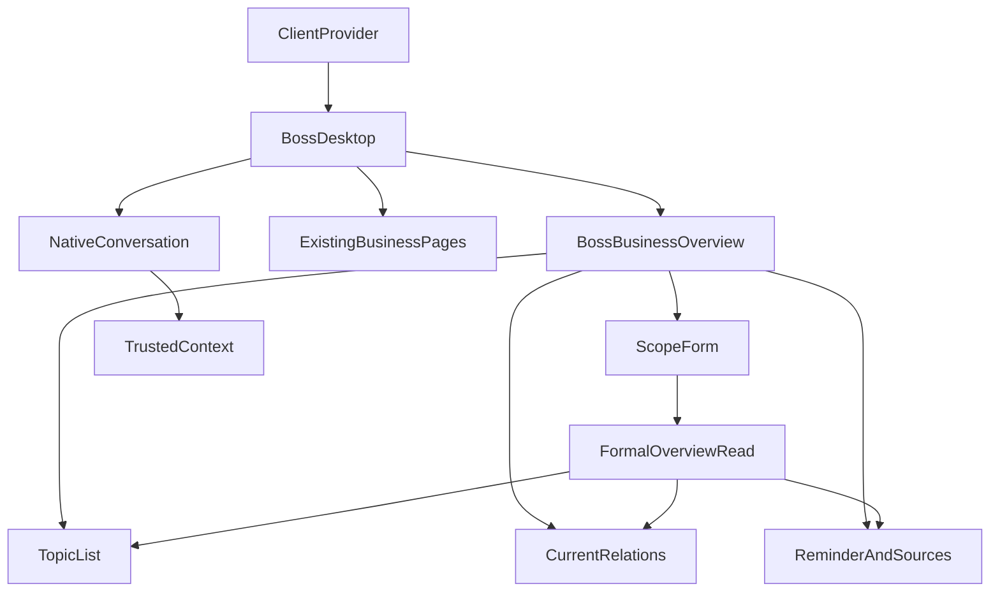

# N03前端设计与当前依据

模式IMPLEMENT／混合输入；CURRENT；2026-10-25。完整范围MENU-N03.C01—C26，唯一正式状态为原始项目specs/feature-delivery.json。需求、来源及角色见原始docs/menu-delivery/N03.md；当前产品基准3d04f28，当前参考测量仅代表原稿，不代表产品通过。

## 1. 上游与实际使用方

PRD FR-02/03/14—23、BR-C01—C07、E01—E06限定范围、专业职责、来源和后续授权。原N03 HTML与加载topics定义主列范围/十专题、右列提醒/来源。现有HLD、ClientProvider、RoleChannel和SQLite领域继续使用；公共组件由N3维护。BusinessOverviewAPI、经营入口持久绑定与N2实际消费者已经接收，business-overview Schema为1.1.0，准备Schema为1.1.0；来源与当前状态均由正式领域重新核查。

| 使用方 | 当前接入或责任 |
|---|---|
| BossDesktop | 独立N03路由、同一身份与原六类导航、D06、公共返回和会话/共享页面采用 |
| BossBusinessOverview（计划新增） | 当前总览读取、应用范围、专题/对象选择、来源/提醒及合法入口，状态与当前身份绑定 |
| BossBIView、F02、F06及来源 | 采用当前正式对象和已应用范围，不接受未经确认的草稿或旧来源；完整后续菜单独立排队 |
| 原生会话及实际Agent | N2提供受限正式绑定、工具范围与参数采用，N3公共接收与真实注册，不创建第二会话系统 |

## 2. 身份与状态边界

服务端确定role、owner、namespace、dataset及当前资料。客户端采用ClientProvider的实际身份，身份epoch与请求generation贯穿读取和后续使用；取消/切换后旧结果无权更新当前页面。来源和对象版本变化需要重新核查，历史保留可辨状态并停止当前采用。

法人、区域、期间、关注条件分为本地草稿和服务端确认的已应用范围；输入不自动改变当前结果。编辑状态由当前菜单组件负责，D06由BossDesktop负责。页面初次进入、当前读取/失败/空结果及已应用范围分别显示。未经确认的业务字段保持待接收，不将任意字符串转换为已支持范围。

私人关注条件与讨论正文仅存在当前表单内存及获准正式服务；URL只采用必要安全技术引用、专题标识与返回坐标。普通持久缓存、日志和静态制品不保存正文或凭据。退出、身份切换和明确放弃清理不适用状态。共享来源入口不得使用默认来源冒充当前选定对象。

## 3. 原设计与Token

evidence/menu-delivery/N03/reference-dom.json包含18组原稿记录：三种桌面尺寸与100%/200%，以及1250、1050、700、690附近阈值。记录原HTML/脚本/CSS/Token摘要、实际加载三个区域、四个字段及F14—F23完整专题顺序。所有测量来自专用隐藏Electron用户目录，没有截图、图像或修改参考样式。

| 区域 | 原稿采用值及当前记录 |
|---|---|
| 公共框架 | clamp留白，24px圆角、白色1px边框与原阴影；侧栏204px、≤1250为174px、≤1050为60px；顶部64px |
| 页面标题 | 原字体顺序Noto/PingFang/Microsoft YaHei；29/25/21px随原阈值，原Hero高度146/124px及Logo/大鹏资产 |
| 主区域 | 常规主列与310px右列、间隔14px；≤1250右列260px、≤1050单列；列内间隔13px |
| Panel | 原加载CSS的18px 20px内距、15px圆角、边框和双层阴影；小窗口15px内距 |
| 范围表单 | 两列、间隔12px；标签14px/22px、字重600；输入16px/24px、字重600、内距10px 12px、圆角9px、至少44px |
| 专题列表 | 两列、间隔14px；事项内距12px 13px、间隔12px、圆角11px；标题15px/24px、说明14px/22px，长内容自然换行 |
| 主要操作 | 14px/24px、字重690、至少44px、圆角10px；原纯蓝与边框；键盘蓝色2px轮廓、间隔2px |
| 辅助说明 | 原note的12px 14px内距、14px/22px、10px圆角与语义颜色；资料缺口保留可读文字 |

设计Token及品牌素材复用现有批准资产，不新增风格或图像。具体原始颜色/阴影/样式以报告及design-v6.css/style.css为准，产品采用后逐字段核查。原预览条与示例身份仅说明参考环境，不进入产品业务内容。动态资料行数及展开状态单独记录，不能据原稿占位高度推断当前业务高度。

## 4. 类型与状态

UI状态分别采用NOT_LOADED、LOADING、READY、EMPTY、PARTIAL、ERROR、FORBIDDEN、HISTORICAL与RECONCILING语义，映射到正式API返回状态，不为未知字段填造值。business-overview-types.ts采用已接收Schema与实际服务字段。OverviewScope严格包含legal_entity_id、region_id、period_start、period_end、timezone、attention；attention仅允许ALL/OWNER_INVOLVEMENT/SOURCE_REVIEW。Overview与OverviewDetail分别采用完整根字段、当前快照、十专题、指标、提醒、关联及来源类型；实际BusinessAlert与BI Scope复用现有定义。

本地拥有draft、dirty、selectedTopic、expandedDetail、returnPoint；服务端拥有appliedScope、overview、source/object版本与业务状态；原生会话拥有chat/run/消息和流式终态。身份epoch、generation及AbortController属于读取生命周期。重新查询只有本人明确应用范围触发，较早读取不覆盖新输入或已应用范围。

## 5. 组件与API传播

| 正式入口 | 请求与当前采用 |
|---|---|
| GET /api/boss/ui/business-overview/dimensions | 当前Bearer身份，无URL参数；返回正式法人/区域/期间/时区及attention选项 |
| boss.business_overview.dimensions | 已认证WebUI请求，payload必须为空对象；调用BusinessOverviewAPI.dimensions |
| boss.business_overview.read | 已认证WebUI结构化Scope，调用BusinessOverviewAPI.read；范围正文不进入URL |
| boss.business_overview.detail | 已认证WebUI的scope/page_id/snapshot_sha256，调用BusinessOverviewAPI.detail；来源/范围变化返回409 |

public_business_overview.py提供精确只读映射，BossCommandAPI限定BOSS并使用现有WebUI传输；BossPageAPI提供无参数范围选项读取。RoleChannel仅记录操作与状态，不记录payload。当前没有新增HTTP POST服务或第二套认证。程序错误继续抛出，正式HTTP业务拒绝由现有边界返回对应状态。

TrustedContext采用N1持久入口和N2经营消费者。当前连接必须通过正式Entry.read核查并明确采用preparation_id/preparation_sha256；重新应用范围清理旧选择，历史回执不恢复执行资格。RoleChannel在晨间候选之前接收admit_business，实际SDK采用同一范围与三项受限工具。Scope→applied_scope→query_handoff/Topic/Source进入独立容器、F03、专题、会话和交办准备。实际公共传输与页面传播仍待认证UI验证。

## 6. 异步、流式与恢复

范围应用、专题详情及来源读取按当前身份/应用范围/专题/对象/版本建立查询键，发起新请求取消旧读取；异步结果再次核查标识后才显示。已应用结果在一般读取失败时保留并明确当前失败；401/403清除受保护内容并交由既有认证路径。预期业务失败明确呈现原服务原因，不能转为替代成功。

讨论继续采用既有原生事件解析、消息状态及实际Runtime。事件按chat、run及event_id归属和去重，沿用现有更新调度、Markdown解析及IME规则；本页不实现流式协议解析或新增模型循环。调用正式工具前复核当前范围与引用；取消只影响当前尚未执行步骤，原请求及已保存结果可重读。

离开前记录当前专题、技术引用、scrollTop和控件标识；返回后核查当前数据，恢复仍有效的专题和焦点，DOM就绪后恢复实际滚动。刷新安全引用需要正式服务重读；私人文字不以URL参数实现恢复。修改对象时清理不适用用途、单位、阶段及来源；未应用编辑通过D06选择继续或明确放弃。

## 7. 验证责任与当前状态

| 范围 | 当前证据及必要后续 |
|---|---|
| 原稿 | 18组REFERENCE_MEASURED；完整区域/字段/十专题顺序与源码摘要已保存 |
| 产品结构及状态 | 独立N03容器与桌面路由、三个业务区域、详情/准备Dialog及D06已经实现；当前制品的成对DOM/样式/位置和交互验证待完成 |
| 字段/身份/业务 | N1/N2准确接口已经接收；领域、PublicConversation、会议准备和实际SDK限定检查通过；完整认证UI待完成 |
| 连续返回 | 专题、F03/F02、来源、讨论、会议/交办准备及刷新路径待实际检查，不能仅靠组件状态推断 |
| 响应与可访问性 | 三尺寸/200%、原阈值、长内容、键盘、44px目标、2px焦点、整页溢出与Dialog关闭/返回待当前制品检查 |
| 工程与交付 | 严格TypeScript与当前独立N03 Vite构建通过；独立启动器/资料/端口、完整清单和最终候选待完成 |

业务BDD采用当前正式获准资料与实际服务、SQLite及SDK；不使用mock、虚假业务数据或替代成功。必要失败证据、准确通过报告和完整26项映射共同完成当前菜单。视觉与用户验收保持NOT_RUN，不建立无依据的全菜单独立检查门槛。
