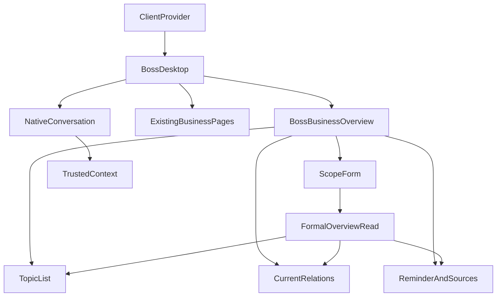

# N03前端设计与当前依据

模式IMPLEMENT／混合输入；CURRENT；2026-10-25。完整范围MENU-N03.C01—C26，唯一正式状态为原始项目specs/feature-delivery.json。需求、来源及角色见原始docs/menu-delivery/N03.md；当前产品基准3d04f28，当前参考测量仅代表原稿，不代表产品通过。

## 1. 上游与实际使用方

PRD FR-02/03/14—23、BR-C01—C07、E01—E06限定范围、专业职责、来源和后续授权。原N03 HTML与加载topics定义主列范围/十专题、右列提醒/来源。现有HLD、ClientProvider、RoleChannel和SQLite领域继续使用；公共组件由N3维护，领域N1与实际Agent N2提供准确接口。当前新总览API/Schema及可信会话范围绑定待生产者交付，不从原稿推断权限或正式字段。

| 使用方 | 当前接入或责任 |
|---|---|
| BossDesktop | 独立N03路由、同一身份与原六类导航、D06、公共返回和会话/共享页面采用 |
| BossBusinessOverview（计划新增） | 当前总览读取、应用范围、专题/对象选择、来源/提醒及合法入口，状态与当前身份绑定 |
| BossBIView、F02、F06及来源 | 采用当前正式对象和已应用范围，不接受未经确认的草稿或旧来源；完整后续菜单独立排队 |
| 原生会话及实际Agent | N2提供受限正式绑定、工具范围与参数采用，N3公共接收与真实注册，不创建第二会话系统 |

## 2. 身份与状态边界

服务端确定role、owner、namespace、dataset及当前资料。客户端采用ClientProvider的实际身份，身份epoch与请求generation贯穿读取和后续使用；取消/切换后旧结果无权更新当前页面。来源和对象版本变化需要重新核查，历史保留可辨状态并停止当前采用。

法人、区域、期间、关注条件分为本地草稿和服务端确认的已应用范围；输入不自动改变当前结果。编辑状态由当前菜单组件负责，D06由BossDesktop负责。页面初次进入、当前读取/失败/空结果及已应用范围分别显示。未经确认的业务字段保持待接收，不将任意字符串转换为已支持范围。

私人关注条件与讨论正文仅存在当前表单内存及获准正式服务；URL只采用必要安全技术引用、专题标识与返回坐标。普通持久缓存、日志和静态制品不保存正文或凭据。退出、身份切换和明确放弃清理不适用状态。共享来源入口不得使用默认来源冒充当前选定对象。

## 3. 原设计与Token

evidence/menu-delivery/N03/reference-dom.json包含18组原稿记录：三种桌面尺寸与100%/200%，以及1250、1050、700、690附近阈值。记录原HTML/脚本/CSS/Token摘要、实际加载三个区域、四个字段及F14—F23完整专题顺序。所有测量来自专用隐藏Electron用户目录，没有截图、图像或修改参考样式。

| 区域 | 原稿采用值及当前记录 |
|---|---|
| 公共框架 | clamp留白，24px圆角、白色1px边框与原阴影；侧栏204px、≤1250为174px、≤1050为60px；顶部64px |
| 页面标题 | 原字体顺序Noto/PingFang/Microsoft YaHei；29/25/21px随原阈值，原Hero高度146/124px及Logo/大鹏资产 |
| 主区域 | 常规主列与310px右列、间隔14px；≤1250右列260px、≤1050单列；列内间隔13px |
| Panel | 原加载CSS的18px 20px内距、15px圆角、边框和双层阴影；小窗口15px内距 |
| 范围表单 | 两列、间隔12px；标签14px/22px、字重600；输入16px/24px、字重600、内距10px 12px、圆角9px、至少44px |
| 专题列表 | 两列、间隔14px；事项内距12px 13px、间隔12px、圆角11px；标题15px/24px、说明14px/22px，长内容自然换行 |
| 主要操作 | 14px/24px、字重690、至少44px、圆角10px；原纯蓝与边框；键盘蓝色2px轮廓、间隔2px |
| 辅助说明 | 原note的12px 14px内距、14px/22px、10px圆角与语义颜色；资料缺口保留可读文字 |

设计Token及品牌素材复用现有批准资产，不新增风格或图像。具体原始颜色/阴影/样式以报告及design-v6.css/style.css为准，产品采用后逐字段核查。原预览条与示例身份仅说明参考环境，不进入产品业务内容。动态资料行数及展开状态单独记录，不能据原稿占位高度推断当前业务高度。

## 4. 类型与状态

UI状态分别采用NOT_LOADED、LOADING、READY、EMPTY、PARTIAL、ERROR、FORBIDDEN、HISTORICAL与RECONCILING语义，最终映射到正式API返回状态，不为未知字段填造值。正式范围、专题、来源及关联对象TypeScript类型在N1准确Schema接收后建立；当前不猜测后端字段。

本地拥有draft、dirty、selectedTopic、expandedDetail、returnPoint；服务端拥有appliedScope、overview、source/object版本与业务状态；原生会话拥有chat/run/消息和流式终态。身份epoch、generation及AbortController属于读取生命周期。重新查询只有本人明确应用范围触发，较早读取不覆盖新输入或已应用范围。

## 5. 组件与API传播

FormalOverviewRead的实际模块/函数、HTTP路径、请求映射、严格字段和错误状态待N1准确交付；TrustedContext待N2基于该接口提供。N3接收后补充逐字段传播与消费者断言，公共Page/Command/RoleChannel及注册由N3唯一维护。当前F03、F02、D01、F06和原生会话的现有能力按各自准确范围复用，不由入口存在推断完整菜单通过。

## 6. 异步、流式与恢复

范围应用、专题详情及来源读取按当前身份/应用范围/专题/对象/版本建立查询键，发起新请求取消旧读取；异步结果再次核查标识后才显示。已应用结果在一般读取失败时保留并明确当前失败；401/403清除受保护内容并交由既有认证路径。预期业务失败明确呈现原服务原因，不能转为替代成功。

讨论继续采用既有原生事件解析、消息状态及实际Runtime。事件按chat、run及event_id归属和去重，沿用现有更新调度、Markdown解析及IME规则；本页不实现流式协议解析或新增模型循环。调用正式工具前复核当前范围与引用；取消只影响当前尚未执行步骤，原请求及已保存结果可重读。

离开前记录当前专题、技术引用、scrollTop和控件标识；返回后核查当前数据，恢复仍有效的专题和焦点，DOM就绪后恢复实际滚动。刷新安全引用需要正式服务重读；私人文字不以URL参数实现恢复。修改对象时清理不适用用途、单位、阶段及来源；未应用编辑通过D06选择继续或明确放弃。

## 7. 验证责任与当前状态

| 范围 | 当前证据及必要后续 |
|---|---|
| 原稿 | 18组REFERENCE_MEASURED；完整区域/字段/十专题顺序与源码摘要已保存 |
| 产品结构及状态 | 当前基准仍为BI别名；独立N03实施、同环境成对DOM/样式/位置和交互验证待完成 |
| 字段/身份/业务 | 等待准确N1/N2接口，接收时核查请求/响应/类型/权限/版本/当前采用及正式终态 |
| 连续返回 | 专题、F03/F02、来源、讨论、会议/交办准备及刷新路径待实际检查，不能仅靠组件状态推断 |
| 响应与可访问性 | 三尺寸/200%、原阈值、长内容、键盘、44px目标、2px焦点、整页溢出与Dialog关闭/返回待当前制品检查 |
| 工程与交付 | 严格TypeScript、Vite、独立入口/资料/端口、实际SDK和保护制品摘要待准确候选完成 |

业务BDD采用当前正式获准资料与实际服务、SQLite及SDK；不使用mock、虚假业务数据或替代成功。必要失败证据、准确通过报告和完整26项映射共同完成当前菜单。视觉与用户验收保持NOT_RUN，不建立无依据的全菜单独立检查门槛。
